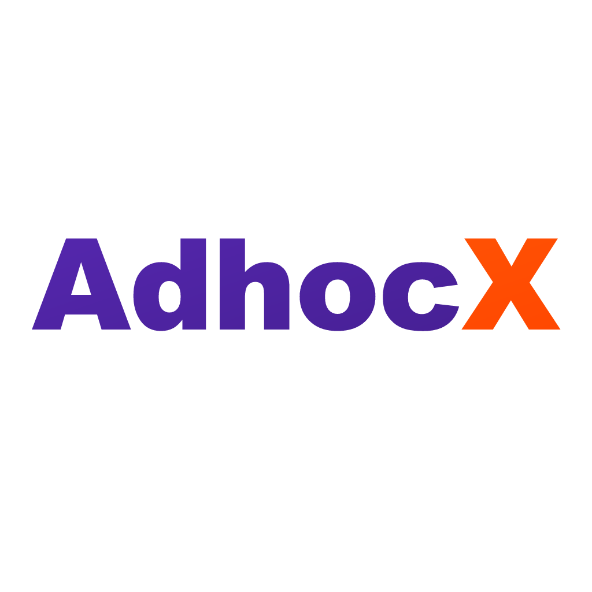

# AdhocX — B2B Cab Sourcing & Fulfillment Marketplace

<div align="center">



**Automated Commercial Ground Mobility & Enterprise Fleet Dispatch Engine**  
*Karnataka (Bengaluru Tech Corridors) • Telangana (Hyderabad) • Maharashtra (Pune)*

[](https://github.com/adhocx)
[](https://turbo.build/repo)
[](https://astro.build)
[](https://nextjs.org)
[](https://nodejs.org)
[](https://flutter.dev)

</div>

---

##  Overview

**AdhocX** is India's leading automated B2B cab sourcing, dispatch, and corporate transport desk marketplace. It replaces unorganized WhatsApp groups, manual phone calls, and fragmented vendors with an algorithmic dispatch engine that guarantees:

* ** Sub-90-Second Programmatic Allocation**: Real-time vehicle telemetry and wave dispatch matching verified drivers instantly.
* ** 100% Commercial Yellow-Plate Compliance**: Exclusively verified 4-seater sedans (*Dzire, Etios, Aura*) and 6/7-seater MUVs (*Ertiga, XL6, Innova Crysta*) with RTA fitness and chauffeur background checks.
* ** 1-Hour Bank Refund SLA**: Unfulfilled or canceled bookings receive guaranteed direct bank refunds within 60 minutes.
* ** Single Unified GST Billing**: Itemized trip audit trails and consolidated monthly tax invoices with 100% input credit compliance for enterprise travel desks.

---

##  Monorepo Architecture

The repository is managed as an integrated **Turborepo** workspace powered by `pnpm`:

```text
adhocx/
├── apps/
│   ├── marketing/          # Public B2B portal, lead-gen & driver acquisition (Astro 4.x + React)
│   ├── admin/              # Governance, KYC verification, finance & billing (Next.js 14)
│   ├── ops/                # Operations desk: requirements, trips/telemetry, assignments & fleet dispatch (Next.js 14)
│   ├── api/                # Core backend API, WebSocket dispatch, Prisma ORM, Redis (Node.js)
│   └── mobile/             # Cross-platform driver partner application (Flutter 3.x)
├── packages/
│   └── contracts/          # Shared TypeScript interfaces, DTOs, and validation schemas
├── docs/                   # Product specs, API contracts, design systems & sprint roadmaps
├── scripts/                # E2E test scripts, asset generators & simulation runners
├── .github/workflows/      # Automated CI/CD, Docker image builds & mobile app compilation
└── package.json            # Monorepo root configuration & Turborepo pipeline scripts
```

---

##  Latest Updates & Changelog

###  Marketing Portal & B2B Lead Conversion (`apps/marketing`)
* **Streamlined Enterprise Demo Form**: Refactored the corporate demo request flow down to a high-converting, 3-input format (`Company Name`, `Official Work Email`, `Mobile / WhatsApp Number`) with regional hub selection.
* **Refreshed Brand Identity & Favicons**: Designed and deployed multi-format vector brand emblems (`favicon.svg`, `favicon.png`, `favicon.ico`, `apple-touch-icon.png`) with white & amber typography on deep sapphire squircle across all portals and static root.
* **Light-Themed Driver Call-to-Action**: Modernized the Driver Portal CTA section with a clean light gradient (`linear-gradient(180deg, var(--color-primary-50) 0%, #FFFFFF 100%)`) and high-contrast typography.
* **Streamlined About Us Layout**: Removed temporary hiring cards and centered the core company mission on digitizing B2B ground transport.
* **Root Static Export Sync**: Automated static HTML generation (`index.html`, `vendors.html`, `drivers.html`, etc.) for direct zero-latency Vercel and CDN deployment.

###  Driver Partner Mobile App (`apps/mobile`)
* **Milestone Incentive Engine**: Integrated the ₹2,000 Century Milestone Joining Bonus (for 100 completed trips).
* **Automated Mobile Release Pipelines**: GitHub Actions workflows generating signed release Android APKs, Google Play App Bundles (AAB), and iOS Xcode builds.
* **Driver Safety & Telemetry**: Driver Trust Scoring (100-point scale), live OSM GPS location tracking, and real-time SOS alerting.

###  Core API & Cloud Infrastructure (`apps/api`)
* **AWS EC2 Production Deployment**: Containerized multi-stage Docker builds with Nginx reverse proxy and SSL automation.
* **Redis Wave Dispatching**: High-concurrency queueing for instant driver matching in high-density corridors (Bengaluru Outer Ring Road, Electronic City, Whitefield, Manyata, and Hyderabad HITEC City).
* **Render Redis & PostgreSQL Integration**: Persistent database layer backed by Prisma ORM with automated migration hooks.

---

##  Tech Stack by Application

| Component | Framework / Technology | Key Features |
|---|---|---|
| **Marketing Portal** | **Astro 4.x**, React 18, Vanilla CSS Design Tokens | Zero-JS default, sub-second LCP, dynamic interactive islands |
| **Admin Control Desk** | **Next.js 14** (App Router), Tailwind CSS, TypeScript | Live dispatch monitor, driver KYC review, billing & GST exports |
| **Backend API** | **Express.js**, **Prisma ORM**, PostgreSQL, Redis | WebSocket dispatch engine, SLA tracking, payout webhooks |
| **Driver Mobile App** | **Flutter 3.x**, Dart, Provider / Bloc, Geolocator | Cross-platform (Android, iOS, Web PWA), offline sync, OTP start |
| **Shared Contracts** | **TypeScript 5.x**, Zod | End-to-end type safety between API, admin, and mobile |

---

##  Getting Started & Local Development

### Prerequisites
* **Node.js**: `>= 20.x`
* **pnpm**: `>= 10.x` (Install via `npm install -g pnpm`)
* **Flutter SDK**: `^3.38.x` (for mobile development)
* **Docker & Docker Compose** (for local PostgreSQL & Redis)

### 1. Installation

Clone the repository and install all workspace dependencies:

```bash
git clone https://github.com/adhocx/adhocx.git
cd adhocx
pnpm install
```

### 2. Environment Setup

Copy example environment files to their respective applications:

```bash
cp apps/api/.env.example apps/api/.env
cp apps/admin/.env.example apps/admin/.env
cp apps/marketing/.env.example apps/marketing/.env
```

### 3. Running Services Locally

Start the API, Admin, Ops, Corporate, Marketing, Driver, and Employee apps in parallel:

```bash
# Start all workspace apps and shared-package watchers
pnpm dev

# Or run individual apps:
pnpm dev:api        # API on http://localhost:7001
pnpm dev:admin      # Admin on http://localhost:7002
pnpm dev:mobile     # Driver app on http://localhost:7003 (Flutter web)
pnpm dev:ops        # Ops on http://localhost:7004
pnpm dev:employee   # Employee app on http://localhost:7005 (Flutter web)
pnpm dev:corporate  # Corporate on http://localhost:7006
pnpm dev:marketing  # Marketing on http://localhost:4321
```

Flutter apps require the Flutter SDK. The API requires a local database and Redis; use local development credentials in `apps/api/.env`, not production credentials.

---

##  Testing & Verification

Run the full automated test suite across the monorepo:

```bash
# Run all unit tests
pnpm test

# Run contract verification between API and clients
pnpm test:contracts

# Run TypeScript typechecks across all workspaces
pnpm typecheck

# Code formatting & linting
pnpm lint
pnpm format
```

---

##  Production Builds & Deployment

```bash
# Build all workspaces with Turborepo caching
pnpm build

# Build individual applications
pnpm --filter @adhocx/marketing build
pnpm --filter @adhocx/admin build
pnpm --filter @adhocx/api build
```

---

##  Security, Compliance & Commercial SLA Commitments

* **Commercial Plate Exclusivity**: 100% yellow-plate verified commercial vehicles. Private white-plate vehicles are strictly forbidden.
* **Driver Onboarding Rigor**: Mandatory RTA commercial badge verification, police background check, vehicle fitness documentation, and valid commercial permit.
* **Financial SLA Guarantee**: 1-hour direct bank refund SLA on unfulfilled booking requirements.
* **Enterprise Invoicing**: Consolidated monthly GST tax invoices with itemized mileage, timings, and toll audit logs.

---

##  License & Proprietary Notice

© 2026 **AdhocX Technologies Private Limited**. All rights reserved.  
Confidential and proprietary software. Unauthorized reproduction, distribution, or reverse engineering is strictly prohibited.
