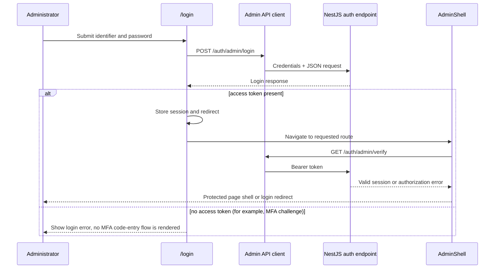
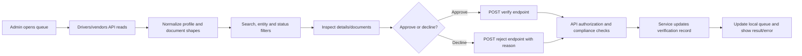

# Admin Route-by-Route Reference

**Coverage:** All 30 files under `apps/admin/src/app/**/page.tsx` are
accounted for below. This guide describes behavior visible in the frontend
source and links to the API controller references for backend handler,
service, authorization and direct persistence evidence. The API reference is
static source evidence, not proof of deployed URLs or a runtime test.

## Application purpose and users

Admin is the privileged platform operations portal. Platform administrators
use it to inspect marketplace activity, review driver/vendor compliance,
configure corporate tenants and prices, administer financial operations,
publish content and notifications, and investigate disputes or support cases.
It is a Next.js application; the API, rather than the browser, is responsible
for authenticating and authorizing protected operations.

## Shared technical behavior

`apps/admin/src/app/layout.tsx` loads global styles, sets portal metadata and
wraps every route in `AdminShell`. The shell in
`apps/admin/src/components/AdminShell.tsx` leaves `/login` outside the
authenticated shell. For other paths it reads the stored admin token and calls
`verifyAdminSession()` (`GET /auth/admin/verify`). A missing or invalid session
clears browser session state and redirects to `/login?redirect=...`; a
temporary connection failure shows an error with a retry action rather than
rendering protected content. A verified session receives the shared sidebar,
header and `ToastProvider`.

The shared request implementation is
`apps/admin/src/lib/api/client.ts`. It resolves the configured API base URL,
attaches the bearer token, serializes JSON or multipart form data, applies a
30-second default timeout, rotates a token after eligible 401 responses,
unwraps the standard success/data envelope and throws `ApiError` for
non-success responses. Network and timeout failures become 503 and 504
`ApiError`s. Unless a caller sets `allowForbidden`, a 401/403 clears the
session; selected pages use `allowForbidden` so they can present a permission
or maker-checker state themselves. These client behaviors do not replace
server-side guards: see the linked endpoint reference for each endpoint's
declared role and validation.

The inspected route pages use React local state and effects. Shared table,
form, drawer, dialog, filter,
pagination, feedback and status components live in
`apps/admin/src/components/common/`. Feature UI is in the corresponding
`apps/admin/src/components/` subfolders or alongside its route page.

## Route catalog

The endpoint paths below are the paths supplied to `adminApi` helpers; the
configured base URL adds the deployment API origin/prefix. Follow the
controller links for the declared HTTP method, server-side role, DTO,
controller-to-service call and directly observed data access. If a route
redirects or has no request in its page component, that is stated explicitly
instead of implying an API workflow.

| Route | Page purpose and user workflow | Frontend implementation and state | API request | Backend/controller and data |
|---|---|---|---|---|
| `/` | Portal entry; immediately sends the user to the dashboard. | `apps/admin/src/app/page.tsx`; Next.js server `redirect("/dashboard")`. | None on this page. The destination uses dashboard APIs. | No route-specific controller or write. |
| `/login` | Admin enters an identifier and password, then returns to the requested internal route or `/dashboard` when a token is returned. | `apps/admin/src/app/login/page.tsx`; `AdhocxBrandLogo`, shared `Form`, `Input`, `Button`, local credential/loading/error state, `useSearchParams` and `useRouter`. | `POST /auth/admin/login` with `{identifier,password}`. The page stores the returned tokens through client helpers. `verifyAdminMfa` exists in the shared client, but this page does not call it. | [Auth endpoint reference](../api/reference/endpoints/auth-controller.md); authentication service validates identity/credentials. User and server-managed auth/session data; server remains authoritative. |
| `/dashboard` | At-a-glance view of marketplace supply, corporate accounts, demand, finance and trip activity; refreshes data and presents source-specific errors. | `apps/admin/src/app/dashboard/page.tsx`; `AnalyticsTrendsSection`, dashboard chart components, local data/loading/error/refresh state and India-local date/month calculations. | Parallel calls: `getMetrics`, `getDrivers("ALL")`, `getVendors("ALL")`, `getCorporateTenants`, `getUsers({role:"EMPLOYEE"})`, `getUserCount`, `getRequirements("ALL")`, `getFinanceDashboard({range:"30D"})`, `getTripFrequencyReport(year,month)`. | [Admin](../api/reference/endpoints/admin-controller.md), [Corporate tenant](../api/reference/endpoints/corporate-tenant-controller.md), and [Payments](../api/reference/endpoints/payments-controller.md) references. Aggregate reads span users, drivers, vendors, tenants, requirements, trips and finance records; displayed totals are assembled partly in the browser. |
| `/users` | **Current implementation is a vendor-management view, not a platform-user list.** It offers vendor search/status filtering, profile and order inspection, onboarding, editing, verification/status changes and deletion. | `apps/admin/src/app/users/page.tsx` renders `UsersAndVendorsView` with `initialSection="VENDORS"`; implementation is `apps/admin/src/app/users/UsersAndVendorsView.tsx`. Local state owns vendor filters, selected record, modal forms and alerts. | `GET /admin/vendors`; `GET /admin/vendors/:id`; `POST /admin/vendors`; `PATCH /admin/vendors/:id`; `POST /admin/vendors/:id/status` (client fallback to verify/reject routes); `DELETE /admin/vendors/:id`. A basic vendor detail response also triggers `GET /requirements` so the helper can synthesize order and monthly summary data. | [Admin controller reference](../api/reference/endpoints/admin-controller.md); admin vendor operations and vendor/requirement records. The `/admin/users` client helpers exist, but this page does not call them. |
| `/vendors` | Same vendor-management screen and same initial section as `/users`; use the vendor route as the clearer navigation entry. | `apps/admin/src/app/vendors/page.tsx` renders the same `UsersAndVendorsView` as `/users`. | Same vendor endpoints as `/users`. | Same controller/service/data path as `/users`; this is a duplicate page entry, not a distinct workflow. |
| `/vendors/[vendorId]/fulfillment` | Inspect a selected vendor's fulfillment/order activity and related totals; the route parameter selects the vendor. | `apps/admin/src/app/vendors/[vendorId]/fulfillment/page.tsx`; `useParams`, local loading/error/data state, summary cards and fulfillment tables. | `GET /admin/vendors/:vendorId/fulfillment`. | [Admin controller reference](../api/reference/endpoints/admin-controller.md); joins vendor fulfillment with requirement/trip/assignment-oriented data as described by the response DTO. No write action is issued by this page. |
| `/companies` | Find corporate tenants, filter by status/search, open an existing tenant, or start onboarding a company. | `apps/admin/src/app/companies/page.tsx`; local query/pagination/loading/error state, `DataTable`, and `CompanyOnboardingDrawer`. A created tenant navigates to its detail route. | `GET /corporate/tenants?search=&status=&page=&limit=`; `POST /corporate/tenants` from the onboarding drawer. | [Corporate tenant controller reference](../api/reference/endpoints/corporate-tenant-controller.md); tenant directory and tenant creation services. Data includes tenant/profile and onboarding-related records; the endpoint reference records exact persistence evidence. |
| `/companies/[id]` | Manage one corporate tenant's organization profile, offices, departments, transport zones and company users; review or update those records in separate sections. | `apps/admin/src/app/companies/[id]/page.tsx`; `useParams`, section selection, detail/list state, edit forms, logo upload and confirmation/notice state. | Reads tenant, offices, departments, zones and users under `/corporate/tenants/:id`. Writes use `PATCH` tenant/child resources, `POST` child resources/invitations and `POST /logo` multipart upload. | [Corporate tenant controller reference](../api/reference/endpoints/corporate-tenant-controller.md); `CorporateTenantController` and tenant-domain services. Tenant, office, department, transport-zone and tenant-user records. Server validation and role declarations are endpoint-specific. |
| `/drivers` | Review the driver supply queue; inspect a driver, edit profile/vehicle fields, verify or reject, suspend/reactivate and clear a cooldown. | `apps/admin/src/app/drivers/page.tsx`; local status/search/selection/action state, driver detail drawer/dialog, shared table/status controls. | `GET /admin/drivers[?verificationStatus=...]`; `GET /admin/drivers/:id`; `PATCH /admin/drivers/:id`; `POST /admin/drivers/:id/{verify,reject,suspend,reactivate,clear-cooldown}`. | [Admin controller reference](../api/reference/endpoints/admin-controller.md); admin service and driver records. Approval/rejection/suspension are server mutations; the controller reference describes declared role, body and persistence evidence. |
| `/drivers/route-earnings` | Inspect an individual driver's route/trip earnings; a `driverId` query parameter can preselect a driver. The page derives route summaries from the fetched driver-detail payload. | `apps/admin/src/app/drivers/route-earnings/page.tsx`; date normalization, driver selection, client-side aggregation of route/trip items, summary cards and tables. | `GET /admin/drivers` to populate choices and `GET /admin/drivers/:id` for the selected driver's detail. No dedicated route-earnings API is called by this page. | [Admin controller reference](../api/reference/endpoints/admin-controller.md); driver/trip data returned by the detail response. Treat the calculated view as frontend aggregation, not an independently verified finance ledger. |
| `/verifications` | Triage driver and vendor applications, search/filter by entity and status, inspect submitted documents and approve or decline an application. | `apps/admin/src/app/verifications/page.tsx`; `useVerificationCenter`, `useVerificationActions`, `VerificationStatsHeader`, `VerificationFilterBar`, `VerificationCard`, detail and decline modals. The hook normalizes several legacy document shapes and resolves document URLs. | Loads `GET /admin/drivers` and `GET /admin/vendors`; actions call driver/vendor verify or reject endpoints. Driver approval may send `overrideReason`; a compliance-blocker response is shown for correction/override. | [Admin controller reference](../api/reference/endpoints/admin-controller.md) and [DigiO reference](../api/reference/endpoints/digio-controller.md). Driver/vendor verification and document records. The page does not itself call DigiO; it displays available document/compliance data and submits the admin decision. |
| `/requirements/*` | Legacy Admin entry for requirements and sourcing; sends users to the Ops portal's `/requirements` page. | `apps/admin/src/app/requirements/[[...slug]]/page.tsx` → `OpsModuleRedirect`; destination uses `getOpsBaseUrl()` / `NEXT_PUBLIC_OPS_URL`. | No Admin API call; browser navigates to the Ops app. | No Admin controller/service/data path. The destination workflow belongs to Ops. |
| `/trips/*` | Legacy Admin entry for trip and telemetry operations; sends users to Ops `/trips`. | `apps/admin/src/app/trips/[[...slug]]/page.tsx` → `OpsModuleRedirect`. | No Admin API call; browser navigates to the Ops app. | No Admin controller/service/data path. |
| `/assignments/*` | Legacy Admin entry for assignment operations; sends users to Ops `/assignments`. | `apps/admin/src/app/assignments/[[...slug]]/page.tsx` → `OpsModuleRedirect`. | No Admin API call; browser navigates to the Ops app. | No Admin controller/service/data path. |
| `/pricing` | Pricing Studio overview compares vendor billing and driver payout rate cards and links to the appropriate editor. | `apps/admin/src/app/pricing/page.tsx`; loads plans/categories, derives active-plan highlights and exposes vendor/driver navigation cards. | `GET /admin/pricing/plans`; `GET /pricing/tiers`. The tier read is caught locally and can fall back to an empty category list. | [Admin pricing](../api/reference/endpoints/admin-pricing-controller.md) and [Pricing](../api/reference/endpoints/pricing-controller.md); `DistancePricingService`/pricing services, plan/slab and vehicle-category data. |
| `/pricing/matrix` | Shared pricing editor; `?role=driver`, `?role=vendor`, or `?role=unified` selects the initial workspace mode (unknown/missing values default to vendor). | `apps/admin/src/app/pricing/matrix/page.tsx` and `PricingMatrixWorkspace.tsx`; `Suspense` handles query-param loading; local plan, slab, peak-window and simulation state. | Reads plans/tiers; creates plans, updates slabs, publishes versions and simulates pricing through `/admin/pricing/*`. Request bodies include plan/slab/config data; publish/edit actions carry a reason where the helper supports it. | [Admin pricing reference](../api/reference/endpoints/admin-pricing-controller.md); `DistancePricingService`; `PricingPlan`, `PricingSlab` and `PricingAudit` data. Role query parameter changes the UI mode, not the server authorization. |
| `/pricing/driver` | Shortcut into the shared matrix editor with driver payout mode selected. | `apps/admin/src/app/pricing/driver/page.tsx` renders `PricingMatrixWorkspace initialRole="driver"`. | Same pricing plan/tier/simulation/edit/publish APIs as `/pricing/matrix`. | Same controller/service/data path as `/pricing/matrix`. |
| `/pricing/vendor` | Shortcut into the shared matrix editor with vendor billing mode selected. | `apps/admin/src/app/pricing/vendor/page.tsx` renders `PricingMatrixWorkspace initialRole="vendor"`. | Same pricing plan/tier/simulation/edit/publish APIs as `/pricing/matrix`. | Same controller/service/data path as `/pricing/matrix`. |
| `/pricing/detail` | Compatibility entry into the shared pricing editor; `type` takes precedence over `role`, and only `driver`/`unified` change the initial mode (otherwise vendor). | `apps/admin/src/app/pricing/detail/page.tsx`; query parsing inside a `Suspense` boundary; no separate detail-fetch page implementation. | Same pricing workspace APIs as `/pricing/matrix`; no independent detail endpoint is called by this wrapper. | Same controller/service/data path as `/pricing/matrix`. |
| `/finance` | Review platform finance KPIs/charts, filter time ranges and transaction data, inspect driver financial history and export visible reports where enabled. | `apps/admin/src/app/finance/page.tsx`; local date range/custom dates, tabs, charts, table, selection and refresh state; finance charts are in `apps/admin/src/components/finance/FinanceCharts.tsx`. | `GET /admin/finance/dashboard?range=&startDate=&endDate=`; `GET /admin/finance/driver/:driverId` when inspecting a driver. Client helper also defines transaction/report endpoints; a helper's existence does not mean this page calls it. | [Admin controller reference](../api/reference/endpoints/admin-controller.md) and [Payments reference](../api/reference/endpoints/payments-controller.md); payment, ledger, settlement and driver finance data. See source for which controls are wired to each helper. |
| `/settlements` | Review settlement rows and bank details; mark bank details verified/rejected and process a payout as settled or failed. | `apps/admin/src/app/settlements/page.tsx`; local status/selection/confirmation state, settlement table and action dialogs. | `GET /settlements?status=...`; `POST /settlements/:id/bank-review` with status/reason; `POST /settlements/:id/process` with `SETTLED`/`FAILED` and applicable transaction/failure details. | [Settlements controller reference](../api/reference/endpoints/settlements-controller.md); `SettlementsService`, settlement, driver and ledger records. The server requires ADMIN for processing/review; failed settlement behavior is specified in the backend reference. |
| `/coupons` | Manage discount campaigns: filter/search, inspect redemptions, create/edit, toggle active state and delete. | `apps/admin/src/app/coupons/page.tsx`; list/metrics, create/edit forms, redemption view, confirmation dialog and local validation/alerts. | `GET /admin/coupons`, `/metrics`, `/:id/redemptions`; `POST /admin/coupons`; `PATCH /admin/coupons/:id`; `DELETE /admin/coupons/:id`. | [Admin coupons reference](../api/reference/endpoints/admin-coupons-controller.md); coupon service and coupon/redemption data. DTO and business validation are enforced by the API in addition to form checks. |
| `/blogs` | Maintain marketing articles: search/filter by status/category, create/edit content, preview, publish/unpublish and delete. | `apps/admin/src/app/blogs/page.tsx`; editor and preview tabs, local form/dirty/submission state, tags and confirm-delete flow. | `GET /admin/blogs`, `/metrics`; `POST /admin/blogs`; `PATCH /admin/blogs/:id` (including status); `DELETE /admin/blogs/:id`. | [Admin blogs reference](../api/reference/endpoints/admin-blogs-controller.md); blog service and `BlogPost` records. Server-side slug/content/status constraints remain authoritative. |
| `/notifications` | Estimate/filter an audience, inspect campaign history/recipients/progress, send a test push, or confirm and launch a broadcast. | `apps/admin/src/app/notifications/page.tsx`; campaign form, audience controls, campaign list, progress polling, test modal and irreversible-action confirmation; delivery modal in `components/notifications/NotificationDeliveryModal.tsx`. | Reads `/notifications/admin/metrics`, `/campaigns`, recipient and progress endpoints; `POST /notifications/admin/audience-estimate`, `/test-push`, `/broadcast`. Broadcast body carries the message/audience/device selection; optional `x-notification-operation-id` supports operation tracking, and the request timeout is 120 seconds. | [Notifications reference](../api/reference/endpoints/notifications-controller.md); `NotificationsService`, campaign/recipient/device-token records and push provider. Audience eligibility, delivery results and partial failures come from the API/provider response. |
| `/feature-flags` | Inspect/search flags by category/platform, create a flag and enable/disable its supported platform state. | `apps/admin/src/app/feature-flags/page.tsx`; local list/search/category/toggle/create state, shared form/drawer and feedback banner. | `GET /admin/feature-flags`; `POST /admin/feature-flags`; `PATCH /admin/feature-flags/:key/toggle` with `{isEnabled,platform}`. | [Admin feature-flags reference](../api/reference/endpoints/admin-feature-flags-controller.md); feature-flag service and `FeatureFlag` data. Server role/validation and flag-key rules are recorded in the endpoint reference. |
| `/disputes` | Review marketplace disputes, inspect the selected case, choose a resolution outcome and submit a written finding. | `apps/admin/src/app/disputes/page.tsx`; status/search filters, detail drawer, resolution text/status state and confirmation dialog. | `GET /disputes?status=...`; `PATCH /disputes/:id/resolve` with `{status:"RESOLVED"|"REJECTED",resolutionText}`. | [Disputes reference](../api/reference/endpoints/disputes-controller.md); `DisputesService` and dispute/support records. Admin authorization is declared for the resolution handler; resolution is recorded server-side. |
| `/support` | One support desk combines Corporate tickets and on-demand support tickets; staff can inspect cases, message/update Corporate tickets and resolve on-demand tickets. | `apps/admin/src/app/support/page.tsx`; separate corp/on-demand state, filters, ticket detail, message composer and status/action controls. | Corporate reads/messages/status changes use `/corporate/support/tickets...`; on-demand ticket list uses `/admin/support/tickets` and resolution uses `/admin/support/tickets/:id/resolve`. | [Corporate support](../api/reference/endpoints/corporate-support-ticket-controller.md) and [Ops support](../api/reference/endpoints/ops-support-ticket-controller.md) references; Corporate and on-demand ticket services/data. The two ticket families have distinct status rules and API paths. |
| `/audit` | Inspect the most recent audit events, filter by actor role/search terms and open an event payload in a drawer. | `apps/admin/src/app/audit/page.tsx`; `DataTable`, `FilterBar`, KPI strip and `Drawer`; filtering/metrics are computed in browser state. | `GET /admin/audit-logs?limit=100`; request failure is caught and presented as an empty list, so an empty result is not proof that no audit events exist. | [Admin controller reference](../api/reference/endpoints/admin-controller.md); audit log records. This page reads but does not mutate audit entries. |
| `/reports` | Compatibility link to the finance dashboard, not a standalone reports page. | `apps/admin/src/app/reports/page.tsx`; client `router.replace("/finance")`. | No request from the redirect page. | No route-specific controller/service/data path; use `/finance` for the destination behavior. |
| `/undefined/*` | Legacy malformed-path fallback: strips the `/undefined` segment and replaces the path with the remaining slug, or `/dashboard` when no slug exists. | `apps/admin/src/app/undefined/[[...slug]]/page.tsx`; `useParams` plus `router.replace`. It does not first verify that the destination exists. | No API request from the fallback. | No route-specific backend path. This is a compatibility fallback, not a general 404/authorization handler. |

## End-to-end workflows

### Sign-in and protected navigation

The API helper can represent an MFA challenge, but the current login page only
checks for `accessToken`. If login returns a challenge without that token, the
page displays an error; it does not render a code-entry step. The redirect
query parameter is used after a token-bearing response; protected content is
gated by server session verification, not by the presence of local storage
alone.

### Driver and vendor review

For driver verification, the client can send an override reason. A
compliance-blocker response is surfaced by `useVerificationActions`; the
client constant `OVERRIDE_REASON_MIN_LENGTH` is ten characters and the API
remains the final validator. Vendor and driver actions use distinct endpoints.
The verification route itself does not call DigiO; it presents data already
available from driver/vendor reads.

### Pricing publication

The overview reads the active plan and vehicle categories. The shared workspace
lets the administrator edit draft slabs, simulate a quote, and publish or
retire a plan. The API writes a versioned plan/slab change and audit record;
consumers later resolve pricing from the published plan. The frontend role
selector only changes which rate-card view is shown.

### Notification broadcast

The administrator configures message and audience filters, estimates reach,
can send a test notification, then confirms the broadcast. The page submits a
tracked broadcast request, receives an operation identifier and polls
progress. The returned counts distinguish targeted users/devices and
successful/failed deliveries; delivery is not assumed successful merely
because the request was accepted.

## Backend references and data boundaries

The route catalog links to the controller references for endpoint-specific
HTTP methods, role declarations, request DTOs, first service calls, and
directly observed persistence. Related backend documents:

| Admin feature area | Backend source/reference | Main data boundary |
|---|---|---|
| Authentication | `apps/api/src/modules/auth/`; [Auth endpoints](../api/reference/endpoints/auth-controller.md) | User identity and server-managed admin session/MFA state |
| Admin, dashboard and driver/vendor operations | `apps/api/src/modules/admin/`; [Admin endpoints](../api/reference/endpoints/admin-controller.md) | User, driver, vendor and audit data; aggregate pages combine several read APIs |
| Tenant directory/profile | `apps/api/src/domains/corporate/tenants/`; [Corporate tenant endpoints](../api/reference/endpoints/corporate-tenant-controller.md) | Tenant configuration, offices, departments, zones and portal users |
| Pricing | `apps/api/src/modules/pricing/`; [Admin pricing endpoints](../api/reference/endpoints/admin-pricing-controller.md) | Pricing plans/slabs/audit and vehicle categories |
| Finance and settlements | `apps/api/src/modules/payments/`, `apps/api/src/modules/settlements/`; [Payments](../api/reference/endpoints/payments-controller.md), [Settlements](../api/reference/endpoints/settlements-controller.md) | Payments, ledger entries, driver accounts and settlements |
| Coupons and content | `apps/api/src/modules/coupons/`, `apps/api/src/modules/blogs/`; [Coupons](../api/reference/endpoints/admin-coupons-controller.md), [Blogs](../api/reference/endpoints/admin-blogs-controller.md) | Coupon/redemption and blog content records |
| Notifications | `apps/api/src/modules/notifications/`; [Notifications](../api/reference/endpoints/notifications-controller.md) | Campaigns, recipients, device tokens and external push delivery |
| Feature flags | `apps/api/src/modules/feature-flags/`; [Feature flags](../api/reference/endpoints/admin-feature-flags-controller.md) | Runtime feature-flag records |
| Disputes and support | `apps/api/src/modules/disputes/`, `apps/api/src/domains/corporate/`; [Disputes](../api/reference/endpoints/disputes-controller.md), [Corporate support](../api/reference/endpoints/corporate-support-ticket-controller.md), [Ops support](../api/reference/endpoints/ops-support-ticket-controller.md) | Dispute and ticket records across separate workflows |

Use the [Prisma data dictionary](../api/data/data-dictionary.md) for exact
model fields and relations. A route's presence in the frontend or a declared
controller path is not by itself evidence that a deployed request succeeds;
see the [API runtime-verification gap](../../platform/missing-documentation-report.md).

## Important implementation caveats

- `/users` and `/vendors` currently render the same vendor-only view. Do not
  document `/users` as a working user-management screen; `/admin/users` helper
  functions are called by other features but not by this route. The shared
  component also accepts an `initialSection` prop, but its current
  implementation does not read that prop.
- `/reports` is a client redirect to `/finance`; the source does not render a
  separate reports UI there.
- Requirements, trips and assignments are legacy Admin paths that redirect
  to Ops. Their functional details belong in the Ops route reference.
- `/drivers/route-earnings` computes its route summary from driver detail data
  in the browser; it does not call a dedicated route-earnings endpoint.
- When a vendor-detail response lacks enriched performance/order fields,
  `getVendorDetails` fetches `/requirements` and derives order statuses,
  revenue and monthly fulfillment values in the browser. These derived values
  are not an independently reconciled finance ledger.
- The login client has an MFA verification helper, but the current login page
  does not invoke it or render an MFA code-entry flow. A challenge response
  without an access token is treated as an authentication error by that page.
- If a vendor status request fails, the client helper falls back to the
  verify/reject endpoints for those two statuses; other failed status changes
  return `null` from the helper. Verify the resulting UI outcome against the
  source before treating a status mutation as successful.
- The finance page converts a failed dashboard request into an empty zero
  state. Those displayed zeroes must not be interpreted as verified live
  financial totals.
- Several pages catch request failures to show a fallback/empty state. In
  particular, the audit page converts a failed read to an empty array, and
  optional category/metrics reads can fall back to empty/default values.
  Treat those states as UI behavior, not proof of server-side absence.
- Route-specific API references record source declarations and first-level
  handler/service evidence. Runtime URLs, complete nested call graphs and
  production data behavior remain unverified where marked Partial.

## Sources

- `apps/admin/src/app/**/page.tsx` — the 30 route page components.
- `apps/admin/src/components/AdminShell.tsx` and `apps/admin/src/lib/api/client.ts` — shared auth and HTTP behavior.
- `apps/admin/src/app/users/UsersAndVendorsView.tsx`, `apps/admin/src/app/pricing/matrix/PricingMatrixWorkspace.tsx`, and `apps/admin/src/hooks/` — reused feature implementations.
- [Exact route inventory](./exact-route-inventory.md), [Admin application reference](./application-reference.md), and [API endpoint appendix](../api/reference/exact-controller-endpoints.md).
