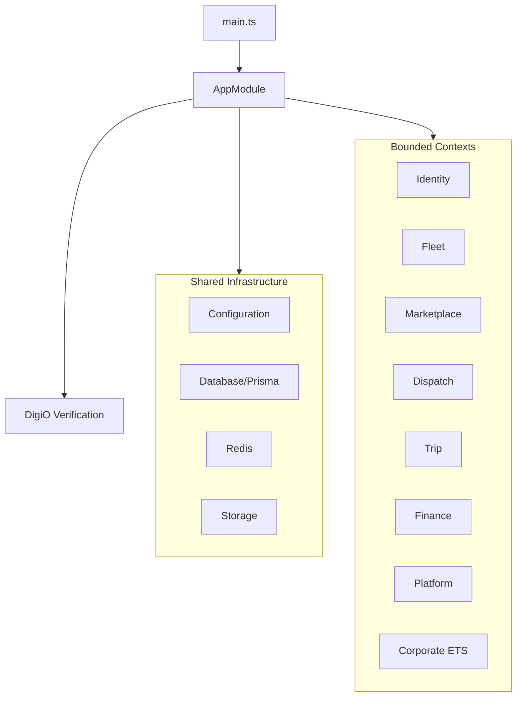

# API Architecture

**Evidence status:** Verified against `apps/api/src/app.module.ts`,
`apps/api/src/main.ts`, domain modules and controller/service folders.

## Runtime Entry Point

`apps/api/src/main.ts` creates the Nest application and applies:

- API prefix: `/api/v1`
- Global validation whitelist
- Global exception filter
- Global response transform interceptor
- Tenant-context interceptor
- CORS policy
- Swagger setup for enabled environments
- Configurable HTTP keep-alive settings

The application may expose Swagger at `/docs` outside production or when
`ENABLE_SWAGGER=true`.

## Architectural Pattern

The backend is a **modular monolith**:

- It has one deployable NestJS process.
- Business areas are organized as bounded-context modules.
- Controllers, services and infrastructure remain in the same process.
- Bounded contexts do not become independent network microservices.
- Cross-domain behavior uses shared NestJS dependency injection and database
  infrastructure.

## Root Composition

`apps/api/src/app.module.ts` imports:

1. Global configuration
2. Database module
3. Redis module
4. Storage module
5. Identity domain
6. Fleet domain
7. Marketplace domain
8. Dispatch domain
9. Trip domain
10. Finance domain
11. Platform domain
12. Corporate domain
13. DigiO module

The composition establishes shared infrastructure once and exports the domain
modules beneath it.

## Layer Responsibilities

| Layer | Responsibility |
|---|---|
| Controller | HTTP route, parameter and request delegation |
| DTO/contracts | Request shape and validation metadata |
| Service | Business workflow and provider orchestration |
| Guard/interceptor | Authentication, authorization and tenant isolation |
| Database service | Prisma access and global database lifecycle |
| Repository/adapters | Database or provider implementation where explicitly present |
| Scheduler | Repeated dispatch, telemetry and safety operations |
| Provider adapter | Google, payment, notification or KYC integration |

Source code also contains application use cases and infrastructure
repositories in the `application` and `infrastructure` directories.

For the complete leaf-module/service ownership map, see the
[module and service reference](./module-service-reference.md). Corporate
roster, dispatch, trip, tracking, safety and billing responsibilities are
expanded in the [Corporate service map](./corporate-module-services.md);
provider ports and failure boundaries are in the
[provider adapter reference](./provider-adapters.md).
