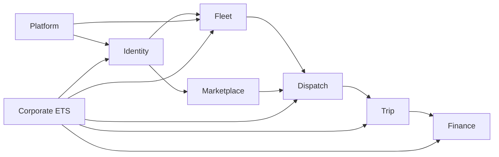

# API Bounded Contexts

**Evidence status:** Verified against domain-module imports and source folders.

## Domain Map

| Domain | Core modules | Primary responsibility |
|---|---|---|
| Identity | Auth, Users | Authentication, profiles and role claims |
| Fleet | Drivers, Vehicles, Vendors | Supply onboarding and verification |
| Marketplace | Requirements | Vendor demand and marketplace requirements |
| Dispatch | Dispatch, Offers | Spatial allocation and offer lifecycle |
| Trip | Trips, Locations, Reviews, Assignments | Trip execution and location services |
| Finance | Ledger, Settlements, Payments, Pricing, Coupons, Subscriptions | Tariffs and financial records |
| Platform | Admin, Audit, Notifications, Health, Leads, Blogs, Disputes, Feature Flags | Governance and shared platform services |
| Corporate ETS | Tenants, rosters, routing, dispatch, execution, tracking, billing, safety | Enterprise commute operations |

## Domain Relationships

The relationship diagram shows code ownership and operational dependencies.
It does not imply a remote service or network call for each arrow.

## Marketplace Modules

The marketplace implementation includes:

- Requirements: vendor trip/vehicle requests
- Offers: driver acceptance or rejection
- Assignments: trip allocation
- Dispatch: ranking, scheduling and retry behavior
- Trips: lifecycle and events

## Corporate ETS Modules

The corporate domain module is the largest backend domain boundary. It
includes:

- Corporate tenant onboarding and configuration
- Offices, departments, zones and cost centers
- Employee and location management
- Roster ingestion and approval
- Shift templates and scheduling
- Route planning and optimization
- Traffic and route-direction adapters
- Dispatch offers and reassignment
- Trip boarding/execution
- GPS tracking and event recording
- Safety, SOS and support tickets
- Billing, invoices, disputes and payouts
- Analytics and operational views

## Module Ownership Rule

New functionality should remain within an existing bounded context unless the
scope clearly creates a separate domain. Avoid introducing a module merely
because a UI route exists; a module should own a business responsibility.
