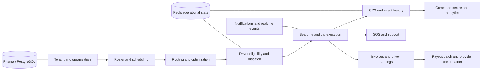

# Corporate ETS Backend Modules and Services

## Functional purpose

The Corporate ETS backend operates employer-managed commuting. Tenant
administrators configure organizations, offices, employees and policies;
rosters supply employee travel demand; planners group that demand into routes;
dispatch offers routes to eligible drivers; trip execution records boarding,
movement and completion; tracking and safety support live operations; billing
and payout services reconcile the completed work.

The API owns the authoritative state transitions. Corporate web, Ops, driver
and employee clients call the controllers; those controllers delegate into
the services below. Corporate services live in one NestJS domain module and
share the API's database and Redis infrastructure. The feature areas are
submodules by directory and responsibility, not separate deployables.

## Module composition

`apps/api/src/domains/corporate/corporate-domain.module.ts` registers
tenant, roster, scheduling, routing, dispatch, execution, replanning,
safety, billing, operations, rider and analytics providers. It imports
`CorporateTrackingModule`, which separately owns GPS intake, telemetry
storage and tracking reads. The root module also imports shared
`DatabaseModule`, `RedisModule`, `NotificationsModule`, `AuditModule`,
`AdminModule` and `LocationsModule`.

Arrows describe business/data dependencies in source, not synchronous
network calls. The service call may be direct in-process injection, a
database relationship, a Redis event, or a queued/scheduled operation.

## Tenant and organization services

| Service | Functional responsibility and technical boundary | Source |
|---|---|---|
| `CorporateTenantService` | Reads and manages tenant, office, employee and corporate account records used by tenant-facing operations. | `apps/api/src/domains/corporate/tenants/corporate-tenant.service.ts` |
| `CorporateOnboardingService` | Creates the initial corporate portal account and tenant onboarding records; enforces the declared minimum password rule and onboarding input checks. | `apps/api/src/domains/corporate/tenants/corporate-onboarding.service.ts` |
| `CorporateTenantPolicyService` | Reads and updates versioned tenant policy, including policy values used by route planning, dispatch and trip rules. | `apps/api/src/domains/corporate/tenants/corporate-tenant-policy.service.ts` |
| `CorporateOrgStructureService` | Maintains tenant organizational structure such as departments, offices and cost-center relationships. | `apps/api/src/domains/corporate/tenants/corporate-org-structure.service.ts` |
| `CorporateTenantUsersService` | Manages corporate user membership, role and office scope; authorization remains enforced by controller guards and the permission utilities. | `apps/api/src/domains/corporate/tenants/corporate-tenant-users.service.ts` |
| `CorporateTransportZoneService` | Manages tenant-scoped service zones and their location/configuration data used by coverage and transport workflows. | `apps/api/src/domains/corporate/tenants/corporate-transport-zone.service.ts` |

These services are reached through
[CorporateTenantController](./reference/endpoints/corporate-tenant-controller.md).
The tenant identifiers and foreign-key boundaries are mapped in the
[tenant isolation reference](./data/tenant-data-isolation.md). A foreign key
does not replace checking the authenticated user's tenant/office scope.

## Roster ingestion and lifecycle

| Service | Functional responsibility and technical boundary | Source |
|---|---|---|
| `RosterTemplateService` | Supplies the downloadable/import template and expected roster column structure. | `apps/api/src/domains/corporate/rosters/roster-template.service.ts` |
| `RosterIngestionService` | Parses and validates uploaded spreadsheet/CSV roster rows, normalizes employee/location data and reports row-level validation outcomes before planning. | `apps/api/src/domains/corporate/rosters/roster-ingestion.service.ts` |
| `RosterLifecycleService` | Persists roster versions and manages their lifecycle/approval state and associated roster entries/transport requests. | `apps/api/src/domains/corporate/rosters/roster-lifecycle.service.ts` |

The user-facing workflow is: obtain template or upload a roster, validate
the rows, resolve employee and office data, then save/activate the accepted
roster version. Rejected rows are validation outcomes; they are not silently
treated as successful transport demand. See the [roster ingestion and
routing workflow](../ets/operational-workflows.md) and
[roster controller reference](./reference/endpoints/corporate-roster-controller.md).

## Scheduling and route planning

| Service | Functional responsibility and technical boundary | Source |
|---|---|---|
| `CorporateShiftTemplateService` | Creates and reads recurring shift definitions and tenant/office scheduling configuration. | `apps/api/src/domains/corporate/scheduling/corporate-shift-template.service.ts` |
| `CorporateAutoPlannerService` | Runs lifecycle-managed automatic planning for eligible scheduled demand. By default it polls every 60 seconds, scans a three-day horizon and plans one hour before the cancellation cutoff; a Redis tick lock and per-shift lock coordinate it with other instances and manual replanning. These values and enablement are configurable. | `apps/api/src/domains/corporate/scheduling/corporate-auto-planner.service.ts` |
| `RouteSolverService` | Solves route grouping/order with the domain's route optimization routines. | `apps/api/src/domains/corporate/routing/route-solver.service.ts` |
| `CorporateRoutePlannerService` | Converts roster/request inputs into candidate routes: validates planning bounds, geocodes/normalizes locations, obtains travel-time inputs, clusters passengers and calculates route/vehicle/pricing outputs. It commits planned routes and stops only after the planning constraints pass. | `apps/api/src/domains/corporate/routing/corporate-route-planner.service.ts` |
| `CorporateRouteDirectionsService` | Produces directions and travel-time information for a route and records whether the result came from live Maps or a road-factor estimate. | `apps/api/src/domains/corporate/routing/corporate-route-directions.service.ts` |

The planner validates supported distances, capacity, wait/buffer intervals,
vehicle category and routing preference. It uses Google geocoding/Routes
adapters when configured, and the travel-time port can return an explicitly
identified Haversine fallback. Route-planning estimates therefore must not
be described as guaranteed actual traffic conditions. The
[route planner and adapters](./provider-adapters.md#corporate-routing-and-traffic)
document the integration details.

## Dispatch and supply eligibility

| Service | Functional responsibility and technical boundary | Source |
|---|---|---|
| `DriverEligibilityService` | Filters drivers against corporate eligibility, availability, verification, capacity, vehicle and schedule constraints before an offer can be made. | `apps/api/src/domains/corporate/supply/driver-eligibility.service.ts` |
| `CorporateDispatchService` | Selects candidates and manages route offer waves, driver exclusivity, expiry/rejection, retry windows and route assignment. It records offer/event state and coordinates Redis, trip-event recording, rate-card data and notifications. | `apps/api/src/domains/corporate/dispatch/corporate-dispatch.service.ts` |
| `CorporateDispatchSchedulerService` | Scans dispatchable routes every 30 seconds by default and runs its Redis-backed dispatch worker every two seconds; page size, concurrency, batch size and stuck-work thresholds are configurable. It reaps due offer expiries and retries routes while releasing stale driver holds. | `apps/api/src/domains/corporate/dispatch/corporate-dispatch-scheduler.service.ts` |

The dispatch workflow checks current route/driver eligibility before issuing
an offer. Active offer pointers and expiry work are maintained in Redis;
durable offer records and route state are persisted in PostgreSQL. A route
is assigned only after an eligible driver accepts and a guarded state
transition succeeds. A failed or expired offer is not an assignment.

See the [dispatch controller reference](./reference/endpoints/corporate-dispatch-controller.md)
and [dispatch workflow](../ets/operational-workflows.md).

## Trip execution, rider self-service and replanning

| Service | Functional responsibility and technical boundary | Source |
|---|---|---|
| `CorporateTripExecutionService` | Starts routes and applies stop/boarding/completion/no-show transitions. It checks assignment, driver verification and passenger capacity; uses a compare-and-set route transition to prevent duplicate starts; validates boarding OTP/QR and wait/attempt rules; records events and coordinates notifications, GPS and safety. | `apps/api/src/domains/corporate/execution/corporate-trip-execution.service.ts` |
| `CorporateRiderNotifier` | Creates employee-facing route/stop notifications and individual pickup ETA events used by the execution workflow. | `apps/api/src/domains/corporate/execution/corporate-rider-notifier.service.ts` |
| `CorporateRiderService` | Implements employee/rider self-service views and actions for their own corporate transport requests and feedback. | `apps/api/src/domains/corporate/rider/corporate-rider.service.ts` |
| `CorporateReplanningService` | Applies cancellation/reschedule cutoff policy and replans affected demand/routes when permitted; records transitions rather than treating a reschedule as a silent field edit. | `apps/api/src/domains/corporate/replanning/corporate-replanning.service.ts` |

The execution service is authoritative for server-side transitions. The
source enforces a 150-metre stop-arrival boundary, a five-minute stop wait
buffer and up to five incorrect OTP attempts within a 30-minute window;
attempt counters have a process-local fallback if Redis is unavailable.
The route also requires an assigned, verified driver and must not exceed
vehicle capacity. Clients display state but cannot mark a route started or
a passenger boarded without the corresponding server checks.

See [trip execution endpoint references](./reference/endpoints/corporate-trip-execution-controller.md),
[rider self-service endpoints](./reference/endpoints/corporate-rider-controller.md)
and [reschedule/cancellation policy](../ets/operational-workflows.md).

## Tracking and telemetry

| Service | Functional responsibility and technical boundary | Source |
|---|---|---|
| `CorporateGpsIngestService` | Validates/accepts corporate GPS updates and places operational telemetry into the Redis-backed ingest flow. | `apps/api/src/domains/corporate/tracking/corporate-gps-ingest.service.ts` |
| `CorporateTelemetryWriter` | Batches telemetry for durable writes to partitioned `CorporateVehiclePosition` history. | `apps/api/src/domains/corporate/tracking/corporate-telemetry-writer.service.ts` |
| `CorporateGpsPartitionMaintenance` | Creates upcoming daily GPS partitions and removes expired partitions according to retention configuration. | `apps/api/src/domains/corporate/tracking/corporate-gps-partition-maintenance.service.ts` |
| `TripEventRecorder` | Appends corporate trip/route assignment events used by execution, dispatch and replanning history. | `apps/api/src/domains/corporate/tracking/trip-event-recorder.service.ts` |
| `CorporateTrackingService` | Reads latest position, route history/playback and fleet snapshots, with freshness-aware results for operations clients. | `apps/api/src/domains/corporate/tracking/corporate-tracking.service.ts` |
| `TelemetryStreamHub` | Publishes live telemetry to local SSE subscribers and releases subscriber resources on module teardown. | `apps/api/src/domains/corporate/tracking/telemetry-stream-hub.ts` |

The ingestion/write/read flow spans Redis and PostgreSQL: location updates
are accepted and streamed, batched into durable daily partitions, then
queried for latest position or history. Redis pub/sub/SSE is a live-delivery
path, not the durable history store. See the [tracking controller
reference](./reference/endpoints/corporate-tracking-controller.md), [GPS
retention guide](./data/migrations-and-indexes.md) and
[tracking service infrastructure](../../platform/engineering/backend-scheduled-and-realtime.md).

## Safety, support and command centre operations

| Service | Functional responsibility and technical boundary | Source |
|---|---|---|
| `CorporateSafetyService` | Creates and advances corporate SOS/safety incident state and coordinates route/tenant event notifications. | `apps/api/src/domains/corporate/safety/corporate-safety.service.ts` |
| `CorporateSosEscalationScheduler` | Polls every 15 seconds by default, escalating eligible unacknowledged SOS after the 120-second acknowledgement SLA; a Redis tick lock and conditional per-alert updates prevent overlapping instances from applying the same escalation. | `apps/api/src/domains/corporate/safety/corporate-sos-escalation.scheduler.ts` |
| `CorporateSupportTicketService` | Creates and manages tenant support tickets, queue visibility, comments, attachments and activity history for corporate and operations workflows. | `apps/api/src/domains/corporate/safety/corporate-support-ticket.service.ts` |
| `CorporateOperationsService` | Serves command-centre operational views and actions across routes, trip execution and safety state. | `apps/api/src/domains/corporate/operations/corporate-operations.service.ts` |
| `CorporateOpsDriversService` | Provides operations-facing driver status/availability and related fleet support views. | `apps/api/src/domains/corporate/operations/corporate-ops-drivers.service.ts` |
| `CorporateAnalyticsService` | Builds tenant-scoped operational reports such as trips, no-shows and attendance with bounded report row counts. | `apps/api/src/domains/corporate/analytics/corporate-analytics.service.ts` |

An SOS scheduler changes incident state only through its eligible lifecycle;
the scheduler is not a substitute for an operator's authorization. Support
comments and activities are persisted as separate records so the ticket
timeline can distinguish discussion from status/activity changes. See
[safety](./reference/endpoints/corporate-safety-controller.md),
[support](./reference/endpoints/corporate-support-ticket-controller.md),
[operations](./reference/endpoints/corporate-operations-controller.md) and
[analytics](./reference/endpoints/corporate-analytics-controller.md)
endpoint references.

## Billing, rates and payouts

| Service | Functional responsibility and technical boundary | Source |
|---|---|---|
| `CorporateBillingService` | Builds tenant invoice and driver-earning records from eligible completed transport activity; creates/approves payout batches under maker/checker rules. | `apps/api/src/domains/corporate/billing/corporate-billing.service.ts` |
| `RateCardService` | Resolves effective corporate and driver rate-card values used by planning, dispatch pricing and billing. | `apps/api/src/domains/corporate/billing/rate-card.service.ts` |
| `CorporateRateCardAdminService` | Creates and versions tenant/driver rate-card configuration for authorized administration. | `apps/api/src/domains/corporate/billing/corporate-rate-card-admin.service.ts` |
| `CorporateInvoiceDisputeService` | Records and resolves tenant invoice disputes and associated credit-note adjustments. | `apps/api/src/domains/corporate/billing/corporate-invoice-dispute.service.ts` |
| `CorporatePayoutService` | Submits approved driver payouts with per-payout idempotency keys, authenticates provider callbacks, checks callback amounts/status transitions and reconciles payout/batch state. | `apps/api/src/domains/corporate/billing/corporate-payout.service.ts` |

Financial state is not inferred from a provider's initial acceptance:
submission moves work into processing; the payout becomes paid only after a
valid signed confirmation. Retries reuse the original idempotency key and a
reversal is recorded as a compensating event. Database immutability triggers
protect selected financial history; see the [payout endpoint
reference](./reference/endpoints/corporate-billing-controller.md),
[webhook reference](./reference/endpoints/corporate-payout-webhook-controller.md)
and [migration history](./data/migration-history.md).

## Workflow summary

| Business workflow | Main service path | Durable/operational state |
|---|---|---|
| Tenant onboarding | Tenant controller → onboarding/tenant-user services | `CorporateTenant`, users, offices and organization records in PostgreSQL |
| Roster to planned routes | Roster controller → ingestion/lifecycle → route planner/solver → routing adapters | Roster/employee/request/route/stop records in PostgreSQL |
| Route dispatch | Dispatch controller/scheduler → eligibility → Corporate dispatch | Offer/route state in PostgreSQL; short-lived offer, expiry and driver-hold state in Redis |
| Start, board and complete | Execution controller → execution/rider notifier → trip event recorder/GPS/safety | Route/request/stop/event records in PostgreSQL, OTP attempts and live events in Redis |
| Track and respond | Tracking/safety/operations controllers → tracking or safety services → stream hub/scheduler | GPS partitions and incident/ticket records in PostgreSQL; live updates and scheduled work use Redis |
| Invoice and pay | Billing/rate-card controllers → billing/dispute/payout services → payout port | Invoice/earnings/batch/payout/provider-event records in PostgreSQL |

## Related documentation

- [Corporate API endpoints](./reference/endpoints/index.md)
- [Data models and tenant isolation](./data/data-dictionary.md)
- [Provider adapters](./provider-adapters.md)
- [Corporate operational workflows](../ets/operational-workflows.md)
