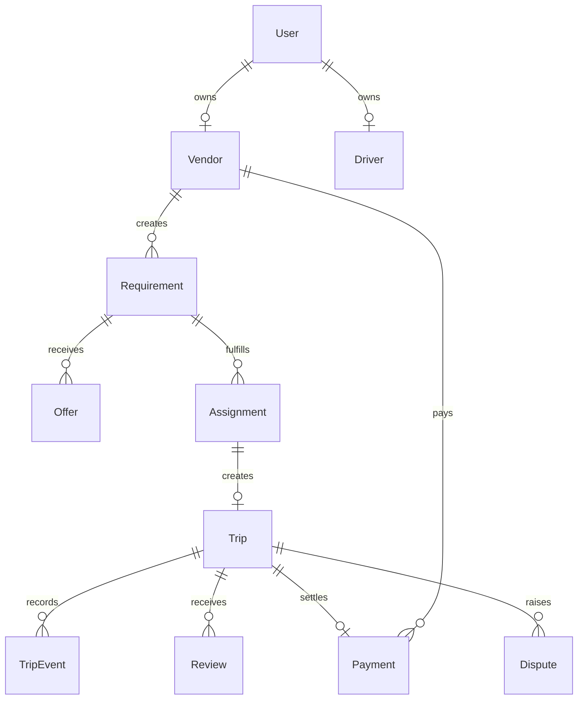
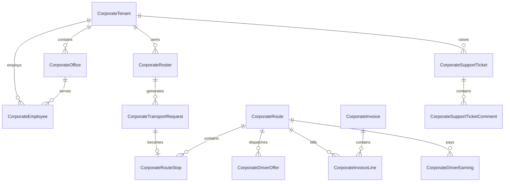

# Database Architecture

**Evidence status:** Verified against the Prisma schema, migrations and
Docker Compose configuration.

For exact model fields, defaults, keys, relations and indexes, use the
[Prisma data dictionary](./data-dictionary.md). The diagrams below are
conceptual summaries; focused relationship diagrams and source field
references are available in the linked bounded-context dictionary pages.

## Database Engine

AdhocX uses PostgreSQL as its authoritative relational database. Production
and local infrastructure use the `postgis/postgis:16-3.4-alpine` image.

Prisma defines models and generates the application client. Redis is a cache,
pub/sub and operational state system; it is not a database of record.

## Storage Boundaries

| Store | Owner | Purpose |
|---|---|---|
| PostgreSQL | API | Authoritative users, trips, finance, corporate, audit and configuration |
| PostGIS/PostgreSQL geography inputs | API | Geospatial coordinates and spatial metadata |
| Redis | API | Cache, rate limits, live offers, token revocation and pub/sub |
| Object storage | API/uploads | User and document files |
| Flutter/browser storage | Individual frontend | Cached UI data and sessions |

## Core Model Families

The Prisma schema contains 75 models across these families:

| Family | Representative models |
|---|---|
| Identity | User |
| Supply | Vendor, Driver, Vehicle, DriverReferral |
| Marketplace | Requirement, Offer, Assignment |
| Trip | Trip, TripEvent, Review, Dispute |
| Finance | Payment, LedgerEntry, Settlement, Coupon, Subscription |
| Communications | BlogPost, DeviceToken, Notification, NotificationPreference, campaigns |
| Pricing | VehiclePricingTier, pricing plans/slabs/audits, trip quotes |
| Corporate tenancy | CorporateTenant, Office, Employee, Department, zone, cost center |
| Corporate scheduling | Roster, transport request, roster entry, shift template, holiday |
| Corporate routing | Route, route stop, route assignment/driver offer |
| Corporate billing | Invoice, invoice line, dispute, credit note, payout, earnings |
| Safety/support | SOS alert, support ticket, comments, activities and feedback |
| Telemetry | CorporateVehiclePosition, CorporateTripEvent |
| KYC/configuration | DigioVerification, FeatureFlag |

## Identity and Marketplace Relationships

The relationship diagram is conceptual and does not replace the complete
Prisma model inventory.

## Corporate Relationships

## Data Ownership

| Data family | Owner |
|---|---|
| Identity and account status | User aggregate and auth services |
| Driver/vendor supply | Fleet domain |
| Marketplace demand | Marketplace domain |
| Trip state | Trip domain |
| Money | Finance domain |
| Corporate tenant data | Corporate tenant domain |
| Roster and requests | Corporate roster domain |
| Routes and execution | Corporate routing/execution domains |
| Safety incidents | Corporate safety domain |
| Audit and notifications | Platform services |

Ownership is a domain responsibility; SQL foreign keys remain the data
integrity boundary.
