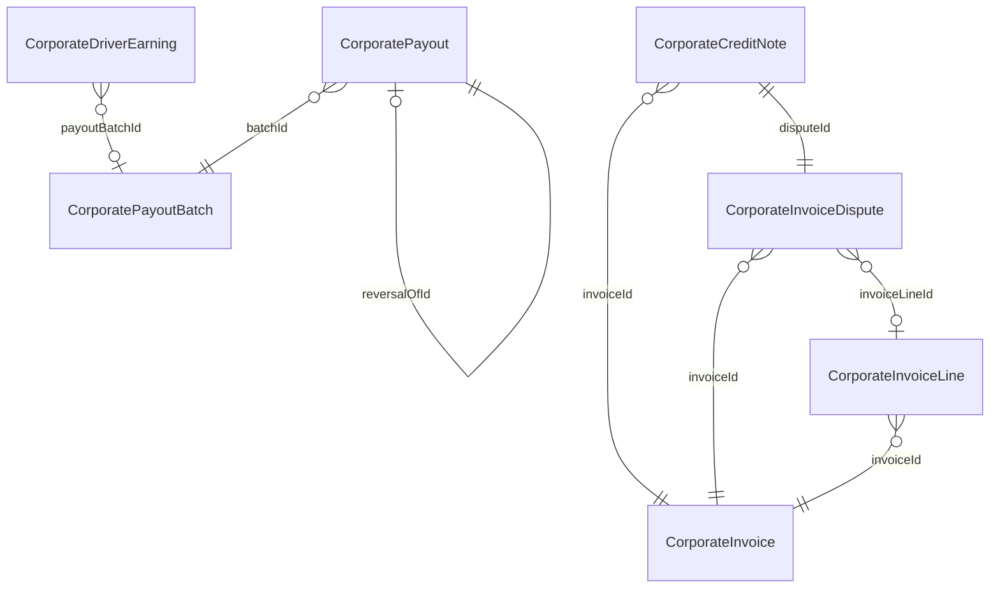

# Corporate Billing and Payouts Data Dictionary

**Business responsibility:** Tenant invoices and line items, disputes and credit notes, driver earnings, rate cards, payout batches, payouts and provider events.
**Primary API ownership evidence:** `apps/api/src/domains/corporate/billing/`. Ownership is logical; other domains may read or update shared models.
**Related API references:** [Corporate billing](../../reference/endpoints/corporate-billing-controller.md), [Corporate rate cards](../../reference/endpoints/corporate-rate-card-controller.md), [Payout callback](../../reference/endpoints/corporate-payout-webhook-controller.md). These are context links, not a claim that every route reads or writes every model in this group.

**Source:** `apps/api/prisma/schema.prisma` (10 models). Model sections cite the declaration line.

## Relationship overview

This ERD includes only direct Prisma foreign-key relations whose two models belong to this page. Cross-context relations remain listed in each model table; a SQL scalar without a Prisma relation is not drawn as a foreign key.

## CorporateInvoice {#corporate-invoice}

**Business purpose:** Tenant invoice
**Storage:** Prisma model `CorporateInvoice` maps to PostgreSQL table `corporate_invoices`. **Schema declaration:** `apps/api/prisma/schema.prisma:1446`.

| Field | Prisma type / native type | Nullability | Default / behavior | Key and column mapping | Schema description |
|---|---|---|---|---|---|
| `id` | String @db.Uuid | Required | `@default(uuid())` | `@id` | — |
| `tenantId` | String @db.Uuid | Required | `—` | column `tenant_id` | — |
| `invoiceNumber` | String @db.VarChar(64) | Required | `—` | `@unique`; column `invoice_number` | — |
| `billingPeriodStart` | DateTime @db.Date | Required | `—` | column `billing_period_start` | — |
| `billingPeriodEnd` | DateTime @db.Date | Required | `—` | column `billing_period_end` | — |
| `subtotalPaise` | BigInt | Required | `—` | column `subtotal_paise` | — |
| `gstPaise` | BigInt | Required | `—` | column `gst_paise` | — |
| `totalAmountPaise` | BigInt | Required | `—` | column `total_amount_paise` | — |
| `status` | [CorporateInvoiceStatus](../enums.md#corporate-invoice-status) | Required | `@default(DRAFT)` | — | — |
| `createdAt` | DateTime | Required | `@default(now())` | column `created_at` | — |
| `updatedAt` | DateTime | Required | `@updatedAt` | column `updated_at` | — |
| `tenant` | [CorporateTenant](./corporate-tenancy-and-organization.md#corporate-tenant) | Required relation | `—` | — | — |
| `lines` | [CorporateInvoiceLine](./corporate-billing-and-payouts.md#corporate-invoice-line)[] | Relation collection | `—` | — | — |
| `disputes` | [CorporateInvoiceDispute](./corporate-billing-and-payouts.md#corporate-invoice-dispute)[] | Relation collection | `—` | — | — |
| `creditNotes` | [CorporateCreditNote](./corporate-billing-and-payouts.md#corporate-credit-note)[] | Relation collection | `—` | — | — |

### Relations

| Relation field | Related model | Foreign-key mapping | On delete | Relation name |
|---|---|---|---|---|
| `tenant` | [CorporateTenant](./corporate-tenancy-and-organization.md#corporate-tenant) | `tenantId` → `id` | Not specified; Prisma/provider default applies | `CorporateInvoiceToCorporateTenant` |
| `lines` | [CorporateInvoiceLine](./corporate-billing-and-payouts.md#corporate-invoice-line)[] | Inverse relation; the foreign-key scalar is declared on the related model | Not specified; Prisma/provider default applies | `CorporateInvoiceToCorporateInvoiceLine` |
| `disputes` | [CorporateInvoiceDispute](./corporate-billing-and-payouts.md#corporate-invoice-dispute)[] | Inverse relation; the foreign-key scalar is declared on the related model | Not specified; Prisma/provider default applies | `CorporateInvoiceToCorporateInvoiceDispute` |
| `creditNotes` | [CorporateCreditNote](./corporate-billing-and-payouts.md#corporate-credit-note)[] | Inverse relation; the foreign-key scalar is declared on the related model | Not specified; Prisma/provider default applies | `CorporateCreditNoteToCorporateInvoice` |

### Model-level keys and indexes

| Declaration | Meaning |
|---|---|
| `@@index([tenantId, billingPeriodStart])` | Database index |

## CorporateInvoiceLine {#corporate-invoice-line}

**Business purpose:** Invoice route billable
**Storage:** Prisma model `CorporateInvoiceLine` maps to PostgreSQL table `corporate_invoice_lines`. **Schema declaration:** `apps/api/prisma/schema.prisma:1469`.

| Field | Prisma type / native type | Nullability | Default / behavior | Key and column mapping | Schema description |
|---|---|---|---|---|---|
| `id` | String @db.Uuid | Required | `@default(uuid())` | `@id` | — |
| `invoiceId` | String @db.Uuid | Required | `—` | column `invoice_id` | — |
| `routeId` | String @db.Uuid | Required | `—` | column `route_id` | — |
| `billableDistanceMeters` | Int | Required | `—` | column `billable_distance_meters` | — |
| `amountPaise` | BigInt | Required | `—` | column `amount_paise` | — |
| `createdAt` | DateTime | Required | `@default(now())` | column `created_at` | — |
| `lineType` | String @db.VarChar(16) | Required | `@default("TRIP")` | column `line_type` | — |
| `rateCardId` | String? @db.Uuid | Nullable | `—` | column `rate_card_id` | — |
| `rateCardVersion` | Int? | Nullable | `—` | column `rate_card_version` | — |
| `noShowCount` | Int | Required | `@default(0)` | column `no_show_count` | — |
| `noShowPaise` | BigInt | Required | `@default("0")` | column `no_show_paise` | — |
| `invoice` | [CorporateInvoice](./corporate-billing-and-payouts.md#corporate-invoice) | Required relation | `—` | — | — |
| `route` | [CorporateRoute](./corporate-routing-execution-and-safety.md#corporate-route) | Required relation | `—` | — | — |
| `disputes` | [CorporateInvoiceDispute](./corporate-billing-and-payouts.md#corporate-invoice-dispute)[] | Relation collection | `—` | — | — |

### Relations

| Relation field | Related model | Foreign-key mapping | On delete | Relation name |
|---|---|---|---|---|
| `invoice` | [CorporateInvoice](./corporate-billing-and-payouts.md#corporate-invoice) | `invoiceId` → `id` | Cascade | `CorporateInvoiceToCorporateInvoiceLine` |
| `route` | [CorporateRoute](./corporate-routing-execution-and-safety.md#corporate-route) | `routeId` → `id` | Not specified; Prisma/provider default applies | `CorporateInvoiceLineToCorporateRoute` |
| `disputes` | [CorporateInvoiceDispute](./corporate-billing-and-payouts.md#corporate-invoice-dispute)[] | Inverse relation; the foreign-key scalar is declared on the related model | Not specified; Prisma/provider default applies | `CorporateInvoiceDisputeToCorporateInvoiceLine` |

### Model-level keys and indexes

| Declaration | Meaning |
|---|---|
| `@@index([invoiceId])` | Database index |
| `@@index([routeId])` | Database index |
| `@@index([rateCardId])` | Database index |

## CorporateInvoiceDispute {#corporate-invoice-dispute}

**Business purpose:** Invoice dispute
**Storage:** Prisma model `CorporateInvoiceDispute` maps to PostgreSQL table `corporate_invoice_disputes`. **Schema declaration:** `apps/api/prisma/schema.prisma:1913`.

| Field | Prisma type / native type | Nullability | Default / behavior | Key and column mapping | Schema description |
|---|---|---|---|---|---|
| `id` | String @db.Uuid | Required | `@default(uuid())` | `@id` | — |
| `tenantId` | String @db.Uuid | Required | `—` | column `tenant_id` | — |
| `invoiceId` | String @db.Uuid | Required | `—` | column `invoice_id` | — |
| `invoiceLineId` | String? @db.Uuid | Nullable | `—` | column `invoice_line_id` | — |
| `raisedByUserId` | String @db.Uuid | Required | `—` | column `raised_by_user_id` | — |
| `reason` | String | Required | `—` | — | — |
| `claimedAmountPaise` | BigInt | Required | `—` | column `claimed_amount_paise` | — |
| `status` | [CorporateInvoiceDisputeStatus](../enums.md#corporate-invoice-dispute-status) | Required | `@default(OPEN)` | — | — |
| `approvedAmountPaise` | BigInt? | Nullable | `—` | column `approved_amount_paise` | — |
| `resolvedByUserId` | String? @db.Uuid | Nullable | `—` | column `resolved_by_user_id` | — |
| `resolvedAt` | DateTime? | Nullable | `—` | column `resolved_at` | — |
| `resolutionNote` | String? | Nullable | `—` | column `resolution_note` | — |
| `createdAt` | DateTime | Required | `@default(now())` | column `created_at` | — |
| `updatedAt` | DateTime | Required | `@updatedAt` | column `updated_at` | — |
| `tenant` | [CorporateTenant](./corporate-tenancy-and-organization.md#corporate-tenant) | Required relation | `—` | — | — |
| `invoice` | [CorporateInvoice](./corporate-billing-and-payouts.md#corporate-invoice) | Required relation | `—` | — | — |
| `invoiceLine` | [CorporateInvoiceLine](./corporate-billing-and-payouts.md#corporate-invoice-line)? | Optional relation | `—` | — | — |
| `creditNote` | [CorporateCreditNote](./corporate-billing-and-payouts.md#corporate-credit-note)? | Optional relation | `—` | — | — |

### Relations

| Relation field | Related model | Foreign-key mapping | On delete | Relation name |
|---|---|---|---|---|
| `tenant` | [CorporateTenant](./corporate-tenancy-and-organization.md#corporate-tenant) | `tenantId` → `id` | Not specified; Prisma/provider default applies | `CorporateInvoiceDisputeToCorporateTenant` |
| `invoice` | [CorporateInvoice](./corporate-billing-and-payouts.md#corporate-invoice) | `invoiceId` → `id` | Not specified; Prisma/provider default applies | `CorporateInvoiceToCorporateInvoiceDispute` |
| `invoiceLine` | [CorporateInvoiceLine](./corporate-billing-and-payouts.md#corporate-invoice-line)? | `invoiceLineId` → `id` | Not specified; Prisma/provider default applies | `CorporateInvoiceDisputeToCorporateInvoiceLine` |
| `creditNote` | [CorporateCreditNote](./corporate-billing-and-payouts.md#corporate-credit-note)? | Inverse relation; the foreign-key scalar is declared on the related model | Not specified; Prisma/provider default applies | `CorporateCreditNoteToCorporateInvoiceDispute` |

### Model-level keys and indexes

| Declaration | Meaning |
|---|---|
| `@@index([tenantId, createdAt])` | Database index |
| `@@index([invoiceId])` | Database index |

## CorporateCreditNote {#corporate-credit-note}

**Business purpose:** Additive correction
**Schema documentation:** Immutable once issued (DB trigger rejects UPDATE / DELETE).
**Storage:** Prisma model `CorporateCreditNote` maps to PostgreSQL table `corporate_credit_notes`. **Schema declaration:** `apps/api/prisma/schema.prisma:1940`.

| Field | Prisma type / native type | Nullability | Default / behavior | Key and column mapping | Schema description |
|---|---|---|---|---|---|
| `id` | String @db.Uuid | Required | `@default(uuid())` | `@id` | — |
| `tenantId` | String @db.Uuid | Required | `—` | column `tenant_id` | — |
| `invoiceId` | String @db.Uuid | Required | `—` | column `invoice_id` | — |
| `disputeId` | String @db.Uuid | Required | `—` | `@unique`; column `dispute_id` | — |
| `creditNoteNumber` | String @db.VarChar(80) | Required | `—` | `@unique`; column `credit_note_number` | — |
| `subtotalPaise` | BigInt | Required | `—` | column `subtotal_paise` | — |
| `gstPaise` | BigInt | Required | `—` | column `gst_paise` | — |
| `totalPaise` | BigInt | Required | `—` | column `total_paise` | — |
| `reason` | String | Required | `—` | — | — |
| `issuedByUserId` | String @db.Uuid | Required | `—` | column `issued_by_user_id` | — |
| `issuedAt` | DateTime | Required | `@default(now())` | column `issued_at` | — |
| `tenant` | [CorporateTenant](./corporate-tenancy-and-organization.md#corporate-tenant) | Required relation | `—` | — | — |
| `invoice` | [CorporateInvoice](./corporate-billing-and-payouts.md#corporate-invoice) | Required relation | `—` | — | — |
| `dispute` | [CorporateInvoiceDispute](./corporate-billing-and-payouts.md#corporate-invoice-dispute) | Required relation | `—` | — | — |

### Relations

| Relation field | Related model | Foreign-key mapping | On delete | Relation name |
|---|---|---|---|---|
| `tenant` | [CorporateTenant](./corporate-tenancy-and-organization.md#corporate-tenant) | `tenantId` → `id` | Not specified; Prisma/provider default applies | `CorporateCreditNoteToCorporateTenant` |
| `invoice` | [CorporateInvoice](./corporate-billing-and-payouts.md#corporate-invoice) | `invoiceId` → `id` | Not specified; Prisma/provider default applies | `CorporateCreditNoteToCorporateInvoice` |
| `dispute` | [CorporateInvoiceDispute](./corporate-billing-and-payouts.md#corporate-invoice-dispute) | `disputeId` → `id` | Not specified; Prisma/provider default applies | `CorporateCreditNoteToCorporateInvoiceDispute` |

### Model-level keys and indexes

| Declaration | Meaning |
|---|---|
| `@@index([tenantId, issuedAt])` | Database index |
| `@@index([invoiceId])` | Database index |

## CorporateDriverEarning {#corporate-driver-earning}

**Business purpose:** Driver route earning
**Storage:** Prisma model `CorporateDriverEarning` maps to PostgreSQL table `corporate_driver_earnings`. **Schema declaration:** `apps/api/prisma/schema.prisma:1493`.

| Field | Prisma type / native type | Nullability | Default / behavior | Key and column mapping | Schema description |
|---|---|---|---|---|---|
| `id` | String @db.Uuid | Required | `@default(uuid())` | `@id` | — |
| `driverId` | String @db.Uuid | Required | `—` | column `driver_id` | — |
| `routeId` | String @db.Uuid | Required | `—` | column `route_id` | — |
| `payoutBatchId` | String? @db.Uuid | Nullable | `—` | column `payout_batch_id` | — |
| `routeFarePaise` | BigInt | Required | `—` | column `route_fare_paise` | — |
| `approachBonusPaise` | BigInt | Required | `@default("0")` | column `approach_bonus_paise` | — |
| `tollReimbursementPaise` | BigInt | Required | `@default("0")` | column `toll_reimbursement_paise` | — |
| `totalEarnedPaise` | BigInt | Required | `—` | column `total_earned_paise` | — |
| `payoutStatus` | [CorporateDriverEarningStatus](../enums.md#corporate-driver-earning-status) | Required | `@default(UNPAID)` | column `payout_status` | — |
| `createdAt` | DateTime | Required | `@default(now())` | column `created_at` | — |
| `updatedAt` | DateTime | Required | `@updatedAt` | column `updated_at` | — |
| `voidedAt` | DateTime? | Nullable | `—` | column `voided_at` | — |
| `voidReason` | String? @db.VarChar(500) | Nullable | `—` | column `void_reason` | — |
| `driver` | [Driver](./identity-and-supply.md#driver) | Required relation | `—` | — | — |
| `route` | [CorporateRoute](./corporate-routing-execution-and-safety.md#corporate-route) | Required relation | `—` | — | — |
| `payoutBatch` | [CorporatePayoutBatch](./corporate-billing-and-payouts.md#corporate-payout-batch)? | Optional relation | `—` | — | — |

### Relations

| Relation field | Related model | Foreign-key mapping | On delete | Relation name |
|---|---|---|---|---|
| `driver` | [Driver](./identity-and-supply.md#driver) | `driverId` → `id` | Not specified; Prisma/provider default applies | `CorporateDriverEarningToDriver` |
| `route` | [CorporateRoute](./corporate-routing-execution-and-safety.md#corporate-route) | `routeId` → `id` | Not specified; Prisma/provider default applies | `CorporateDriverEarningToCorporateRoute` |
| `payoutBatch` | [CorporatePayoutBatch](./corporate-billing-and-payouts.md#corporate-payout-batch)? | `payoutBatchId` → `id` | Not specified; Prisma/provider default applies | `CorporateDriverEarningToCorporatePayoutBatch` |

### Model-level keys and indexes

| Declaration | Meaning |
|---|---|
| `@@index([driverId, payoutStatus])` | Database index |
| `@@index([routeId])` | Database index |
| `@@index([payoutBatchId])` | Database index |

## CorporatePayoutBatch {#corporate-payout-batch}

**Business purpose:** Maker/checker payout batch
**Storage:** Prisma model `CorporatePayoutBatch` maps to PostgreSQL table `corporate_payout_batches`. **Schema declaration:** `apps/api/prisma/schema.prisma:1746`.

| Field | Prisma type / native type | Nullability | Default / behavior | Key and column mapping | Schema description |
|---|---|---|---|---|---|
| `id` | String @db.Uuid | Required | `@default(uuid())` | `@id` | — |
| `batchNumber` | String @db.VarChar(32) | Required | `—` | `@unique`; column `batch_number` | — |
| `idempotencyKey` | String @db.VarChar(64) | Required | `—` | `@unique`; column `idempotency_key` | — |
| `status` | [CorporatePayoutBatchStatus](../enums.md#corporate-payout-batch-status) | Required | `@default(DRAFT)` | — | — |
| `totalDrivers` | Int | Required | `—` | column `total_drivers` | — |
| `totalRoutes` | Int | Required | `—` | column `total_routes` | — |
| `grossPaise` | BigInt | Required | `—` | column `gross_paise` | — |
| `tdsPaise` | BigInt | Required | `—` | column `tds_paise` | — |
| `netPayoutPaise` | BigInt | Required | `—` | column `net_payout_paise` | — |
| `createdByUserId` | String @db.Uuid | Required | `—` | column `created_by_user_id` | — |
| `approvedByUserId` | String? @db.Uuid | Nullable | `—` | column `approved_by_user_id` | — |
| `approvedAt` | DateTime? | Nullable | `—` | column `approved_at` | — |
| `processedAt` | DateTime? | Nullable | `—` | column `processed_at` | — |
| `disbursementReference` | String? @db.VarChar(64) | Nullable | `—` | column `disbursement_reference` | — |
| `failureReason` | String? | Nullable | `—` | column `failure_reason` | — |
| `createdAt` | DateTime | Required | `@default(now())` | column `created_at` | — |
| `updatedAt` | DateTime | Required | `@updatedAt` | column `updated_at` | — |
| `submittedAt` | DateTime? | Nullable | `—` | column `submitted_at` | — |
| `submittedByUserId` | String? @db.Uuid | Nullable | `—` | column `submitted_by_user_id` | — |
| `provider` | String? @db.VarChar(32) | Nullable | `—` | — | — |
| `earnings` | [CorporateDriverEarning](./corporate-billing-and-payouts.md#corporate-driver-earning)[] | Relation collection | `—` | — | — |
| `payouts` | [CorporatePayout](./corporate-billing-and-payouts.md#corporate-payout)[] | Relation collection | `—` | — | — |

### Relations

| Relation field | Related model | Foreign-key mapping | On delete | Relation name |
|---|---|---|---|---|
| `earnings` | [CorporateDriverEarning](./corporate-billing-and-payouts.md#corporate-driver-earning)[] | Inverse relation; the foreign-key scalar is declared on the related model | Not specified; Prisma/provider default applies | `CorporateDriverEarningToCorporatePayoutBatch` |
| `payouts` | [CorporatePayout](./corporate-billing-and-payouts.md#corporate-payout)[] | Inverse relation; the foreign-key scalar is declared on the related model | Not specified; Prisma/provider default applies | `CorporatePayoutToCorporatePayoutBatch` |

### Model-level keys and indexes

| Declaration | Meaning |
|---|---|
| `@@index([status])` | Database index |
| `@@index([createdAt])` | Database index |

## CorporatePayout {#corporate-payout}

**Business purpose:** Individual payout
**Schema documentation:** One row per driver per batch. kind PAYOUT carries money out; kind REVERSAL is the compensating record of a reversed PAYOUT (negative amounts, reversalOfId set).
**Storage:** Prisma model `CorporatePayout` maps to PostgreSQL table `corporate_payouts`. **Schema declaration:** `apps/api/prisma/schema.prisma:1849`.

| Field | Prisma type / native type | Nullability | Default / behavior | Key and column mapping | Schema description |
|---|---|---|---|---|---|
| `id` | String @db.Uuid | Required | `@default(uuid())` | `@id` | — |
| `batchId` | String @db.Uuid | Required | `—` | column `batch_id` | — |
| `driverId` | String @db.Uuid | Required | `—` | column `driver_id` | — |
| `kind` | String @db.VarChar(16) | Required | `@default("PAYOUT")` | — | — |
| `reversalOfId` | String? @db.Uuid | Nullable | `—` | `@unique`; column `reversal_of_id` | — |
| `idempotencyKey` | String @db.VarChar(128) | Required | `—` | `@unique`; column `idempotency_key` | — |
| `status` | [CorporatePayoutStatus](../enums.md#corporate-payout-status) | Required | `@default(PENDING)` | — | — |
| `grossPaise` | BigInt | Required | `—` | column `gross_paise` | — |
| `tdsPaise` | BigInt | Required | `—` | column `tds_paise` | — |
| `netPaise` | BigInt | Required | `—` | column `net_paise` | — |
| `earningIds` | String[] @db.Uuid | List (not a nullable scalar) | `—` | column `earning_ids` | — |
| `attemptCount` | Int | Required | `@default(0)` | column `attempt_count` | — |
| `providerPayoutId` | String? @db.VarChar(128) | Nullable | `—` | column `provider_payout_id` | — |
| `providerReference` | String? @db.VarChar(128) | Nullable | `—` | column `provider_reference` | — |
| `failureReason` | String? | Nullable | `—` | column `failure_reason` | — |
| `submittedAt` | DateTime? | Nullable | `—` | column `submitted_at` | — |
| `paidAt` | DateTime? | Nullable | `—` | column `paid_at` | — |
| `failedAt` | DateTime? | Nullable | `—` | column `failed_at` | — |
| `reversedAt` | DateTime? | Nullable | `—` | column `reversed_at` | — |
| `createdAt` | DateTime | Required | `@default(now())` | column `created_at` | — |
| `updatedAt` | DateTime | Required | `@updatedAt` | column `updated_at` | — |
| `batch` | [CorporatePayoutBatch](./corporate-billing-and-payouts.md#corporate-payout-batch) | Required relation | `—` | — | — |
| `driver` | [Driver](./identity-and-supply.md#driver) | Required relation | `—` | — | — |
| `reversalOf` | [CorporatePayout](./corporate-billing-and-payouts.md#corporate-payout)? | Optional relation | `—` | — | — |
| `reversal` | [CorporatePayout](./corporate-billing-and-payouts.md#corporate-payout)? | Optional relation | `—` | — | — |

### Relations

| Relation field | Related model | Foreign-key mapping | On delete | Relation name |
|---|---|---|---|---|
| `batch` | [CorporatePayoutBatch](./corporate-billing-and-payouts.md#corporate-payout-batch) | `batchId` → `id` | Not specified; Prisma/provider default applies | `CorporatePayoutToCorporatePayoutBatch` |
| `driver` | [Driver](./identity-and-supply.md#driver) | `driverId` → `id` | Not specified; Prisma/provider default applies | `CorporatePayoutToDriver` |
| `reversalOf` | [CorporatePayout](./corporate-billing-and-payouts.md#corporate-payout)? | `reversalOfId` → `id` | Not specified; Prisma/provider default applies | `CorporatePayoutReversal` |
| `reversal` | [CorporatePayout](./corporate-billing-and-payouts.md#corporate-payout)? | Inverse relation; the foreign-key scalar is declared on the related model | Not specified; Prisma/provider default applies | `CorporatePayoutReversal` |

### Model-level keys and indexes

| Declaration | Meaning |
|---|---|
| `@@unique([batchId, driverId, kind])` | Composite unique constraint |
| `@@index([driverId, status])` | Database index |
| `@@index([status, updatedAt])` | Database index |
| `@@index([providerPayoutId])` | Database index |

## CorporatePayoutProviderEvent {#corporate-payout-provider-event}

**Business purpose:** Provider confirmation event
**Schema documentation:** Append-only log of signed provider callbacks. (provider, eventId) unique => replays are ignored.
**Storage:** Prisma model `CorporatePayoutProviderEvent` maps to PostgreSQL table `corporate_payout_provider_events`. **Schema declaration:** `apps/api/prisma/schema.prisma:1885`.

| Field | Prisma type / native type | Nullability | Default / behavior | Key and column mapping | Schema description |
|---|---|---|---|---|---|
| `id` | String @db.Uuid | Required | `@default(uuid())` | `@id` | — |
| `provider` | String @db.VarChar(32) | Required | `—` | — | — |
| `eventId` | String @db.VarChar(128) | Required | `—` | column `event_id` | — |
| `payoutId` | String? @db.Uuid | Nullable | `—` | column `payout_id` | — |
| `idempotencyKey` | String? @db.VarChar(128) | Nullable | `—` | column `idempotency_key` | — |
| `providerPayoutId` | String? @db.VarChar(128) | Nullable | `—` | column `provider_payout_id` | — |
| `status` | String @db.VarChar(16) | Required | `—` | — | — |
| `amountPaise` | BigInt? | Nullable | `—` | column `amount_paise` | — |
| `providerReference` | String? @db.VarChar(128) | Nullable | `—` | column `provider_reference` | — |
| `outcome` | String @db.VarChar(32) | Required | `—` | — | APPLIED \| NOOP_SAME_STATE \| ILLEGAL_TRANSITION \| AMOUNT_MISMATCH \| UNMATCHED |
| `occurredAt` | DateTime | Required | `—` | column `occurred_at` | — |
| `receivedAt` | DateTime | Required | `@default(now())` | column `received_at` | — |
| `payload` | Json | Required | `@default("{}")` | — | — |

### Relations

| Relation field | Related model | Foreign-key mapping | On delete | Relation name |
|---|---|---|---|---|
| — | No Prisma relation fields | — | — | — |

### Model-level keys and indexes

| Declaration | Meaning |
|---|---|
| `@@unique([provider, eventId])` | Composite unique constraint |
| `@@index([receivedAt])` | Database index |
| `@@index([payoutId, occurredAt])` | Database index |

## CorporateRateCard {#corporate-rate-card}

**Business purpose:** Tenant rate card
**Storage:** Prisma model `CorporateRateCard` maps to PostgreSQL table `corporate_rate_cards`. **Schema declaration:** `apps/api/prisma/schema.prisma:1777`.

| Field | Prisma type / native type | Nullability | Default / behavior | Key and column mapping | Schema description |
|---|---|---|---|---|---|
| `id` | String @db.Uuid | Required | `@default(uuid())` | `@id` | — |
| `tenantId` | String @db.Uuid | Required | `—` | column `tenant_id` | — |
| `vehicleCategory` | String @db.VarChar(16) | Required | `—` | column `vehicle_category` | — |
| `baseFarePaise` | BigInt | Required | `—` | column `base_fare_paise` | — |
| `baseDistanceMeters` | Int | Required | `@default(10000)` | column `base_distance_meters` | — |
| `perKmPaise` | BigInt | Required | `—` | column `per_km_paise` | — |
| `perExtraStopPaise` | BigInt | Required | `@default("0")` | column `per_extra_stop_paise` | — |
| `effectiveFrom` | DateTime | Required | `@default(now())` | column `effective_from` | — |
| `effectiveTo` | DateTime? | Nullable | `—` | column `effective_to` | — |
| `isActive` | Boolean | Required | `@default(true)` | column `is_active` | — |
| `createdAt` | DateTime | Required | `@default(now())` | column `created_at` | — |
| `updatedAt` | DateTime | Required | `@updatedAt` | column `updated_at` | — |
| `version` | Int | Required | `@default(1)` | — | — |
| `perHourPaise` | BigInt? | Nullable | `—` | column `per_hour_paise` | — |
| `minimumPaise` | BigInt | Required | `@default("0")` | column `minimum_paise` | — |
| `noShowPaise` | BigInt | Required | `@default("0")` | column `no_show_paise` | — |
| `cancellationPaise` | BigInt | Required | `@default("0")` | column `cancellation_paise` | — |
| `createdByUserId` | String? @db.Uuid | Nullable | `—` | column `created_by_user_id` | — |
| `retiredAt` | DateTime? | Nullable | `—` | column `retired_at` | — |
| `retiredByUserId` | String? @db.Uuid | Nullable | `—` | column `retired_by_user_id` | — |
| `tenant` | [CorporateTenant](./corporate-tenancy-and-organization.md#corporate-tenant) | Required relation | `—` | — | — |

### Relations

| Relation field | Related model | Foreign-key mapping | On delete | Relation name |
|---|---|---|---|---|
| `tenant` | [CorporateTenant](./corporate-tenancy-and-organization.md#corporate-tenant) | `tenantId` → `id` | Cascade | `CorporateRateCardToCorporateTenant` |

### Model-level keys and indexes

| Declaration | Meaning |
|---|---|
| `@@unique([tenantId, vehicleCategory, version])` | Composite unique constraint |
| `@@index([tenantId, vehicleCategory, isActive])` | Database index |
| `@@index([tenantId, vehicleCategory, effectiveFrom])` | Database index |

## CorporateDriverRateCard {#corporate-driver-rate-card}

**Business purpose:** Driver rate card
**Storage:** Prisma model `CorporateDriverRateCard` maps to PostgreSQL table `corporate_driver_rate_cards`. **Schema declaration:** `apps/api/prisma/schema.prisma:1809`.

| Field | Prisma type / native type | Nullability | Default / behavior | Key and column mapping | Schema description |
|---|---|---|---|---|---|
| `id` | String @db.Uuid | Required | `@default(uuid())` | `@id` | — |
| `vehicleCategory` | String @db.VarChar(16) | Required | `—` | column `vehicle_category` | — |
| `basePayoutPaise` | BigInt | Required | `—` | column `base_payout_paise` | — |
| `baseDistanceMeters` | Int | Required | `@default(10000)` | column `base_distance_meters` | — |
| `perKmPaise` | BigInt | Required | `—` | column `per_km_paise` | — |
| `tollReimbursementPaise` | BigInt | Required | `@default("0")` | column `toll_reimbursement_paise` | — |
| `effectiveFrom` | DateTime | Required | `@default(now())` | column `effective_from` | — |
| `effectiveTo` | DateTime? | Nullable | `—` | column `effective_to` | — |
| `isActive` | Boolean | Required | `@default(true)` | column `is_active` | — |
| `createdAt` | DateTime | Required | `@default(now())` | column `created_at` | — |
| `updatedAt` | DateTime | Required | `@updatedAt` | column `updated_at` | — |
| `version` | Int | Required | `@default(1)` | — | — |
| `perHourPaise` | BigInt? | Nullable | `—` | column `per_hour_paise` | — |
| `minimumPaise` | BigInt | Required | `@default("0")` | column `minimum_paise` | — |
| `noShowPaise` | BigInt | Required | `@default("0")` | column `no_show_paise` | — |
| `cancellationPaise` | BigInt | Required | `@default("0")` | column `cancellation_paise` | — |
| `createdByUserId` | String? @db.Uuid | Nullable | `—` | column `created_by_user_id` | — |
| `retiredAt` | DateTime? | Nullable | `—` | column `retired_at` | — |
| `retiredByUserId` | String? @db.Uuid | Nullable | `—` | column `retired_by_user_id` | — |

### Relations

| Relation field | Related model | Foreign-key mapping | On delete | Relation name |
|---|---|---|---|---|
| — | No Prisma relation fields | — | — | — |

### Model-level keys and indexes

| Declaration | Meaning |
|---|---|
| `@@unique([vehicleCategory, version])` | Composite unique constraint |
| `@@index([vehicleCategory, isActive])` | Database index |
| `@@index([vehicleCategory, effectiveFrom])` | Database index |

## Reading the field tables

- `Required` means Prisma marks the scalar field non-null; `Nullable` means the Prisma type permits null.
- `[]` denotes a Prisma list field. Object/relation fields are not physical columns unless a scalar FK field is also listed.
- `@db.*`, `@map` and `@@map` preserve native PostgreSQL types and storage names declared in the schema.
- Defaults and `@updatedAt` are schema declarations, not guarantees that existing production databases have no drift.
- A missing description means the Prisma schema has no field-level documentation comment; field meaning should not be guessed from the name alone.
