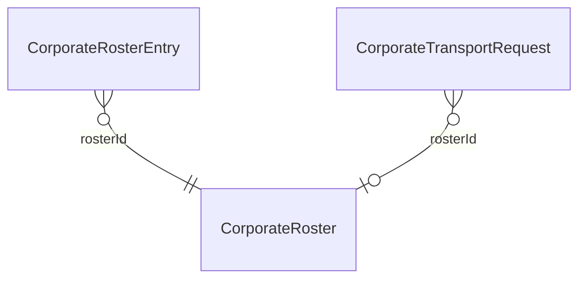

# Corporate Rosters and Scheduling Data Dictionary

**Business responsibility:** Versioned employee rosters, transport demand, shift templates and tenant/office holidays.
**Primary API ownership evidence:** `apps/api/src/domains/corporate/rosters/` and `scheduling/`. Ownership is logical; other domains may read or update shared models.
**Related API references:** [Corporate rosters](../../reference/endpoints/corporate-roster-controller.md), [Corporate scheduling](../../reference/endpoints/corporate-scheduling-controller.md). These are context links, not a claim that every route reads or writes every model in this group.

**Source:** `apps/api/prisma/schema.prisma` (5 models). Model sections cite the declaration line.

## Relationship overview

This ERD includes only direct Prisma foreign-key relations whose two models belong to this page. Cross-context relations remain listed in each model table; a SQL scalar without a Prisma relation is not drawn as a foreign key.

## CorporateRoster {#corporate-roster}

**Business purpose:** Shift roster version
**Storage:** Prisma model `CorporateRoster` maps to PostgreSQL table `corporate_rosters`. **Schema declaration:** `apps/api/prisma/schema.prisma:1305`.

| Field | Prisma type / native type | Nullability | Default / behavior | Key and column mapping | Schema description |
|---|---|---|---|---|---|
| `id` | String @db.Uuid | Required | `@default(uuid())` | `@id` | — |
| `tenantId` | String @db.Uuid | Required | `—` | column `tenant_id` | — |
| `officeId` | String @db.Uuid | Required | `—` | column `office_id` | — |
| `rosterDate` | DateTime @db.Date | Required | `—` | column `roster_date` | — |
| `shiftTime` | String @db.VarChar(8) | Required | `—` | column `shift_time` | — |
| `direction` | [CorporateTransportDirection](../enums.md#corporate-transport-direction) | Required | `—` | — | — |
| `status` | [CorporateRosterStatus](../enums.md#corporate-roster-status) | Required | `@default(DRAFT)` | — | — |
| `passengerCount` | Int | Required | `@default(0)` | column `passenger_count` | — |
| `version` | Int | Required | `@default(1)` | — | WS-F: version per (tenant, office, rosterDate) and lifecycle actors. |
| `uploadedById` | String? @db.Uuid | Nullable | `—` | column `uploaded_by_id` | — |
| `approvedById` | String? @db.Uuid | Nullable | `—` | column `approved_by_id` | — |
| `approvedAt` | DateTime? | Nullable | `—` | column `approved_at` | — |
| `publishedById` | String? @db.Uuid | Nullable | `—` | column `published_by_id` | — |
| `publishedAt` | DateTime? | Nullable | `—` | column `published_at` | — |
| `createdAt` | DateTime | Required | `@default(now())` | column `created_at` | — |
| `updatedAt` | DateTime | Required | `@updatedAt` | column `updated_at` | — |
| `tenant` | [CorporateTenant](./corporate-tenancy-and-organization.md#corporate-tenant) | Required relation | `—` | — | — |
| `office` | [CorporateOffice](./corporate-tenancy-and-organization.md#corporate-office) | Required relation | `—` | — | — |
| `requests` | [CorporateTransportRequest](./corporate-rosters-and-scheduling.md#corporate-transport-request)[] | Relation collection | `—` | — | — |
| `entries` | [CorporateRosterEntry](./corporate-rosters-and-scheduling.md#corporate-roster-entry)[] | Relation collection | `—` | — | — |

### Relations

| Relation field | Related model | Foreign-key mapping | On delete | Relation name |
|---|---|---|---|---|
| `tenant` | [CorporateTenant](./corporate-tenancy-and-organization.md#corporate-tenant) | `tenantId` → `id` | Not specified; Prisma/provider default applies | `CorporateRosterToCorporateTenant` |
| `office` | [CorporateOffice](./corporate-tenancy-and-organization.md#corporate-office) | `officeId` → `id` | Not specified; Prisma/provider default applies | `CorporateOfficeToCorporateRoster` |
| `requests` | [CorporateTransportRequest](./corporate-rosters-and-scheduling.md#corporate-transport-request)[] | Inverse relation; the foreign-key scalar is declared on the related model | Not specified; Prisma/provider default applies | `CorporateRosterToCorporateTransportRequest` |
| `entries` | [CorporateRosterEntry](./corporate-rosters-and-scheduling.md#corporate-roster-entry)[] | Inverse relation; the foreign-key scalar is declared on the related model | Not specified; Prisma/provider default applies | `CorporateRosterToCorporateRosterEntry` |

### Model-level keys and indexes

| Declaration | Meaning |
|---|---|
| `@@index([tenantId, rosterDate])` | Database index |
| `@@index([officeId])` | Database index |

## CorporateRosterEntry {#corporate-roster-entry}

**Business purpose:** Roster line
**Schema documentation:** Demand line of a DRAFT / APPROVED roster version. Publishing turns each line into a CorporateTransportRequest with the same idempotencyHash (createMany skipDuplicates).
**Storage:** Prisma model `CorporateRosterEntry` maps to PostgreSQL table `corporate_roster_entries`. **Schema declaration:** `apps/api/prisma/schema.prisma:2209`.

| Field | Prisma type / native type | Nullability | Default / behavior | Key and column mapping | Schema description |
|---|---|---|---|---|---|
| `id` | String @db.Uuid | Required | `@default(uuid())` | `@id` | — |
| `rosterId` | String @db.Uuid | Required | `—` | column `roster_id` | — |
| `tenantId` | String @db.Uuid | Required | `—` | column `tenant_id` | — |
| `employeeId` | String @db.Uuid | Required | `—` | column `employee_id` | — |
| `officeId` | String @db.Uuid | Required | `—` | column `office_id` | — |
| `scheduledDate` | DateTime @db.Date | Required | `—` | column `scheduled_date` | — |
| `shiftTime` | String @db.VarChar(8) | Required | `—` | column `shift_time` | — |
| `direction` | [CorporateTransportDirection](../enums.md#corporate-transport-direction) | Required | `—` | — | — |
| `pickupLat` | Decimal @db.Decimal(10, 7) | Required | `—` | column `pickup_lat` | — |
| `pickupLng` | Decimal @db.Decimal(10, 7) | Required | `—` | column `pickup_lng` | — |
| `dropoffLat` | Decimal @db.Decimal(10, 7) | Required | `—` | column `dropoff_lat` | — |
| `dropoffLng` | Decimal @db.Decimal(10, 7) | Required | `—` | column `dropoff_lng` | — |
| `h3PickupIndex` | String @db.VarChar(15) | Required | `—` | column `h3_pickup_index` | — |
| `idempotencyHash` | String @db.VarChar(64) | Required | `—` | column `idempotency_hash` | — |
| `createdAt` | DateTime | Required | `@default(now())` | column `created_at` | — |
| `roster` | [CorporateRoster](./corporate-rosters-and-scheduling.md#corporate-roster) | Required relation | `—` | — | — |
| `employee` | [CorporateEmployee](./corporate-tenancy-and-organization.md#corporate-employee) | Required relation | `—` | — | — |

### Relations

| Relation field | Related model | Foreign-key mapping | On delete | Relation name |
|---|---|---|---|---|
| `roster` | [CorporateRoster](./corporate-rosters-and-scheduling.md#corporate-roster) | `rosterId` → `id` | Cascade | `CorporateRosterToCorporateRosterEntry` |
| `employee` | [CorporateEmployee](./corporate-tenancy-and-organization.md#corporate-employee) | `employeeId` → `id` | Cascade | `CorporateEmployeeToCorporateRosterEntry` |

### Model-level keys and indexes

| Declaration | Meaning |
|---|---|
| `@@unique([rosterId, idempotencyHash])` | Composite unique constraint |
| `@@index([rosterId])` | Database index |
| `@@index([tenantId, scheduledDate])` | Database index |

## CorporateTransportRequest {#corporate-transport-request}

**Business purpose:** Employee transport demand
**Storage:** Prisma model `CorporateTransportRequest` maps to PostgreSQL table `corporate_transport_requests`. **Schema declaration:** `apps/api/prisma/schema.prisma:1334`.

| Field | Prisma type / native type | Nullability | Default / behavior | Key and column mapping | Schema description |
|---|---|---|---|---|---|
| `id` | String @db.Uuid | Required | `@default(uuid())` | `@id` | — |
| `tenantId` | String @db.Uuid | Required | `—` | column `tenant_id` | — |
| `rosterId` | String? @db.Uuid | Nullable | `—` | column `roster_id` | — |
| `employeeId` | String @db.Uuid | Required | `—` | column `employee_id` | — |
| `scheduledDate` | DateTime @db.Date | Required | `—` | column `scheduled_date` | — |
| `shiftTime` | String @db.VarChar(8) | Required | `—` | column `shift_time` | — |
| `direction` | [CorporateTransportDirection](../enums.md#corporate-transport-direction) | Required | `—` | — | — |
| `pickupLat` | Decimal @db.Decimal(10, 7) | Required | `—` | column `pickup_lat` | — |
| `pickupLng` | Decimal @db.Decimal(10, 7) | Required | `—` | column `pickup_lng` | — |
| `dropoffLat` | Decimal @db.Decimal(10, 7) | Required | `—` | column `dropoff_lat` | — |
| `dropoffLng` | Decimal @db.Decimal(10, 7) | Required | `—` | column `dropoff_lng` | — |
| `h3PickupIndex` | String @db.VarChar(15) | Required | `—` | column `h3_pickup_index` | — |
| `status` | [CorporateRequestStatus](../enums.md#corporate-request-status) | Required | `@default(APPROVED)` | — | — |
| `idempotencyHash` | String @db.VarChar(64) | Required | `—` | `@unique`; column `idempotency_hash` | — |
| `createdAt` | DateTime | Required | `@default(now())` | column `created_at` | — |
| `updatedAt` | DateTime | Required | `@updatedAt` | column `updated_at` | — |
| `tenant` | [CorporateTenant](./corporate-tenancy-and-organization.md#corporate-tenant) | Required relation | `—` | — | — |
| `roster` | [CorporateRoster](./corporate-rosters-and-scheduling.md#corporate-roster)? | Optional relation | `—` | — | — |
| `employee` | [CorporateEmployee](./corporate-tenancy-and-organization.md#corporate-employee) | Required relation | `—` | — | — |
| `routeStop` | [CorporateRouteStop](./corporate-routing-execution-and-safety.md#corporate-route-stop)? | Optional relation | `—` | — | — |

### Relations

| Relation field | Related model | Foreign-key mapping | On delete | Relation name |
|---|---|---|---|---|
| `tenant` | [CorporateTenant](./corporate-tenancy-and-organization.md#corporate-tenant) | `tenantId` → `id` | Not specified; Prisma/provider default applies | `CorporateTenantToCorporateTransportRequest` |
| `roster` | [CorporateRoster](./corporate-rosters-and-scheduling.md#corporate-roster)? | `rosterId` → `id` | Not specified; Prisma/provider default applies | `CorporateRosterToCorporateTransportRequest` |
| `employee` | [CorporateEmployee](./corporate-tenancy-and-organization.md#corporate-employee) | `employeeId` → `id` | Not specified; Prisma/provider default applies | `CorporateEmployeeToCorporateTransportRequest` |
| `routeStop` | [CorporateRouteStop](./corporate-routing-execution-and-safety.md#corporate-route-stop)? | Inverse relation; the foreign-key scalar is declared on the related model | Not specified; Prisma/provider default applies | `CorporateRouteStopToCorporateTransportRequest` |

### Model-level keys and indexes

| Declaration | Meaning |
|---|---|
| `@@index([tenantId, scheduledDate, shiftTime])` | Database index |
| `@@index([tenantId, status, scheduledDate])` | Database index |
| `@@index([employeeId])` | Database index |
| `@@index([employeeId, scheduledDate])` | Database index |
| `@@index([h3PickupIndex])` | Database index |

## CorporateShiftTemplate {#corporate-shift-template}

**Business purpose:** Recurring shift
**Storage:** Prisma model `CorporateShiftTemplate` maps to PostgreSQL table `corporate_shift_templates`. **Schema declaration:** `apps/api/prisma/schema.prisma:2167`.

| Field | Prisma type / native type | Nullability | Default / behavior | Key and column mapping | Schema description |
|---|---|---|---|---|---|
| `id` | String @db.Uuid | Required | `@default(uuid())` | `@id` | — |
| `tenantId` | String @db.Uuid | Required | `—` | column `tenant_id` | — |
| `officeId` | String @db.Uuid | Required | `—` | column `office_id` | — |
| `name` | String @db.VarChar(64) | Required | `—` | — | — |
| `loginTime` | String @db.VarChar(5) | Required | `—` | column `login_time` | — |
| `logoutTime` | String @db.VarChar(5) | Required | `—` | column `logout_time` | — |
| `weekdays` | Int[] | List (not a nullable scalar) | `—` | — | ISO weekdays the shift runs on (1 = Monday ... 7 = Sunday). |
| `isOvernight` | Boolean | Required | `@default(false)` | column `is_overnight` | Logout falls on the next IST calendar day (e.g. login 20:00, logout 02:00). |
| `isActive` | Boolean | Required | `@default(true)` | column `is_active` | — |
| `createdAt` | DateTime | Required | `@default(now())` | column `created_at` | — |
| `updatedAt` | DateTime | Required | `@updatedAt` | column `updated_at` | — |
| `tenant` | [CorporateTenant](./corporate-tenancy-and-organization.md#corporate-tenant) | Required relation | `—` | — | — |
| `office` | [CorporateOffice](./corporate-tenancy-and-organization.md#corporate-office) | Required relation | `—` | — | — |

### Relations

| Relation field | Related model | Foreign-key mapping | On delete | Relation name |
|---|---|---|---|---|
| `tenant` | [CorporateTenant](./corporate-tenancy-and-organization.md#corporate-tenant) | `tenantId` → `id` | Cascade | `CorporateShiftTemplateToCorporateTenant` |
| `office` | [CorporateOffice](./corporate-tenancy-and-organization.md#corporate-office) | `officeId` → `id` | Cascade | `CorporateOfficeToCorporateShiftTemplate` |

### Model-level keys and indexes

| Declaration | Meaning |
|---|---|
| `@@unique([tenantId, officeId, name])` | Composite unique constraint |
| `@@index([tenantId, officeId])` | Database index |

## CorporateHoliday {#corporate-holiday}

**Business purpose:** Tenant/office holiday
**Schema documentation:** No transport demand is generated on a holiday. officeId null => every office of the tenant.
**Storage:** Prisma model `CorporateHoliday` maps to PostgreSQL table `corporate_holidays`. **Schema declaration:** `apps/api/prisma/schema.prisma:2191`.

| Field | Prisma type / native type | Nullability | Default / behavior | Key and column mapping | Schema description |
|---|---|---|---|---|---|
| `id` | String @db.Uuid | Required | `@default(uuid())` | `@id` | — |
| `tenantId` | String @db.Uuid | Required | `—` | column `tenant_id` | — |
| `officeId` | String? @db.Uuid | Nullable | `—` | column `office_id` | — |
| `holidayDate` | DateTime @db.Date | Required | `—` | column `holiday_date` | — |
| `name` | String | Required | `—` | — | — |
| `createdAt` | DateTime | Required | `@default(now())` | column `created_at` | — |
| `tenant` | [CorporateTenant](./corporate-tenancy-and-organization.md#corporate-tenant) | Required relation | `—` | — | — |
| `office` | [CorporateOffice](./corporate-tenancy-and-organization.md#corporate-office)? | Optional relation | `—` | — | — |

### Relations

| Relation field | Related model | Foreign-key mapping | On delete | Relation name |
|---|---|---|---|---|
| `tenant` | [CorporateTenant](./corporate-tenancy-and-organization.md#corporate-tenant) | `tenantId` → `id` | Cascade | `CorporateHolidayToCorporateTenant` |
| `office` | [CorporateOffice](./corporate-tenancy-and-organization.md#corporate-office)? | `officeId` → `id` | Cascade | `CorporateHolidayToCorporateOffice` |

### Model-level keys and indexes

| Declaration | Meaning |
|---|---|
| `@@unique([tenantId, officeId, holidayDate])` | Composite unique constraint |
| `@@index([tenantId, holidayDate])` | Database index |

## Reading the field tables

- `Required` means Prisma marks the scalar field non-null; `Nullable` means the Prisma type permits null.
- `[]` denotes a Prisma list field. Object/relation fields are not physical columns unless a scalar FK field is also listed.
- `@db.*`, `@map` and `@@map` preserve native PostgreSQL types and storage names declared in the schema.
- Defaults and `@updatedAt` are schema declarations, not guarantees that existing production databases have no drift.
- A missing description means the Prisma schema has no field-level documentation comment; field meaning should not be guessed from the name alone.
