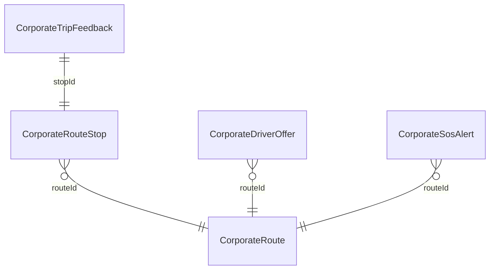

# Corporate Routing, Execution and Safety Data Dictionary

**Business responsibility:** Routes, ordered stops, driver offers, assignment and trip events, vehicle positions, trip feedback and SOS records.
**Primary API ownership evidence:** `apps/api/src/domains/corporate/routing/`, `dispatch/`, `execution/`, `tracking/`, `safety/`. Ownership is logical; other domains may read or update shared models.
**Related API references:** [Routing](../../reference/endpoints/corporate-routing-controller.md), [Dispatch](../../reference/endpoints/corporate-dispatch-controller.md), [Trip execution](../../reference/endpoints/corporate-trip-execution-controller.md), [Tracking](../../reference/endpoints/corporate-tracking-controller.md), [Safety](../../reference/endpoints/corporate-safety-controller.md), [Rider self-service](../../reference/endpoints/corporate-rider-controller.md), [Operations](../../reference/endpoints/corporate-operations-controller.md). These are context links, not a claim that every route reads or writes every model in this group.

**Source:** `apps/api/prisma/schema.prisma` (8 models). Model sections cite the declaration line.

## Relationship overview

This ERD includes only direct Prisma foreign-key relations whose two models belong to this page. Cross-context relations remain listed in each model table; a SQL scalar without a Prisma relation is not drawn as a foreign key.

## CorporateRoute {#corporate-route}

**Business purpose:** Planned/executed route
**Storage:** Prisma model `CorporateRoute` maps to PostgreSQL table `corporate_routes`. **Schema declaration:** `apps/api/prisma/schema.prisma:1365`.

| Field | Prisma type / native type | Nullability | Default / behavior | Key and column mapping | Schema description |
|---|---|---|---|---|---|
| `id` | String @db.Uuid | Required | `@default(uuid())` | `@id` | — |
| `tenantId` | String @db.Uuid | Required | `—` | column `tenant_id` | — |
| `officeId` | String @db.Uuid | Required | `—` | column `office_id` | — |
| `shiftDate` | DateTime @db.Date | Required | `—` | column `shift_date` | — |
| `shiftTime` | String @db.VarChar(8) | Required | `—` | column `shift_time` | — |
| `direction` | [CorporateTransportDirection](../enums.md#corporate-transport-direction) | Required | `—` | — | — |
| `vehicleCategory` | String @db.VarChar(32) | Required | `—` | column `vehicle_category` | — |
| `maxCapacity` | Int | Required | `—` | column `max_capacity` | — |
| `assignedPassengerCount` | Int | Required | `—` | column `assigned_passenger_count` | — |
| `targetPickup1Time` | DateTime | Required | `—` | column `target_pickup_1_time` | — |
| `targetOfficeArrivalTime` | DateTime | Required | `—` | column `target_office_arrival_time` | — |
| `estDistanceMeters` | Int | Required | `—` | column `est_distance_meters` | — |
| `estDurationSeconds` | Int | Required | `—` | column `est_duration_seconds` | — |
| `status` | [CorporateRouteStatus](../enums.md#corporate-route-status) | Required | `@default(PLANNED)` | — | — |
| `driverId` | String? @db.Uuid | Nullable | `—` | column `driver_id` | — |
| `vehicleId` | String? @db.Uuid | Nullable | `—` | column `vehicle_id` | — |
| `dispatchStatus` | String @db.VarChar(32) | Required | `@default("PENDING")` | column `dispatch_status` | — |
| `dispatchAttempts` | Int | Required | `@default(0)` | column `dispatch_attempts` | — |
| `dispatchWindowStartedAt` | DateTime? | Nullable | `—` | column `dispatch_window_started_at` | — |
| `lastDispatchAttemptAt` | DateTime? | Nullable | `—` | column `last_dispatch_attempt_at` | — |
| `dispatchFailureReason` | String? @db.VarChar(500) | Nullable | `—` | column `dispatch_failure_reason` | — |
| `createdAt` | DateTime | Required | `@default(now())` | column `created_at` | — |
| `updatedAt` | DateTime | Required | `@updatedAt` | column `updated_at` | — |
| `tenant` | [CorporateTenant](./corporate-tenancy-and-organization.md#corporate-tenant) | Required relation | `—` | — | — |
| `office` | [CorporateOffice](./corporate-tenancy-and-organization.md#corporate-office) | Required relation | `—` | — | — |
| `driver` | [Driver](./identity-and-supply.md#driver)? | Optional relation | `—` | — | — |
| `vehicle` | [Vehicle](./identity-and-supply.md#vehicle)? | Optional relation | `—` | — | — |
| `stops` | [CorporateRouteStop](./corporate-routing-execution-and-safety.md#corporate-route-stop)[] | Relation collection | `—` | — | — |
| `invoiceLines` | [CorporateInvoiceLine](./corporate-billing-and-payouts.md#corporate-invoice-line)[] | Relation collection | `—` | — | — |
| `driverEarnings` | [CorporateDriverEarning](./corporate-billing-and-payouts.md#corporate-driver-earning)[] | Relation collection | `—` | — | — |
| `sosAlerts` | [CorporateSosAlert](./corporate-routing-execution-and-safety.md#corporate-sos-alert)[] | Relation collection | `—` | — | — |
| `driverOffers` | [CorporateDriverOffer](./corporate-routing-execution-and-safety.md#corporate-driver-offer)[] | Relation collection | `—` | — | — |
| `atRisk` | Boolean | Required | `@default(false)` | column `at_risk` | — |

### Relations

| Relation field | Related model | Foreign-key mapping | On delete | Relation name |
|---|---|---|---|---|
| `tenant` | [CorporateTenant](./corporate-tenancy-and-organization.md#corporate-tenant) | `tenantId` → `id` | Not specified; Prisma/provider default applies | `CorporateRouteToCorporateTenant` |
| `office` | [CorporateOffice](./corporate-tenancy-and-organization.md#corporate-office) | `officeId` → `id` | Not specified; Prisma/provider default applies | `CorporateOfficeToCorporateRoute` |
| `driver` | [Driver](./identity-and-supply.md#driver)? | `driverId` → `id` | Not specified; Prisma/provider default applies | `CorporateRouteToDriver` |
| `vehicle` | [Vehicle](./identity-and-supply.md#vehicle)? | `vehicleId` → `id` | Not specified; Prisma/provider default applies | `CorporateRouteToVehicle` |
| `stops` | [CorporateRouteStop](./corporate-routing-execution-and-safety.md#corporate-route-stop)[] | Inverse relation; the foreign-key scalar is declared on the related model | Not specified; Prisma/provider default applies | `CorporateRouteToCorporateRouteStop` |
| `invoiceLines` | [CorporateInvoiceLine](./corporate-billing-and-payouts.md#corporate-invoice-line)[] | Inverse relation; the foreign-key scalar is declared on the related model | Not specified; Prisma/provider default applies | `CorporateInvoiceLineToCorporateRoute` |
| `driverEarnings` | [CorporateDriverEarning](./corporate-billing-and-payouts.md#corporate-driver-earning)[] | Inverse relation; the foreign-key scalar is declared on the related model | Not specified; Prisma/provider default applies | `CorporateDriverEarningToCorporateRoute` |
| `sosAlerts` | [CorporateSosAlert](./corporate-routing-execution-and-safety.md#corporate-sos-alert)[] | Inverse relation; the foreign-key scalar is declared on the related model | Not specified; Prisma/provider default applies | `CorporateRouteToCorporateSosAlert` |
| `driverOffers` | [CorporateDriverOffer](./corporate-routing-execution-and-safety.md#corporate-driver-offer)[] | Inverse relation; the foreign-key scalar is declared on the related model | Not specified; Prisma/provider default applies | `CorporateDriverOfferToCorporateRoute` |

### Model-level keys and indexes

| Declaration | Meaning |
|---|---|
| `@@index([tenantId, shiftDate, shiftTime])` | Database index |
| `@@index([shiftDate, tenantId, status])` | Database index |
| `@@index([tenantId, status, shiftDate])` | Database index |
| `@@index([driverId])` | Database index |
| `@@index([driverId, status, targetPickup1Time])` | Database index |
| `@@index([status])` | Database index |

## CorporateRouteStop {#corporate-route-stop}

**Business purpose:** Ordered route stop
**Storage:** Prisma model `CorporateRouteStop` maps to PostgreSQL table `corporate_route_stops`. **Schema declaration:** `apps/api/prisma/schema.prisma:1410`.

| Field | Prisma type / native type | Nullability | Default / behavior | Key and column mapping | Schema description |
|---|---|---|---|---|---|
| `id` | String @db.Uuid | Required | `@default(uuid())` | `@id` | — |
| `routeId` | String @db.Uuid | Required | `—` | column `route_id` | — |
| `stopSequence` | Int | Required | `—` | column `stop_sequence` | — |
| `stopType` | String @db.VarChar(16) | Required | `—` | column `stop_type` | — |
| `transportRequestId` | String? @db.Uuid | Nullable | `—` | `@unique`; column `transport_request_id` | — |
| `employeeId` | String? @db.Uuid | Nullable | `—` | column `employee_id` | — |
| `latitude` | Decimal @db.Decimal(10, 7) | Required | `—` | — | — |
| `longitude` | Decimal @db.Decimal(10, 7) | Required | `—` | — | — |
| `addressText` | String? | Nullable | `—` | column `address_text` | — |
| `employeeName` | String? @db.VarChar(150) | Nullable | `—` | column `employee_name` | — |
| `employeePhone` | String? @db.VarChar(32) | Nullable | `—` | column `employee_phone` | — |
| `plannedEta` | DateTime | Required | `—` | column `planned_eta` | — |
| `actualArrivalTime` | DateTime? | Nullable | `—` | column `actual_arrival_time` | — |
| `actualDepartureTime` | DateTime? | Nullable | `—` | column `actual_departure_time` | — |
| `boardingOtp` | String @db.VarChar(6) | Required | `—` | column `boarding_otp` | — |
| `dwellBufferSeconds` | Int | Required | `@default(300)` | column `dwell_buffer_seconds` | — |
| `status` | [CorporateStopStatus](../enums.md#corporate-stop-status) | Required | `@default(PENDING)` | — | — |
| `noShowReason` | String? | Nullable | `—` | column `no_show_reason` | — |
| `createdAt` | DateTime | Required | `@default(now())` | column `created_at` | — |
| `updatedAt` | DateTime | Required | `@updatedAt` | column `updated_at` | — |
| `route` | [CorporateRoute](./corporate-routing-execution-and-safety.md#corporate-route) | Required relation | `—` | — | — |
| `transportRequest` | [CorporateTransportRequest](./corporate-rosters-and-scheduling.md#corporate-transport-request)? | Optional relation | `—` | — | — |
| `employee` | [CorporateEmployee](./corporate-tenancy-and-organization.md#corporate-employee)? | Optional relation | `—` | — | — |
| `feedback` | [CorporateTripFeedback](./corporate-routing-execution-and-safety.md#corporate-trip-feedback)? | Optional relation | `—` | — | — |

### Relations

| Relation field | Related model | Foreign-key mapping | On delete | Relation name |
|---|---|---|---|---|
| `route` | [CorporateRoute](./corporate-routing-execution-and-safety.md#corporate-route) | `routeId` → `id` | Cascade | `CorporateRouteToCorporateRouteStop` |
| `transportRequest` | [CorporateTransportRequest](./corporate-rosters-and-scheduling.md#corporate-transport-request)? | `transportRequestId` → `id` | Not specified; Prisma/provider default applies | `CorporateRouteStopToCorporateTransportRequest` |
| `employee` | [CorporateEmployee](./corporate-tenancy-and-organization.md#corporate-employee)? | `employeeId` → `id` | Not specified; Prisma/provider default applies | `CorporateEmployeeToCorporateRouteStop` |
| `feedback` | [CorporateTripFeedback](./corporate-routing-execution-and-safety.md#corporate-trip-feedback)? | Inverse relation; the foreign-key scalar is declared on the related model | Not specified; Prisma/provider default applies | `CorporateRouteStopToCorporateTripFeedback` |

### Model-level keys and indexes

| Declaration | Meaning |
|---|---|
| `@@unique([routeId, stopSequence])` | Composite unique constraint |
| `@@index([routeId])` | Database index |
| `@@index([routeId, status])` | Database index |
| `@@index([employeeId])` | Database index |
| `@@index([employeeId, status])` | Database index |
| `@@index([status, plannedEta])` | Database index |

## CorporateDriverOffer {#corporate-driver-offer}

**Business purpose:** Corporate route offer
**Storage:** Prisma model `CorporateDriverOffer` maps to PostgreSQL table `corporate_driver_offers`. **Schema declaration:** `apps/api/prisma/schema.prisma:2039`.

| Field | Prisma type / native type | Nullability | Default / behavior | Key and column mapping | Schema description |
|---|---|---|---|---|---|
| `id` | String @db.Uuid | Required | `@default(uuid())` | `@id` | — |
| `tenantId` | String @db.Uuid | Required | `—` | column `tenant_id` | — |
| `routeId` | String @db.Uuid | Required | `—` | column `route_id` | — |
| `driverId` | String @db.Uuid | Required | `—` | column `driver_id` | — |
| `attempt` | Int | Required | `@default(1)` | — | — |
| `status` | [CorporateDriverOfferStatus](../enums.md#corporate-driver-offer-status) | Required | `@default(SENT)` | — | — |
| `payoutPaise` | BigInt | Required | `—` | column `payout_paise` | — |
| `expiresAt` | DateTime | Required | `—` | column `expires_at` | — |
| `respondedAt` | DateTime? | Nullable | `—` | column `responded_at` | — |
| `rejectReason` | String? @db.VarChar(128) | Nullable | `—` | column `reject_reason` | — |
| `createdAt` | DateTime | Required | `@default(now())` | column `created_at` | — |
| `updatedAt` | DateTime | Required | `@updatedAt` | column `updated_at` | — |
| `tenant` | [CorporateTenant](./corporate-tenancy-and-organization.md#corporate-tenant) | Required relation | `—` | — | — |
| `route` | [CorporateRoute](./corporate-routing-execution-and-safety.md#corporate-route) | Required relation | `—` | — | — |
| `driver` | [Driver](./identity-and-supply.md#driver) | Required relation | `—` | — | — |

### Relations

| Relation field | Related model | Foreign-key mapping | On delete | Relation name |
|---|---|---|---|---|
| `tenant` | [CorporateTenant](./corporate-tenancy-and-organization.md#corporate-tenant) | `tenantId` → `id` | Not specified; Prisma/provider default applies | `CorporateDriverOfferToCorporateTenant` |
| `route` | [CorporateRoute](./corporate-routing-execution-and-safety.md#corporate-route) | `routeId` → `id` | Cascade | `CorporateDriverOfferToCorporateRoute` |
| `driver` | [Driver](./identity-and-supply.md#driver) | `driverId` → `id` | Not specified; Prisma/provider default applies | `CorporateDriverOfferToDriver` |

### Model-level keys and indexes

| Declaration | Meaning |
|---|---|
| `@@unique([routeId, driverId, attempt])` | Composite unique constraint |
| `@@index([driverId, status, expiresAt])` | Database index |
| `@@index([routeId, status])` | Database index |
| `@@index([tenantId, createdAt])` | Database index |

## CorporateRouteAssignmentEvent {#corporate-route-assignment-event}

**Business purpose:** Driver assignment history
**Schema documentation:** Driver assignment / reassignment / replacement history of a route.
**Storage:** Prisma model `CorporateRouteAssignmentEvent` maps to PostgreSQL table `corporate_route_assignment_events`. **Schema declaration:** `apps/api/prisma/schema.prisma:2012`.

| Field | Prisma type / native type | Nullability | Default / behavior | Key and column mapping | Schema description |
|---|---|---|---|---|---|
| `id` | BigInt | Required | `@default(autoincrement())` | `@id` | — |
| `tenantId` | String @db.Uuid | Required | `—` | column `tenant_id` | — |
| `routeId` | String @db.Uuid | Required | `—` | column `route_id` | — |
| `fromDriverId` | String? @db.Uuid | Nullable | `—` | column `from_driver_id` | — |
| `toDriverId` | String? @db.Uuid | Nullable | `—` | column `to_driver_id` | — |
| `reason` | String @db.VarChar(64) | Required | `—` | — | — |
| `actorId` | String? @db.VarChar(64) | Nullable | `—` | column `actor_id` | — |
| `at` | DateTime | Required | `@default(now())` | — | — |

### Relations

| Relation field | Related model | Foreign-key mapping | On delete | Relation name |
|---|---|---|---|---|
| — | No Prisma relation fields | — | — | — |

### Model-level keys and indexes

| Declaration | Meaning |
|---|---|
| `@@index([routeId, at])` | Database index |
| `@@index([tenantId, at])` | Database index |

## CorporateTripEvent {#corporate-trip-event}

**Business purpose:** Ordered route lifecycle event
**Schema documentation:** Every trip-lifecycle transition (execution / dispatch / replanning). Ordered by (at, id).
**Storage:** Prisma model `CorporateTripEvent` maps to PostgreSQL table `corporate_trip_events`. **Schema declaration:** `apps/api/prisma/schema.prisma:1995`.

| Field | Prisma type / native type | Nullability | Default / behavior | Key and column mapping | Schema description |
|---|---|---|---|---|---|
| `id` | BigInt | Required | `@default(autoincrement())` | `@id` | — |
| `tenantId` | String @db.Uuid | Required | `—` | column `tenant_id` | — |
| `routeId` | String @db.Uuid | Required | `—` | column `route_id` | — |
| `stopId` | String? @db.Uuid | Nullable | `—` | column `stop_id` | — |
| `type` | String @db.VarChar(48) | Required | `—` | — | — |
| `actorId` | String? @db.VarChar(64) | Nullable | `—` | column `actor_id` | — |
| `actorRole` | String? @db.VarChar(32) | Nullable | `—` | column `actor_role` | — |
| `payload` | Json | Required | `@default("{}")` | — | — |
| `at` | DateTime | Required | `@default(now())` | — | — |

### Relations

| Relation field | Related model | Foreign-key mapping | On delete | Relation name |
|---|---|---|---|---|
| — | No Prisma relation fields | — | — | — |

### Model-level keys and indexes

| Declaration | Meaning |
|---|---|
| `@@index([routeId, at])` | Database index |
| `@@index([tenantId, at])` | Database index |

## CorporateVehiclePosition {#corporate-vehicle-position}

**Business purpose:** Live vehicle GPS/history
**Schema documentation:** Time-partitioned GPS history. Physically a PARTITION BY RANGE (received_at) parent with one partition per UTC day (migration 20261103000002_ws_b_tracking_events, partitions managed by CorporateGpsPartitionMaintenance). Prisma reads and writes the parent; Postgres routes rows. Postgres requires the partition key in every PK/unique, hence received_at in both. A stream redelivery carries the original receivedAt, so the unique key keeps retries idempotent; device re-uploads of the same fix are de-duplicated at ingest (Redis SET NX).
**Storage:** Prisma model `CorporateVehiclePosition` maps to PostgreSQL table `corporate_vehicle_positions`. **Schema declaration:** `apps/api/prisma/schema.prisma:1974`.

| Field | Prisma type / native type | Nullability | Default / behavior | Key and column mapping | Schema description |
|---|---|---|---|---|---|
| `id` | BigInt | Required | `@default(autoincrement())` | — | — |
| `tenantId` | String @db.Uuid | Required | `—` | column `tenant_id` | — |
| `routeId` | String @db.Uuid | Required | `—` | column `route_id` | — |
| `driverId` | String @db.Uuid | Required | `—` | column `driver_id` | — |
| `lat` | Float | Required | `—` | — | — |
| `lng` | Float | Required | `—` | — | — |
| `speedKph` | Float? @db.Real | Nullable | `—` | column `speed_kph` | — |
| `heading` | Float? @db.Real | Nullable | `—` | — | — |
| `accuracyM` | Float? @db.Real | Nullable | `—` | column `accuracy_m` | — |
| `batteryPct` | Int? @db.SmallInt | Nullable | `—` | column `battery_pct` | — |
| `recordedAt` | DateTime | Required | `—` | column `recorded_at` | — |
| `receivedAt` | DateTime | Required | `—` | column `received_at` | — |

### Relations

| Relation field | Related model | Foreign-key mapping | On delete | Relation name |
|---|---|---|---|---|
| — | No Prisma relation fields | — | — | — |

### Model-level keys and indexes

| Declaration | Meaning |
|---|---|
| `@@id([id, receivedAt])` | Composite primary key |
| `@@unique([routeId, recordedAt, driverId, receivedAt], map: "corporate_vehicle_positions_dedupe_key")` | Composite unique constraint |
| `@@index([driverId, recordedAt])` | Database index |

## CorporateTripFeedback {#corporate-trip-feedback}

**Business purpose:** Employee trip feedback
**Storage:** Prisma model `CorporateTripFeedback` maps to PostgreSQL table `corporate_trip_feedback`. **Schema declaration:** `apps/api/prisma/schema.prisma:1710`.

| Field | Prisma type / native type | Nullability | Default / behavior | Key and column mapping | Schema description |
|---|---|---|---|---|---|
| `id` | String @db.Uuid | Required | `@default(uuid())` | `@id` | — |
| `tenantId` | String @db.Uuid | Required | `—` | column `tenant_id` | — |
| `employeeId` | String @db.Uuid | Required | `—` | column `employee_id` | — |
| `routeId` | String @db.Uuid | Required | `—` | column `route_id` | — |
| `stopId` | String @db.Uuid | Required | `—` | `@unique`; column `stop_id` | — |
| `driverId` | String? @db.Uuid | Nullable | `—` | column `driver_id` | — |
| `rating` | Int | Required | `—` | — | — |
| `feltSafe` | Boolean? | Nullable | `—` | column `felt_safe` | — |
| `tags` | String[] | List (not a nullable scalar) | `@default([])` | — | — |
| `comment` | String? | Nullable | `—` | — | — |
| `createdAt` | DateTime | Required | `@default(now())` | column `created_at` | — |
| `tenant` | [CorporateTenant](./corporate-tenancy-and-organization.md#corporate-tenant) | Required relation | `—` | — | — |
| `employee` | [CorporateEmployee](./corporate-tenancy-and-organization.md#corporate-employee) | Required relation | `—` | — | — |
| `stop` | [CorporateRouteStop](./corporate-routing-execution-and-safety.md#corporate-route-stop) | Required relation | `—` | — | — |
| `driver` | [Driver](./identity-and-supply.md#driver)? | Optional relation | `—` | — | — |

### Relations

| Relation field | Related model | Foreign-key mapping | On delete | Relation name |
|---|---|---|---|---|
| `tenant` | [CorporateTenant](./corporate-tenancy-and-organization.md#corporate-tenant) | `tenantId` → `id` | Cascade | `CorporateTenantToCorporateTripFeedback` |
| `employee` | [CorporateEmployee](./corporate-tenancy-and-organization.md#corporate-employee) | `employeeId` → `id` | Cascade | `CorporateEmployeeToCorporateTripFeedback` |
| `stop` | [CorporateRouteStop](./corporate-routing-execution-and-safety.md#corporate-route-stop) | `stopId` → `id` | Cascade | `CorporateRouteStopToCorporateTripFeedback` |
| `driver` | [Driver](./identity-and-supply.md#driver)? | `driverId` → `id` | SetNull | `CorporateTripFeedbackToDriver` |

### Model-level keys and indexes

| Declaration | Meaning |
|---|---|
| `@@index([tenantId])` | Database index |
| `@@index([employeeId])` | Database index |
| `@@index([routeId])` | Database index |
| `@@index([driverId])` | Database index |

## CorporateSosAlert {#corporate-sos-alert}

**Business purpose:** Emergency alert/lifecycle
**Storage:** Prisma model `CorporateSosAlert` maps to PostgreSQL table `corporate_sos_alerts`. **Schema declaration:** `apps/api/prisma/schema.prisma:1531`.

| Field | Prisma type / native type | Nullability | Default / behavior | Key and column mapping | Schema description |
|---|---|---|---|---|---|
| `id` | String @db.Uuid | Required | `@default(uuid())` | `@id` | — |
| `tenantId` | String? @db.Uuid | Nullable | `—` | column `tenant_id` | — |
| `routeId` | String @db.Uuid | Required | `—` | column `route_id` | — |
| `stopId` | String? @db.Uuid | Nullable | `—` | column `stop_id` | — |
| `triggeredById` | String @db.Uuid | Required | `—` | column `triggered_by_id` | — |
| `triggeredByRole` | String @db.VarChar(32) | Required | `—` | column `triggered_by_role` | — |
| `latitude` | Decimal @db.Decimal(10, 7) | Required | `—` | — | — |
| `longitude` | Decimal @db.Decimal(10, 7) | Required | `—` | — | — |
| `batteryPct` | Int? | Nullable | `—` | column `battery_pct` | — |
| `audioUrl` | String? | Nullable | `—` | column `audio_url` | — |
| `status` | [CorporateSosStatus](../enums.md#corporate-sos-status) | Required | `@default(NEW)` | — | — |
| `acknowledgedAt` | DateTime? | Nullable | `—` | column `acknowledged_at` | — |
| `escalatedAt` | DateTime? | Nullable | `—` | column `escalated_at` | — |
| `autoEscalated` | Boolean | Required | `@default(false)` | column `auto_escalated` | — |
| `escalationLevel` | Int | Required | `@default(0)` | column `escalation_level` | — |
| `assignedToAdminId` | String? @db.Uuid | Nullable | `—` | column `assigned_to_admin_id` | — |
| `assignedAdminName` | String? @db.VarChar(128) | Nullable | `—` | column `assigned_admin_name` | — |
| `resolvedAt` | DateTime? | Nullable | `—` | column `resolved_at` | — |
| `resolvedById` | String? @db.Uuid | Nullable | `—` | column `resolved_by_id` | — |
| `resolutionNotes` | String? | Nullable | `—` | column `resolution_notes` | — |
| `createdAt` | DateTime | Required | `@default(now())` | column `created_at` | — |
| `updatedAt` | DateTime | Required | `@updatedAt` | column `updated_at` | — |
| `route` | [CorporateRoute](./corporate-routing-execution-and-safety.md#corporate-route) | Required relation | `—` | — | — |
| `tenant` | [CorporateTenant](./corporate-tenancy-and-organization.md#corporate-tenant)? | Optional relation | `—` | — | — |

### Relations

| Relation field | Related model | Foreign-key mapping | On delete | Relation name |
|---|---|---|---|---|
| `route` | [CorporateRoute](./corporate-routing-execution-and-safety.md#corporate-route) | `routeId` → `id` | Cascade | `CorporateRouteToCorporateSosAlert` |
| `tenant` | [CorporateTenant](./corporate-tenancy-and-organization.md#corporate-tenant)? | `tenantId` → `id` | Cascade | `CorporateSosAlertToCorporateTenant` |

### Model-level keys and indexes

| Declaration | Meaning |
|---|---|
| `@@index([routeId])` | Database index |
| `@@index([tenantId])` | Database index |
| `@@index([tenantId, status, createdAt])` | Database index |
| `@@index([status])` | Database index |
| `@@index([status, createdAt])` | Database index |
| `@@index([status, acknowledgedAt, escalatedAt])` | Database index |

## Reading the field tables

- `Required` means Prisma marks the scalar field non-null; `Nullable` means the Prisma type permits null.
- `[]` denotes a Prisma list field. Object/relation fields are not physical columns unless a scalar FK field is also listed.
- `@db.*`, `@map` and `@@map` preserve native PostgreSQL types and storage names declared in the schema.
- Defaults and `@updatedAt` are schema declarations, not guarantees that existing production databases have no drift.
- A missing description means the Prisma schema has no field-level documentation comment; field meaning should not be guessed from the name alone.
