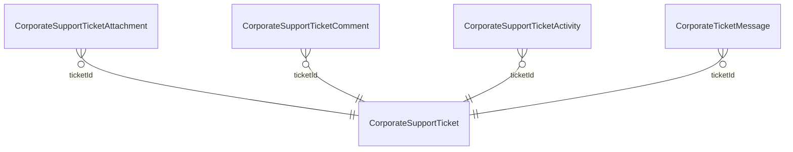

# Corporate Support Data Dictionary

**Business responsibility:** Tenant support tickets, attachments, comments, activities and shared ticket messages.
**Primary API ownership evidence:** `apps/api/src/domains/corporate/safety/`. Ownership is logical; other domains may read or update shared models.
**Related API references:** [Corporate support tickets](../../reference/endpoints/corporate-support-ticket-controller.md), [Operations support tickets](../../reference/endpoints/ops-support-ticket-controller.md). These are context links, not a claim that every route reads or writes every model in this group.

**Source:** `apps/api/prisma/schema.prisma` (5 models). Model sections cite the declaration line.

## Relationship overview

This ERD includes only direct Prisma foreign-key relations whose two models belong to this page. Cross-context relations remain listed in each model table; a SQL scalar without a Prisma relation is not drawn as a foreign key.

## CorporateSupportTicket {#corporate-support-ticket}

**Business purpose:** Support case
**Storage:** Prisma model `CorporateSupportTicket` maps to PostgreSQL table `corporate_support_tickets`. **Schema declaration:** `apps/api/prisma/schema.prisma:1610`.

| Field | Prisma type / native type | Nullability | Default / behavior | Key and column mapping | Schema description |
|---|---|---|---|---|---|
| `id` | String @db.Uuid | Required | `@default(uuid())` | `@id` | — |
| `ticketNumber` | String @db.VarChar(32) | Required | `—` | `@unique`; column `ticket_number` | — |
| `tenantId` | String @db.Uuid | Required | `—` | column `tenant_id` | — |
| `employeeId` | String @db.Uuid | Required | `—` | column `employee_id` | — |
| `routeId` | String? @db.Uuid | Nullable | `—` | column `route_id` | — |
| `stopId` | String? @db.Uuid | Nullable | `—` | column `stop_id` | — |
| `category` | [CorporateTicketCategory](../enums.md#corporate-ticket-category) | Required | `@default(OTHER)` | — | — |
| `priority` | [CorporateTicketPriority](../enums.md#corporate-ticket-priority) | Required | `@default(MEDIUM)` | — | — |
| `status` | [CorporateTicketStatus](../enums.md#corporate-ticket-status) | Required | `@default(OPEN)` | — | — |
| `subject` | String @db.VarChar(255) | Required | `—` | — | — |
| `description` | String @db.Text | Required | `—` | — | — |
| `adminNotes` | String? @db.Text | Nullable | `—` | column `admin_notes` | — |
| `resolutionNotes` | String? @db.Text | Nullable | `—` | column `resolution_notes` | — |
| `assignedToUserId` | String? @db.Uuid | Nullable | `—` | column `assigned_to_user_id` | — |
| `slaMinutes` | Int | Required | `@default(240)` | column `sla_minutes` | — |
| `resolvedAt` | DateTime? | Nullable | `—` | column `resolved_at` | — |
| `resolvedByUserId` | String? @db.Uuid | Nullable | `—` | column `resolved_by_user_id` | — |
| `raisedByUserId` | String? @db.Uuid | Nullable | `—` | column `raised_by_user_id` | — |
| `assignedTeam` | String? @db.VarChar(64) | Nullable | `—` | column `assigned_team` | — |
| `idempotencyKey` | String? @db.VarChar(64) | Nullable | `—` | `@unique`; column `idempotency_key` | — |
| `createdAt` | DateTime | Required | `@default(now())` | column `created_at` | — |
| `updatedAt` | DateTime | Required | `@updatedAt` | column `updated_at` | — |
| `tenant` | [CorporateTenant](./corporate-tenancy-and-organization.md#corporate-tenant) | Required relation | `—` | — | — |
| `employee` | [CorporateEmployee](./corporate-tenancy-and-organization.md#corporate-employee) | Required relation | `—` | — | — |
| `attachments` | [CorporateSupportTicketAttachment](./corporate-support.md#corporate-support-ticket-attachment)[] | Relation collection | `—` | — | — |
| `comments` | [CorporateSupportTicketComment](./corporate-support.md#corporate-support-ticket-comment)[] | Relation collection | `—` | — | — |
| `activities` | [CorporateSupportTicketActivity](./corporate-support.md#corporate-support-ticket-activity)[] | Relation collection | `—` | — | — |
| `messages` | [CorporateTicketMessage](./corporate-support.md#corporate-ticket-message)[] | Relation collection | `—` | — | — |

### Relations

| Relation field | Related model | Foreign-key mapping | On delete | Relation name |
|---|---|---|---|---|
| `tenant` | [CorporateTenant](./corporate-tenancy-and-organization.md#corporate-tenant) | `tenantId` → `id` | Cascade | `CorporateSupportTicketToCorporateTenant` |
| `employee` | [CorporateEmployee](./corporate-tenancy-and-organization.md#corporate-employee) | `employeeId` → `id` | Cascade | `CorporateEmployeeToCorporateSupportTicket` |
| `attachments` | [CorporateSupportTicketAttachment](./corporate-support.md#corporate-support-ticket-attachment)[] | Inverse relation; the foreign-key scalar is declared on the related model | Not specified; Prisma/provider default applies | `CorporateSupportTicketToCorporateSupportTicketAttachment` |
| `comments` | [CorporateSupportTicketComment](./corporate-support.md#corporate-support-ticket-comment)[] | Inverse relation; the foreign-key scalar is declared on the related model | Not specified; Prisma/provider default applies | `CorporateSupportTicketToCorporateSupportTicketComment` |
| `activities` | [CorporateSupportTicketActivity](./corporate-support.md#corporate-support-ticket-activity)[] | Inverse relation; the foreign-key scalar is declared on the related model | Not specified; Prisma/provider default applies | `CorporateSupportTicketToCorporateSupportTicketActivity` |
| `messages` | [CorporateTicketMessage](./corporate-support.md#corporate-ticket-message)[] | Inverse relation; the foreign-key scalar is declared on the related model | Not specified; Prisma/provider default applies | `CorporateSupportTicketToCorporateTicketMessage` |

### Model-level keys and indexes

| Declaration | Meaning |
|---|---|
| `@@index([tenantId, status])` | Database index |
| `@@index([employeeId])` | Database index |
| `@@index([status, priority])` | Database index |
| `@@index([assignedTeam, status])` | Database index |

## CorporateSupportTicketAttachment {#corporate-support-ticket-attachment}

**Business purpose:** Ticket attachment
**Storage:** Prisma model `CorporateSupportTicketAttachment` maps to PostgreSQL table `corporate_support_ticket_attachments`. **Schema declaration:** `apps/api/prisma/schema.prisma:1648`.

| Field | Prisma type / native type | Nullability | Default / behavior | Key and column mapping | Schema description |
|---|---|---|---|---|---|
| `id` | String @db.Uuid | Required | `@default(uuid())` | `@id` | — |
| `ticketId` | String @db.Uuid | Required | `—` | column `ticket_id` | — |
| `fileName` | String @db.VarChar(255) | Required | `—` | column `file_name` | — |
| `fileType` | String @db.VarChar(100) | Required | `—` | column `file_type` | — |
| `fileSize` | Int | Required | `—` | column `file_size` | — |
| `storageReference` | String @db.Text | Required | `—` | column `storage_reference` | — |
| `uploadedBy` | String @db.Uuid | Required | `—` | column `uploaded_by` | — |
| `createdAt` | DateTime | Required | `@default(now())` | column `created_at` | — |
| `ticket` | [CorporateSupportTicket](./corporate-support.md#corporate-support-ticket) | Required relation | `—` | — | — |

### Relations

| Relation field | Related model | Foreign-key mapping | On delete | Relation name |
|---|---|---|---|---|
| `ticket` | [CorporateSupportTicket](./corporate-support.md#corporate-support-ticket) | `ticketId` → `id` | Cascade | `CorporateSupportTicketToCorporateSupportTicketAttachment` |

### Model-level keys and indexes

| Declaration | Meaning |
|---|---|
| `@@index([ticketId, createdAt])` | Database index |

## CorporateSupportTicketComment {#corporate-support-ticket-comment}

**Business purpose:** Public/internal comment
**Storage:** Prisma model `CorporateSupportTicketComment` maps to PostgreSQL table `corporate_support_ticket_comments`. **Schema declaration:** `apps/api/prisma/schema.prisma:1663`.

| Field | Prisma type / native type | Nullability | Default / behavior | Key and column mapping | Schema description |
|---|---|---|---|---|---|
| `id` | String @db.Uuid | Required | `@default(uuid())` | `@id` | — |
| `ticketId` | String @db.Uuid | Required | `—` | column `ticket_id` | — |
| `userId` | String @db.Uuid | Required | `—` | column `user_id` | — |
| `message` | String @db.VarChar(1000) | Required | `—` | — | — |
| `visibility` | [CorporateTicketCommentVisibility](../enums.md#corporate-ticket-comment-visibility) | Required | `@default(PUBLIC)` | — | — |
| `createdAt` | DateTime | Required | `@default(now())` | column `created_at` | — |
| `ticket` | [CorporateSupportTicket](./corporate-support.md#corporate-support-ticket) | Required relation | `—` | — | — |

### Relations

| Relation field | Related model | Foreign-key mapping | On delete | Relation name |
|---|---|---|---|---|
| `ticket` | [CorporateSupportTicket](./corporate-support.md#corporate-support-ticket) | `ticketId` → `id` | Cascade | `CorporateSupportTicketToCorporateSupportTicketComment` |

### Model-level keys and indexes

| Declaration | Meaning |
|---|---|
| `@@index([ticketId, createdAt])` | Database index |

## CorporateSupportTicketActivity {#corporate-support-ticket-activity}

**Business purpose:** Ticket audit activity
**Storage:** Prisma model `CorporateSupportTicketActivity` maps to PostgreSQL table `corporate_support_ticket_activities`. **Schema declaration:** `apps/api/prisma/schema.prisma:1676`.

| Field | Prisma type / native type | Nullability | Default / behavior | Key and column mapping | Schema description |
|---|---|---|---|---|---|
| `id` | String @db.Uuid | Required | `@default(uuid())` | `@id` | — |
| `ticketId` | String @db.Uuid | Required | `—` | column `ticket_id` | — |
| `performedBy` | String @db.Uuid | Required | `—` | column `performed_by` | — |
| `action` | String @db.VarChar(64) | Required | `—` | — | — |
| `previousValue` | String? @db.VarChar(255) | Nullable | `—` | column `previous_value` | — |
| `newValue` | String? @db.VarChar(255) | Nullable | `—` | column `new_value` | — |
| `description` | String @db.VarChar(1000) | Required | `—` | — | — |
| `visibility` | [CorporateTicketCommentVisibility](../enums.md#corporate-ticket-comment-visibility) | Required | `@default(PUBLIC)` | — | — |
| `createdAt` | DateTime | Required | `@default(now())` | column `created_at` | — |
| `ticket` | [CorporateSupportTicket](./corporate-support.md#corporate-support-ticket) | Required relation | `—` | — | — |

### Relations

| Relation field | Related model | Foreign-key mapping | On delete | Relation name |
|---|---|---|---|---|
| `ticket` | [CorporateSupportTicket](./corporate-support.md#corporate-support-ticket) | `ticketId` → `id` | Cascade | `CorporateSupportTicketToCorporateSupportTicketActivity` |

### Model-level keys and indexes

| Declaration | Meaning |
|---|---|
| `@@index([ticketId, createdAt])` | Database index |

## CorporateTicketMessage {#corporate-ticket-message}

**Business purpose:** Shared support message
**Storage:** Prisma model `CorporateTicketMessage` maps to PostgreSQL table `corporate_ticket_messages`. **Schema declaration:** `apps/api/prisma/schema.prisma:1692`.

| Field | Prisma type / native type | Nullability | Default / behavior | Key and column mapping | Schema description |
|---|---|---|---|---|---|
| `id` | String @db.Uuid | Required | `@default(uuid())` | `@id` | — |
| `ticketId` | String @db.Uuid | Required | `—` | column `ticket_id` | — |
| `senderId` | String @db.Uuid | Required | `—` | column `sender_id` | — |
| `senderRole` | String @db.VarChar(32) | Required | `—` | column `sender_role` | — |
| `senderName` | String? @db.VarChar(128) | Nullable | `—` | column `sender_name` | — |
| `message` | String @db.Text | Required | `—` | — | — |
| `isInternal` | Boolean | Required | `@default(false)` | column `is_internal` | — |
| `createdAt` | DateTime | Required | `@default(now())` | column `created_at` | — |
| `ticket` | [CorporateSupportTicket](./corporate-support.md#corporate-support-ticket) | Required relation | `—` | — | — |
| `sender` | [User](./identity-and-supply.md#user) | Required relation | `—` | — | — |

### Relations

| Relation field | Related model | Foreign-key mapping | On delete | Relation name |
|---|---|---|---|---|
| `ticket` | [CorporateSupportTicket](./corporate-support.md#corporate-support-ticket) | `ticketId` → `id` | Cascade | `CorporateSupportTicketToCorporateTicketMessage` |
| `sender` | [User](./identity-and-supply.md#user) | `senderId` → `id` | Cascade | `CorporateTicketMessageToUser` |

### Model-level keys and indexes

| Declaration | Meaning |
|---|---|
| `@@index([ticketId, createdAt])` | Database index |
| `@@index([senderId])` | Database index |

## Reading the field tables

- `Required` means Prisma marks the scalar field non-null; `Nullable` means the Prisma type permits null.
- `[]` denotes a Prisma list field. Object/relation fields are not physical columns unless a scalar FK field is also listed.
- `@db.*`, `@map` and `@@map` preserve native PostgreSQL types and storage names declared in the schema.
- Defaults and `@updatedAt` are schema declarations, not guarantees that existing production databases have no drift.
- A missing description means the Prisma schema has no field-level documentation comment; field meaning should not be guessed from the name alone.
