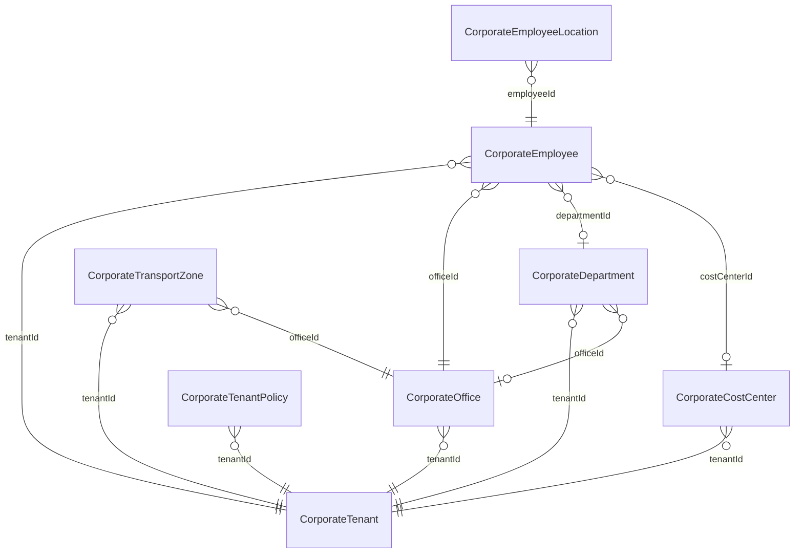

# Corporate Tenancy and Organization Data Dictionary

**Business responsibility:** Corporate tenant identity, offices, employees, departments, service zones, cost centers, tenant policies and employee locations.
**Primary API ownership evidence:** `apps/api/src/domains/corporate/tenants/`. Ownership is logical; other domains may read or update shared models.
**Related API references:** [Corporate tenants](../../reference/endpoints/corporate-tenant-controller.md). These are context links, not a claim that every route reads or writes every model in this group.

**Source:** `apps/api/prisma/schema.prisma` (8 models). Model sections cite the declaration line.

## Relationship overview

This ERD includes only direct Prisma foreign-key relations whose two models belong to this page. Cross-context relations remain listed in each model table; a SQL scalar without a Prisma relation is not drawn as a foreign key.

## CorporateTenant {#corporate-tenant}

**Business purpose:** Corporate organization
**Storage:** Prisma model `CorporateTenant` maps to PostgreSQL table `corporate_tenants`. **Schema declaration:** `apps/api/prisma/schema.prisma:1158`.

| Field | Prisma type / native type | Nullability | Default / behavior | Key and column mapping | Schema description |
|---|---|---|---|---|---|
| `id` | String @db.Uuid | Required | `@default(uuid())` | `@id` | — |
| `code` | String @db.VarChar(32) | Required | `—` | `@unique` | — |
| `name` | String | Required | `—` | — | — |
| `legalEntityName` | String | Required | `—` | column `legal_entity_name` | — |
| `gstin` | String? @db.VarChar(15) | Nullable | `—` | — | — |
| `cin` | String? @db.VarChar(21) | Nullable | `—` | — | — |
| `logoUrl` | String? | Nullable | `—` | column `logo_url` | — |
| `industry` | String? | Nullable | `—` | — | — |
| `website` | String? | Nullable | `—` | — | — |
| `registeredAddress` | String? | Nullable | `—` | column `registered_address` | — |
| `city` | String? | Nullable | `—` | — | — |
| `state` | String? | Nullable | `—` | — | — |
| `pinCode` | String? @db.VarChar(12) | Nullable | `—` | column `pin_code` | — |
| `country` | String? | Nullable | `—` | — | — |
| `primaryContactName` | String? | Nullable | `—` | column `primary_contact_name` | — |
| `primaryContactEmail` | String? | Nullable | `—` | column `primary_contact_email` | — |
| `primaryContactPhone` | String? @db.VarChar(32) | Nullable | `—` | column `primary_contact_phone` | — |
| `registeredBusinessAddress` | String? | Nullable | `—` | column `registered_business_address` | — |
| `billingAddress` | String? | Nullable | `—` | column `billing_address` | — |
| `billingSameAsRegistered` | Boolean | Required | `@default(true)` | column `billing_same_as_registered` | — |
| `status` | [CorporateTenantStatus](../enums.md#corporate-tenant-status) | Required | `@default(ACTIVE)` | — | — |
| `createdAt` | DateTime | Required | `@default(now())` | column `created_at` | — |
| `updatedAt` | DateTime | Required | `@updatedAt` | column `updated_at` | — |
| `offices` | [CorporateOffice](./corporate-tenancy-and-organization.md#corporate-office)[] | Relation collection | `—` | — | — |
| `employees` | [CorporateEmployee](./corporate-tenancy-and-organization.md#corporate-employee)[] | Relation collection | `—` | — | — |
| `rosters` | [CorporateRoster](./corporate-rosters-and-scheduling.md#corporate-roster)[] | Relation collection | `—` | — | — |
| `transportRequests` | [CorporateTransportRequest](./corporate-rosters-and-scheduling.md#corporate-transport-request)[] | Relation collection | `—` | — | — |
| `routes` | [CorporateRoute](./corporate-routing-execution-and-safety.md#corporate-route)[] | Relation collection | `—` | — | — |
| `invoices` | [CorporateInvoice](./corporate-billing-and-payouts.md#corporate-invoice)[] | Relation collection | `—` | — | — |
| `users` | [User](./identity-and-supply.md#user)[] | Relation collection | `—` | — | — |
| `driverOffers` | [CorporateDriverOffer](./corporate-routing-execution-and-safety.md#corporate-driver-offer)[] | Relation collection | `—` | — | — |
| `supportTickets` | [CorporateSupportTicket](./corporate-support.md#corporate-support-ticket)[] | Relation collection | `—` | — | — |
| `tripFeedbacks` | [CorporateTripFeedback](./corporate-routing-execution-and-safety.md#corporate-trip-feedback)[] | Relation collection | `—` | — | — |
| `sosAlerts` | [CorporateSosAlert](./corporate-routing-execution-and-safety.md#corporate-sos-alert)[] | Relation collection | `—` | — | — |
| `rateCards` | [CorporateRateCard](./corporate-billing-and-payouts.md#corporate-rate-card)[] | Relation collection | `—` | — | — |
| `departments` | [CorporateDepartment](./corporate-tenancy-and-organization.md#corporate-department)[] | Relation collection | `—` | — | — |
| `costCenters` | [CorporateCostCenter](./corporate-tenancy-and-organization.md#corporate-cost-center)[] | Relation collection | `—` | — | — |
| `transportZones` | [CorporateTransportZone](./corporate-tenancy-and-organization.md#corporate-transport-zone)[] | Relation collection | `—` | — | — |
| `policies` | [CorporateTenantPolicy](./corporate-tenancy-and-organization.md#corporate-tenant-policy)[] | Relation collection | `—` | — | — |
| `shiftTemplates` | [CorporateShiftTemplate](./corporate-rosters-and-scheduling.md#corporate-shift-template)[] | Relation collection | `—` | — | — |
| `holidays` | [CorporateHoliday](./corporate-rosters-and-scheduling.md#corporate-holiday)[] | Relation collection | `—` | — | — |
| `invoiceDisputes` | [CorporateInvoiceDispute](./corporate-billing-and-payouts.md#corporate-invoice-dispute)[] | Relation collection | `—` | — | — |
| `creditNotes` | [CorporateCreditNote](./corporate-billing-and-payouts.md#corporate-credit-note)[] | Relation collection | `—` | — | — |

### Relations

| Relation field | Related model | Foreign-key mapping | On delete | Relation name |
|---|---|---|---|---|
| `offices` | [CorporateOffice](./corporate-tenancy-and-organization.md#corporate-office)[] | Inverse relation; the foreign-key scalar is declared on the related model | Not specified; Prisma/provider default applies | `CorporateOfficeToCorporateTenant` |
| `employees` | [CorporateEmployee](./corporate-tenancy-and-organization.md#corporate-employee)[] | Inverse relation; the foreign-key scalar is declared on the related model | Not specified; Prisma/provider default applies | `CorporateEmployeeToCorporateTenant` |
| `rosters` | [CorporateRoster](./corporate-rosters-and-scheduling.md#corporate-roster)[] | Inverse relation; the foreign-key scalar is declared on the related model | Not specified; Prisma/provider default applies | `CorporateRosterToCorporateTenant` |
| `transportRequests` | [CorporateTransportRequest](./corporate-rosters-and-scheduling.md#corporate-transport-request)[] | Inverse relation; the foreign-key scalar is declared on the related model | Not specified; Prisma/provider default applies | `CorporateTenantToCorporateTransportRequest` |
| `routes` | [CorporateRoute](./corporate-routing-execution-and-safety.md#corporate-route)[] | Inverse relation; the foreign-key scalar is declared on the related model | Not specified; Prisma/provider default applies | `CorporateRouteToCorporateTenant` |
| `invoices` | [CorporateInvoice](./corporate-billing-and-payouts.md#corporate-invoice)[] | Inverse relation; the foreign-key scalar is declared on the related model | Not specified; Prisma/provider default applies | `CorporateInvoiceToCorporateTenant` |
| `users` | [User](./identity-and-supply.md#user)[] | Inverse relation; the foreign-key scalar is declared on the related model | Not specified; Prisma/provider default applies | `CorporateTenantToUser` |
| `driverOffers` | [CorporateDriverOffer](./corporate-routing-execution-and-safety.md#corporate-driver-offer)[] | Inverse relation; the foreign-key scalar is declared on the related model | Not specified; Prisma/provider default applies | `CorporateDriverOfferToCorporateTenant` |
| `supportTickets` | [CorporateSupportTicket](./corporate-support.md#corporate-support-ticket)[] | Inverse relation; the foreign-key scalar is declared on the related model | Not specified; Prisma/provider default applies | `CorporateSupportTicketToCorporateTenant` |
| `tripFeedbacks` | [CorporateTripFeedback](./corporate-routing-execution-and-safety.md#corporate-trip-feedback)[] | Inverse relation; the foreign-key scalar is declared on the related model | Not specified; Prisma/provider default applies | `CorporateTenantToCorporateTripFeedback` |
| `sosAlerts` | [CorporateSosAlert](./corporate-routing-execution-and-safety.md#corporate-sos-alert)[] | Inverse relation; the foreign-key scalar is declared on the related model | Not specified; Prisma/provider default applies | `CorporateSosAlertToCorporateTenant` |
| `rateCards` | [CorporateRateCard](./corporate-billing-and-payouts.md#corporate-rate-card)[] | Inverse relation; the foreign-key scalar is declared on the related model | Not specified; Prisma/provider default applies | `CorporateRateCardToCorporateTenant` |
| `departments` | [CorporateDepartment](./corporate-tenancy-and-organization.md#corporate-department)[] | Inverse relation; the foreign-key scalar is declared on the related model | Not specified; Prisma/provider default applies | `CorporateDepartmentToCorporateTenant` |
| `costCenters` | [CorporateCostCenter](./corporate-tenancy-and-organization.md#corporate-cost-center)[] | Inverse relation; the foreign-key scalar is declared on the related model | Not specified; Prisma/provider default applies | `CorporateCostCenterToCorporateTenant` |
| `transportZones` | [CorporateTransportZone](./corporate-tenancy-and-organization.md#corporate-transport-zone)[] | Inverse relation; the foreign-key scalar is declared on the related model | Not specified; Prisma/provider default applies | `CorporateTenantToCorporateTransportZone` |
| `policies` | [CorporateTenantPolicy](./corporate-tenancy-and-organization.md#corporate-tenant-policy)[] | Inverse relation; the foreign-key scalar is declared on the related model | Not specified; Prisma/provider default applies | `CorporateTenantToCorporateTenantPolicy` |
| `shiftTemplates` | [CorporateShiftTemplate](./corporate-rosters-and-scheduling.md#corporate-shift-template)[] | Inverse relation; the foreign-key scalar is declared on the related model | Not specified; Prisma/provider default applies | `CorporateShiftTemplateToCorporateTenant` |
| `holidays` | [CorporateHoliday](./corporate-rosters-and-scheduling.md#corporate-holiday)[] | Inverse relation; the foreign-key scalar is declared on the related model | Not specified; Prisma/provider default applies | `CorporateHolidayToCorporateTenant` |
| `invoiceDisputes` | [CorporateInvoiceDispute](./corporate-billing-and-payouts.md#corporate-invoice-dispute)[] | Inverse relation; the foreign-key scalar is declared on the related model | Not specified; Prisma/provider default applies | `CorporateInvoiceDisputeToCorporateTenant` |
| `creditNotes` | [CorporateCreditNote](./corporate-billing-and-payouts.md#corporate-credit-note)[] | Inverse relation; the foreign-key scalar is declared on the related model | Not specified; Prisma/provider default applies | `CorporateCreditNoteToCorporateTenant` |

### Model-level keys and indexes

| Declaration | Meaning |
|---|---|
| — | No model-level `@@id`, `@@unique`, `@@index` or `@@fulltext` declaration. Field-level `@id`/`@unique` appears in the field table. |

## CorporateOffice {#corporate-office}

**Business purpose:** Tenant office
**Storage:** Prisma model `CorporateOffice` maps to PostgreSQL table `corporate_offices`. **Schema declaration:** `apps/api/prisma/schema.prisma:1209`.

| Field | Prisma type / native type | Nullability | Default / behavior | Key and column mapping | Schema description |
|---|---|---|---|---|---|
| `id` | String @db.Uuid | Required | `@default(uuid())` | `@id` | — |
| `tenantId` | String @db.Uuid | Required | `—` | column `tenant_id` | — |
| `code` | String @db.VarChar(32) | Required | `—` | — | — |
| `name` | String | Required | `—` | — | — |
| `addressText` | String | Required | `—` | column `address_text` | — |
| `city` | String? | Nullable | `—` | — | — |
| `state` | String? | Nullable | `—` | — | — |
| `pinCode` | String? @db.VarChar(12) | Nullable | `—` | column `pin_code` | — |
| `country` | String? | Nullable | `—` | — | — |
| `contactName` | String? | Nullable | `—` | column `contact_name` | — |
| `contactEmail` | String? | Nullable | `—` | column `contact_email` | — |
| `contactPhone` | String? @db.VarChar(32) | Nullable | `—` | column `contact_phone` | — |
| `isActive` | Boolean | Required | `@default(true)` | column `is_active` | — |
| `latitude` | Decimal @db.Decimal(10, 7) | Required | `—` | — | — |
| `longitude` | Decimal @db.Decimal(10, 7) | Required | `—` | — | — |
| `h3Res8Index` | String @db.VarChar(15) | Required | `—` | column `h3_res8_index` | — |
| `createdAt` | DateTime | Required | `@default(now())` | column `created_at` | — |
| `updatedAt` | DateTime | Required | `@updatedAt` | column `updated_at` | — |
| `tenant` | [CorporateTenant](./corporate-tenancy-and-organization.md#corporate-tenant) | Required relation | `—` | — | — |
| `employees` | [CorporateEmployee](./corporate-tenancy-and-organization.md#corporate-employee)[] | Relation collection | `—` | — | — |
| `rosters` | [CorporateRoster](./corporate-rosters-and-scheduling.md#corporate-roster)[] | Relation collection | `—` | — | — |
| `routes` | [CorporateRoute](./corporate-routing-execution-and-safety.md#corporate-route)[] | Relation collection | `—` | — | — |
| `shiftTemplates` | [CorporateShiftTemplate](./corporate-rosters-and-scheduling.md#corporate-shift-template)[] | Relation collection | `—` | — | — |
| `holidays` | [CorporateHoliday](./corporate-rosters-and-scheduling.md#corporate-holiday)[] | Relation collection | `—` | — | — |
| `departments` | [CorporateDepartment](./corporate-tenancy-and-organization.md#corporate-department)[] | Relation collection | `—` | — | — |
| `transportZones` | [CorporateTransportZone](./corporate-tenancy-and-organization.md#corporate-transport-zone)[] | Relation collection | `—` | — | — |

### Relations

| Relation field | Related model | Foreign-key mapping | On delete | Relation name |
|---|---|---|---|---|
| `tenant` | [CorporateTenant](./corporate-tenancy-and-organization.md#corporate-tenant) | `tenantId` → `id` | Cascade | `CorporateOfficeToCorporateTenant` |
| `employees` | [CorporateEmployee](./corporate-tenancy-and-organization.md#corporate-employee)[] | Inverse relation; the foreign-key scalar is declared on the related model | Not specified; Prisma/provider default applies | `CorporateEmployeeToCorporateOffice` |
| `rosters` | [CorporateRoster](./corporate-rosters-and-scheduling.md#corporate-roster)[] | Inverse relation; the foreign-key scalar is declared on the related model | Not specified; Prisma/provider default applies | `CorporateOfficeToCorporateRoster` |
| `routes` | [CorporateRoute](./corporate-routing-execution-and-safety.md#corporate-route)[] | Inverse relation; the foreign-key scalar is declared on the related model | Not specified; Prisma/provider default applies | `CorporateOfficeToCorporateRoute` |
| `shiftTemplates` | [CorporateShiftTemplate](./corporate-rosters-and-scheduling.md#corporate-shift-template)[] | Inverse relation; the foreign-key scalar is declared on the related model | Not specified; Prisma/provider default applies | `CorporateOfficeToCorporateShiftTemplate` |
| `holidays` | [CorporateHoliday](./corporate-rosters-and-scheduling.md#corporate-holiday)[] | Inverse relation; the foreign-key scalar is declared on the related model | Not specified; Prisma/provider default applies | `CorporateHolidayToCorporateOffice` |
| `departments` | [CorporateDepartment](./corporate-tenancy-and-organization.md#corporate-department)[] | Inverse relation; the foreign-key scalar is declared on the related model | Not specified; Prisma/provider default applies | `CorporateDepartmentToCorporateOffice` |
| `transportZones` | [CorporateTransportZone](./corporate-tenancy-and-organization.md#corporate-transport-zone)[] | Inverse relation; the foreign-key scalar is declared on the related model | Not specified; Prisma/provider default applies | `CorporateOfficeToCorporateTransportZone` |

### Model-level keys and indexes

| Declaration | Meaning |
|---|---|
| `@@unique([tenantId, code])` | Composite unique constraint |
| `@@index([tenantId])` | Database index |
| `@@index([h3Res8Index])` | Database index |

## CorporateEmployee {#corporate-employee}

**Business purpose:** Tenant employee
**Storage:** Prisma model `CorporateEmployee` maps to PostgreSQL table `corporate_employees`. **Schema declaration:** `apps/api/prisma/schema.prisma:1245`.

| Field | Prisma type / native type | Nullability | Default / behavior | Key and column mapping | Schema description |
|---|---|---|---|---|---|
| `id` | String @db.Uuid | Required | `@default(uuid())` | `@id` | — |
| `tenantId` | String @db.Uuid | Required | `—` | column `tenant_id` | — |
| `officeId` | String @db.Uuid | Required | `—` | column `office_id` | — |
| `employeeCode` | String @db.VarChar(64) | Required | `—` | column `employee_code` | — |
| `fullName` | String | Required | `—` | column `full_name` | — |
| `email` | String | Required | `—` | — | — |
| `phoneNumber` | String @db.VarChar(20) | Required | `—` | column `phone_number` | — |
| `gender` | [CorporateGender](../enums.md#corporate-gender) | Required | `@default(MALE)` | — | — |
| `department` | String? @db.VarChar(64) | Nullable | `—` | — | — |
| `costCenter` | String? @db.VarChar(64) | Nullable | `—` | column `cost_center` | — |
| `departmentId` | String? @db.Uuid | Nullable | `—` | column `department_id` | WS-F: optional FKs; the string fields above stay what the roster upload writes. |
| `costCenterId` | String? @db.Uuid | Nullable | `—` | column `cost_center_id` | — |
| `isActive` | Boolean | Required | `@default(true)` | column `is_active` | — |
| `userId` | String? @db.Uuid | Nullable | `—` | `@unique`; column `user_id` | Login account of this employee (EMPLOYEE role). Null until the employee is onboarded to the rider app. |
| `createdAt` | DateTime | Required | `@default(now())` | column `created_at` | — |
| `updatedAt` | DateTime | Required | `@updatedAt` | column `updated_at` | — |
| `user` | [User](./identity-and-supply.md#user)? | Optional relation | `—` | — | — |
| `tenant` | [CorporateTenant](./corporate-tenancy-and-organization.md#corporate-tenant) | Required relation | `—` | — | — |
| `office` | [CorporateOffice](./corporate-tenancy-and-organization.md#corporate-office) | Required relation | `—` | — | — |
| `locations` | [CorporateEmployeeLocation](./corporate-tenancy-and-organization.md#corporate-employee-location)[] | Relation collection | `—` | — | — |
| `transportRequests` | [CorporateTransportRequest](./corporate-rosters-and-scheduling.md#corporate-transport-request)[] | Relation collection | `—` | — | — |
| `routeStops` | [CorporateRouteStop](./corporate-routing-execution-and-safety.md#corporate-route-stop)[] | Relation collection | `—` | — | — |
| `supportTickets` | [CorporateSupportTicket](./corporate-support.md#corporate-support-ticket)[] | Relation collection | `—` | — | — |
| `tripFeedbacks` | [CorporateTripFeedback](./corporate-routing-execution-and-safety.md#corporate-trip-feedback)[] | Relation collection | `—` | — | — |
| `departmentRef` | [CorporateDepartment](./corporate-tenancy-and-organization.md#corporate-department)? | Optional relation | `—` | — | — |
| `costCenterRef` | [CorporateCostCenter](./corporate-tenancy-and-organization.md#corporate-cost-center)? | Optional relation | `—` | — | — |
| `rosterEntries` | [CorporateRosterEntry](./corporate-rosters-and-scheduling.md#corporate-roster-entry)[] | Relation collection | `—` | — | — |

### Relations

| Relation field | Related model | Foreign-key mapping | On delete | Relation name |
|---|---|---|---|---|
| `user` | [User](./identity-and-supply.md#user)? | `userId` → `id` | SetNull | `CorporateEmployeeToUser` |
| `tenant` | [CorporateTenant](./corporate-tenancy-and-organization.md#corporate-tenant) | `tenantId` → `id` | Cascade | `CorporateEmployeeToCorporateTenant` |
| `office` | [CorporateOffice](./corporate-tenancy-and-organization.md#corporate-office) | `officeId` → `id` | Not specified; Prisma/provider default applies | `CorporateEmployeeToCorporateOffice` |
| `locations` | [CorporateEmployeeLocation](./corporate-tenancy-and-organization.md#corporate-employee-location)[] | Inverse relation; the foreign-key scalar is declared on the related model | Not specified; Prisma/provider default applies | `CorporateEmployeeToCorporateEmployeeLocation` |
| `transportRequests` | [CorporateTransportRequest](./corporate-rosters-and-scheduling.md#corporate-transport-request)[] | Inverse relation; the foreign-key scalar is declared on the related model | Not specified; Prisma/provider default applies | `CorporateEmployeeToCorporateTransportRequest` |
| `routeStops` | [CorporateRouteStop](./corporate-routing-execution-and-safety.md#corporate-route-stop)[] | Inverse relation; the foreign-key scalar is declared on the related model | Not specified; Prisma/provider default applies | `CorporateEmployeeToCorporateRouteStop` |
| `supportTickets` | [CorporateSupportTicket](./corporate-support.md#corporate-support-ticket)[] | Inverse relation; the foreign-key scalar is declared on the related model | Not specified; Prisma/provider default applies | `CorporateEmployeeToCorporateSupportTicket` |
| `tripFeedbacks` | [CorporateTripFeedback](./corporate-routing-execution-and-safety.md#corporate-trip-feedback)[] | Inverse relation; the foreign-key scalar is declared on the related model | Not specified; Prisma/provider default applies | `CorporateEmployeeToCorporateTripFeedback` |
| `departmentRef` | [CorporateDepartment](./corporate-tenancy-and-organization.md#corporate-department)? | `departmentId` → `id` | SetNull | `CorporateDepartmentToCorporateEmployee` |
| `costCenterRef` | [CorporateCostCenter](./corporate-tenancy-and-organization.md#corporate-cost-center)? | `costCenterId` → `id` | SetNull | `CorporateCostCenterToCorporateEmployee` |
| `rosterEntries` | [CorporateRosterEntry](./corporate-rosters-and-scheduling.md#corporate-roster-entry)[] | Inverse relation; the foreign-key scalar is declared on the related model | Not specified; Prisma/provider default applies | `CorporateEmployeeToCorporateRosterEntry` |

### Model-level keys and indexes

| Declaration | Meaning |
|---|---|
| `@@unique([tenantId, employeeCode])` | Composite unique constraint |
| `@@index([tenantId])` | Database index |
| `@@index([tenantId, phoneNumber])` | Database index |
| `@@index([tenantId, isActive])` | Database index |
| `@@index([officeId])` | Database index |

## CorporateEmployeeLocation {#corporate-employee-location}

**Business purpose:** Employee pickup location
**Storage:** Prisma model `CorporateEmployeeLocation` maps to PostgreSQL table `corporate_employee_locations`. **Schema declaration:** `apps/api/prisma/schema.prisma:1286`.

| Field | Prisma type / native type | Nullability | Default / behavior | Key and column mapping | Schema description |
|---|---|---|---|---|---|
| `id` | String @db.Uuid | Required | `@default(uuid())` | `@id` | — |
| `employeeId` | String @db.Uuid | Required | `—` | column `employee_id` | — |
| `addressText` | String | Required | `—` | column `address_text` | — |
| `landmark` | String? | Nullable | `—` | — | — |
| `latitude` | Decimal @db.Decimal(10, 7) | Required | `—` | — | — |
| `longitude` | Decimal @db.Decimal(10, 7) | Required | `—` | — | — |
| `h3Res8Index` | String @db.VarChar(15) | Required | `—` | column `h3_res8_index` | — |
| `isDefault` | Boolean | Required | `@default(true)` | column `is_default` | — |
| `createdAt` | DateTime | Required | `@default(now())` | column `created_at` | — |
| `updatedAt` | DateTime | Required | `@updatedAt` | column `updated_at` | — |
| `employee` | [CorporateEmployee](./corporate-tenancy-and-organization.md#corporate-employee) | Required relation | `—` | — | — |

### Relations

| Relation field | Related model | Foreign-key mapping | On delete | Relation name |
|---|---|---|---|---|
| `employee` | [CorporateEmployee](./corporate-tenancy-and-organization.md#corporate-employee) | `employeeId` → `id` | Cascade | `CorporateEmployeeToCorporateEmployeeLocation` |

### Model-level keys and indexes

| Declaration | Meaning |
|---|---|
| `@@index([employeeId])` | Database index |
| `@@index([h3Res8Index])` | Database index |

## CorporateDepartment {#corporate-department}

**Business purpose:** Organizational department
**Storage:** Prisma model `CorporateDepartment` maps to PostgreSQL table `corporate_departments`. **Schema declaration:** `apps/api/prisma/schema.prisma:2078`.

| Field | Prisma type / native type | Nullability | Default / behavior | Key and column mapping | Schema description |
|---|---|---|---|---|---|
| `id` | String @db.Uuid | Required | `@default(uuid())` | `@id` | — |
| `tenantId` | String @db.Uuid | Required | `—` | column `tenant_id` | — |
| `code` | String @db.VarChar(32) | Required | `—` | — | — |
| `name` | String | Required | `—` | — | — |
| `departmentHead` | String? | Nullable | `—` | column `department_head` | — |
| `officeId` | String? @db.Uuid | Nullable | `—` | column `office_id` | — |
| `description` | String? | Nullable | `—` | — | — |
| `isActive` | Boolean | Required | `@default(true)` | column `is_active` | — |
| `createdAt` | DateTime | Required | `@default(now())` | column `created_at` | — |
| `updatedAt` | DateTime | Required | `@updatedAt` | column `updated_at` | — |
| `tenant` | [CorporateTenant](./corporate-tenancy-and-organization.md#corporate-tenant) | Required relation | `—` | — | — |
| `office` | [CorporateOffice](./corporate-tenancy-and-organization.md#corporate-office)? | Optional relation | `—` | — | — |
| `employees` | [CorporateEmployee](./corporate-tenancy-and-organization.md#corporate-employee)[] | Relation collection | `—` | — | — |

### Relations

| Relation field | Related model | Foreign-key mapping | On delete | Relation name |
|---|---|---|---|---|
| `tenant` | [CorporateTenant](./corporate-tenancy-and-organization.md#corporate-tenant) | `tenantId` → `id` | Cascade | `CorporateDepartmentToCorporateTenant` |
| `office` | [CorporateOffice](./corporate-tenancy-and-organization.md#corporate-office)? | `officeId` → `id` | SetNull | `CorporateDepartmentToCorporateOffice` |
| `employees` | [CorporateEmployee](./corporate-tenancy-and-organization.md#corporate-employee)[] | Inverse relation; the foreign-key scalar is declared on the related model | Not specified; Prisma/provider default applies | `CorporateDepartmentToCorporateEmployee` |

### Model-level keys and indexes

| Declaration | Meaning |
|---|---|
| `@@unique([tenantId, code])` | Composite unique constraint |
| `@@index([tenantId])` | Database index |

## CorporateTransportZone {#corporate-transport-zone}

**Business purpose:** Tenant service zone
**Storage:** Prisma model `CorporateTransportZone` maps to PostgreSQL table `corporate_transport_zones`. **Schema declaration:** `apps/api/prisma/schema.prisma:2099`.

| Field | Prisma type / native type | Nullability | Default / behavior | Key and column mapping | Schema description |
|---|---|---|---|---|---|
| `id` | String @db.Uuid | Required | `@default(uuid())` | `@id` | — |
| `tenantId` | String @db.Uuid | Required | `—` | column `tenant_id` | — |
| `officeId` | String @db.Uuid | Required | `—` | column `office_id` | — |
| `code` | String @db.VarChar(32) | Required | `—` | — | — |
| `name` | String | Required | `—` | — | — |
| `description` | String? | Nullable | `—` | — | — |
| `serviceArea` | String | Required | `—` | column `service_area` | — |
| `pickupLocations` | Json | Required | `@default("[]")` | column `pickup_locations` | — |
| `dropLocations` | Json | Required | `@default("[]")` | column `drop_locations` | — |
| `isActive` | Boolean | Required | `@default(true)` | column `is_active` | — |
| `createdAt` | DateTime | Required | `@default(now())` | column `created_at` | — |
| `updatedAt` | DateTime | Required | `@updatedAt` | column `updated_at` | — |
| `tenant` | [CorporateTenant](./corporate-tenancy-and-organization.md#corporate-tenant) | Required relation | `—` | — | — |
| `office` | [CorporateOffice](./corporate-tenancy-and-organization.md#corporate-office) | Required relation | `—` | — | — |

### Relations

| Relation field | Related model | Foreign-key mapping | On delete | Relation name |
|---|---|---|---|---|
| `tenant` | [CorporateTenant](./corporate-tenancy-and-organization.md#corporate-tenant) | `tenantId` → `id` | Cascade | `CorporateTenantToCorporateTransportZone` |
| `office` | [CorporateOffice](./corporate-tenancy-and-organization.md#corporate-office) | `officeId` → `id` | Restrict | `CorporateOfficeToCorporateTransportZone` |

### Model-level keys and indexes

| Declaration | Meaning |
|---|---|
| `@@unique([tenantId, code])` | Composite unique constraint |
| `@@index([tenantId, officeId])` | Database index |

## CorporateCostCenter {#corporate-cost-center}

**Business purpose:** Cost allocation
**Storage:** Prisma model `CorporateCostCenter` maps to PostgreSQL table `corporate_cost_centers`. **Schema declaration:** `apps/api/prisma/schema.prisma:2121`.

| Field | Prisma type / native type | Nullability | Default / behavior | Key and column mapping | Schema description |
|---|---|---|---|---|---|
| `id` | String @db.Uuid | Required | `@default(uuid())` | `@id` | — |
| `tenantId` | String @db.Uuid | Required | `—` | column `tenant_id` | — |
| `code` | String @db.VarChar(32) | Required | `—` | — | — |
| `name` | String | Required | `—` | — | — |
| `isActive` | Boolean | Required | `@default(true)` | column `is_active` | — |
| `createdAt` | DateTime | Required | `@default(now())` | column `created_at` | — |
| `updatedAt` | DateTime | Required | `@updatedAt` | column `updated_at` | — |
| `tenant` | [CorporateTenant](./corporate-tenancy-and-organization.md#corporate-tenant) | Required relation | `—` | — | — |
| `employees` | [CorporateEmployee](./corporate-tenancy-and-organization.md#corporate-employee)[] | Relation collection | `—` | — | — |

### Relations

| Relation field | Related model | Foreign-key mapping | On delete | Relation name |
|---|---|---|---|---|
| `tenant` | [CorporateTenant](./corporate-tenancy-and-organization.md#corporate-tenant) | `tenantId` → `id` | Cascade | `CorporateCostCenterToCorporateTenant` |
| `employees` | [CorporateEmployee](./corporate-tenancy-and-organization.md#corporate-employee)[] | Inverse relation; the foreign-key scalar is declared on the related model | Not specified; Prisma/provider default applies | `CorporateCostCenterToCorporateEmployee` |

### Model-level keys and indexes

| Declaration | Meaning |
|---|---|
| `@@unique([tenantId, code])` | Composite unique constraint |
| `@@index([tenantId])` | Database index |

## CorporateTenantPolicy {#corporate-tenant-policy}

**Business purpose:** Versioned policy
**Schema documentation:** Versioned operational policy per tenant. Every edit inserts a new version; active = highest version with effective_from <= now.
**Storage:** Prisma model `CorporateTenantPolicy` maps to PostgreSQL table `corporate_tenant_policies`. **Schema declaration:** `apps/api/prisma/schema.prisma:2139`.

| Field | Prisma type / native type | Nullability | Default / behavior | Key and column mapping | Schema description |
|---|---|---|---|---|---|
| `id` | String @db.Uuid | Required | `@default(uuid())` | `@id` | — |
| `tenantId` | String @db.Uuid | Required | `—` | column `tenant_id` | — |
| `version` | Int | Required | `—` | — | — |
| `effectiveFrom` | DateTime | Required | `—` | column `effective_from` | — |
| `cancelCutoffHours` | Int | Required | `@default(9)` | column `cancel_cutoff_hours` | — |
| `maxRideMinutes` | Int | Required | `@default(120)` | column `max_ride_minutes` | — |
| `defaultVehicleCategory` | String @db.VarChar(32) | Required | `—` | column `default_vehicle_category` | — |
| `defaultCapacity` | Int | Required | `—` | column `default_capacity` | — |
| `escalationLeadMinutes` | Int | Required | `@default(30)` | column `escalation_lead_minutes` | — |
| `officeArrivalBufferMinutes` | Int | Required | `@default(10)` | column `office_arrival_buffer_minutes` | — |
| `stopDwellMinutes` | Int | Required | `@default(10)` | column `stop_dwell_minutes` | — |
| `approachLeadMinutes` | Int | Required | `@default(30)` | column `approach_lead_minutes` | — |
| `dispatchWindowMinutes` | Int | Required | `@default(30)` | column `dispatch_window_minutes` | — |
| `dispatchRetryIntervalMinutes` | Int | Required | `@default(5)` | column `dispatch_retry_interval_minutes` | — |
| `searchRadiusKm` | Int | Required | `@default(10)` | column `search_radius_km` | — |
| `nightShiftStart` | String @db.VarChar(5) | Required | `@default("20:00")` | column `night_shift_start` | — |
| `nightShiftEnd` | String @db.VarChar(5) | Required | `@default("06:00")` | column `night_shift_end` | — |
| `createdById` | String? @db.Uuid | Nullable | `—` | column `created_by_id` | — |
| `createdAt` | DateTime | Required | `@default(now())` | column `created_at` | — |
| `tenant` | [CorporateTenant](./corporate-tenancy-and-organization.md#corporate-tenant) | Required relation | `—` | — | — |

### Relations

| Relation field | Related model | Foreign-key mapping | On delete | Relation name |
|---|---|---|---|---|
| `tenant` | [CorporateTenant](./corporate-tenancy-and-organization.md#corporate-tenant) | `tenantId` → `id` | Cascade | `CorporateTenantToCorporateTenantPolicy` |

### Model-level keys and indexes

| Declaration | Meaning |
|---|---|
| `@@unique([tenantId, version])` | Composite unique constraint |
| `@@index([tenantId, effectiveFrom])` | Database index |

## Reading the field tables

- `Required` means Prisma marks the scalar field non-null; `Nullable` means the Prisma type permits null.
- `[]` denotes a Prisma list field. Object/relation fields are not physical columns unless a scalar FK field is also listed.
- `@db.*`, `@map` and `@@map` preserve native PostgreSQL types and storage names declared in the schema.
- Defaults and `@updatedAt` are schema declarations, not guarantees that existing production databases have no drift.
- A missing description means the Prisma schema has no field-level documentation comment; field meaning should not be guessed from the name alone.
