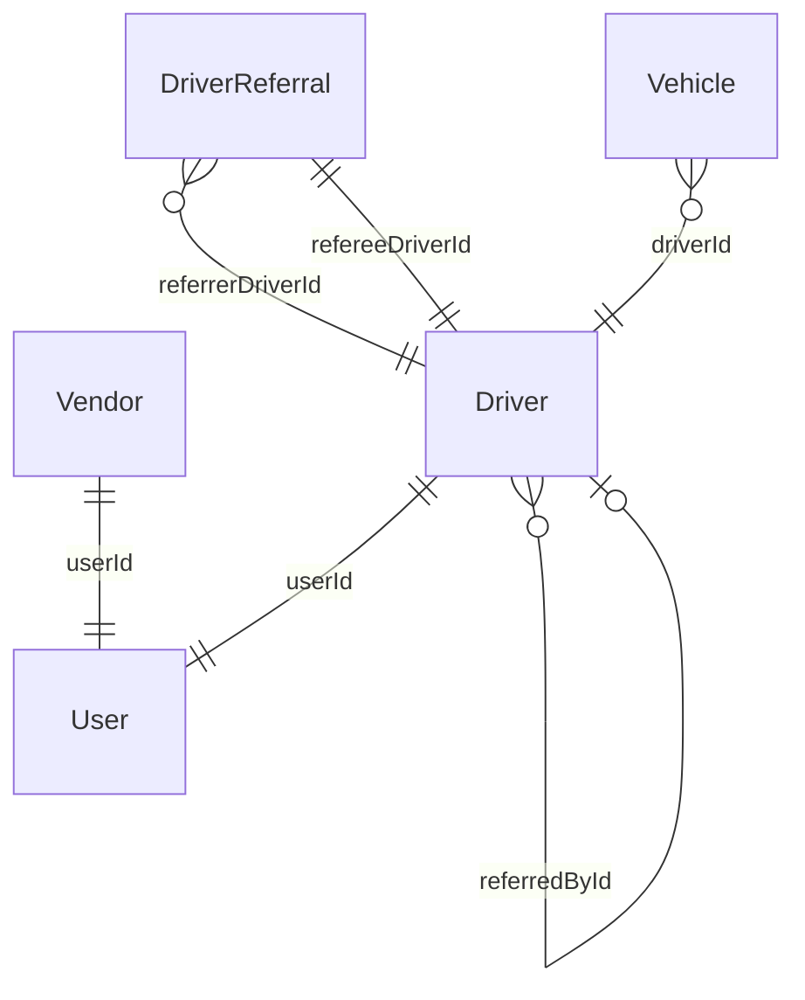

# Identity and Supply Data Dictionary

**Business responsibility:** Accounts, role identity, vendor and driver profiles, referrals and vehicles.
**Primary API ownership evidence:** `apps/api/src/modules/auth/`, `vendors/`, `drivers/`. Ownership is logical; other domains may read or update shared models.
**Related API references:** [Authentication](../../reference/endpoints/auth-controller.md), [Vendors](../../reference/endpoints/vendors-controller.md), [Drivers](../../reference/endpoints/drivers-controller.md), [Referrals](../../reference/endpoints/referrals-controller.md). These are context links, not a claim that every route reads or writes every model in this group.

**Source:** `apps/api/prisma/schema.prisma` (5 models). Model sections cite the declaration line.

## Relationship overview

This ERD includes only direct Prisma foreign-key relations whose two models belong to this page. Cross-context relations remain listed in each model table; a SQL scalar without a Prisma relation is not drawn as a foreign key.

## User {#user}

**Business purpose:** Account, role and corporate tenant identity
**Storage:** Prisma model `User` maps to PostgreSQL table `users`. **Schema declaration:** `apps/api/prisma/schema.prisma:136`.

| Field | Prisma type / native type | Nullability | Default / behavior | Key and column mapping | Schema description |
|---|---|---|---|---|---|
| `id` | String @db.Uuid | Required | `@default(uuid())` | `@id` | — |
| `phone` | String? | Nullable | `—` | `@unique` | — |
| `email` | String? | Nullable | `—` | `@unique` | — |
| `passwordHash` | String? | Nullable | `—` | column `password_hash` | — |
| `fullName` | String? | Nullable | `—` | column `full_name` | — |
| `role` | [UserRole](../enums.md#user-role) | Required | `@default(DRIVER)` | — | — |
| `status` | [UserStatus](../enums.md#user-status) | Required | `@default(ACTIVE)` | — | — |
| `corporateTenantId` | String? @db.Uuid | Nullable | `—` | column `corporate_tenant_id` | Corporate tenant this user belongs to (CORPORATE_ADMIN / CORPORATE_MANAGER / EMPLOYEE). Null for platform users. |
| `corporateRole` | [CorporateUserRole](../enums.md#corporate-user-role)? | Nullable | `—` | column `corporate_role` | WS-F: fine-grained corporate role. Null => derived from `role` (CORPORATE_ADMIN -> CORP_SUPER_ADMIN, CORPORATE_MANAGER -> TRANSPORT). |
| `corporateOfficeIds` | String[] @db.Uuid | List (not a nullable scalar) | `@default([])` | column `corporate_office_ids` | WS-F: office scope of a corporate user. Empty => all offices of the tenant. |
| `createdAt` | DateTime | Required | `@default(now())` | column `created_at` | — |
| `updatedAt` | DateTime | Required | `@updatedAt` | column `updated_at` | — |
| `vendor` | [Vendor](./identity-and-supply.md#vendor)? | Optional relation | `—` | — | — |
| `driver` | [Driver](./identity-and-supply.md#driver)? | Optional relation | `—` | — | — |
| `auditLogs` | [AuditLog](./platform-and-communications.md#audit-log)[] | Relation collection | `—` | — | — |
| `reviewsWritten` | [Review](./marketplace-and-trips.md#review)[] | Relation collection | `—` | — | — |
| `reviewsReceived` | [Review](./marketplace-and-trips.md#review)[] | Relation collection | `—` | — | — |
| `filedDisputes` | [Dispute](./marketplace-and-trips.md#dispute)[] | Relation collection | `—` | — | — |
| `accusedDisputes` | [Dispute](./marketplace-and-trips.md#dispute)[] | Relation collection | `—` | — | — |
| `couponRedemptions` | [CouponRedemption](./payments-and-promotions.md#coupon-redemption)[] | Relation collection | `—` | — | — |
| `deviceTokens` | [DeviceToken](./platform-and-communications.md#device-token)[] | Relation collection | `—` | — | — |
| `notifications` | [Notification](./platform-and-communications.md#notification)[] | Relation collection | `—` | — | — |
| `notificationCampaignRecipients` | [NotificationCampaignRecipient](./platform-and-communications.md#notification-campaign-recipient)[] | Relation collection | `—` | — | — |
| `notificationPreference` | [NotificationPreference](./platform-and-communications.md#notification-preference)? | Optional relation | `—` | — | — |
| `corporateTenant` | [CorporateTenant](./corporate-tenancy-and-organization.md#corporate-tenant)? | Optional relation | `—` | — | — |
| `corporateEmployee` | [CorporateEmployee](./corporate-tenancy-and-organization.md#corporate-employee)? | Optional relation | `—` | — | — |
| `corporateTicketMessages` | [CorporateTicketMessage](./corporate-support.md#corporate-ticket-message)[] | Relation collection | `—` | — | — |

### Relations

| Relation field | Related model | Foreign-key mapping | On delete | Relation name |
|---|---|---|---|---|
| `vendor` | [Vendor](./identity-and-supply.md#vendor)? | Inverse relation; the foreign-key scalar is declared on the related model | Not specified; Prisma/provider default applies | `UserToVendor` |
| `driver` | [Driver](./identity-and-supply.md#driver)? | Inverse relation; the foreign-key scalar is declared on the related model | Not specified; Prisma/provider default applies | `DriverToUser` |
| `auditLogs` | [AuditLog](./platform-and-communications.md#audit-log)[] | Inverse relation; the foreign-key scalar is declared on the related model | Not specified; Prisma/provider default applies | `AuditLogToUser` |
| `reviewsWritten` | [Review](./marketplace-and-trips.md#review)[] | Inverse relation; the foreign-key scalar is declared on the related model | Not specified; Prisma/provider default applies | `ReviewsWritten` |
| `reviewsReceived` | [Review](./marketplace-and-trips.md#review)[] | Inverse relation; the foreign-key scalar is declared on the related model | Not specified; Prisma/provider default applies | `ReviewsReceived` |
| `filedDisputes` | [Dispute](./marketplace-and-trips.md#dispute)[] | Inverse relation; the foreign-key scalar is declared on the related model | Not specified; Prisma/provider default applies | `ReporterDisputes` |
| `accusedDisputes` | [Dispute](./marketplace-and-trips.md#dispute)[] | Inverse relation; the foreign-key scalar is declared on the related model | Not specified; Prisma/provider default applies | `AccusedDisputes` |
| `couponRedemptions` | [CouponRedemption](./payments-and-promotions.md#coupon-redemption)[] | Inverse relation; the foreign-key scalar is declared on the related model | Not specified; Prisma/provider default applies | `CouponRedemptionToUser` |
| `deviceTokens` | [DeviceToken](./platform-and-communications.md#device-token)[] | Inverse relation; the foreign-key scalar is declared on the related model | Not specified; Prisma/provider default applies | `DeviceTokenToUser` |
| `notifications` | [Notification](./platform-and-communications.md#notification)[] | Inverse relation; the foreign-key scalar is declared on the related model | Not specified; Prisma/provider default applies | `NotificationToUser` |
| `notificationCampaignRecipients` | [NotificationCampaignRecipient](./platform-and-communications.md#notification-campaign-recipient)[] | Inverse relation; the foreign-key scalar is declared on the related model | Not specified; Prisma/provider default applies | `NotificationCampaignRecipientToUser` |
| `notificationPreference` | [NotificationPreference](./platform-and-communications.md#notification-preference)? | Inverse relation; the foreign-key scalar is declared on the related model | Not specified; Prisma/provider default applies | `NotificationPreferenceToUser` |
| `corporateTenant` | [CorporateTenant](./corporate-tenancy-and-organization.md#corporate-tenant)? | `corporateTenantId` → `id` | SetNull | `CorporateTenantToUser` |
| `corporateEmployee` | [CorporateEmployee](./corporate-tenancy-and-organization.md#corporate-employee)? | Inverse relation; the foreign-key scalar is declared on the related model | Not specified; Prisma/provider default applies | `CorporateEmployeeToUser` |
| `corporateTicketMessages` | [CorporateTicketMessage](./corporate-support.md#corporate-ticket-message)[] | Inverse relation; the foreign-key scalar is declared on the related model | Not specified; Prisma/provider default applies | `CorporateTicketMessageToUser` |

### Model-level keys and indexes

| Declaration | Meaning |
|---|---|
| `@@index([corporateTenantId])` | Database index |

## Vendor {#vendor}

**Business purpose:** Vendor organization profile and verification
**Storage:** Prisma model `Vendor` maps to PostgreSQL table `vendors`. **Schema declaration:** `apps/api/prisma/schema.prisma:173`.

| Field | Prisma type / native type | Nullability | Default / behavior | Key and column mapping | Schema description |
|---|---|---|---|---|---|
| `id` | String @db.Uuid | Required | `@default(uuid())` | `@id` | — |
| `userId` | String @db.Uuid | Required | `—` | `@unique`; column `user_id` | — |
| `organizationName` | String | Required | `—` | column `organization_name` | — |
| `fullName` | String | Required | `—` | column `full_name` | — |
| `phone` | String? | Nullable | `—` | — | — |
| `gstNumber` | String? | Nullable | `—` | column `gst_number` | — |
| `address` | String? | Nullable | `—` | — | — |
| `verificationStatus` | [VerificationStatus](../enums.md#verification-status) | Required | `@default(PENDING)` | column `verification_status` | — |
| `escrowBalance` | Decimal @db.Decimal(12, 2) | Required | `@default(0)` | column `escrow_balance` | — |
| `rejectionReason` | String? | Nullable | `—` | column `rejection_reason` | — |
| `kycDocuments` | Json? | Nullable | `—` | column `kyc_documents` | — |
| `approvedAt` | DateTime? | Nullable | `—` | column `approved_at` | — |
| `createdAt` | DateTime | Required | `@default(now())` | column `created_at` | — |
| `updatedAt` | DateTime | Required | `@updatedAt` | column `updated_at` | — |
| `user` | [User](./identity-and-supply.md#user) | Required relation | `—` | — | — |
| `requirements` | [Requirement](./marketplace-and-trips.md#requirement)[] | Relation collection | `—` | — | — |
| `trips` | [Trip](./marketplace-and-trips.md#trip)[] | Relation collection | `—` | — | — |
| `payments` | [Payment](./payments-and-promotions.md#payment)[] | Relation collection | `—` | — | — |

### Relations

| Relation field | Related model | Foreign-key mapping | On delete | Relation name |
|---|---|---|---|---|
| `user` | [User](./identity-and-supply.md#user) | `userId` → `id` | Cascade | `UserToVendor` |
| `requirements` | [Requirement](./marketplace-and-trips.md#requirement)[] | Inverse relation; the foreign-key scalar is declared on the related model | Not specified; Prisma/provider default applies | `RequirementToVendor` |
| `trips` | [Trip](./marketplace-and-trips.md#trip)[] | Inverse relation; the foreign-key scalar is declared on the related model | Not specified; Prisma/provider default applies | `TripToVendor` |
| `payments` | [Payment](./payments-and-promotions.md#payment)[] | Inverse relation; the foreign-key scalar is declared on the related model | Not specified; Prisma/provider default applies | `PaymentToVendor` |

### Model-level keys and indexes

| Declaration | Meaning |
|---|---|
| — | No model-level `@@id`, `@@unique`, `@@index` or `@@fulltext` declaration. Field-level `@id`/`@unique` appears in the field table. |

## Driver {#driver}

**Business purpose:** Driver profile, availability and performance
**Storage:** Prisma model `Driver` maps to PostgreSQL table `drivers`. **Schema declaration:** `apps/api/prisma/schema.prisma:197`.

| Field | Prisma type / native type | Nullability | Default / behavior | Key and column mapping | Schema description |
|---|---|---|---|---|---|
| `id` | String @db.Uuid | Required | `@default(uuid())` | `@id` | — |
| `userId` | String @db.Uuid | Required | `—` | `@unique`; column `user_id` | — |
| `fullName` | String | Required | `—` | column `full_name` | — |
| `phone` | String? | Nullable | `—` | `@unique` | — |
| `referralCode` | String? @db.VarChar(12) | Nullable | `—` | `@unique`; column `referral_code` | — |
| `referredById` | String? @db.Uuid | Nullable | `—` | column `referred_by_id` | — |
| `referredAt` | DateTime? | Nullable | `—` | column `referred_at` | — |
| `verificationStatus` | [VerificationStatus](../enums.md#verification-status) | Required | `@default(PENDING)` | column `verification_status` | — |
| `availabilityStatus` | [DriverAvailability](../enums.md#driver-availability) | Required | `@default(OFFLINE)` | column `availability_status` | — |
| `vehicleType` | String? @db.VarChar(50) | Nullable | `—` | column `vehicle_type` | — |
| `vehicleModel` | String? | Nullable | `—` | column `vehicle_model` | — |
| `vehiclePlate` | String? | Nullable | `—` | column `vehicle_plate` | — |
| `walletBalance` | Decimal @db.Decimal(12, 2) | Required | `@default(0)` | column `wallet_balance` | — |
| `trustScore` | Float | Required | `@default(100)` | column `trust_score` | — |
| `averageRating` | Float | Required | `@default(5)` | column `average_rating` | — |
| `ratingCount` | Int | Required | `@default(0)` | column `rating_count` | — |
| `totalTrips` | Int | Required | `@default(0)` | column `total_trips` | — |
| `acceptanceRate` | Float | Required | `@default(100)` | column `acceptance_rate` | — |
| `acceptedOffers` | Int | Required | `@default(0)` | column `accepted_offers` | — |
| `declinedOffers` | Int | Required | `@default(0)` | column `declined_offers` | — |
| `consecutiveDeclines` | Int | Required | `@default(0)` | column `consecutive_declines` | — |
| `cooldownUntil` | DateTime? | Nullable | `—` | column `cooldown_until` | — |
| `cooldownLevel` | Int | Required | `@default(0)` | column `cooldown_level` | — |
| `lastCooldownAt` | DateTime? | Nullable | `—` | column `last_cooldown_at` | — |
| `currentLat` | Decimal? @db.Decimal(10, 7) | Nullable | `—` | column `current_lat` | — |
| `currentLng` | Decimal? @db.Decimal(10, 7) | Nullable | `—` | column `current_lng` | — |
| `lastLocationAt` | DateTime? | Nullable | `—` | column `last_location_at` | — |
| `rejectionReason` | String? | Nullable | `—` | column `rejection_reason` | — |
| `kycDocuments` | Json? | Nullable | `—` | column `kyc_documents` | — |
| `dlFrontUrl` | String? | Nullable | `—` | column `dl_front_url` | — |
| `dlBackUrl` | String? | Nullable | `—` | column `dl_back_url` | — |
| `rcDocUrl` | String? | Nullable | `—` | column `rc_doc_url` | — |
| `insuranceDocUrl` | String? | Nullable | `—` | column `insurance_doc_url` | — |
| `vehiclePhotoUrl` | String? | Nullable | `—` | column `vehicle_photo_url` | — |
| `aadharFrontUrl` | String? | Nullable | `—` | column `aadhar_front_url` | — |
| `aadharBackUrl` | String? | Nullable | `—` | column `aadhar_back_url` | — |
| `panDocUrl` | String? | Nullable | `—` | column `pan_doc_url` | — |
| `subscriptionStatus` | [DriverSubscriptionStatus](../enums.md#driver-subscription-status) | Required | `@default(TRIAL_ACTIVE)` | column `subscription_status` | — |
| `trialStartDate` | DateTime | Required | `@default(now())` | column `trial_start_date` | — |
| `trialEndDate` | DateTime? | Nullable | `—` | column `trial_end_date` | — |
| `subscriptionExpiry` | DateTime? | Nullable | `—` | column `subscription_expiry` | — |
| `autoDebit` | Boolean | Required | `@default(true)` | column `auto_debit` | — |
| `createdAt` | DateTime | Required | `@default(now())` | column `created_at` | — |
| `updatedAt` | DateTime | Required | `@updatedAt` | column `updated_at` | — |
| `user` | [User](./identity-and-supply.md#user) | Required relation | `—` | — | — |
| `vehicles` | [Vehicle](./identity-and-supply.md#vehicle)[] | Relation collection | `—` | — | — |
| `offers` | [Offer](./marketplace-and-trips.md#offer)[] | Relation collection | `—` | — | — |
| `assignments` | [Assignment](./marketplace-and-trips.md#assignment)[] | Relation collection | `—` | — | — |
| `trips` | [Trip](./marketplace-and-trips.md#trip)[] | Relation collection | `—` | — | — |
| `settlements` | [Settlement](./payments-and-promotions.md#settlement)[] | Relation collection | `—` | — | — |
| `reviewsReceived` | [Review](./marketplace-and-trips.md#review)[] | Relation collection | `—` | — | — |
| `subscriptionPayments` | [DriverSubscriptionPayment](./payments-and-promotions.md#driver-subscription-payment)[] | Relation collection | `—` | — | — |
| `corporateRoutes` | [CorporateRoute](./corporate-routing-execution-and-safety.md#corporate-route)[] | Relation collection | `—` | — | — |
| `corporateEarnings` | [CorporateDriverEarning](./corporate-billing-and-payouts.md#corporate-driver-earning)[] | Relation collection | `—` | — | — |
| `corporateOffers` | [CorporateDriverOffer](./corporate-routing-execution-and-safety.md#corporate-driver-offer)[] | Relation collection | `—` | — | — |
| `corporatePayouts` | [CorporatePayout](./corporate-billing-and-payouts.md#corporate-payout)[] | Relation collection | `—` | — | — |
| `corporateTripFeedbacks` | [CorporateTripFeedback](./corporate-routing-execution-and-safety.md#corporate-trip-feedback)[] | Relation collection | `—` | — | — |
| `referredBy` | [Driver](./identity-and-supply.md#driver)? | Optional relation | `—` | — | — |
| `referees` | [Driver](./identity-and-supply.md#driver)[] | Relation collection | `—` | — | — |
| `referralsMade` | [DriverReferral](./identity-and-supply.md#driver-referral)[] | Relation collection | `—` | — | — |
| `referralReceived` | [DriverReferral](./identity-and-supply.md#driver-referral)? | Optional relation | `—` | — | — |

### Relations

| Relation field | Related model | Foreign-key mapping | On delete | Relation name |
|---|---|---|---|---|
| `user` | [User](./identity-and-supply.md#user) | `userId` → `id` | Cascade | `DriverToUser` |
| `vehicles` | [Vehicle](./identity-and-supply.md#vehicle)[] | Inverse relation; the foreign-key scalar is declared on the related model | Not specified; Prisma/provider default applies | `DriverToVehicle` |
| `offers` | [Offer](./marketplace-and-trips.md#offer)[] | Inverse relation; the foreign-key scalar is declared on the related model | Not specified; Prisma/provider default applies | `DriverToOffer` |
| `assignments` | [Assignment](./marketplace-and-trips.md#assignment)[] | Inverse relation; the foreign-key scalar is declared on the related model | Not specified; Prisma/provider default applies | `AssignmentToDriver` |
| `trips` | [Trip](./marketplace-and-trips.md#trip)[] | Inverse relation; the foreign-key scalar is declared on the related model | Not specified; Prisma/provider default applies | `DriverToTrip` |
| `settlements` | [Settlement](./payments-and-promotions.md#settlement)[] | Inverse relation; the foreign-key scalar is declared on the related model | Not specified; Prisma/provider default applies | `DriverToSettlement` |
| `reviewsReceived` | [Review](./marketplace-and-trips.md#review)[] | Inverse relation; the foreign-key scalar is declared on the related model | Not specified; Prisma/provider default applies | `DriverReviewsReceived` |
| `subscriptionPayments` | [DriverSubscriptionPayment](./payments-and-promotions.md#driver-subscription-payment)[] | Inverse relation; the foreign-key scalar is declared on the related model | Not specified; Prisma/provider default applies | `DriverToDriverSubscriptionPayment` |
| `corporateRoutes` | [CorporateRoute](./corporate-routing-execution-and-safety.md#corporate-route)[] | Inverse relation; the foreign-key scalar is declared on the related model | Not specified; Prisma/provider default applies | `CorporateRouteToDriver` |
| `corporateEarnings` | [CorporateDriverEarning](./corporate-billing-and-payouts.md#corporate-driver-earning)[] | Inverse relation; the foreign-key scalar is declared on the related model | Not specified; Prisma/provider default applies | `CorporateDriverEarningToDriver` |
| `corporateOffers` | [CorporateDriverOffer](./corporate-routing-execution-and-safety.md#corporate-driver-offer)[] | Inverse relation; the foreign-key scalar is declared on the related model | Not specified; Prisma/provider default applies | `CorporateDriverOfferToDriver` |
| `corporatePayouts` | [CorporatePayout](./corporate-billing-and-payouts.md#corporate-payout)[] | Inverse relation; the foreign-key scalar is declared on the related model | Not specified; Prisma/provider default applies | `CorporatePayoutToDriver` |
| `corporateTripFeedbacks` | [CorporateTripFeedback](./corporate-routing-execution-and-safety.md#corporate-trip-feedback)[] | Inverse relation; the foreign-key scalar is declared on the related model | Not specified; Prisma/provider default applies | `CorporateTripFeedbackToDriver` |
| `referredBy` | [Driver](./identity-and-supply.md#driver)? | `referredById` → `id` | SetNull | `DriverReferrals` |
| `referees` | [Driver](./identity-and-supply.md#driver)[] | Inverse relation; the foreign-key scalar is declared on the related model | Not specified; Prisma/provider default applies | `DriverReferrals` |
| `referralsMade` | [DriverReferral](./identity-and-supply.md#driver-referral)[] | Inverse relation; the foreign-key scalar is declared on the related model | Not specified; Prisma/provider default applies | `ReferrerReferrals` |
| `referralReceived` | [DriverReferral](./identity-and-supply.md#driver-referral)? | Inverse relation; the foreign-key scalar is declared on the related model | Not specified; Prisma/provider default applies | `RefereeReferral` |

### Model-level keys and indexes

| Declaration | Meaning |
|---|---|
| `@@index([availabilityStatus, verificationStatus, lastLocationAt], map: "drivers_dispatch_fallback_idx")` | Database index |
| `@@index([referralCode])` | Database index |
| `@@index([referredById])` | Database index |

## DriverReferral {#driver-referral}

**Business purpose:** Referral and incentive relationship
**Storage:** Prisma model `DriverReferral` maps to PostgreSQL table `driver_referrals`. **Schema declaration:** `apps/api/prisma/schema.prisma:269`.

| Field | Prisma type / native type | Nullability | Default / behavior | Key and column mapping | Schema description |
|---|---|---|---|---|---|
| `id` | String @db.Uuid | Required | `@default(uuid())` | `@id` | — |
| `referrerDriverId` | String @db.Uuid | Required | `—` | column `referrer_driver_id` | — |
| `refereeDriverId` | String @db.Uuid | Required | `—` | `@unique`; column `referee_driver_id` | — |
| `rewardPaise` | Int | Required | `@default(50000)` | column `reward_paise` | — |
| `status` | [ReferralStatus](../enums.md#referral-status) | Required | `@default(PENDING_VERIFICATION)` | — | — |
| `refereeVerifiedAt` | DateTime? | Nullable | `—` | column `referee_verified_at` | — |
| `claimedAt` | DateTime? | Nullable | `—` | column `claimed_at` | — |
| `ledgerEntryId` | String? @db.Uuid | Nullable | `—` | `@unique`; column `ledger_entry_id` | — |
| `notes` | String? | Nullable | `—` | — | — |
| `createdAt` | DateTime | Required | `@default(now())` | column `created_at` | — |
| `updatedAt` | DateTime | Required | `@updatedAt` | column `updated_at` | — |
| `referrerDriver` | [Driver](./identity-and-supply.md#driver) | Required relation | `—` | — | — |
| `refereeDriver` | [Driver](./identity-and-supply.md#driver) | Required relation | `—` | — | — |

### Relations

| Relation field | Related model | Foreign-key mapping | On delete | Relation name |
|---|---|---|---|---|
| `referrerDriver` | [Driver](./identity-and-supply.md#driver) | `referrerDriverId` → `id` | Cascade | `ReferrerReferrals` |
| `refereeDriver` | [Driver](./identity-and-supply.md#driver) | `refereeDriverId` → `id` | Cascade | `RefereeReferral` |

### Model-level keys and indexes

| Declaration | Meaning |
|---|---|
| `@@index([referrerDriverId, status])` | Database index |
| `@@index([refereeDriverId])` | Database index |

## Vehicle {#vehicle}

**Business purpose:** Driver or registered vehicle details
**Storage:** Prisma model `Vehicle` maps to PostgreSQL table `vehicles`. **Schema declaration:** `apps/api/prisma/schema.prisma:290`.

| Field | Prisma type / native type | Nullability | Default / behavior | Key and column mapping | Schema description |
|---|---|---|---|---|---|
| `id` | String @db.Uuid | Required | `@default(uuid())` | `@id` | — |
| `driverId` | String @db.Uuid | Required | `—` | column `driver_id` | — |
| `vehicleType` | String @db.VarChar(50) | Required | `—` | column `vehicle_type` | — |
| `make` | String? | Nullable | `—` | — | — |
| `model` | String | Required | `—` | — | — |
| `registrationNumber` | String | Required | `—` | column `registration_number` | — |
| `verificationStatus` | [VerificationStatus](../enums.md#verification-status) | Required | `@default(PENDING)` | column `verification_status` | — |
| `rcNumber` | String? | Nullable | `—` | column `rc_number` | — |
| `insuranceExpiry` | DateTime? | Nullable | `—` | column `insurance_expiry` | — |
| `createdAt` | DateTime | Required | `@default(now())` | column `created_at` | — |
| `updatedAt` | DateTime | Required | `@updatedAt` | column `updated_at` | — |
| `driver` | [Driver](./identity-and-supply.md#driver) | Required relation | `—` | — | — |
| `assignments` | [Assignment](./marketplace-and-trips.md#assignment)[] | Relation collection | `—` | — | — |
| `trips` | [Trip](./marketplace-and-trips.md#trip)[] | Relation collection | `—` | — | — |
| `corporateRoutes` | [CorporateRoute](./corporate-routing-execution-and-safety.md#corporate-route)[] | Relation collection | `—` | — | — |

### Relations

| Relation field | Related model | Foreign-key mapping | On delete | Relation name |
|---|---|---|---|---|
| `driver` | [Driver](./identity-and-supply.md#driver) | `driverId` → `id` | Cascade | `DriverToVehicle` |
| `assignments` | [Assignment](./marketplace-and-trips.md#assignment)[] | Inverse relation; the foreign-key scalar is declared on the related model | Not specified; Prisma/provider default applies | `AssignmentToVehicle` |
| `trips` | [Trip](./marketplace-and-trips.md#trip)[] | Inverse relation; the foreign-key scalar is declared on the related model | Not specified; Prisma/provider default applies | `TripToVehicle` |
| `corporateRoutes` | [CorporateRoute](./corporate-routing-execution-and-safety.md#corporate-route)[] | Inverse relation; the foreign-key scalar is declared on the related model | Not specified; Prisma/provider default applies | `CorporateRouteToVehicle` |

### Model-level keys and indexes

| Declaration | Meaning |
|---|---|
| `@@index([driverId])` | Database index |
| `@@index([registrationNumber])` | Database index |
| `@@unique([driverId, registrationNumber])` | Composite unique constraint |

## Reading the field tables

- `Required` means Prisma marks the scalar field non-null; `Nullable` means the Prisma type permits null.
- `[]` denotes a Prisma list field. Object/relation fields are not physical columns unless a scalar FK field is also listed.
- `@db.*`, `@map` and `@@map` preserve native PostgreSQL types and storage names declared in the schema.
- Defaults and `@updatedAt` are schema declarations, not guarantees that existing production databases have no drift.
- A missing description means the Prisma schema has no field-level documentation comment; field meaning should not be guessed from the name alone.
