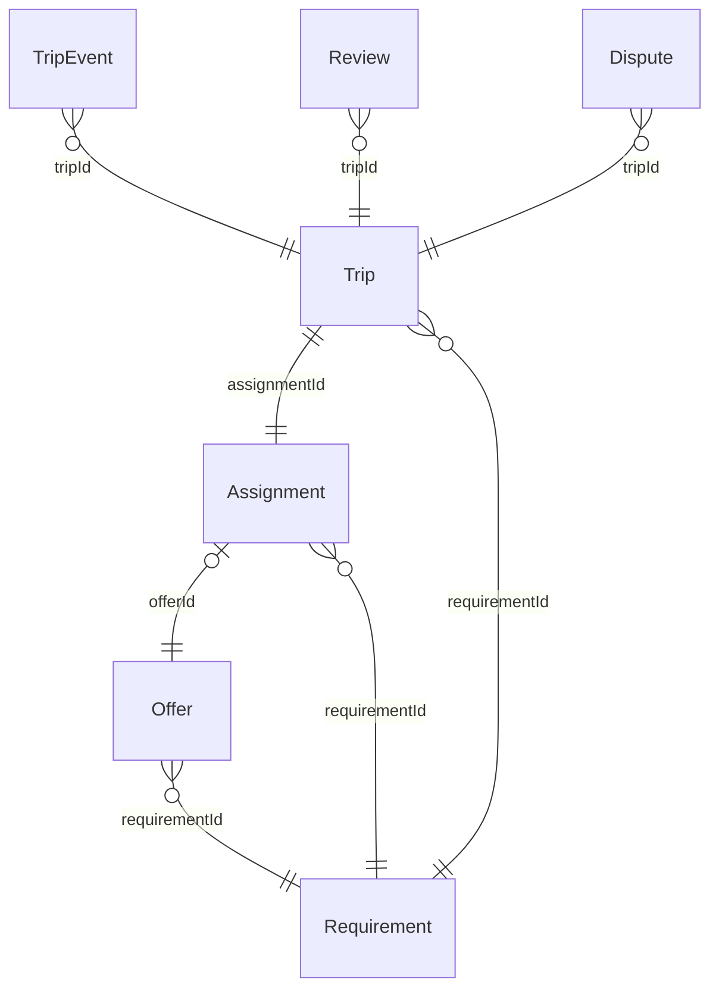

# Marketplace and Trips Data Dictionary

**Business responsibility:** Demand publication, offers, assignments, trip lifecycle, reviews and disputes.
**Primary API ownership evidence:** `apps/api/src/modules/requirements/`, `offers/`, `assignments/`, `trips/`, `reviews/`, `disputes/`. Ownership is logical; other domains may read or update shared models.
**Related API references:** [Requirements](../../reference/endpoints/requirements-controller.md), [Offers](../../reference/endpoints/offers-controller.md), [Assignments](../../reference/endpoints/assignments-controller.md), [Trips](../../reference/endpoints/trips-controller.md), [Reviews](../../reference/endpoints/reviews-controller.md), [Disputes](../../reference/endpoints/disputes-controller.md). These are context links, not a claim that every route reads or writes every model in this group.

**Source:** `apps/api/prisma/schema.prisma` (7 models). Model sections cite the declaration line.

## Relationship overview

This ERD includes only direct Prisma foreign-key relations whose two models belong to this page. Cross-context relations remain listed in each model table; a SQL scalar without a Prisma relation is not drawn as a foreign key.

## Requirement {#requirement}

**Business purpose:** Cab/vehicle demand
**Storage:** Prisma model `Requirement` maps to PostgreSQL table `requirements`. **Schema declaration:** `apps/api/prisma/schema.prisma:315`.

| Field | Prisma type / native type | Nullability | Default / behavior | Key and column mapping | Schema description |
|---|---|---|---|---|---|
| `id` | String @db.Uuid | Required | `@default(uuid())` | `@id` | — |
| `vendorId` | String @db.Uuid | Required | `—` | column `vendor_id` | — |
| `fulfillmentMode` | [FulfillmentMode](../enums.md#fulfillment-mode) | Required | `@default(DIRECT_DISPATCH)` | column `fulfillment_mode` | — |
| `vehicleType` | String @db.VarChar(50) | Required | `—` | column `vehicle_type` | — |
| `quantity` | Int | Required | `@default(1)` | — | — |
| `assignedQuantity` | Int | Required | `@default(0)` | column `assigned_quantity` | — |
| `pickupLat` | Decimal @db.Decimal(10, 7) | Required | `—` | column `pickup_lat` | — |
| `pickupLng` | Decimal @db.Decimal(10, 7) | Required | `—` | column `pickup_lng` | — |
| `pickupAddress` | String | Required | `—` | column `pickup_address` | — |
| `dropLat` | Decimal @db.Decimal(10, 7) | Required | `—` | column `drop_lat` | — |
| `dropLng` | Decimal @db.Decimal(10, 7) | Required | `—` | column `drop_lng` | — |
| `dropAddress` | String | Required | `—` | column `drop_address` | — |
| `reportingTime` | DateTime | Required | `—` | column `reporting_time` | — |
| `ratePerVehicle` | Decimal? @db.Decimal(10, 2) | Nullable | `—` | column `rate_per_vehicle` | — |
| `suggestedBudget` | Decimal? @db.Decimal(10, 2) | Nullable | `—` | column `suggested_budget` | — |
| `totalAmount` | Decimal @db.Decimal(12, 2) | Required | `—` | column `total_amount` | — |
| `status` | [RequirementStatus](../enums.md#requirement-status) | Required | `@default(POSTED)` | — | — |
| `dispatchWaves` | Int | Required | `@default(0)` | column `dispatch_waves` | — |
| `notes` | String? | Nullable | `—` | — | — |
| `createdAt` | DateTime | Required | `@default(now())` | column `created_at` | — |
| `updatedAt` | DateTime | Required | `@updatedAt` | column `updated_at` | — |
| `vendor` | [Vendor](./identity-and-supply.md#vendor) | Required relation | `—` | — | — |
| `offers` | [Offer](./marketplace-and-trips.md#offer)[] | Relation collection | `—` | — | — |
| `assignments` | [Assignment](./marketplace-and-trips.md#assignment)[] | Relation collection | `—` | — | — |
| `trips` | [Trip](./marketplace-and-trips.md#trip)[] | Relation collection | `—` | — | — |
| `payments` | [Payment](./payments-and-promotions.md#payment)[] | Relation collection | `—` | — | — |
| `zonalQuote` | [ZonalQuoteSnapshot](./pricing-and-locality.md#zonal-quote-snapshot)? | Optional relation | `—` | — | — |
| `pricingSnapshot` | [TripPricingSnapshot](./pricing-and-locality.md#trip-pricing-snapshot)? | Optional relation | `—` | — | — |
| `tripQuote` | [TripQuote](./pricing-and-locality.md#trip-quote)? | Optional relation | `—` | — | — |

### Relations

| Relation field | Related model | Foreign-key mapping | On delete | Relation name |
|---|---|---|---|---|
| `vendor` | [Vendor](./identity-and-supply.md#vendor) | `vendorId` → `id` | Cascade | `RequirementToVendor` |
| `offers` | [Offer](./marketplace-and-trips.md#offer)[] | Inverse relation; the foreign-key scalar is declared on the related model | Not specified; Prisma/provider default applies | `OfferToRequirement` |
| `assignments` | [Assignment](./marketplace-and-trips.md#assignment)[] | Inverse relation; the foreign-key scalar is declared on the related model | Not specified; Prisma/provider default applies | `AssignmentToRequirement` |
| `trips` | [Trip](./marketplace-and-trips.md#trip)[] | Inverse relation; the foreign-key scalar is declared on the related model | Not specified; Prisma/provider default applies | `RequirementToTrip` |
| `payments` | [Payment](./payments-and-promotions.md#payment)[] | Inverse relation; the foreign-key scalar is declared on the related model | Not specified; Prisma/provider default applies | `PaymentToRequirement` |
| `zonalQuote` | [ZonalQuoteSnapshot](./pricing-and-locality.md#zonal-quote-snapshot)? | Inverse relation; the foreign-key scalar is declared on the related model | Not specified; Prisma/provider default applies | `RequirementToZonalQuoteSnapshot` |
| `pricingSnapshot` | [TripPricingSnapshot](./pricing-and-locality.md#trip-pricing-snapshot)? | Inverse relation; the foreign-key scalar is declared on the related model | Not specified; Prisma/provider default applies | `RequirementToTripPricingSnapshot` |
| `tripQuote` | [TripQuote](./pricing-and-locality.md#trip-quote)? | Inverse relation; the foreign-key scalar is declared on the related model | Not specified; Prisma/provider default applies | `RequirementToTripQuote` |

### Model-level keys and indexes

| Declaration | Meaning |
|---|---|
| — | No model-level `@@id`, `@@unique`, `@@index` or `@@fulltext` declaration. Field-level `@id`/`@unique` appears in the field table. |

## Offer {#offer}

**Business purpose:** Marketplace driver offer
**Storage:** Prisma model `Offer` maps to PostgreSQL table `offers`. **Schema declaration:** `apps/api/prisma/schema.prisma:350`.

| Field | Prisma type / native type | Nullability | Default / behavior | Key and column mapping | Schema description |
|---|---|---|---|---|---|
| `id` | String @db.Uuid | Required | `@default(uuid())` | `@id` | — |
| `requirementId` | String @db.Uuid | Required | `—` | column `requirement_id` | — |
| `driverId` | String @db.Uuid | Required | `—` | column `driver_id` | — |
| `vehicleType` | String @db.VarChar(50) | Required | `—` | column `vehicle_type` | — |
| `offeredRate` | Decimal @db.Decimal(10, 2) | Required | `—` | column `offered_rate` | — |
| `status` | [OfferStatus](../enums.md#offer-status) | Required | `@default(SENT)` | — | — |
| `expiresAt` | DateTime | Required | `—` | column `expires_at` | — |
| `respondedAt` | DateTime? | Nullable | `—` | column `responded_at` | — |
| `waveNumber` | Int | Required | `@default(1)` | column `wave_number` | — |
| `distanceKm` | Float? | Nullable | `—` | column `distance_km` | — |
| `etaMinutes` | Int? | Nullable | `—` | column `eta_minutes` | — |
| `seenAt` | DateTime? | Nullable | `—` | column `seen_at` | — |
| `countsForAr` | Boolean | Required | `@default(false)` | column `counts_for_ar` | — |
| `createdAt` | DateTime | Required | `@default(now())` | column `created_at` | — |
| `updatedAt` | DateTime | Required | `@updatedAt` | column `updated_at` | — |
| `requirement` | [Requirement](./marketplace-and-trips.md#requirement) | Required relation | `—` | — | — |
| `driver` | [Driver](./identity-and-supply.md#driver) | Required relation | `—` | — | — |
| `assignment` | [Assignment](./marketplace-and-trips.md#assignment)? | Optional relation | `—` | — | — |

### Relations

| Relation field | Related model | Foreign-key mapping | On delete | Relation name |
|---|---|---|---|---|
| `requirement` | [Requirement](./marketplace-and-trips.md#requirement) | `requirementId` → `id` | Cascade | `OfferToRequirement` |
| `driver` | [Driver](./identity-and-supply.md#driver) | `driverId` → `id` | Cascade | `DriverToOffer` |
| `assignment` | [Assignment](./marketplace-and-trips.md#assignment)? | Inverse relation; the foreign-key scalar is declared on the related model | Not specified; Prisma/provider default applies | `AssignmentToOffer` |

### Model-level keys and indexes

| Declaration | Meaning |
|---|---|
| `@@index([status, expiresAt])` | Database index |
| `@@index([requirementId, status])` | Database index |
| `@@index([driverId, countsForAr, respondedAt])` | Database index |
| `@@index([driverId, status, expiresAt])` | Database index |

## Assignment {#assignment}

**Business purpose:** Driver/requirement allocation
**Storage:** Prisma model `Assignment` maps to PostgreSQL table `assignments`. **Schema declaration:** `apps/api/prisma/schema.prisma:382`.

| Field | Prisma type / native type | Nullability | Default / behavior | Key and column mapping | Schema description |
|---|---|---|---|---|---|
| `id` | String @db.Uuid | Required | `@default(uuid())` | `@id` | — |
| `requirementId` | String @db.Uuid | Required | `—` | column `requirement_id` | — |
| `offerId` | String? @db.Uuid | Nullable | `—` | `@unique`; column `offer_id` | — |
| `driverId` | String @db.Uuid | Required | `—` | column `driver_id` | — |
| `vehicleId` | String? @db.Uuid | Nullable | `—` | column `vehicle_id` | — |
| `status` | [AssignmentStatus](../enums.md#assignment-status) | Required | `@default(CONFIRMED)` | — | — |
| `assignedAt` | DateTime | Required | `@default(now())` | column `assigned_at` | — |
| `createdAt` | DateTime | Required | `@default(now())` | column `created_at` | — |
| `updatedAt` | DateTime | Required | `@updatedAt` | column `updated_at` | — |
| `requirement` | [Requirement](./marketplace-and-trips.md#requirement) | Required relation | `—` | — | — |
| `offer` | [Offer](./marketplace-and-trips.md#offer)? | Optional relation | `—` | — | — |
| `driver` | [Driver](./identity-and-supply.md#driver) | Required relation | `—` | — | — |
| `vehicle` | [Vehicle](./identity-and-supply.md#vehicle)? | Optional relation | `—` | — | — |
| `trip` | [Trip](./marketplace-and-trips.md#trip)? | Optional relation | `—` | — | — |

### Relations

| Relation field | Related model | Foreign-key mapping | On delete | Relation name |
|---|---|---|---|---|
| `requirement` | [Requirement](./marketplace-and-trips.md#requirement) | `requirementId` → `id` | Cascade | `AssignmentToRequirement` |
| `offer` | [Offer](./marketplace-and-trips.md#offer)? | `offerId` → `id` | Cascade | `AssignmentToOffer` |
| `driver` | [Driver](./identity-and-supply.md#driver) | `driverId` → `id` | Cascade | `AssignmentToDriver` |
| `vehicle` | [Vehicle](./identity-and-supply.md#vehicle)? | `vehicleId` → `id` | SetNull | `AssignmentToVehicle` |
| `trip` | [Trip](./marketplace-and-trips.md#trip)? | Inverse relation; the foreign-key scalar is declared on the related model | Not specified; Prisma/provider default applies | `AssignmentToTrip` |

### Model-level keys and indexes

| Declaration | Meaning |
|---|---|
| — | No model-level `@@id`, `@@unique`, `@@index` or `@@fulltext` declaration. Field-level `@id`/`@unique` appears in the field table. |

## Trip {#trip}

**Business purpose:** Marketplace trip lifecycle
**Storage:** Prisma model `Trip` maps to PostgreSQL table `trips`. **Schema declaration:** `apps/api/prisma/schema.prisma:402`.

| Field | Prisma type / native type | Nullability | Default / behavior | Key and column mapping | Schema description |
|---|---|---|---|---|---|
| `id` | String @db.Uuid | Required | `@default(uuid())` | `@id` | — |
| `requirementId` | String @db.Uuid | Required | `—` | column `requirement_id` | — |
| `assignmentId` | String @db.Uuid | Required | `—` | `@unique`; column `assignment_id` | — |
| `vendorId` | String @db.Uuid | Required | `—` | column `vendor_id` | — |
| `driverId` | String @db.Uuid | Required | `—` | column `driver_id` | — |
| `vehicleId` | String? @db.Uuid | Nullable | `—` | column `vehicle_id` | — |
| `vehicleType` | String @db.VarChar(50) | Required | `—` | column `vehicle_type` | — |
| `pickupAddress` | String | Required | `—` | column `pickup_address` | — |
| `dropAddress` | String | Required | `—` | column `drop_address` | — |
| `reportingTime` | DateTime | Required | `—` | column `reporting_time` | — |
| `startedAt` | DateTime? | Nullable | `—` | column `started_at` | — |
| `completedAt` | DateTime? | Nullable | `—` | column `completed_at` | — |
| `cancelledAt` | DateTime? | Nullable | `—` | column `cancelled_at` | — |
| `status` | [TripStatus](../enums.md#trip-status) | Required | `@default(ASSIGNED)` | — | — |
| `otp` | String | Required | `@default("1234")` | — | — |
| `driverRate` | Decimal @db.Decimal(10, 2) | Required | `—` | column `driver_rate` | — |
| `tollCharges` | Decimal @db.Decimal(10, 2) | Required | `@default(0)` | column `toll_charges` | — |
| `parkingCharges` | Decimal @db.Decimal(10, 2) | Required | `@default(0)` | column `parking_charges` | — |
| `totalDriverEarnings` | Decimal @db.Decimal(10, 2) | Required | `@default(0)` | column `total_driver_earnings` | — |
| `createdAt` | DateTime | Required | `@default(now())` | column `created_at` | — |
| `updatedAt` | DateTime | Required | `@updatedAt` | column `updated_at` | — |
| `requirement` | [Requirement](./marketplace-and-trips.md#requirement) | Required relation | `—` | — | — |
| `assignment` | [Assignment](./marketplace-and-trips.md#assignment) | Required relation | `—` | — | — |
| `vendor` | [Vendor](./identity-and-supply.md#vendor) | Required relation | `—` | — | — |
| `driver` | [Driver](./identity-and-supply.md#driver) | Required relation | `—` | — | — |
| `vehicle` | [Vehicle](./identity-and-supply.md#vehicle)? | Optional relation | `—` | — | — |
| `events` | [TripEvent](./marketplace-and-trips.md#trip-event)[] | Relation collection | `—` | — | — |
| `reviews` | [Review](./marketplace-and-trips.md#review)[] | Relation collection | `—` | — | — |
| `disputes` | [Dispute](./marketplace-and-trips.md#dispute)[] | Relation collection | `—` | — | — |
| `pricingSnapshot` | [TripPricingSnapshot](./pricing-and-locality.md#trip-pricing-snapshot)? | Optional relation | `—` | — | — |

### Relations

| Relation field | Related model | Foreign-key mapping | On delete | Relation name |
|---|---|---|---|---|
| `requirement` | [Requirement](./marketplace-and-trips.md#requirement) | `requirementId` → `id` | Cascade | `RequirementToTrip` |
| `assignment` | [Assignment](./marketplace-and-trips.md#assignment) | `assignmentId` → `id` | Cascade | `AssignmentToTrip` |
| `vendor` | [Vendor](./identity-and-supply.md#vendor) | `vendorId` → `id` | Cascade | `TripToVendor` |
| `driver` | [Driver](./identity-and-supply.md#driver) | `driverId` → `id` | Cascade | `DriverToTrip` |
| `vehicle` | [Vehicle](./identity-and-supply.md#vehicle)? | `vehicleId` → `id` | SetNull | `TripToVehicle` |
| `events` | [TripEvent](./marketplace-and-trips.md#trip-event)[] | Inverse relation; the foreign-key scalar is declared on the related model | Not specified; Prisma/provider default applies | `TripToTripEvent` |
| `reviews` | [Review](./marketplace-and-trips.md#review)[] | Inverse relation; the foreign-key scalar is declared on the related model | Not specified; Prisma/provider default applies | `ReviewToTrip` |
| `disputes` | [Dispute](./marketplace-and-trips.md#dispute)[] | Inverse relation; the foreign-key scalar is declared on the related model | Not specified; Prisma/provider default applies | `DisputeToTrip` |
| `pricingSnapshot` | [TripPricingSnapshot](./pricing-and-locality.md#trip-pricing-snapshot)? | Inverse relation; the foreign-key scalar is declared on the related model | Not specified; Prisma/provider default applies | `TripToTripPricingSnapshot` |

### Model-level keys and indexes

| Declaration | Meaning |
|---|---|
| `@@index([vendorId, status, completedAt])` | Database index |
| `@@index([driverId, status])` | Database index |

## TripEvent {#trip-event}

**Business purpose:** Trip state and GPS event history
**Storage:** Prisma model `TripEvent` maps to PostgreSQL table `trip_events`. **Schema declaration:** `apps/api/prisma/schema.prisma:441`.

| Field | Prisma type / native type | Nullability | Default / behavior | Key and column mapping | Schema description |
|---|---|---|---|---|---|
| `id` | String @db.Uuid | Required | `@default(uuid())` | `@id` | — |
| `tripId` | String @db.Uuid | Required | `—` | column `trip_id` | — |
| `eventType` | String | Required | `—` | column `event_type` | — |
| `latitude` | Decimal? @db.Decimal(10, 7) | Nullable | `—` | — | — |
| `longitude` | Decimal? @db.Decimal(10, 7) | Nullable | `—` | — | — |
| `metadata` | Json? | Nullable | `—` | — | — |
| `createdAt` | DateTime | Required | `@default(now())` | column `created_at` | — |
| `trip` | [Trip](./marketplace-and-trips.md#trip) | Required relation | `—` | — | — |

### Relations

| Relation field | Related model | Foreign-key mapping | On delete | Relation name |
|---|---|---|---|---|
| `trip` | [Trip](./marketplace-and-trips.md#trip) | `tripId` → `id` | Cascade | `TripToTripEvent` |

### Model-level keys and indexes

| Declaration | Meaning |
|---|---|
| — | No model-level `@@id`, `@@unique`, `@@index` or `@@fulltext` declaration. Field-level `@id`/`@unique` appears in the field table. |

## Review {#review}

**Business purpose:** Trip participant reviews
**Storage:** Prisma model `Review` maps to PostgreSQL table `reviews`. **Schema declaration:** `apps/api/prisma/schema.prisma:455`.

| Field | Prisma type / native type | Nullability | Default / behavior | Key and column mapping | Schema description |
|---|---|---|---|---|---|
| `id` | String @db.Uuid | Required | `@default(uuid())` | `@id` | — |
| `tripId` | String @db.Uuid | Required | `—` | column `trip_id` | — |
| `reviewerId` | String @db.Uuid | Required | `—` | column `reviewer_id` | — |
| `revieweeId` | String @db.Uuid | Required | `—` | column `reviewee_id` | — |
| `driverId` | String? @db.Uuid | Nullable | `—` | column `driver_id` | — |
| `rating` | Int | Required | `—` | — | — |
| `feedback` | String? | Nullable | `—` | — | — |
| `createdAt` | DateTime | Required | `@default(now())` | column `created_at` | — |
| `trip` | [Trip](./marketplace-and-trips.md#trip) | Required relation | `—` | — | — |
| `reviewer` | [User](./identity-and-supply.md#user) | Required relation | `—` | — | — |
| `reviewee` | [User](./identity-and-supply.md#user) | Required relation | `—` | — | — |
| `driver` | [Driver](./identity-and-supply.md#driver)? | Optional relation | `—` | — | — |

### Relations

| Relation field | Related model | Foreign-key mapping | On delete | Relation name |
|---|---|---|---|---|
| `trip` | [Trip](./marketplace-and-trips.md#trip) | `tripId` → `id` | Cascade | `ReviewToTrip` |
| `reviewer` | [User](./identity-and-supply.md#user) | `reviewerId` → `id` | Cascade | `ReviewsWritten` |
| `reviewee` | [User](./identity-and-supply.md#user) | `revieweeId` → `id` | Cascade | `ReviewsReceived` |
| `driver` | [Driver](./identity-and-supply.md#driver)? | `driverId` → `id` | SetNull | `DriverReviewsReceived` |

### Model-level keys and indexes

| Declaration | Meaning |
|---|---|
| `@@unique([tripId, reviewerId])` | Composite unique constraint |

## Dispute {#dispute}

**Business purpose:** Trip or support dispute
**Storage:** Prisma model `Dispute` maps to PostgreSQL table `disputes`. **Schema declaration:** `apps/api/prisma/schema.prisma:474`.

| Field | Prisma type / native type | Nullability | Default / behavior | Key and column mapping | Schema description |
|---|---|---|---|---|---|
| `id` | String @db.Uuid | Required | `@default(uuid())` | `@id` | — |
| `tripId` | String @db.Uuid | Required | `—` | column `trip_id` | — |
| `reporterId` | String @db.Uuid | Required | `—` | column `reporter_id` | — |
| `accusedId` | String @db.Uuid | Required | `—` | column `accused_id` | — |
| `reason` | String | Required | `—` | — | — |
| `description` | String? | Nullable | `—` | — | — |
| `status` | [DisputeStatus](../enums.md#dispute-status) | Required | `@default(OPEN)` | — | — |
| `resolutionText` | String? | Nullable | `—` | column `resolution_text` | — |
| `createdAt` | DateTime | Required | `@default(now())` | column `created_at` | — |
| `updatedAt` | DateTime | Required | `@updatedAt` | column `updated_at` | — |
| `trip` | [Trip](./marketplace-and-trips.md#trip) | Required relation | `—` | — | — |
| `reporter` | [User](./identity-and-supply.md#user) | Required relation | `—` | — | — |
| `accused` | [User](./identity-and-supply.md#user) | Required relation | `—` | — | — |

### Relations

| Relation field | Related model | Foreign-key mapping | On delete | Relation name |
|---|---|---|---|---|
| `trip` | [Trip](./marketplace-and-trips.md#trip) | `tripId` → `id` | Cascade | `DisputeToTrip` |
| `reporter` | [User](./identity-and-supply.md#user) | `reporterId` → `id` | Cascade | `ReporterDisputes` |
| `accused` | [User](./identity-and-supply.md#user) | `accusedId` → `id` | Cascade | `AccusedDisputes` |

### Model-level keys and indexes

| Declaration | Meaning |
|---|---|
| `@@index([tripId, status])` | Database index |
| `@@index([reporterId])` | Database index |
| `@@index([status])` | Database index |

## Reading the field tables

- `Required` means Prisma marks the scalar field non-null; `Nullable` means the Prisma type permits null.
- `[]` denotes a Prisma list field. Object/relation fields are not physical columns unless a scalar FK field is also listed.
- `@db.*`, `@map` and `@@map` preserve native PostgreSQL types and storage names declared in the schema.
- Defaults and `@updatedAt` are schema declarations, not guarantees that existing production databases have no drift.
- A missing description means the Prisma schema has no field-level documentation comment; field meaning should not be guessed from the name alone.
