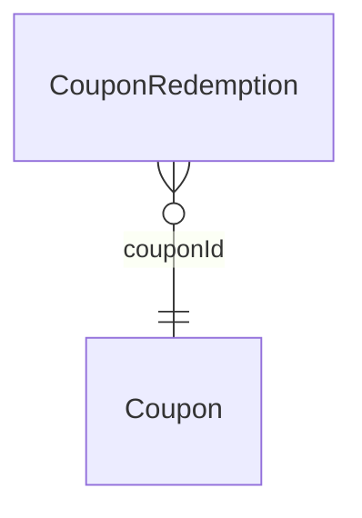

# Payments and Promotions Data Dictionary

**Business responsibility:** Payments, wallet ledger entries, settlements, coupon definitions/redemptions and driver subscription payments.
**Primary API ownership evidence:** `apps/api/src/modules/payments/`, `ledger/`, `settlements/`, `coupons/`, `subscriptions/`. Ownership is logical; other domains may read or update shared models.
**Related API references:** [Payments](../../reference/endpoints/payments-controller.md), [Ledger](../../reference/endpoints/ledger-controller.md), [Settlements](../../reference/endpoints/settlements-controller.md), [Coupons](../../reference/endpoints/coupons-controller.md), [Subscriptions](../../reference/endpoints/subscriptions-controller.md). These are context links, not a claim that every route reads or writes every model in this group.

**Source:** `apps/api/prisma/schema.prisma` (6 models). Model sections cite the declaration line.

## Relationship overview

This ERD includes only direct Prisma foreign-key relations whose two models belong to this page. Cross-context relations remain listed in each model table; a SQL scalar without a Prisma relation is not drawn as a foreign key.

## Payment {#payment}

**Business purpose:** Payment/transaction record
**Storage:** Prisma model `Payment` maps to PostgreSQL table `payments`. **Schema declaration:** `apps/api/prisma/schema.prisma:496`.

| Field | Prisma type / native type | Nullability | Default / behavior | Key and column mapping | Schema description |
|---|---|---|---|---|---|
| `id` | String @db.Uuid | Required | `@default(uuid())` | `@id` | — |
| `requirementId` | String @db.Uuid | Required | `—` | column `requirement_id` | — |
| `vendorId` | String @db.Uuid | Required | `—` | column `vendor_id` | — |
| `amount` | Decimal @db.Decimal(12, 2) | Required | `—` | — | — |
| `status` | [PaymentStatus](../enums.md#payment-status) | Required | `@default(PENDING)` | — | — |
| `paymentMethod` | String? | Nullable | `—` | column `payment_method` | — |
| `transactionRef` | String? | Nullable | `—` | column `transaction_ref` | — |
| `createdAt` | DateTime | Required | `@default(now())` | column `created_at` | — |
| `updatedAt` | DateTime | Required | `@updatedAt` | column `updated_at` | — |
| `requirement` | [Requirement](./marketplace-and-trips.md#requirement) | Required relation | `—` | — | — |
| `vendor` | [Vendor](./identity-and-supply.md#vendor) | Required relation | `—` | — | — |

### Relations

| Relation field | Related model | Foreign-key mapping | On delete | Relation name |
|---|---|---|---|---|
| `requirement` | [Requirement](./marketplace-and-trips.md#requirement) | `requirementId` → `id` | Cascade | `PaymentToRequirement` |
| `vendor` | [Vendor](./identity-and-supply.md#vendor) | `vendorId` → `id` | Cascade | `PaymentToVendor` |

### Model-level keys and indexes

| Declaration | Meaning |
|---|---|
| — | No model-level `@@id`, `@@unique`, `@@index` or `@@fulltext` declaration. Field-level `@id`/`@unique` appears in the field table. |

## LedgerEntry {#ledger-entry}

**Business purpose:** Wallet and ledger credit/debit
**Storage:** Prisma model `LedgerEntry` maps to PostgreSQL table `ledger_entries`. **Schema declaration:** `apps/api/prisma/schema.prisma:513`.

| Field | Prisma type / native type | Nullability | Default / behavior | Key and column mapping | Schema description |
|---|---|---|---|---|---|
| `id` | String @db.Uuid | Required | `@default(uuid())` | `@id` | — |
| `accountType` | String | Required | `—` | column `account_type` | — |
| `accountId` | String @db.Uuid | Required | `—` | column `account_id` | — |
| `entryType` | [LedgerEntryType](../enums.md#ledger-entry-type) | Required | `—` | column `entry_type` | — |
| `amount` | Decimal @db.Decimal(12, 2) | Required | `—` | — | — |
| `balanceAfter` | Decimal @db.Decimal(12, 2) | Required | `—` | column `balance_after` | — |
| `referenceType` | String | Required | `—` | column `reference_type` | — |
| `referenceId` | String | Required | `—` | column `reference_id` | — |
| `description` | String | Required | `—` | — | — |
| `createdAt` | DateTime | Required | `@default(now())` | column `created_at` | — |

### Relations

| Relation field | Related model | Foreign-key mapping | On delete | Relation name |
|---|---|---|---|---|
| — | No Prisma relation fields | — | — | — |

### Model-level keys and indexes

| Declaration | Meaning |
|---|---|
| — | No model-level `@@id`, `@@unique`, `@@index` or `@@fulltext` declaration. Field-level `@id`/`@unique` appears in the field table. |

## Settlement {#settlement}

**Business purpose:** Settlement/payout operation
**Storage:** Prisma model `Settlement` maps to PostgreSQL table `settlements`. **Schema declaration:** `apps/api/prisma/schema.prisma:528`.

| Field | Prisma type / native type | Nullability | Default / behavior | Key and column mapping | Schema description |
|---|---|---|---|---|---|
| `id` | String @db.Uuid | Required | `@default(uuid())` | `@id` | — |
| `driverId` | String @db.Uuid | Required | `—` | column `driver_id` | — |
| `amount` | Decimal @db.Decimal(12, 2) | Required | `—` | — | — |
| `status` | [SettlementStatus](../enums.md#settlement-status) | Required | `@default(PENDING)` | — | — |
| `bankAccountName` | String? | Nullable | `—` | column `bank_account_name` | — |
| `bankAccountNumber` | String? | Nullable | `—` | column `bank_account_number` | — |
| `bankIfsc` | String? | Nullable | `—` | column `bank_ifsc` | — |
| `bankName` | String? | Nullable | `—` | column `bank_name` | — |
| `transactionRef` | String? | Nullable | `—` | column `transaction_ref` | — |
| `processedAt` | DateTime? | Nullable | `—` | column `processed_at` | — |
| `createdAt` | DateTime | Required | `@default(now())` | column `created_at` | — |
| `updatedAt` | DateTime | Required | `@updatedAt` | column `updated_at` | — |
| `driver` | [Driver](./identity-and-supply.md#driver) | Required relation | `—` | — | — |

### Relations

| Relation field | Related model | Foreign-key mapping | On delete | Relation name |
|---|---|---|---|---|
| `driver` | [Driver](./identity-and-supply.md#driver) | `driverId` → `id` | Cascade | `DriverToSettlement` |

### Model-level keys and indexes

| Declaration | Meaning |
|---|---|
| — | No model-level `@@id`, `@@unique`, `@@index` or `@@fulltext` declaration. Field-level `@id`/`@unique` appears in the field table. |

## Coupon {#coupon}

**Business purpose:** Coupon definition
**Storage:** Prisma model `Coupon` maps to PostgreSQL table `coupons`. **Schema declaration:** `apps/api/prisma/schema.prisma:568`.

| Field | Prisma type / native type | Nullability | Default / behavior | Key and column mapping | Schema description |
|---|---|---|---|---|---|
| `id` | String @db.Uuid | Required | `@default(uuid())` | `@id` | — |
| `code` | String | Required | `—` | `@unique` | — |
| `title` | String | Required | `—` | — | — |
| `description` | String? | Nullable | `—` | — | — |
| `discountType` | [CouponDiscountType](../enums.md#coupon-discount-type) | Required | `—` | column `discount_type` | — |
| `discountValue` | Decimal @db.Decimal(10, 2) | Required | `—` | column `discount_value` | — |
| `maxDiscountAmount` | Decimal? @db.Decimal(10, 2) | Nullable | `—` | column `max_discount_amount` | — |
| `minOrderAmount` | Decimal @db.Decimal(10, 2) | Required | `@default(0)` | column `min_order_amount` | — |
| `applicableTo` | [CouponApplicableContext](../enums.md#coupon-applicable-context) | Required | `@default(ALL)` | column `applicable_to` | — |
| `usageLimitTotal` | Int? | Nullable | `—` | column `usage_limit_total` | — |
| `usageLimitPerUser` | Int | Required | `@default(1)` | column `usage_limit_per_user` | — |
| `usedCount` | Int | Required | `@default(0)` | column `used_count` | — |
| `validFrom` | DateTime | Required | `—` | column `valid_from` | — |
| `validUntil` | DateTime | Required | `—` | column `valid_until` | — |
| `isActive` | Boolean | Required | `@default(true)` | column `is_active` | — |
| `createdAt` | DateTime | Required | `@default(now())` | column `created_at` | — |
| `updatedAt` | DateTime | Required | `@updatedAt` | column `updated_at` | — |
| `redemptions` | [CouponRedemption](./payments-and-promotions.md#coupon-redemption)[] | Relation collection | `—` | — | — |

### Relations

| Relation field | Related model | Foreign-key mapping | On delete | Relation name |
|---|---|---|---|---|
| `redemptions` | [CouponRedemption](./payments-and-promotions.md#coupon-redemption)[] | Inverse relation; the foreign-key scalar is declared on the related model | Not specified; Prisma/provider default applies | `CouponToCouponRedemption` |

### Model-level keys and indexes

| Declaration | Meaning |
|---|---|
| — | No model-level `@@id`, `@@unique`, `@@index` or `@@fulltext` declaration. Field-level `@id`/`@unique` appears in the field table. |

## CouponRedemption {#coupon-redemption}

**Business purpose:** Coupon use
**Storage:** Prisma model `CouponRedemption` maps to PostgreSQL table `coupon_redemptions`. **Schema declaration:** `apps/api/prisma/schema.prisma:592`.

| Field | Prisma type / native type | Nullability | Default / behavior | Key and column mapping | Schema description |
|---|---|---|---|---|---|
| `id` | String @db.Uuid | Required | `@default(uuid())` | `@id` | — |
| `couponId` | String @db.Uuid | Required | `—` | column `coupon_id` | — |
| `userId` | String @db.Uuid | Required | `—` | column `user_id` | — |
| `referenceType` | String | Required | `—` | column `reference_type` | — |
| `referenceId` | String | Required | `—` | column `reference_id` | — |
| `orderAmount` | Decimal @db.Decimal(12, 2) | Required | `—` | column `order_amount` | — |
| `discountAmount` | Decimal @db.Decimal(10, 2) | Required | `—` | column `discount_amount` | — |
| `finalAmount` | Decimal @db.Decimal(12, 2) | Required | `—` | column `final_amount` | — |
| `redeemedAt` | DateTime | Required | `@default(now())` | column `redeemed_at` | — |
| `coupon` | [Coupon](./payments-and-promotions.md#coupon) | Required relation | `—` | — | — |
| `user` | [User](./identity-and-supply.md#user) | Required relation | `—` | — | — |

### Relations

| Relation field | Related model | Foreign-key mapping | On delete | Relation name |
|---|---|---|---|---|
| `coupon` | [Coupon](./payments-and-promotions.md#coupon) | `couponId` → `id` | Cascade | `CouponToCouponRedemption` |
| `user` | [User](./identity-and-supply.md#user) | `userId` → `id` | Cascade | `CouponRedemptionToUser` |

### Model-level keys and indexes

| Declaration | Meaning |
|---|---|
| `@@index([couponId, userId])` | Database index |
| `@@index([userId])` | Database index |

## DriverSubscriptionPayment {#driver-subscription-payment}

**Business purpose:** Driver subscription purchase
**Storage:** Prisma model `DriverSubscriptionPayment` maps to PostgreSQL table `driver_subscription_payments`. **Schema declaration:** `apps/api/prisma/schema.prisma:807`.

| Field | Prisma type / native type | Nullability | Default / behavior | Key and column mapping | Schema description |
|---|---|---|---|---|---|
| `id` | String @db.Uuid | Required | `@default(uuid())` | `@id` | — |
| `driverId` | String @db.Uuid | Required | `—` | column `driver_id` | — |
| `amount` | Decimal @db.Decimal(10, 2) | Required | `—` | — | — |
| `discountAmount` | Decimal @db.Decimal(10, 2) | Required | `@default(0)` | column `discount_amount` | — |
| `finalAmount` | Decimal @db.Decimal(10, 2) | Required | `—` | column `final_amount` | — |
| `paymentMethod` | String | Required | `—` | column `payment_method` | — |
| `paymentRef` | String? | Nullable | `—` | column `payment_ref` | — |
| `periodStart` | DateTime | Required | `—` | column `period_start` | — |
| `periodEnd` | DateTime | Required | `—` | column `period_end` | — |
| `couponCode` | String? | Nullable | `—` | column `coupon_code` | — |
| `createdAt` | DateTime | Required | `@default(now())` | column `created_at` | — |
| `driver` | [Driver](./identity-and-supply.md#driver) | Required relation | `—` | — | — |

### Relations

| Relation field | Related model | Foreign-key mapping | On delete | Relation name |
|---|---|---|---|---|
| `driver` | [Driver](./identity-and-supply.md#driver) | `driverId` → `id` | Cascade | `DriverToDriverSubscriptionPayment` |

### Model-level keys and indexes

| Declaration | Meaning |
|---|---|
| — | No model-level `@@id`, `@@unique`, `@@index` or `@@fulltext` declaration. Field-level `@id`/`@unique` appears in the field table. |

## Reading the field tables

- `Required` means Prisma marks the scalar field non-null; `Nullable` means the Prisma type permits null.
- `[]` denotes a Prisma list field. Object/relation fields are not physical columns unless a scalar FK field is also listed.
- `@db.*`, `@map` and `@@map` preserve native PostgreSQL types and storage names declared in the schema.
- Defaults and `@updatedAt` are schema declarations, not guarantees that existing production databases have no drift.
- A missing description means the Prisma schema has no field-level documentation comment; field meaning should not be guessed from the name alone.
