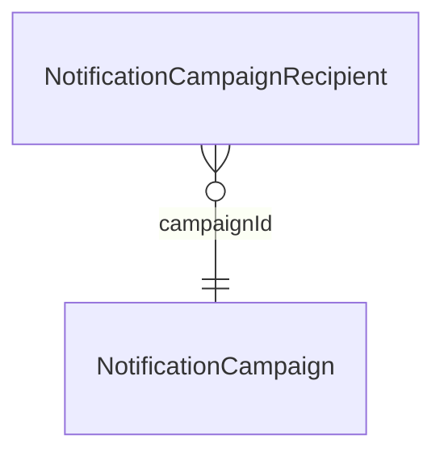

# Platform and Communications Data Dictionary

**Business responsibility:** Audit records, content, push registration and notifications, campaigns, leads, runtime flags and system policy configuration.
**Primary API ownership evidence:** `apps/api/src/modules/admin/`, `blogs/`, `notifications/`, `leads/`, `feature-flags/`. Ownership is logical; other domains may read or update shared models.
**Related API references:** [Administration](../../reference/endpoints/admin-controller.md), [Blogs](../../reference/endpoints/blogs-controller.md), [Notifications](../../reference/endpoints/notifications-controller.md), [Leads](../../reference/endpoints/leads-controller.md), [Feature flags](../../reference/endpoints/feature-flags-controller.md), [Health](../../reference/endpoints/health-controller.md). These are context links, not a claim that every route reads or writes every model in this group.

**Source:** `apps/api/prisma/schema.prisma` (10 models). Model sections cite the declaration line.

## Relationship overview

This ERD includes only direct Prisma foreign-key relations whose two models belong to this page. Cross-context relations remain listed in each model table; a SQL scalar without a Prisma relation is not drawn as a foreign key.

## AuditLog {#audit-log}

**Business purpose:** Administrative and domain audit
**Storage:** Prisma model `AuditLog` maps to PostgreSQL table `audit_logs`. **Schema declaration:** `apps/api/prisma/schema.prisma:547`.

| Field | Prisma type / native type | Nullability | Default / behavior | Key and column mapping | Schema description |
|---|---|---|---|---|---|
| `id` | String @db.Uuid | Required | `@default(uuid())` | `@id` | — |
| `actorId` | String? @db.Uuid | Nullable | `—` | column `actor_id` | — |
| `actorRole` | String? | Nullable | `—` | column `actor_role` | — |
| `action` | String | Required | `—` | — | — |
| `entityName` | String | Required | `—` | column `entity_name` | — |
| `entityId` | String? | Nullable | `—` | column `entity_id` | — |
| `payload` | Json? | Nullable | `—` | — | — |
| `ipAddress` | String? | Nullable | `—` | column `ip_address` | — |
| `userAgent` | String? | Nullable | `—` | column `user_agent` | — |
| `createdAt` | DateTime | Required | `@default(now())` | column `created_at` | — |
| `actor` | [User](./identity-and-supply.md#user)? | Optional relation | `—` | — | — |

### Relations

| Relation field | Related model | Foreign-key mapping | On delete | Relation name |
|---|---|---|---|---|
| `actor` | [User](./identity-and-supply.md#user)? | `actorId` → `id` | SetNull | `AuditLogToUser` |

### Model-level keys and indexes

| Declaration | Meaning |
|---|---|
| `@@index([actorId])` | Database index |
| `@@index([action])` | Database index |
| `@@index([entityName, entityId])` | Database index |
| `@@index([createdAt])` | Database index |

## BlogPost {#blog-post}

**Business purpose:** Marketing content
**Storage:** Prisma model `BlogPost` maps to PostgreSQL table `blog_posts`. **Schema declaration:** `apps/api/prisma/schema.prisma:617`.

| Field | Prisma type / native type | Nullability | Default / behavior | Key and column mapping | Schema description |
|---|---|---|---|---|---|
| `id` | String @db.Uuid | Required | `@default(uuid())` | `@id` | — |
| `title` | String | Required | `—` | — | — |
| `slug` | String | Required | `—` | `@unique` | — |
| `excerpt` | String @db.Text | Required | `—` | — | — |
| `content` | String @db.Text | Required | `—` | — | — |
| `category` | String | Required | `—` | — | — |
| `tags` | String[] | List (not a nullable scalar) | `@default([])` | — | — |
| `coverImage` | String? | Nullable | `—` | column `cover_image` | — |
| `authorName` | String | Required | `@default("AdhocX Team")` | column `author_name` | — |
| `authorRole` | String? | Nullable | `@default("Fleet Operations & Mobility Research")` | column `author_role` | — |
| `status` | [BlogStatus](../enums.md#blog-status) | Required | `@default(DRAFT)` | — | — |
| `views` | Int | Required | `@default(0)` | — | — |
| `readTime` | String | Required | `@default("5 min read")` | column `read_time` | — |
| `seoTitle` | String? | Nullable | `—` | column `seo_title` | — |
| `seoDescription` | String? @db.Text | Nullable | `—` | column `seo_description` | — |
| `seoKeywords` | String? | Nullable | `—` | column `seo_keywords` | — |
| `publishedAt` | DateTime? | Nullable | `—` | column `published_at` | — |
| `createdAt` | DateTime | Required | `@default(now())` | column `created_at` | — |
| `updatedAt` | DateTime | Required | `@updatedAt` | column `updated_at` | — |

### Relations

| Relation field | Related model | Foreign-key mapping | On delete | Relation name |
|---|---|---|---|---|
| — | No Prisma relation fields | — | — | — |

### Model-level keys and indexes

| Declaration | Meaning |
|---|---|
| `@@index([slug])` | Database index |
| `@@index([status, publishedAt])` | Database index |
| `@@index([category])` | Database index |

## DeviceToken {#device-token}

**Business purpose:** Push target
**Storage:** Prisma model `DeviceToken` maps to PostgreSQL table `device_tokens`. **Schema declaration:** `apps/api/prisma/schema.prisma:662`.

| Field | Prisma type / native type | Nullability | Default / behavior | Key and column mapping | Schema description |
|---|---|---|---|---|---|
| `id` | String @db.Uuid | Required | `@default(uuid())` | `@id` | — |
| `userId` | String @db.Uuid | Required | `—` | column `user_id` | — |
| `token` | String | Required | `—` | `@unique` | — |
| `platform` | [DevicePlatform](../enums.md#device-platform) | Required | `@default(ANDROID)` | — | — |
| `deviceModel` | String? | Nullable | `—` | column `device_model` | — |
| `appVersion` | String? | Nullable | `—` | column `app_version` | — |
| `isActive` | Boolean | Required | `@default(true)` | column `is_active` | — |
| `lastActiveAt` | DateTime | Required | `@default(now())` | column `last_active_at` | — |
| `createdAt` | DateTime | Required | `@default(now())` | column `created_at` | — |
| `updatedAt` | DateTime | Required | `@updatedAt` | column `updated_at` | — |
| `user` | [User](./identity-and-supply.md#user) | Required relation | `—` | — | — |

### Relations

| Relation field | Related model | Foreign-key mapping | On delete | Relation name |
|---|---|---|---|---|
| `user` | [User](./identity-and-supply.md#user) | `userId` → `id` | Cascade | `DeviceTokenToUser` |

### Model-level keys and indexes

| Declaration | Meaning |
|---|---|
| `@@index([userId, isActive])` | Database index |

## Notification {#notification}

**Business purpose:** Notification record
**Storage:** Prisma model `Notification` maps to PostgreSQL table `notifications`. **Schema declaration:** `apps/api/prisma/schema.prisma:680`.

| Field | Prisma type / native type | Nullability | Default / behavior | Key and column mapping | Schema description |
|---|---|---|---|---|---|
| `id` | String @db.Uuid | Required | `@default(uuid())` | `@id` | — |
| `userId` | String @db.Uuid | Required | `—` | column `user_id` | — |
| `title` | String | Required | `—` | — | — |
| `body` | String | Required | `—` | — | — |
| `type` | [NotificationType](../enums.md#notification-type) | Required | `@default(SYSTEM)` | — | — |
| `data` | Json? | Nullable | `—` | — | — |
| `imageUrl` | String? | Nullable | `—` | column `image_url` | — |
| `isRead` | Boolean | Required | `@default(false)` | column `is_read` | — |
| `readAt` | DateTime? | Nullable | `—` | column `read_at` | — |
| `isClicked` | Boolean | Required | `@default(false)` | column `is_clicked` | — |
| `clickedAt` | DateTime? | Nullable | `—` | column `clicked_at` | — |
| `idempotencyKey` | String? | Nullable | `—` | column `idempotency_key` | — |
| `priority` | String | Required | `@default("high")` | — | — |
| `channel` | String | Required | `@default("PUSH")` | — | — |
| `createdAt` | DateTime | Required | `@default(now())` | column `created_at` | — |
| `user` | [User](./identity-and-supply.md#user) | Required relation | `—` | — | — |

### Relations

| Relation field | Related model | Foreign-key mapping | On delete | Relation name |
|---|---|---|---|---|
| `user` | [User](./identity-and-supply.md#user) | `userId` → `id` | Cascade | `NotificationToUser` |

### Model-level keys and indexes

| Declaration | Meaning |
|---|---|
| `@@index([userId, isRead])` | Database index |
| `@@index([userId, createdAt])` | Database index |
| `@@index([idempotencyKey])` | Database index |
| `@@index([createdAt])` | Database index |

## NotificationPreference {#notification-preference}

**Business purpose:** User channel preference
**Storage:** Prisma model `NotificationPreference` maps to PostgreSQL table `notification_preferences`. **Schema declaration:** `apps/api/prisma/schema.prisma:706`.

| Field | Prisma type / native type | Nullability | Default / behavior | Key and column mapping | Schema description |
|---|---|---|---|---|---|
| `id` | String @db.Uuid | Required | `@default(uuid())` | `@id` | — |
| `userId` | String @db.Uuid | Required | `—` | `@unique`; column `user_id` | — |
| `pushEnabled` | Boolean | Required | `@default(true)` | column `push_enabled` | — |
| `emailEnabled` | Boolean | Required | `@default(true)` | column `email_enabled` | — |
| `smsEnabled` | Boolean | Required | `@default(true)` | column `sms_enabled` | — |
| `tripAlerts` | Boolean | Required | `@default(true)` | column `trip_alerts` | — |
| `marketingPromos` | Boolean | Required | `@default(true)` | column `marketing_promos` | — |
| `quietHoursStart` | String? | Nullable | `—` | column `quiet_hours_start` | — |
| `quietHoursEnd` | String? | Nullable | `—` | column `quiet_hours_end` | — |
| `createdAt` | DateTime | Required | `@default(now())` | column `created_at` | — |
| `updatedAt` | DateTime | Required | `@updatedAt` | column `updated_at` | — |
| `user` | [User](./identity-and-supply.md#user) | Required relation | `—` | — | — |

### Relations

| Relation field | Related model | Foreign-key mapping | On delete | Relation name |
|---|---|---|---|---|
| `user` | [User](./identity-and-supply.md#user) | `userId` → `id` | Cascade | `NotificationPreferenceToUser` |

### Model-level keys and indexes

| Declaration | Meaning |
|---|---|
| — | No model-level `@@id`, `@@unique`, `@@index` or `@@fulltext` declaration. Field-level `@id`/`@unique` appears in the field table. |

## NotificationCampaign {#notification-campaign}

**Business purpose:** Broadcast campaign
**Storage:** Prisma model `NotificationCampaign` maps to PostgreSQL table `notification_campaigns`. **Schema declaration:** `apps/api/prisma/schema.prisma:724`.

| Field | Prisma type / native type | Nullability | Default / behavior | Key and column mapping | Schema description |
|---|---|---|---|---|---|
| `id` | String @db.Uuid | Required | `@default(uuid())` | `@id` | — |
| `title` | String | Required | `—` | — | — |
| `body` | String | Required | `—` | — | — |
| `imageUrl` | String? | Nullable | `—` | column `image_url` | — |
| `actionUrl` | String? | Nullable | `—` | column `action_url` | — |
| `targetRole` | String? | Nullable | `—` | column `target_role` | — |
| `targetFilter` | Json? | Nullable | `—` | column `target_filter` | — |
| `totalTargeted` | Int | Required | `@default(0)` | column `total_targeted` | — |
| `successCount` | Int | Required | `@default(0)` | column `success_count` | — |
| `failureCount` | Int | Required | `@default(0)` | column `failure_count` | — |
| `status` | String | Required | `@default("SENT")` | — | — |
| `sentBy` | String? | Nullable | `—` | column `sent_by` | — |
| `recipientTrackingEnabled` | Boolean | Required | `@default(false)` | column `recipient_tracking_enabled` | — |
| `createdAt` | DateTime | Required | `@default(now())` | column `created_at` | — |
| `recipients` | [NotificationCampaignRecipient](./platform-and-communications.md#notification-campaign-recipient)[] | Relation collection | `—` | — | — |

### Relations

| Relation field | Related model | Foreign-key mapping | On delete | Relation name |
|---|---|---|---|---|
| `recipients` | [NotificationCampaignRecipient](./platform-and-communications.md#notification-campaign-recipient)[] | Inverse relation; the foreign-key scalar is declared on the related model | Not specified; Prisma/provider default applies | `NotificationCampaignToNotificationCampaignRecipient` |

### Model-level keys and indexes

| Declaration | Meaning |
|---|---|
| `@@index([createdAt])` | Database index |

## NotificationCampaignRecipient {#notification-campaign-recipient}

**Business purpose:** Campaign recipient
**Storage:** Prisma model `NotificationCampaignRecipient` maps to PostgreSQL table `notification_campaign_recipients`. **Schema declaration:** `apps/api/prisma/schema.prisma:746`.

| Field | Prisma type / native type | Nullability | Default / behavior | Key and column mapping | Schema description |
|---|---|---|---|---|---|
| `id` | String @db.Uuid | Required | `@default(uuid())` | `@id` | — |
| `campaignId` | String @db.Uuid | Required | `—` | column `campaign_id` | — |
| `userId` | String? @db.Uuid | Nullable | `—` | column `user_id` | — |
| `recipientName` | String? | Nullable | `—` | column `recipient_name` | — |
| `recipientPhone` | String? | Nullable | `—` | column `recipient_phone` | — |
| `recipientRole` | String? | Nullable | `—` | column `recipient_role` | — |
| `recipientEmail` | String? | Nullable | `—` | column `recipient_email` | — |
| `recipientProfile` | Json? | Nullable | `—` | column `recipient_profile` | — |
| `deviceDetails` | Json? | Nullable | `—` | column `device_details` | — |
| `status` | String @db.VarChar(16) | Required | `@default("PENDING")` | — | — |
| `deviceCount` | Int | Required | `@default(0)` | column `device_count` | — |
| `providerAcceptedCount` | Int | Required | `@default(0)` | column `provider_accepted_count` | — |
| `providerFailedCount` | Int | Required | `@default(0)` | column `provider_failed_count` | — |
| `providerMessageIds` | String[] | List (not a nullable scalar) | `@default([])` | column `provider_message_ids` | — |
| `attemptedAt` | DateTime? | Nullable | `—` | column `attempted_at` | — |
| `deliveredAt` | DateTime? | Nullable | `—` | column `delivered_at` | — |
| `failedAt` | DateTime? | Nullable | `—` | column `failed_at` | — |
| `failureReason` | String? @db.Text | Nullable | `—` | column `failure_reason` | — |
| `createdAt` | DateTime | Required | `@default(now())` | column `created_at` | — |
| `updatedAt` | DateTime | Required | `@updatedAt` | column `updated_at` | — |
| `campaign` | [NotificationCampaign](./platform-and-communications.md#notification-campaign) | Required relation | `—` | — | — |
| `user` | [User](./identity-and-supply.md#user)? | Optional relation | `—` | — | — |

### Relations

| Relation field | Related model | Foreign-key mapping | On delete | Relation name |
|---|---|---|---|---|
| `campaign` | [NotificationCampaign](./platform-and-communications.md#notification-campaign) | `campaignId` → `id` | Cascade | `NotificationCampaignToNotificationCampaignRecipient` |
| `user` | [User](./identity-and-supply.md#user)? | `userId` → `id` | SetNull | `NotificationCampaignRecipientToUser` |

### Model-level keys and indexes

| Declaration | Meaning |
|---|---|
| `@@unique([campaignId, userId])` | Composite unique constraint |
| `@@index([campaignId, status])` | Database index |
| `@@index([userId])` | Database index |

## LeadCapture {#lead-capture}

**Business purpose:** Marketing/enterprise lead
**Storage:** Prisma model `LeadCapture` maps to PostgreSQL table `lead_captures`. **Schema declaration:** `apps/api/prisma/schema.prisma:825`.

| Field | Prisma type / native type | Nullability | Default / behavior | Key and column mapping | Schema description |
|---|---|---|---|---|---|
| `id` | String @db.Uuid | Required | `@default(uuid())` | `@id` | — |
| `type` | String | Required | `—` | — | — |
| `email` | String | Required | `—` | — | — |
| `phone` | String? | Nullable | `—` | — | — |
| `companyName` | String? | Nullable | `—` | column `company_name` | — |
| `contactName` | String? | Nullable | `—` | column `contact_name` | — |
| `city` | String? | Nullable | `—` | — | — |
| `fleetRequirements` | String? | Nullable | `—` | column `fleet_requirements` | — |
| `monthlyTripsEstimate` | String? | Nullable | `—` | column `monthly_trips_estimate` | — |
| `preferredVehicles` | String? | Nullable | `—` | column `preferred_vehicles` | — |
| `notes` | String? | Nullable | `—` | — | — |
| `status` | String | Required | `@default("NEW")` | — | — |
| `createdAt` | DateTime | Required | `@default(now())` | column `created_at` | — |
| `updatedAt` | DateTime | Required | `@updatedAt` | column `updated_at` | — |

### Relations

| Relation field | Related model | Foreign-key mapping | On delete | Relation name |
|---|---|---|---|---|
| — | No Prisma relation fields | — | — | — |

### Model-level keys and indexes

| Declaration | Meaning |
|---|---|
| — | No model-level `@@id`, `@@unique`, `@@index` or `@@fulltext` declaration. Field-level `@id`/`@unique` appears in the field table. |

## FeatureFlag {#feature-flag}

**Business purpose:** Runtime feature state
**Storage:** Prisma model `FeatureFlag` maps to PostgreSQL table `feature_flags`. **Schema declaration:** `apps/api/prisma/schema.prisma:2282`.

| Field | Prisma type / native type | Nullability | Default / behavior | Key and column mapping | Schema description |
|---|---|---|---|---|---|
| `id` | String | Required | `@default(uuid())` | `@id` | — |
| `key` | String | Required | `—` | `@unique` | — |
| `name` | String | Required | `—` | — | — |
| `description` | String? | Nullable | `—` | — | — |
| `category` | String | Required | `@default("GENERAL")` | — | — |
| `isEnabled` | Boolean | Required | `@default(false)` | column `is_enabled` | — |
| `metadata` | Json? | Nullable | `—` | — | — |
| `createdBy` | String? | Nullable | `—` | column `created_by` | — |
| `updatedBy` | String? | Nullable | `—` | column `updated_by` | — |
| `createdAt` | DateTime | Required | `@default(now())` | column `created_at` | — |
| `updatedAt` | DateTime | Required | `@updatedAt` | column `updated_at` | — |

### Relations

| Relation field | Related model | Foreign-key mapping | On delete | Relation name |
|---|---|---|---|---|
| — | No Prisma relation fields | — | — | — |

### Model-level keys and indexes

| Declaration | Meaning |
|---|---|
| `@@index([key])` | Database index |
| `@@index([isEnabled])` | Database index |

## SystemPolicyConfig {#system-policy-config}

**Business purpose:** Global policy configuration
**Storage:** Prisma model `SystemPolicyConfig` maps to PostgreSQL table `system_policy_configs`. **Schema declaration:** `apps/api/prisma/schema.prisma:795`.

| Field | Prisma type / native type | Nullability | Default / behavior | Key and column mapping | Schema description |
|---|---|---|---|---|---|
| `id` | String @db.Uuid | Required | `@default(uuid())` | `@id` | — |
| `key` | String | Required | `—` | `@unique` | — |
| `driverMonthlyFee` | Decimal @db.Decimal(10, 2) | Required | `@default(499)` | column `driver_monthly_fee` | — |
| `driverTrialDays` | Int | Required | `@default(15)` | column `driver_trial_days` | — |
| `minWithdrawalAmount` | Decimal @db.Decimal(10, 2) | Required | `@default(1000)` | column `min_withdrawal_amount` | — |
| `escortFee` | Decimal @db.Decimal(10, 2) | Required | `@default(300)` | column `escort_fee` | — |
| `updatedAt` | DateTime | Required | `@updatedAt` | column `updated_at` | — |

### Relations

| Relation field | Related model | Foreign-key mapping | On delete | Relation name |
|---|---|---|---|---|
| — | No Prisma relation fields | — | — | — |

### Model-level keys and indexes

| Declaration | Meaning |
|---|---|
| — | No model-level `@@id`, `@@unique`, `@@index` or `@@fulltext` declaration. Field-level `@id`/`@unique` appears in the field table. |

## Reading the field tables

- `Required` means Prisma marks the scalar field non-null; `Nullable` means the Prisma type permits null.
- `[]` denotes a Prisma list field. Object/relation fields are not physical columns unless a scalar FK field is also listed.
- `@db.*`, `@map` and `@@map` preserve native PostgreSQL types and storage names declared in the schema.
- Defaults and `@updatedAt` are schema declarations, not guarantees that existing production databases have no drift.
- A missing description means the Prisma schema has no field-level documentation comment; field meaning should not be guessed from the name alone.
