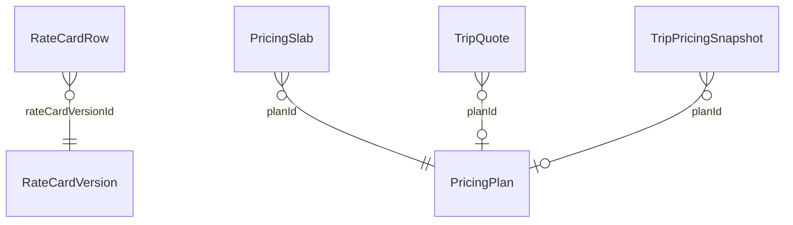

# Pricing and Locality Data Dictionary

**Business responsibility:** Vehicle pricing inputs, versioned pricing plans, quotes, pricing snapshots, locality metadata and pricing audit.
**Primary API ownership evidence:** `apps/api/src/modules/pricing/` and pricing/locality services. Ownership is logical; other domains may read or update shared models.
**Related API references:** [Pricing](../../reference/endpoints/pricing-controller.md), [Admin pricing](../../reference/endpoints/admin-pricing-controller.md), [Vendor quotes](../../reference/endpoints/vendor-quote-controller.md), [Driver quotes](../../reference/endpoints/driver-quote-controller.md). These are context links, not a claim that every route reads or writes every model in this group.

**Source:** `apps/api/prisma/schema.prisma` (10 models). Model sections cite the declaration line.

## Relationship overview

This ERD includes only direct Prisma foreign-key relations whose two models belong to this page. Cross-context relations remain listed in each model table; a SQL scalar without a Prisma relation is not drawn as a foreign key.

## VehiclePricingTier {#vehicle-pricing-tier}

**Business purpose:** Vehicle category pricing inputs, including base fare, included distance and per-kilometer rate
**Storage:** Prisma model `VehiclePricingTier` maps to PostgreSQL table `vehicle_pricing_tiers`. **Schema declaration:** `apps/api/prisma/schema.prisma:777`.

| Field | Prisma type / native type | Nullability | Default / behavior | Key and column mapping | Schema description |
|---|---|---|---|---|---|
| `id` | String @db.Uuid | Required | `@default(uuid())` | `@id` | — |
| `vehicleType` | String @db.VarChar(50) | Required | `—` | `@unique`; column `vehicle_type` | — |
| `categoryLabel` | String | Required | `—` | column `category_label` | — |
| `seatingCapacity` | String | Required | `—` | column `seating_capacity` | — |
| `description` | String | Required | `—` | — | — |
| `iconKey` | String? | Nullable | `@default("car")` | column `icon_key` | — |
| `baseFare` | Decimal @db.Decimal(10, 2) | Required | `—` | column `base_fare` | — |
| `baseKm` | Decimal @db.Decimal(10, 2) | Required | `—` | column `base_km` | — |
| `perKmRate` | Decimal @db.Decimal(10, 2) | Required | `—` | column `per_km_rate` | — |
| `surgeMultiplier` | Decimal @db.Decimal(4, 2) | Required | `@default(1)` | column `surge_multiplier` | — |
| `isActive` | Boolean | Required | `@default(true)` | column `is_active` | — |
| `updatedAt` | DateTime | Required | `@updatedAt` | column `updated_at` | — |
| `updatedBy` | String? | Nullable | `—` | column `updated_by` | — |

### Relations

| Relation field | Related model | Foreign-key mapping | On delete | Relation name |
|---|---|---|---|---|
| — | No Prisma relation fields | — | — | — |

### Model-level keys and indexes

| Declaration | Meaning |
|---|---|
| — | No model-level `@@id`, `@@unique`, `@@index` or `@@fulltext` declaration. Field-level `@id`/`@unique` appears in the field table. |

## RateCardVersion {#rate-card-version}

**Business purpose:** Versioned rate-card header with audience, status and effective date
**Storage:** Prisma model `RateCardVersion` maps to PostgreSQL table `rate_card_versions`. **Schema declaration:** `apps/api/prisma/schema.prisma:858`.

| Field | Prisma type / native type | Nullability | Default / behavior | Key and column mapping | Schema description |
|---|---|---|---|---|---|
| `id` | String @db.Uuid | Required | `@default(uuid())` | `@id` | — |
| `version` | String | Required | `—` | — | — |
| `audience` | [RateCardAudience](../enums.md#rate-card-audience) | Required | `—` | — | — |
| `status` | [RateCardStatus](../enums.md#rate-card-status) | Required | `@default(DRAFT)` | — | — |
| `effectiveFrom` | DateTime | Required | `—` | column `effective_from` | — |
| `currency` | String | Required | `@default("INR")` | — | — |
| `notes` | String? | Nullable | `—` | — | — |
| `createdAt` | DateTime | Required | `@default(now())` | column `created_at` | — |
| `publishedAt` | DateTime? | Nullable | `—` | column `published_at` | — |
| `publishedBy` | String? | Nullable | `—` | column `published_by` | — |
| `rows` | [RateCardRow](./pricing-and-locality.md#rate-card-row)[] | Relation collection | `—` | — | — |

### Relations

| Relation field | Related model | Foreign-key mapping | On delete | Relation name |
|---|---|---|---|---|
| `rows` | [RateCardRow](./pricing-and-locality.md#rate-card-row)[] | Inverse relation; the foreign-key scalar is declared on the related model | Not specified; Prisma/provider default applies | `RateCardRowToRateCardVersion` |

### Model-level keys and indexes

| Declaration | Meaning |
|---|---|
| `@@unique([audience, version])` | Composite unique constraint |
| `@@index([audience, status])` | Database index |

## RateCardRow {#rate-card-row}

**Business purpose:** Rate-card amount for a hub, zone and vehicle type
**Storage:** Prisma model `RateCardRow` maps to PostgreSQL table `rate_card_rows`. **Schema declaration:** `apps/api/prisma/schema.prisma:876`.

| Field | Prisma type / native type | Nullability | Default / behavior | Key and column mapping | Schema description |
|---|---|---|---|---|---|
| `id` | String @db.Uuid | Required | `@default(uuid())` | `@id` | — |
| `rateCardVersionId` | String @db.Uuid | Required | `—` | column `rate_card_version_id` | — |
| `hubId` | String | Required | `—` | column `hub_id` | — |
| `zoneId` | String | Required | `—` | column `zone_id` | — |
| `vehicleType` | String @db.VarChar(50) | Required | `—` | column `vehicle_type` | — |
| `baseAmountPaise` | Int | Required | `—` | column `base_amount_paise` | — |
| `escortMaxPaise` | Int | Required | `@default(0)` | column `escort_max_paise` | — |
| `rateCardVersion` | [RateCardVersion](./pricing-and-locality.md#rate-card-version) | Required relation | `—` | — | — |

### Relations

| Relation field | Related model | Foreign-key mapping | On delete | Relation name |
|---|---|---|---|---|
| `rateCardVersion` | [RateCardVersion](./pricing-and-locality.md#rate-card-version) | `rateCardVersionId` → `id` | Cascade | `RateCardRowToRateCardVersion` |

### Model-level keys and indexes

| Declaration | Meaning |
|---|---|
| `@@unique([rateCardVersionId, hubId, zoneId, vehicleType])` | Composite unique constraint |

## LocalityMaster {#locality-master}

**Business purpose:** Locality display name, aliases, zone and optional geospatial/H3 metadata
**Storage:** Prisma model `LocalityMaster` maps to PostgreSQL table `locality_masters`. **Schema declaration:** `apps/api/prisma/schema.prisma:900`.

| Field | Prisma type / native type | Nullability | Default / behavior | Key and column mapping | Schema description |
|---|---|---|---|---|---|
| `id` | String @db.Uuid | Required | `@default(uuid())` | `@id` | — |
| `displayName` | String | Required | `—` | `@unique`; column `display_name` | — |
| `aliases` | String[] | List (not a nullable scalar) | `—` | — | — |
| `zoneId` | String | Required | `—` | column `zone_id` | — |
| `centerLat` | Decimal? @db.Decimal(10, 7) | Nullable | `—` | column `center_lat` | — |
| `centerLng` | Decimal? @db.Decimal(10, 7) | Nullable | `—` | column `center_lng` | — |
| `h3IndexRes8` | String? | Nullable | `—` | column `h3_index_res8` | — |
| `reviewStatus` | [LocalityReviewStatus](../enums.md#locality-review-status) | Required | `@default(VERIFIED)` | column `review_status` | — |
| `notes` | String? | Nullable | `—` | — | — |
| `version` | Int | Required | `@default(1)` | — | — |
| `createdAt` | DateTime | Required | `@default(now())` | column `created_at` | — |
| `updatedAt` | DateTime | Required | `@updatedAt` | column `updated_at` | — |

### Relations

| Relation field | Related model | Foreign-key mapping | On delete | Relation name |
|---|---|---|---|---|
| — | No Prisma relation fields | — | — | — |

### Model-level keys and indexes

| Declaration | Meaning |
|---|---|
| `@@index([zoneId])` | Database index |
| `@@index([h3IndexRes8])` | Database index |

## ZonalQuoteSnapshot {#zonal-quote-snapshot}

**Business purpose:** Quote-time snapshot of selected rate versions, zone/locality and trip coordinates
**Storage:** Prisma model `ZonalQuoteSnapshot` maps to PostgreSQL table `zonal_quote_snapshots`. **Schema declaration:** `apps/api/prisma/schema.prisma:922`.

| Field | Prisma type / native type | Nullability | Default / behavior | Key and column mapping | Schema description |
|---|---|---|---|---|---|
| `id` | String @db.Uuid | Required | `@default(uuid())` | `@id` | — |
| `requirementId` | String? @db.Uuid | Nullable | `—` | `@unique`; column `requirement_id` | — |
| `requestedBy` | String? @db.Uuid | Nullable | `—` | column `requested_by` | — |
| `rateVersion` | String | Required | `—` | column `rate_version` | — |
| `driverRateVersion` | String? | Nullable | `—` | column `driver_rate_version` | — |
| `direction` | String? @db.VarChar(32) | Nullable | `—` | — | — |
| `hubId` | String | Required | `—` | column `hub_id` | — |
| `localityId` | String | Required | `—` | column `locality_id` | — |
| `localityName` | String? | Nullable | `—` | column `locality_name` | — |
| `zoneId` | String | Required | `—` | column `zone_id` | — |
| `pickupLat` | Decimal? @db.Decimal(10, 7) | Nullable | `—` | column `pickup_lat` | — |
| `pickupLng` | Decimal? @db.Decimal(10, 7) | Nullable | `—` | column `pickup_lng` | — |
| `dropLat` | Decimal? @db.Decimal(10, 7) | Nullable | `—` | column `drop_lat` | — |
| `dropLng` | Decimal? @db.Decimal(10, 7) | Nullable | `—` | column `drop_lng` | — |
| `consumedAt` | DateTime? | Nullable | `—` | column `consumed_at` | — |
| `vehicleType` | String @db.VarChar(50) | Required | `—` | column `vehicle_type` | — |
| `hasEscort` | Boolean | Required | `@default(false)` | column `has_escort` | — |
| `baseFarePaise` | Int | Required | `—` | column `base_fare_paise` | — |
| `escortFarePaise` | Int | Required | `@default(0)` | column `escort_fare_paise` | — |
| `totalFarePaise` | Int | Required | `—` | column `total_fare_paise` | — |
| `driverFarePaise` | Int | Required | `—` | column `driver_fare_paise` | — |
| `expiresAt` | DateTime | Required | `—` | column `expires_at` | — |
| `createdAt` | DateTime | Required | `@default(now())` | column `created_at` | — |
| `requirement` | [Requirement](./marketplace-and-trips.md#requirement)? | Optional relation | `—` | — | — |

### Relations

| Relation field | Related model | Foreign-key mapping | On delete | Relation name |
|---|---|---|---|---|
| `requirement` | [Requirement](./marketplace-and-trips.md#requirement)? | `requirementId` → `id` | Not specified; Prisma/provider default applies | `RequirementToZonalQuoteSnapshot` |

### Model-level keys and indexes

| Declaration | Meaning |
|---|---|
| `@@index([requestedBy, createdAt])` | Database index |

## PricingPlan {#pricing-plan}

**Business purpose:** Distance pricing plan
**Storage:** Prisma model `PricingPlan` maps to PostgreSQL table `pricing_plans`. **Schema declaration:** `apps/api/prisma/schema.prisma:957`.

| Field | Prisma type / native type | Nullability | Default / behavior | Key and column mapping | Schema description |
|---|---|---|---|---|---|
| `id` | String @db.Uuid | Required | `@default(uuid())` | `@id` | — |
| `vehicleCategory` | String @db.VarChar(50) | Required | `@default("ALL")` | column `vehicle_category` | — |
| `version` | String | Required | `—` | — | — |
| `name` | String? | Nullable | `—` | — | — |
| `status` | String | Required | `@default("DRAFT")` | — | — |
| `effectiveFrom` | DateTime | Required | `@default(now())` | column `effective_from` | — |
| `effectiveTo` | DateTime? | Nullable | `—` | column `effective_to` | — |
| `createdBy` | String? | Nullable | `—` | column `created_by` | — |
| `publishedBy` | String? | Nullable | `—` | column `published_by` | — |
| `publishedAt` | DateTime? | Nullable | `—` | column `published_at` | — |
| `createdAt` | DateTime | Required | `@default(now())` | column `created_at` | — |
| `updatedAt` | DateTime | Required | `@updatedAt` | column `updated_at` | — |
| `peakWindowsJson` | Json? | Nullable | `—` | column `peak_windows_json` | Peak windows in IST: [{ start: "08:00", end: "11:00", label? }]. Null/empty = never peak. |
| `rateConfigJson` | Json? | Nullable | `—` | column `rate_config_json` | Admin slab-generator settings (step km, max km, uplift %). Display only; never used for pricing. |
| `slabs` | [PricingSlab](./pricing-and-locality.md#pricing-slab)[] | Relation collection | `—` | — | — |
| `quotes` | [TripQuote](./pricing-and-locality.md#trip-quote)[] | Relation collection | `—` | — | — |
| `snapshots` | [TripPricingSnapshot](./pricing-and-locality.md#trip-pricing-snapshot)[] | Relation collection | `—` | — | — |

### Relations

| Relation field | Related model | Foreign-key mapping | On delete | Relation name |
|---|---|---|---|---|
| `slabs` | [PricingSlab](./pricing-and-locality.md#pricing-slab)[] | Inverse relation; the foreign-key scalar is declared on the related model | Not specified; Prisma/provider default applies | `PricingPlanToPricingSlab` |
| `quotes` | [TripQuote](./pricing-and-locality.md#trip-quote)[] | Inverse relation; the foreign-key scalar is declared on the related model | Not specified; Prisma/provider default applies | `PricingPlanToTripQuote` |
| `snapshots` | [TripPricingSnapshot](./pricing-and-locality.md#trip-pricing-snapshot)[] | Inverse relation; the foreign-key scalar is declared on the related model | Not specified; Prisma/provider default applies | `PricingPlanToTripPricingSnapshot` |

### Model-level keys and indexes

| Declaration | Meaning |
|---|---|
| `@@unique([vehicleCategory, version])` | Composite unique constraint |
| `@@index([vehicleCategory, status])` | Database index |

## PricingSlab {#pricing-slab}

**Business purpose:** Pricing slab
**Storage:** Prisma model `PricingSlab` maps to PostgreSQL table `pricing_slabs`. **Schema declaration:** `apps/api/prisma/schema.prisma:984`.

| Field | Prisma type / native type | Nullability | Default / behavior | Key and column mapping | Schema description |
|---|---|---|---|---|---|
| `id` | String @db.Uuid | Required | `@default(uuid())` | `@id` | — |
| `planId` | String @db.Uuid | Required | `—` | column `plan_id` | — |
| `minDistanceMExclusive` | Int | Required | `—` | column `min_distance_m_exclusive` | — |
| `maxDistanceMInclusive` | Int | Required | `—` | column `max_distance_m_inclusive` | — |
| `vendorPricePaise` | Int | Required | `—` | column `vendor_price_paise` | — |
| `driverPayoutPaise` | Int | Required | `—` | column `driver_payout_paise` | — |
| `vendorPeakPricePaise` | Int? | Nullable | `—` | column `vendor_peak_price_paise` | Peak-hour rates. Null = same as the standard rate (no implicit surcharge). |
| `driverPeakPayoutPaise` | Int? | Nullable | `—` | column `driver_peak_payout_paise` | — |
| `active` | Boolean | Required | `@default(true)` | — | — |
| `sortOrder` | Int | Required | `@default(0)` | column `sort_order` | — |
| `plan` | [PricingPlan](./pricing-and-locality.md#pricing-plan) | Required relation | `—` | — | — |

### Relations

| Relation field | Related model | Foreign-key mapping | On delete | Relation name |
|---|---|---|---|---|
| `plan` | [PricingPlan](./pricing-and-locality.md#pricing-plan) | `planId` → `id` | Cascade | `PricingPlanToPricingSlab` |

### Model-level keys and indexes

| Declaration | Meaning |
|---|---|
| `@@index([planId, active])` | Database index |

## PricingAudit {#pricing-audit}

**Business purpose:** Pricing change audit
**Storage:** Prisma model `PricingAudit` maps to PostgreSQL table `pricing_audit`. **Schema declaration:** `apps/api/prisma/schema.prisma:1003`.

| Field | Prisma type / native type | Nullability | Default / behavior | Key and column mapping | Schema description |
|---|---|---|---|---|---|
| `id` | String @db.Uuid | Required | `@default(uuid())` | `@id` | — |
| `actorId` | String? | Nullable | `—` | column `actor_id` | — |
| `actorName` | String? | Nullable | `—` | column `actor_name` | — |
| `action` | String | Required | `—` | — | — |
| `entityType` | String | Required | `@default("PRICING_PLAN")` | column `entity_type` | — |
| `entityId` | String | Required | `—` | column `entity_id` | — |
| `oldValueJson` | Json? | Nullable | `—` | column `old_value_json` | — |
| `newValueJson` | Json? | Nullable | `—` | column `new_value_json` | — |
| `reason` | String? | Nullable | `—` | — | — |
| `timestamp` | DateTime | Required | `@default(now())` | — | — |

### Relations

| Relation field | Related model | Foreign-key mapping | On delete | Relation name |
|---|---|---|---|---|
| — | No Prisma relation fields | — | — | — |

### Model-level keys and indexes

| Declaration | Meaning |
|---|---|
| `@@index([entityId])` | Database index |
| `@@index([timestamp])` | Database index |

## TripQuote {#trip-quote}

**Business purpose:** Marketplace trip quote
**Storage:** Prisma model `TripQuote` maps to PostgreSQL table `trip_quotes`. **Schema declaration:** `apps/api/prisma/schema.prisma:1020`.

| Field | Prisma type / native type | Nullability | Default / behavior | Key and column mapping | Schema description |
|---|---|---|---|---|---|
| `id` | String @db.Uuid | Required | `@default(uuid())` | `@id` | — |
| `vendorId` | String | Required | `—` | column `vendor_id` | — |
| `pickupAddress` | String? | Nullable | `—` | column `pickup_address` | — |
| `pickupLat` | Decimal? @db.Decimal(10, 7) | Nullable | `—` | column `pickup_lat` | — |
| `pickupLng` | Decimal? @db.Decimal(10, 7) | Nullable | `—` | column `pickup_lng` | — |
| `dropAddress` | String? | Nullable | `—` | column `drop_address` | — |
| `dropLat` | Decimal? @db.Decimal(10, 7) | Nullable | `—` | column `drop_lat` | — |
| `dropLng` | Decimal? @db.Decimal(10, 7) | Nullable | `—` | column `drop_lng` | — |
| `vehicleCategory` | String @db.VarChar(50) | Required | `@default("ALL")` | column `vehicle_category` | — |
| `routeDistanceM` | Int | Required | `—` | column `route_distance_m` | — |
| `planId` | String? @db.Uuid | Nullable | `—` | column `plan_id` | — |
| `planVersion` | String? | Nullable | `—` | column `plan_version` | — |
| `slabId` | String? @db.Uuid | Nullable | `—` | column `slab_id` | — |
| `vendorPricePaise` | Int | Required | `—` | column `vendor_price_paise` | — |
| `driverPayoutPaise` | Int | Required | `—` | column `driver_payout_paise` | — |
| `hasEscort` | Boolean | Required | `@default(false)` | column `has_escort` | — |
| `escortFarePaise` | Int | Required | `@default(0)` | column `escort_fare_paise` | — |
| `pricedForTime` | DateTime? | Nullable | `—` | column `priced_for_time` | Pickup instant the quote was priced for, and whether that fell in a peak window. A booking's\nreporting time must fall in the same pricing period or the quote is refused. |
| `isPeak` | Boolean | Required | `@default(false)` | column `is_peak` | — |
| `expiresAt` | DateTime | Required | `—` | column `expires_at` | — |
| `status` | String | Required | `@default("ACTIVE")` | — | — |
| `routeSummary` | String? | Nullable | `—` | column `route_summary` | — |
| `routeSource` | String? @db.VarChar(32) | Nullable | `—` | column `route_source` | Distance source and routing policy used (PRD 6 audit), e.g. GOOGLE_ROUTES / TRAFFIC_UNAWARE. |
| `routingPreference` | String? @db.VarChar(32) | Nullable | `—` | column `routing_preference` | — |
| `requirementId` | String? @db.Uuid | Nullable | `—` | `@unique`; column `requirement_id` | — |
| `consumedAt` | DateTime? | Nullable | `—` | column `consumed_at` | — |
| `createdAt` | DateTime | Required | `@default(now())` | column `created_at` | — |
| `plan` | [PricingPlan](./pricing-and-locality.md#pricing-plan)? | Optional relation | `—` | — | — |
| `requirement` | [Requirement](./marketplace-and-trips.md#requirement)? | Optional relation | `—` | — | — |

### Relations

| Relation field | Related model | Foreign-key mapping | On delete | Relation name |
|---|---|---|---|---|
| `plan` | [PricingPlan](./pricing-and-locality.md#pricing-plan)? | `planId` → `id` | Restrict | `PricingPlanToTripQuote` |
| `requirement` | [Requirement](./marketplace-and-trips.md#requirement)? | `requirementId` → `id` | SetNull | `RequirementToTripQuote` |

### Model-level keys and indexes

| Declaration | Meaning |
|---|---|
| `@@index([vendorId, status])` | Database index |

## TripPricingSnapshot {#trip-pricing-snapshot}

**Business purpose:** Immutable trip price snapshot
**Storage:** Prisma model `TripPricingSnapshot` maps to PostgreSQL table `trip_pricing_snapshots`. **Schema declaration:** `apps/api/prisma/schema.prisma:1060`.

| Field | Prisma type / native type | Nullability | Default / behavior | Key and column mapping | Schema description |
|---|---|---|---|---|---|
| `id` | String @db.Uuid | Required | `@default(uuid())` | `@id` | — |
| `tripId` | String? @db.Uuid | Nullable | `—` | `@unique`; column `trip_id` | — |
| `requirementId` | String? @db.Uuid | Nullable | `—` | `@unique`; column `requirement_id` | — |
| `quoteId` | String? @db.Uuid | Nullable | `—` | column `quote_id` | — |
| `planId` | String? @db.Uuid | Nullable | `—` | column `plan_id` | — |
| `planVersion` | String | Required | `—` | column `plan_version` | — |
| `distanceM` | Int | Required | `—` | column `distance_m` | — |
| `slabId` | String? @db.Uuid | Nullable | `—` | column `slab_id` | — |
| `vendorPricePaise` | Int | Required | `—` | column `vendor_price_paise` | — |
| `driverPayoutPaise` | Int | Required | `—` | column `driver_payout_paise` | — |
| `grossSpreadPaise` | Int | Required | `—` | column `gross_spread_paise` | — |
| `hasEscort` | Boolean | Required | `@default(false)` | column `has_escort` | — |
| `escortFarePaise` | Int | Required | `@default(0)` | column `escort_fare_paise` | — |
| `quotedAt` | DateTime | Required | `@default(now())` | column `quoted_at` | — |
| `overrideReason` | String? | Nullable | `—` | column `override_reason` | — |
| `createdAt` | DateTime | Required | `@default(now())` | column `created_at` | — |
| `trip` | [Trip](./marketplace-and-trips.md#trip)? | Optional relation | `—` | — | — |
| `requirement` | [Requirement](./marketplace-and-trips.md#requirement)? | Optional relation | `—` | — | — |
| `plan` | [PricingPlan](./pricing-and-locality.md#pricing-plan)? | Optional relation | `—` | — | — |

### Relations

| Relation field | Related model | Foreign-key mapping | On delete | Relation name |
|---|---|---|---|---|
| `trip` | [Trip](./marketplace-and-trips.md#trip)? | `tripId` → `id` | Cascade | `TripToTripPricingSnapshot` |
| `requirement` | [Requirement](./marketplace-and-trips.md#requirement)? | `requirementId` → `id` | Cascade | `RequirementToTripPricingSnapshot` |
| `plan` | [PricingPlan](./pricing-and-locality.md#pricing-plan)? | `planId` → `id` | Restrict | `PricingPlanToTripPricingSnapshot` |

### Model-level keys and indexes

| Declaration | Meaning |
|---|---|
| `@@index([planVersion])` | Database index |

## Reading the field tables

- `Required` means Prisma marks the scalar field non-null; `Nullable` means the Prisma type permits null.
- `[]` denotes a Prisma list field. Object/relation fields are not physical columns unless a scalar FK field is also listed.
- `@db.*`, `@map` and `@@map` preserve native PostgreSQL types and storage names declared in the schema.
- Defaults and `@updatedAt` are schema declarations, not guarantees that existing production databases have no drift.
- A missing description means the Prisma schema has no field-level documentation comment; field meaning should not be guessed from the name alone.
