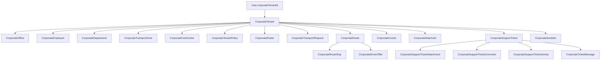

# Tenant Data Isolation Map

Corporate isolation is enforced by API authentication, corporate access guards, tenant/resource decorators and service-level filtering. Prisma foreign keys protect referential integrity; they do not by themselves prevent a caller from querying another tenant’s rows.

The diagram groups related models; the per-model dictionary pages show the exact Prisma foreign-key fields and delete actions. It does not imply that every child record has a direct tenant foreign key.

## Models with direct tenant identifiers

| Model | Field | Prisma relation to `CorporateTenant` | Isolation note |
|---|---|---|---|
| [User](./dictionary/identity-and-supply.md#user) | `corporateTenantId` (nullable) | [CorporateTenant](./dictionary/corporate-tenancy-and-organization.md#corporate-tenant) | FK action: SetNull. API queries still require tenant authorization/filtering. |
| [CorporateOffice](./dictionary/corporate-tenancy-and-organization.md#corporate-office) | `tenantId` (required) | [CorporateTenant](./dictionary/corporate-tenancy-and-organization.md#corporate-tenant) | FK action: Cascade. API queries still require tenant authorization/filtering. |
| [CorporateEmployee](./dictionary/corporate-tenancy-and-organization.md#corporate-employee) | `tenantId` (required) | [CorporateTenant](./dictionary/corporate-tenancy-and-organization.md#corporate-tenant) | FK action: Cascade. API queries still require tenant authorization/filtering. |
| [CorporateRoster](./dictionary/corporate-rosters-and-scheduling.md#corporate-roster) | `tenantId` (required) | [CorporateTenant](./dictionary/corporate-tenancy-and-organization.md#corporate-tenant) | A Prisma relation is declared; delete action is not explicit. API queries still require tenant authorization/filtering. |
| [CorporateTransportRequest](./dictionary/corporate-rosters-and-scheduling.md#corporate-transport-request) | `tenantId` (required) | [CorporateTenant](./dictionary/corporate-tenancy-and-organization.md#corporate-tenant) | A Prisma relation is declared; delete action is not explicit. API queries still require tenant authorization/filtering. |
| [CorporateRoute](./dictionary/corporate-routing-execution-and-safety.md#corporate-route) | `tenantId` (required) | [CorporateTenant](./dictionary/corporate-tenancy-and-organization.md#corporate-tenant) | A Prisma relation is declared; delete action is not explicit. API queries still require tenant authorization/filtering. |
| [CorporateInvoice](./dictionary/corporate-billing-and-payouts.md#corporate-invoice) | `tenantId` (required) | [CorporateTenant](./dictionary/corporate-tenancy-and-organization.md#corporate-tenant) | A Prisma relation is declared; delete action is not explicit. API queries still require tenant authorization/filtering. |
| [CorporateSosAlert](./dictionary/corporate-routing-execution-and-safety.md#corporate-sos-alert) | `tenantId` (nullable) | [CorporateTenant](./dictionary/corporate-tenancy-and-organization.md#corporate-tenant) | FK action: Cascade. API queries still require tenant authorization/filtering. |
| [CorporateSupportTicket](./dictionary/corporate-support.md#corporate-support-ticket) | `tenantId` (required) | [CorporateTenant](./dictionary/corporate-tenancy-and-organization.md#corporate-tenant) | FK action: Cascade. API queries still require tenant authorization/filtering. |
| [CorporateTripFeedback](./dictionary/corporate-routing-execution-and-safety.md#corporate-trip-feedback) | `tenantId` (required) | [CorporateTenant](./dictionary/corporate-tenancy-and-organization.md#corporate-tenant) | FK action: Cascade. API queries still require tenant authorization/filtering. |
| [CorporateRateCard](./dictionary/corporate-billing-and-payouts.md#corporate-rate-card) | `tenantId` (required) | [CorporateTenant](./dictionary/corporate-tenancy-and-organization.md#corporate-tenant) | FK action: Cascade. API queries still require tenant authorization/filtering. |
| [CorporateInvoiceDispute](./dictionary/corporate-billing-and-payouts.md#corporate-invoice-dispute) | `tenantId` (required) | [CorporateTenant](./dictionary/corporate-tenancy-and-organization.md#corporate-tenant) | A Prisma relation is declared; delete action is not explicit. API queries still require tenant authorization/filtering. |
| [CorporateCreditNote](./dictionary/corporate-billing-and-payouts.md#corporate-credit-note) | `tenantId` (required) | [CorporateTenant](./dictionary/corporate-tenancy-and-organization.md#corporate-tenant) | A Prisma relation is declared; delete action is not explicit. API queries still require tenant authorization/filtering. |
| [CorporateVehiclePosition](./dictionary/corporate-routing-execution-and-safety.md#corporate-vehicle-position) | `tenantId` (required) | None declared | Scalar identifier only; this field has no Prisma relation/FK to CorporateTenant. |
| [CorporateTripEvent](./dictionary/corporate-routing-execution-and-safety.md#corporate-trip-event) | `tenantId` (required) | None declared | Scalar identifier only; this field has no Prisma relation/FK to CorporateTenant. |
| [CorporateRouteAssignmentEvent](./dictionary/corporate-routing-execution-and-safety.md#corporate-route-assignment-event) | `tenantId` (required) | None declared | Scalar identifier only; this field has no Prisma relation/FK to CorporateTenant. |
| [CorporateDriverOffer](./dictionary/corporate-routing-execution-and-safety.md#corporate-driver-offer) | `tenantId` (required) | [CorporateTenant](./dictionary/corporate-tenancy-and-organization.md#corporate-tenant) | A Prisma relation is declared; delete action is not explicit. API queries still require tenant authorization/filtering. |
| [CorporateDepartment](./dictionary/corporate-tenancy-and-organization.md#corporate-department) | `tenantId` (required) | [CorporateTenant](./dictionary/corporate-tenancy-and-organization.md#corporate-tenant) | FK action: Cascade. API queries still require tenant authorization/filtering. |
| [CorporateTransportZone](./dictionary/corporate-tenancy-and-organization.md#corporate-transport-zone) | `tenantId` (required) | [CorporateTenant](./dictionary/corporate-tenancy-and-organization.md#corporate-tenant) | FK action: Cascade. API queries still require tenant authorization/filtering. |
| [CorporateCostCenter](./dictionary/corporate-tenancy-and-organization.md#corporate-cost-center) | `tenantId` (required) | [CorporateTenant](./dictionary/corporate-tenancy-and-organization.md#corporate-tenant) | FK action: Cascade. API queries still require tenant authorization/filtering. |
| [CorporateTenantPolicy](./dictionary/corporate-tenancy-and-organization.md#corporate-tenant-policy) | `tenantId` (required) | [CorporateTenant](./dictionary/corporate-tenancy-and-organization.md#corporate-tenant) | FK action: Cascade. API queries still require tenant authorization/filtering. |
| [CorporateShiftTemplate](./dictionary/corporate-rosters-and-scheduling.md#corporate-shift-template) | `tenantId` (required) | [CorporateTenant](./dictionary/corporate-tenancy-and-organization.md#corporate-tenant) | FK action: Cascade. API queries still require tenant authorization/filtering. |
| [CorporateHoliday](./dictionary/corporate-rosters-and-scheduling.md#corporate-holiday) | `tenantId` (required) | [CorporateTenant](./dictionary/corporate-tenancy-and-organization.md#corporate-tenant) | FK action: Cascade. API queries still require tenant authorization/filtering. |
| [CorporateRosterEntry](./dictionary/corporate-rosters-and-scheduling.md#corporate-roster-entry) | `tenantId` (required) | None declared | Scalar identifier only; this field has no Prisma relation/FK to CorporateTenant. |
| [DigioVerification](./dictionary/identity-verification.md#digio-verification) | `tenantId` (nullable) | None declared | Scalar identifier only; this field has no Prisma relation/FK to CorporateTenant. |

## Enforced scope is not identical to schema ownership

- `User.corporateTenantId` has a declared relation to `CorporateTenant`; corporate roles and office scopes are also represented separately in `User` fields.
- Many child rows obtain tenant context through a route, roster, employee, invoice, support ticket or other parent relation. Follow the dictionary relation tables rather than assuming a `tenantId` column exists on every child.
- `CorporateVehiclePosition`, `CorporateTripEvent`, `CorporateRouteAssignmentEvent`, `CorporateRosterEntry` and `DigioVerification` contain a tenant identifier without a Prisma relation field for that identifier. The schema therefore does not declare a foreign key from those scalars to `CorporateTenant`; application-level validation/ownership must be checked in the relevant service.
- `DigioVerification.tenantId` is optional and is verification metadata, not proof of tenant authorization.
- `CorporateAccessGuard`, `CorporateTenantScoped`, `CorporateResource` and `CorporatePermission` establish request-level access controls where declared. Not every controller uses every mechanism; inspect the route’s endpoint reference.
- No `ENABLE ROW LEVEL SECURITY` or `CREATE POLICY` declaration was found in the checked-in Prisma migration SQL. This does not rule out policies added outside the repository; the documented isolation controls here are application-level.

## Source references

- `apps/api/prisma/schema.prisma` — model fields and foreign-key declarations.
- `apps/api/src/common/guards/corporate-access.guard.ts` — corporate access guard.
- `apps/api/src/common/decorators/corporate-resource.decorator.ts` — `CorporateTenantScoped` and `CorporateResource` metadata.
- `apps/api/src/domains/corporate/tenants/corporate-permissions.ts` — corporate permission metadata and role mapping.
- [Corporate API endpoint references](../reference/endpoints/index.md) — route-specific roles and access declarations.
