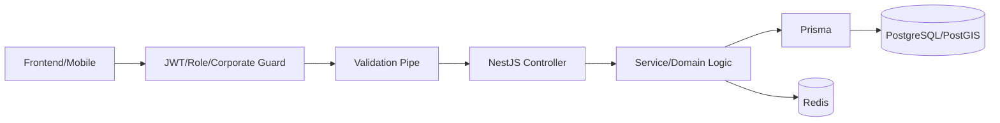

# API

## Functional Perspective

The API is the authoritative backend for AdhocX. It authenticates users,
authorizes actions, validates requests, applies business rules, persists
transactions and coordinates external integrations. No frontend determines
pricing, role authority, trip state or financial correctness for itself.

## Technical Perspective

The API is a NestJS modular monolith under `apps/api`. It starts in
`src/main.ts`, composes bounded contexts in `src/app.module.ts`, exposes
`/api/v1/*`, uses Prisma for PostgreSQL/PostGIS and Redis for cache/pubsub,
and applies global validation, transformation and exception handling.

- [Live Swagger/OpenAPI reference](./reference/swagger.md)
- [API specification](./reference/10_API_SPECIFICATION.md)
- [Data and database](./data/09_DATABASE.md)
- [Prisma data dictionary](./data/data-dictionary.md)
- [Tenant data isolation](./data/tenant-data-isolation.md)
- [Migration history](./data/migration-history.md)
- [Dispatch engine](./dispatch/11_DISPATCH_ENGINE.md)
- [Workflow state machines](./workflows/12_STATE_MACHINES.md)
- [ETS backend documentation](../ets/backend/index.md)
- [API architecture](./architecture.md)
- [API bounded contexts](./bounded-contexts.md)
- [Module and service reference](./module-service-reference.md)
- [Corporate module and service map](./corporate-module-services.md)
- [Provider adapters and integration boundaries](./provider-adapters.md)
- [Middleware and infrastructure](./middleware-and-infrastructure.md)
- [Endpoint inventory](./reference/endpoint-inventory.md)
- [API conventions](./reference/api-conventions.md)
- [Frontend API consumption](./reference/frontend-api-consumption.md)
- [API controller and service guide](./reference/complete-controller-inventory.md)
- [Exact controller endpoint appendix](./reference/exact-controller-endpoints.md)
- [Endpoint references by controller](./reference/endpoints/index.md)
- [Request and response DTO catalog](./reference/request-response-dto-catalog.md)
- [API error code catalog](./reference/error-code-catalog.md)
- [Webhooks and idempotency](./reference/webhooks-and-idempotency.md)
- [API troubleshooting](./reference/troubleshooting.md)
