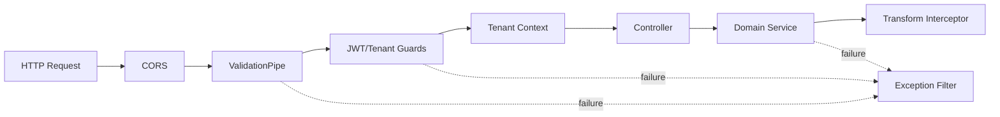

# API Middleware and Infrastructure

**Evidence status:** Verified against bootstrap configuration and the
`common`, `database`, `redis` and `common/storage` directories.

## Request Pipeline

## Global Validation

The global `ValidationPipe` is configured with:

- `whitelist: true`
- `forbidNonWhitelisted: true`
- `transform: true`
- Implicit conversion disabled

This means unknown request fields are rejected and request DTO declarations
must describe accepted input explicitly.

## Authentication Infrastructure

The API uses JWT guards and role decorators. JWT verification:

- Reads a Bearer access token
- Supports single-use stream tickets for live-stream URLs
- Checks Redis token blacklist state
- Checks account revocation state
- Checks minimum token issued-at state where configured
- Attaches the resolved user to the request

Full role and permission behavior is covered in the security phase.

## Tenant Context

The API includes:

- Current tenant/user decorators
- A tenant-context interceptor
- A corporate-resource decorator
- A corporate-access guard
- Prisma tenant extension support

These components help isolate corporate users and tenant-scoped operations.

## Exception Handling

`HttpExceptionFilter` converts exceptions to a consistent API response. The
exact response shape must be documented in the API reference phase using
controller and filter behavior.

## Database Infrastructure

`DatabaseModule` exports `DatabaseService`, a global Prisma-backed database
service. Domain modules import the global database module through NestJS
composition.

Prisma is configured with PostgreSQL and a `DATABASE_URL` environment
variable.

## Redis Infrastructure

Redis modules provide:

- Cache and key operations
- Authentication revocation state
- Rate limiting
- Pub/sub
- Stream-ticket support

Redis Pub/Sub has a dedicated publisher/subscriber connection mode and an
in-process fallback where Redis is unavailable.

## Storage Infrastructure

The storage module provides upload and file-sanitization services. Private
uploads use upload controllers and access checks instead of being treated as
public static assets.

## Health and Diagnostics

The API has a health module with health, liveness and readiness endpoints.
Structured logging and HTTP keep-alive behavior are configured at bootstrap.
