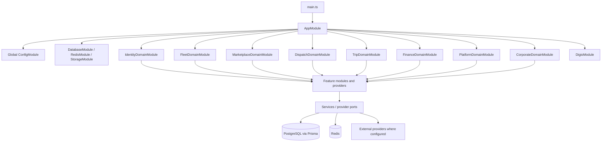
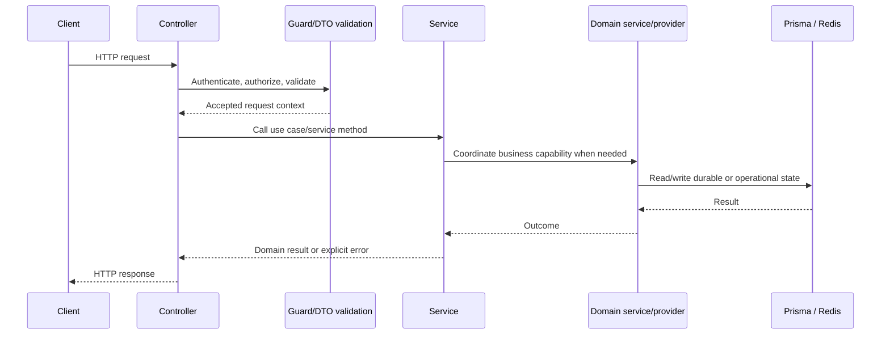

# API Module and Service Reference

## What this reference covers

The API is one NestJS deployment, not a set of independently deployed
microservices. Root domain modules group feature modules; feature modules
register controllers and injectable services; shared infrastructure supplies
Prisma/PostgreSQL, Redis and file storage. A service may be called by several
controllers or other services, so the module that provides a class is its
dependency-injection owner, not necessarily its only consumer.

The [endpoint references](./reference/endpoints/index.md) explain individual
HTTP entry points. The [data dictionary](./data/data-dictionary.md) explains
Prisma models. This page connects those inventories to the backend module and
service layer without asserting a route-to-model relationship that has not
been traced from the handler through the full call chain.

## Runtime composition

`apps/api/src/main.ts` creates the Nest application, applies the `/api/v1`
prefix and global pipes/interceptors/filters, and starts the server.
`apps/api/src/app.module.ts` loads configuration, registers shared
infrastructure, and composes the domain modules. Modules in `src/domains/`
are organizational boundaries inside that process; they do not represent
network hops.

In tests, individual feature modules can be assembled with mocks. In
production, the root composition provides shared implementations. Optional
injections and explicit fallbacks exist in some services; they must not be
mistaken for distributed failover.

## Domain-module map

| Root module | Root module source | Feature modules included | Functional boundary |
|---|---|---|---|
| `IdentityDomainModule` | `apps/api/src/domains/identity/identity-domain.module.ts` | `AuthModule`, `UsersModule` | Sign-in, account/session lifecycle, user profiles and role identity. |
| `FleetDomainModule` | `apps/api/src/domains/fleet/fleet-domain.module.ts` | `DriversModule` (which includes referrals), `VehiclesModule`, `VendorsModule` | Driver/vendor supply records, verification, availability, vehicles and referrals. |
| `MarketplaceDomainModule` | `apps/api/src/domains/marketplace/marketplace-domain.module.ts` | `RequirementsModule` | Vendor transport demand and its publication/fulfilment lifecycle. |
| `DispatchDomainModule` | `apps/api/src/domains/dispatch/dispatch-domain.module.ts` | `DispatchModule`, `OffersModule` | Driver candidate selection, dispatch waves, offer response and assignment hand-off. |
| `TripDomainModule` | `apps/api/src/domains/trip/trip-domain.module.ts` | `TripsModule`, `LocationsModule`, `ReviewsModule`, `AssignmentsModule` | Marketplace trip execution, location helpers, assignment and participant feedback. |
| `FinanceDomainModule` | `apps/api/src/domains/finance/finance-domain.module.ts` | `LedgerModule`, `SettlementsModule`, `PaymentsModule`, `PricingModule`, `CouponsModule`, `SubscriptionsModule` | Prices, payment records, wallet/ledger entries, settlement and promotion rules. |
| `PlatformDomainModule` | `apps/api/src/domains/platform/platform-domain.module.ts` | `AdminModule`, `AuditModule`, `NotificationsModule`, `HealthModule`, `LeadsModule`, `BlogsModule`, `AppUpdateModule`, `DisputesModule`, `FeatureFlagsModule` | Shared administration, audit, communications, content, support/operational and configuration capabilities. |
| `CorporateDomainModule` | `apps/api/src/domains/corporate/corporate-domain.module.ts` | Corporate tenant, roster, scheduling, routing, dispatch, execution, tracking, safety, billing, operations, rider and analytics providers | Enterprise commute lifecycle across tenant setup, route operations, safety and finance. |
| Root-level `DigioModule` | `apps/api/src/modules/digio/digio.module.ts` | `DigioController`, `DigioService`, `DigioClient` | DigiO/DigiLocker verification endpoints; `AdminModule` also imports it for privileged verification operations. |

The Corporate GPS submodule is
`apps/api/src/domains/corporate/tracking/corporate-tracking.module.ts`.
The 29 leaf feature-module source files under `apps/api/src/modules/` are:

| Bounded context | Leaf module source files |
|---|---|
| Identity | `auth/auth.module.ts`, `users/users.module.ts` |
| Fleet | `drivers/drivers.module.ts`, `drivers/referrals/referrals.module.ts`, `vehicles/vehicles.module.ts`, `vendors/vendors.module.ts` |
| Marketplace | `requirements/requirements.module.ts` |
| Dispatch | `dispatch/dispatch.module.ts`, `offers/offers.module.ts` |
| Trip | `trips/trips.module.ts`, `locations/locations.module.ts`, `reviews/reviews.module.ts`, `assignments/assignments.module.ts` |
| Finance | `ledger/ledger.module.ts`, `settlements/settlements.module.ts`, `payments/payments.module.ts`, `pricing/pricing.module.ts`, `coupons/coupons.module.ts`, `subscriptions/subscriptions.module.ts` |
| Platform | `admin/admin.module.ts`, `audit/audit.module.ts`, `notifications/notifications.module.ts`, `health/health.module.ts`, `leads/leads.module.ts`, `blogs/blogs.module.ts`, `app-update/app-update.module.ts`, `disputes/disputes.module.ts`, `feature-flags/feature-flags.module.ts` |
| Verification | `digio/digio.module.ts` |

Shared module source files outside `src/modules/` are
`apps/api/src/database/database.module.ts`,
`apps/api/src/redis/redis.module.ts` and
`apps/api/src/common/storage/storage.module.ts`.

The root domain module implementations are under
`apps/api/src/domains/`; the feature modules are under
`apps/api/src/modules/`. In particular, Corporate is deliberately composed
in a dedicated module because its services coordinate several capabilities
and share the tracking module.

## Data and provider connections by domain

The table gives a navigation map, not a claim that every service in a domain
reads/writes every listed model. Use the linked model dictionary and the
specific controller/service method to confirm an individual data effect.

| Domain | Representative persisted data | Shared or external dependencies |
|---|---|---|
| Identity | `User` account/profile and role records | JWT, Redis-backed OTP/attempt/revocation state, notification delivery |
| Fleet | `Driver`, `Vendor`, `Vehicle`, `DriverReferral` | DigiO verification in admin/onboarding workflows; locations and ledger services |
| Marketplace | `Requirement`, `TripQuote`, `TripPricingSnapshot` | Pricing, dispatch and vendor notification services |
| Dispatch | `Requirement`, `Offer`, `Assignment`, `Driver`, `Trip` | H3/location search, Redis offer/scheduler state, ranking, pricing and notifications |
| Trip | `Trip`, `TripEvent`, `Review` | Dispatch, location, audit, referral, notification and Redis realtime services |
| Finance | `Payment`, `LedgerEntry`, `Settlement`, pricing/coupon/subscription records | Razorpay is called directly by payment/subscription services; marketplace and Corporate payouts are separate |
| Platform | `AuditLog`, `Notification`, `DeviceToken`, `BlogPost`, `LeadCapture`, `FeatureFlag` | Firebase, MSG91, SMTP, Redis and DigiO as used by the specific feature |
| Corporate | Tenant, roster, request, route, telemetry, safety and billing records | Redis, Google Maps/Routes, notifications and the payout provider port |

For exact fields and declared relations, use the
[Prisma data dictionary](./data/data-dictionary.md). Provider configuration,
cache/fallback rules and whether a formal interface exists are in the
[provider adapter reference](./provider-adapters.md).

## Feature-module and service directory

These are the feature modules registered by the root composition. Each
service entry describes the responsibility visible in the service/module
source; the endpoint reference remains the place to follow a specific HTTP
request into a particular method and response.

### Identity

| Module / service | What the service does | Implementation |
|---|---|---|
| `AuthModule` / `AuthService` | Handles OTP/password/social-auth flows, credential verification and password-hash upgrades, account bootstrap and JWT/session-related operations. It coordinates Redis OTP/attempt state, notifications, user persistence and optional location/referral helpers. | `apps/api/src/modules/auth/auth.service.ts` |
| `UsersModule` / `UsersService` | Reads and updates the signed-in user's profile and role-backed account data for the account APIs. | `apps/api/src/modules/users/users.service.ts` |

### Fleet and supply

| Module / service | What the service does | Implementation |
|---|---|---|
| `DriversModule` / `DriversService` | Manages driver profile, verification, availability and driver-facing records; it collaborates with auth, locations, ledger and referrals. | `apps/api/src/modules/drivers/drivers.service.ts` |
| `DriversModule` / `ReferralsService` | Creates and resolves referral codes/relationships and the referral reward workflow used by driver onboarding and trip completion. | `apps/api/src/modules/drivers/referrals/referrals.service.ts` |
| `VehiclesModule` / `VehiclesService` | Owns driver vehicle records and vehicle verification/profile operations. | `apps/api/src/modules/vehicles/vehicles.service.ts` |
| `VendorsModule` / `VendorsService` | Manages vendor organization profile, onboarding and verification-facing data. | `apps/api/src/modules/vendors/vendors.service.ts` |

### Marketplace

| Module / service | What the service does | Implementation |
|---|---|---|
| `RequirementsModule` / `RequirementsService` | Creates, validates, retrieves, updates and cancels vendor transport requirements, and coordinates pricing and dispatch when the requirement becomes eligible. | `apps/api/src/modules/requirements/requirements.service.ts` |

### Dispatch and offers

| Module / service | What the service does | Implementation |
|---|---|---|
| `DispatchModule` / `DispatchService` | Finds eligible nearby drivers, ranks candidates, creates dispatch waves/offers, resolves offer expiry and acceptance, and hands a successful match to assignment/trip processing. Redis coordinates shared state when available; the service contains explicit single-process degraded/test paths. | `apps/api/src/modules/dispatch/dispatch.service.ts` |
| `DispatchModule` / `DispatchSchedulerService` | Stores delayed dispatch work by due time in a Redis sorted set and claims due work atomically; without Redis it uses an instance-local map. `DispatchService` registers the job handler. | `apps/api/src/modules/dispatch/dispatch-scheduler.service.ts` |
| `DispatchModule` / `DriverBehaviorService` | Supplies driver reliability/behavior signals used by dispatch ranking. | `apps/api/src/modules/dispatch/driver-behavior.service.ts` |
| `OffersModule` / `OffersService` | Implements the driver's offer inbox and accept/reject response path, rechecking live offer and requirement state before the dispatch/assignment transition. | `apps/api/src/modules/offers/offers.service.ts` |

### Trip execution and location

| Module / service | What the service does | Implementation |
|---|---|---|
| `TripsModule` / `TripsService` | Serves role-scoped trip lists/details and enforces server-side trip transition rules for arrival, start, completion, cancellation, no-show and trip location/event workflows. It coordinates dispatch, notifications, audit, location and referrals. | `apps/api/src/modules/trips/trips.service.ts` |
| `LocationsModule` / `LocationsService` | Provides shared geospatial lookup and location operations to marketplace, dispatch and trip services. | `apps/api/src/modules/locations/locations.service.ts` |
| `LocationsModule` / `H3Service` | Converts coordinates to H3 cells and supports indexed spatial candidate/location operations; H3 bucketing is not a road-distance calculation. | `apps/api/src/modules/locations/h3.service.ts` |
| `LocationsModule` / `GoogleMapsService` | Wraps configured Google Maps/Routes requests used for geocoding, route and traffic-aware estimates; callers that support fallback must preserve whether an estimate came from Google or a heuristic. | `apps/api/src/modules/locations/google-maps.service.ts` |
| `ReviewsModule` / `ReviewsService` | Creates and reads trip participant reviews, applies review eligibility/duplicate rules and coordinates audit/notification behavior. | `apps/api/src/modules/reviews/reviews.service.ts` |
| `AssignmentsModule` / `AssignmentsService` | Coordinates and exposes the allocation of a requirement to a selected driver, connecting dispatch outcome to trip records. | `apps/api/src/modules/assignments/assignments.service.ts` |

### Finance and pricing

| Module / service | What the service does | Implementation |
|---|---|---|
| `LedgerModule` / `LedgerService` | Writes and reads wallet/account ledger entries used to represent credits, debits and financial adjustments. | `apps/api/src/modules/ledger/ledger.service.ts` |
| `SettlementsModule` / `SettlementsService` | Validates and processes vendor/driver settlement requests in coordination with ledger state. | `apps/api/src/modules/settlements/settlements.service.ts` |
| `PaymentsModule` / `PaymentsService` | Creates marketplace payment records, Razorpay wallet top-up orders and signature-verified payment webhook updates; applies authenticated ownership and wallet-credit rules before persistence. | `apps/api/src/modules/payments/payments.service.ts` |
| `PricingModule` / `PricingService` | Serves the active vehicle/pricing catalogue and global policy values consumed by quoting and trip flows. | `apps/api/src/modules/pricing/pricing.service.ts` |
| `PricingModule` / `DistancePricingService` | Calculates distance-based prices from versioned plans/slabs and exposes its lifecycle-managed pricing state to the requirement/quote workflow. | `apps/api/src/modules/pricing/distance-pricing.service.ts` |
| `CouponsModule` / `CouponsService` | Validates coupon eligibility and records coupon use/redemption under the applicable user, product and order rules. | `apps/api/src/modules/coupons/coupons.service.ts` |
| `SubscriptionsModule` / `SubscriptionsService` | Creates and verifies driver subscription orders and persists subscription-payment outcomes. | `apps/api/src/modules/subscriptions/subscriptions.service.ts` |

### Platform services

| Module / service | What the service does | Implementation |
|---|---|---|
| `AdminModule` / `AdminService` | Provides privileged platform operations, moderation and cross-domain administration behind controller authorization. | `apps/api/src/modules/admin/admin.service.ts` |
| `AuditModule` / `AuditService` | Persists actor/action/entity audit events used by administrative and business workflows. | `apps/api/src/modules/audit/audit.service.ts` |
| `NotificationsModule` / `NotificationsService` | Persists in-app notifications and coordinates Firebase push, email, SMS and realtime events; delivery outcome is distinct from the underlying business-state change. | `apps/api/src/modules/notifications/notifications.service.ts` |
| `NotificationsModule` / `NotificationQueueService` | Buffers and drains notification jobs with bounded retry/dead-letter handling; its queue is process-local, while the optional Redis dependency supports duplicate suppression rather than making the job queue durable. | `apps/api/src/modules/notifications/notification-queue.service.ts` |
| `NotificationsModule` / `Msg91Service` | Normalizes phone numbers and submits OTP/SMS messages through MSG91, with an explicit unconfigured simulation path. | `apps/api/src/modules/notifications/msg91.service.ts` |
| `HealthModule` / `HealthService` | Probes PostgreSQL and Redis, reports their latency and process memory, and supplies liveness/readiness outcomes. | `apps/api/src/modules/health/health.service.ts` |
| `LeadsModule` / `LeadsService` | Validates and persists public marketing/enterprise lead submissions. | `apps/api/src/modules/leads/leads.service.ts` |
| `BlogsModule` / `BlogsService` | Filters and paginates published posts for public readers, supports editorial operations, sanitizes content/URLs and maintains a process-local fallback cache. | `apps/api/src/modules/blogs/blogs.service.ts` |
| `AppUpdateModule` / `AppUpdateService` | Serves mobile application update/version policy data used by client compatibility checks. | `apps/api/src/modules/app-update/app-update.service.ts` |
| `DisputesModule` / `DisputesService` | Handles platform marketplace dispute creation and resolution state with audit/notification dependencies. Corporate invoice disputes have their own service in the Corporate billing domain. | `apps/api/src/modules/disputes/disputes.service.ts` |
| `FeatureFlagsModule` / `FeatureFlagsService` | Seeds the default flag if missing, serves the full admin list and builds a client flag map with platform-specific metadata; admin APIs control changes. | `apps/api/src/modules/feature-flags/feature-flags.service.ts` |

### Identity verification

| Module / service | What the service does | Implementation |
|---|---|---|
| `DigioModule` / `DigioService` | Orchestrates verification requests, results, reuse/expiry rules and persisted verification state. It delegates HTTP/authentication details to `DigioClient`. | `apps/api/src/modules/digio/digio.service.ts` |
| `DigioModule` / `DigioClient` | Builds authenticated DigiO API requests for identity, vehicle, bank/UPI, document-AI and DigiLocker operations; applies request timeouts and maps provider/network failures into controlled API exceptions. | `apps/api/src/modules/digio/digio.client.ts` |

## Shared infrastructure services

These are not leaf business modules in the domain map. Their owning modules
are imported by the root application or by Corporate and they support
multiple business contexts.

| Module / service | Responsibility | Implementation |
|---|---|---|
| `DatabaseModule` / `DatabaseService` | Exposes a shared Prisma client and manages database connection lifecycle. PostgreSQL is the durable source of truth for application records. | `apps/api/src/database/database.module.ts`, `apps/api/src/database/database.service.ts` |
| `RedisModule` / `RedisService` | Owns Redis connection setup and common key/value, list, set, sorted-set, lock and expiry operations used by dispatch, cache, revocation and stream workflows. Explicit in-memory fallbacks are instance-local. | `apps/api/src/redis/redis.module.ts`, `apps/api/src/redis/redis.service.ts` |
| `RedisModule` / `RedisPubSubService` | Publishes/subscribes to Redis channels and reconnects/resubscribes for cross-process realtime events. | `apps/api/src/redis/redis-pubsub.service.ts` |
| `RedisModule` / `StreamTicketService` | Issues/verifies short-lived, single-use tickets for protected live-stream connections so clients do not put bearer tokens in stream URLs. | `apps/api/src/redis/stream-ticket.service.ts` |
| `StorageModule` / `StorageService` | Sanitizes and stores managed files in configured R2 or local disk and resolves document/file access URLs. | `apps/api/src/common/storage/storage.module.ts`, `apps/api/src/common/storage/storage.service.ts` |
| `StorageModule` / `FileSanitizerService` | Checks file content/type and applies configured sanitization before a file is persisted. | `apps/api/src/common/storage/file-sanitizer.service.ts` |

The source inventory contains 29 feature-module files under `src/modules/`,
78 `*.service.ts` files across the API and four `*.adapter.ts` files. Some
injectable classes (such as schedulers, stream hubs and the DigiO client)
use a different suffix and are separately identified in this reference.

## Cross-domain request flow

For a protected endpoint, the controller and guards establish the HTTP and
authorization boundary; DTO pipes validate the request; the feature service
performs the business transition and coordinates Prisma, Redis or a provider;
the controller maps the result to the API response. Some services call
another feature service instead of a repository. Direct Prisma access is
common, and repository abstractions are used only where source shows them.

This sequence is a template, not a claim that every route has every layer.
See the [endpoint page for the controller](./reference/endpoints/index.md)
and follow its referenced service file for route-specific evidence.

## Related references

- [Corporate module and service map](./corporate-module-services.md)
- [Provider adapters and failure boundaries](./provider-adapters.md)
- [Scheduled and realtime processing](../../platform/engineering/backend-scheduled-and-realtime.md)
- [Shared guards, repositories and utilities](../../platform/engineering/backend-utility-patterns.md)
- [Feature-to-service traceability registry](../../platform/traceability-registry.md)
