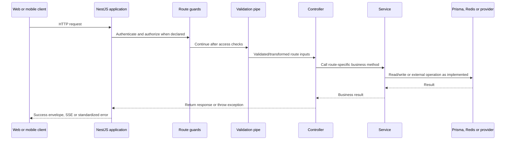

# API Controller and Service Guide

The API is a NestJS modular monolith. Controllers expose HTTP actions and
delegate business work to injectable services; those services use Prisma,
Redis and provider adapters as needed. This guide groups the API by business
responsibility. It is not a second route manifest: use the
[AST-derived endpoint index](./exact-controller-endpoints.md) and its
[controller pages](./endpoints/index.md) for individual paths, inputs,
access declarations and direct service calls.

## Source coverage and limits

The TypeScript AST inventory found **50 decorated controller classes** in
**44 controller source files**, with **431 HTTP method decorators** and
**436 controller/method path variants**. These are source declarations, not
live runtime route introspection. The pages preserve controller-declared
paths and do not guess the deployed URL when the global prefix, exclusions
or explicit path segments may interact.

Each route page captures the handler's directly invoked service and direct
Prisma delegate references found in the first service method. It does not
recursively trace every helper, transaction, provider callback or database
effect. “No direct persistence reference found” therefore does not mean the
complete workflow is read-only.

## API areas and route references

| API area | Functional responsibility | Source-traced controller references |
|---|---|---|
| Identity and platform administration | Sign-in, OTP/session lifecycle, role-protected platform operations, app metadata and version information. | [Authentication](./endpoints/auth-controller.md), [administration](./endpoints/admin-controller.md), [root app](./endpoints/app-controller.md), [app update](./endpoints/app-update-controller.md) |
| Marketplace and trip fulfillment | Manage vendors and drivers, requirements, offers, assignments, trip lifecycle, reviews and disputes. These flows connect supply to pricing, dispatch and settlement. | [Vendors](./endpoints/vendors-controller.md), [drivers](./endpoints/drivers-controller.md), [referrals](./endpoints/referrals-controller.md), [requirements](./endpoints/requirements-controller.md), [offers](./endpoints/offers-controller.md), [assignments](./endpoints/assignments-controller.md), [trips](./endpoints/trips-controller.md), [reviews](./endpoints/reviews-controller.md), [disputes](./endpoints/disputes-controller.md) |
| Pricing and finance | Configure pricing and quotes; initiate payments; expose wallet/ledger and settlement operations; manage subscriptions. Corporate invoicing and payouts are documented under the Corporate ETS area. | [Pricing](./endpoints/pricing-controller.md), [admin pricing](./endpoints/admin-pricing-controller.md), [vendor quotes](./endpoints/vendor-quote-controller.md), [driver quotes](./endpoints/driver-quote-controller.md), [payments](./endpoints/payments-controller.md), [ledger](./endpoints/ledger-controller.md), [settlements](./endpoints/settlements-controller.md), [subscriptions](./endpoints/subscriptions-controller.md) |
| Corporate ETS | Serve tenant, employee, roster, dispatch, trip execution, live tracking, safety, support, scheduling, billing, rate-card and analytics workflows. Corporate controllers apply route-specific role, tenant and resource controls. | [Tenants](./endpoints/corporate-tenant-controller.md), [rosters](./endpoints/corporate-roster-controller.md), [routing](./endpoints/corporate-routing-controller.md), [dispatch](./endpoints/corporate-dispatch-controller.md), [trip execution](./endpoints/corporate-trip-execution-controller.md), [tracking](./endpoints/corporate-tracking-controller.md), [rider self-service](./endpoints/corporate-rider-controller.md), [operations](./endpoints/corporate-operations-controller.md), [route cancellation](./endpoints/corporate-route-cancellation-controller.md), [operations drivers](./endpoints/corporate-ops-drivers-controller.md), [safety](./endpoints/corporate-safety-controller.md), [support tickets](./endpoints/corporate-support-ticket-controller.md), [operations support tickets](./endpoints/ops-support-ticket-controller.md), [scheduling](./endpoints/corporate-scheduling-controller.md), [billing](./endpoints/corporate-billing-controller.md), [rate cards](./endpoints/corporate-rate-card-controller.md), [payout callback](./endpoints/corporate-payout-webhook-controller.md), [analytics](./endpoints/corporate-analytics-controller.md) |
| Content, communication and operations support | Publish public/admin content, capture leads, expose health checks, manage notification workflows and provide file upload/download actions. | [Public blogs](./endpoints/blogs-controller.md), [admin blogs](./endpoints/admin-blogs-controller.md), [leads](./endpoints/leads-controller.md), [notifications](./endpoints/notifications-controller.md), [health](./endpoints/health-controller.md), [uploads](./endpoints/uploads-controller.md), [coupons](./endpoints/coupons-controller.md), [admin coupons](./endpoints/admin-coupons-controller.md), [feature flags](./endpoints/feature-flags-controller.md), [admin feature flags](./endpoints/admin-feature-flags-controller.md) |
| External identity and document verification | Provide KYC/KYB and document checks through the DigiO integration, including asynchronous verification callbacks and synchronization. | [DigiO](./endpoints/digio-controller.md) |

## Request lifecycle

A typical request traverses shared security and transformation layers, then
uses the route-specific controller and service. Not every route uses every
guard or database; the endpoint page is authoritative for its declarations.

The global `ValidationPipe` rejects undeclared fields and disables implicit
conversion. The global response interceptor wraps standard JSON successes;
SSE bypasses that envelope. The global exception filter formats failures and
hides most unexpected 5xx details. See [API conventions](./api-conventions.md),
the [error catalog](./error-code-catalog.md), and
[troubleshooting](./troubleshooting.md).

## How to trace a feature

1. Find the controller and declared method in the
   [endpoint index](./exact-controller-endpoints.md).
2. Read the endpoint page's purpose, request parameters, DTO references,
   access declarations and Swagger response annotations.
3. Follow its direct service call into the implementation source listed on
   that page; use the DTO catalog for class-validator metadata.
4. Follow any additional service, repository, transaction, Redis or provider
   calls in source before asserting full persistence or business behavior.
5. Use the [webhook/idempotency guide](./webhooks-and-idempotency.md) for
   server-to-server callback and retry semantics.

## Related references

- [API overview](../index.md)
- [Exact controller endpoint index](./exact-controller-endpoints.md)
- [Controller pages](./endpoints/index.md)
- [Request and response DTO catalog](./request-response-dto-catalog.md)
- [Error code catalog](./error-code-catalog.md)
- [Webhooks and idempotency](./webhooks-and-idempotency.md)
- [API troubleshooting](./troubleshooting.md)
- [Data and database](../data/09_DATABASE.md)
