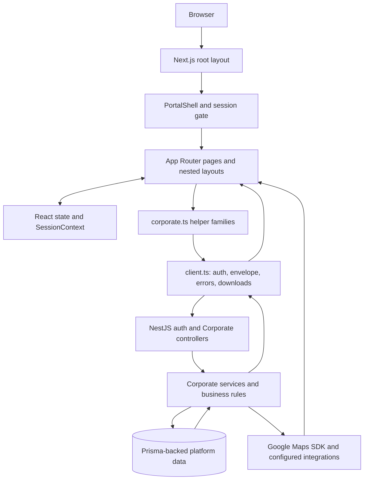

# Corporate application architecture

**Evidence status:** Verified against the Corporate package, App Router pages
and layouts, shared shell, session and permission code, API client, and
controller references. The route-level redirects listed below are current
implementation behavior and materially restrict which page workflows can be
used.

## Application identity and purpose

The Corporate application is a Next.js 14 App Router frontend for company
administrators and day-to-day transport, HR, finance, and safety roles. It is
the tenant-facing interface for organization setup, employee management,
transport demand, route visibility, support, billing, and reports. The
backend remains the owner of authorization, business rules, and persistence.

- Workspace: `apps/corporate`
- Development port: `7006`
- Root layout: `src/app/layout.tsx`
- Main shell: `src/components/layout/PortalShell.tsx`
- Session context: `src/lib/auth/SessionContext.tsx`
- API helpers: `src/lib/api/corporate.ts`
- HTTP client: `src/lib/api/client.ts`

## Technology and responsibility

| Technology | Purpose in AdhocX Corporate | Where used | Responsibility and dependencies |
|---|---|---|---|
| Next.js 14 App Router | Provides the portal's page tree, dynamic routes, layouts, redirects, and navigation. | `src/app/**`, `next/navigation` | Resolves route files and shared layouts. Nested layouts can redirect before a page runs; this is currently relevant for live, bookings, rosters, and safety. |
| React 18 | Builds interactive client-side pages and reusable UI. | Page components, `SessionContext`, shell, charts, maps, forms | Local component state and effects manage page data, filters, forms, polling, loading, and errors. There is no Redux store in this app. |
| TypeScript 5 | Checks page, API, session, and shared UI contracts during development/build. | `.ts` and `.tsx` sources | Request/response types are declared in `src/lib/api/types.ts`; compile-time types do not replace runtime backend validation. |
| `@adhocx/contracts` workspace package | Shares DTO types for tenant profile, office, and transport-zone mutations. | `src/lib/api/corporate.ts` | Keeps selected frontend payload shapes aligned with API contracts; backend DTOs remain authoritative. |
| Browser Fetch API | Sends authenticated requests to the AdhocX API. | `src/lib/api/client.ts` | Adds bearer auth, serializes JSON or multipart data, unwraps the success/data envelope, refreshes eligible expired sessions, and raises `ApiError` for failures. |
| Google Maps JavaScript SDK | Renders route direction, stops, and live-position context. | `src/components/maps/GoogleRouteMap.tsx` | Loaded from Google when `NEXT_PUBLIC_GOOGLE_MAPS_KEY` is configured; route/position data comes from AdhocX APIs, while map rendering/directions may depend on Google service availability and key restrictions. |
| `lucide-react` | Supplies consistent interface icons. | Shell and route/page components | Presentation only; it does not provide business or data behavior. |
| Local chart components | Render aggregate and trend views. | `src/components/charts/` | Custom `DonutChart`, `AreaTrendChart`, and `BarComparisonChart` components receive page-derived/API-provided data; they are not an external analytics service. |
| CSS modules and global CSS | Style the portal shell, responsive pages, and feature-specific components. | `src/app/globals.css`, component `.module.css` files | Visual layout/theme only; CSS does not enforce permissions. |

## Application layers

### Navigation and reusable components

`PortalShell` wraps pages with the top bar and sidebar after the session is
ready. The login route is rendered under `SessionProvider` without the
authenticated shell. Anonymous users are redirected to `/login`; a signed-in
account without Corporate portal/tenant access sees an access-denied state.
The top bar provides employee search, a notification dropdown, theme toggle,
user menu, and logout. Its notification count refreshes on a timer while the
document is visible and responds to the `adhocx:notifications-updated` event.

Reusable UI lives under `src/components/`, including:

- common buttons, cards, status badges, modals, filters, and loading/empty
  states;
- chart components for metrics and trends;
- `CorporateRouteDetailView` for the shared route dossier;
- `GoogleRouteMap` for route stops, office location, decoded path, and optional
  live position;
- layout navigation and section tabs.

Feature layouts may add navigation or wrappers, but four currently redirect
all their children rather than rendering those pages:

| Layout | Runtime behavior |
|---|---|
| `src/app/live/layout.tsx` | Redirects all `/live/**` routes to `/dashboard`. |
| `src/app/bookings/layout.tsx` | Redirects all `/bookings/**` routes to `/dashboard`. |
| `src/app/rosters/layout.tsx` | Redirects all `/rosters/**` routes to `/dashboard`. |
| `src/app/safety/layout.tsx` | Redirects all `/safety/**` routes to `/dashboard`. |

The full route status is in the [exact route inventory](./exact-route-inventory.md).

## Session, tenant scope, and permissions

`SessionProvider` reads the stored access token and user, decodes JWT claims,
derives the Corporate role and tenant, and loads tenant and office data. It
exposes `tenantId`, `offices`, selected `officeScope`, `corporateRole`, and
`can(permission)` to pages. UI permission checks are a mirror intended to hide
or disable unsupported actions; controller guards and tenant-scoped backend
services are the enforcement boundary.

The role/permission mirror is implemented in
`src/lib/auth/permissions.ts`. It recognizes `CORP_SUPER_ADMIN`, `HR`,
`TRANSPORT`, `FINANCE`, `SAFETY`, and `READ_ONLY`; legacy `CORPORATE_ADMIN` and
`CORPORATE_MANAGER` map to super-admin and transport roles. Unknown corporate
role values fail closed to `READ_ONLY` in the UI mirror.

## API and error behavior

The helper families are `authApi`, `tenantApi`, `analyticsApi`, `employeeApi`,
`rosterApi`, `schedulingApi`, `routesApi`, `tripsApi`, `safetyApi`,
`supportApi`, `billingApi`, `usersApi`, and `notificationsApi`.

The base URL is selected in `client.ts`: local Corporate/Operations ports use
the API on port `7001` with `/api/v1`; deployments may use
`NEXT_PUBLIC_API_URL` or the same-origin API path. Authenticated calls attach
the bearer token. JSON calls are unwrapped from `{ success, data }`; file
uploads use `FormData`; PDF/CSV downloads use a blob and browser download.

- 401: an eligible authenticated request attempts one refresh and replay;
  failed refresh clears session and redirects to sign-in.
- 403: surfaced as `ApiError` and is not converted into an empty result.
- Network failure: raised as a network `ApiError`.
- Page-level behavior varies: a page may show a visible error, local empty
  state, or—in a few secondary-read cases—fall back to `null`/empty data. See
  route-specific notes in the [route reference](./detailed-route-reference.md).

## Backend and data ownership

The Corporate app is a client of platform services, not a separate database
application. API controllers under `apps/api/src/domains/corporate/` delegate
to tenant, roster, scheduling, routing, execution, tracking, analytics,
safety, support, and billing services. These services read/write the shared
platform's tenant, membership, office, department, employee, roster,
transport-request, route, stop, tracking, alert, ticket, invoice, and dispute
records.

The [Corporate frontend API reference](./api-reference.md) records each helper
method/path and request shape and links to the relevant controller reference.
Controller pages document route declarations and first-level service/data
evidence; they indicate when deeper runtime behavior is only partially
traced.

