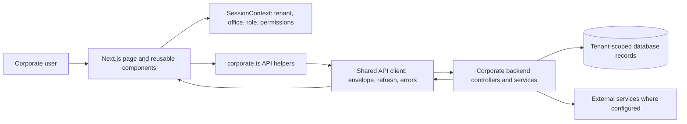
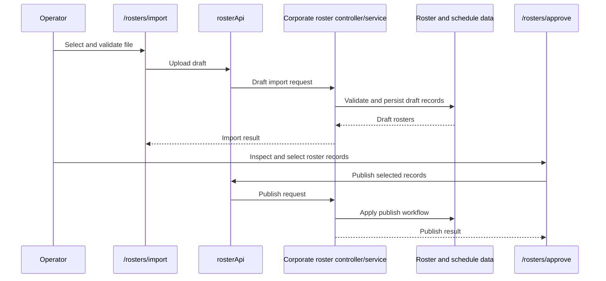
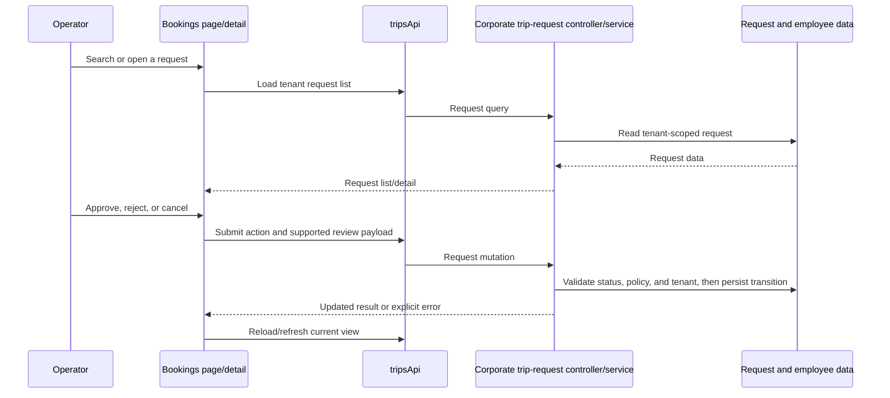
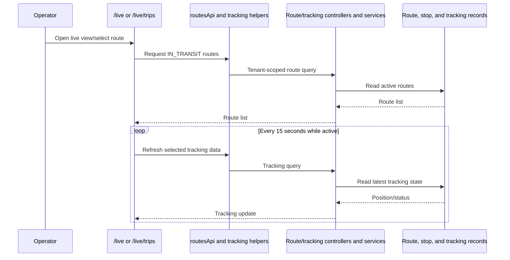

# Corporate portal route-by-route reference

This reference describes what each Corporate page is for and how it is implemented. The source of truth is the page under `apps/corporate/src/app/`, the API helper in `apps/corporate/src/lib/api/corporate.ts`, and the corresponding backend controller and service. A route that redirects or re-exports another page is identified as such; it is not described as an independent feature.

**Critical runtime routing limitation:** the nested layouts at `src/app/live/layout.tsx`, `src/app/bookings/layout.tsx`, `src/app/rosters/layout.tsx`, and `src/app/safety/layout.tsx` each redirect to `/dashboard`. As a result, every URL under `/live/**`, `/bookings/**`, `/rosters/**`, and `/safety/**` is redirected before its page component can render. The route rows in those areas describe the source implementation behind the redirect, not currently reachable user workflows. Backend helpers/endpoints still exist, but the Corporate UI cannot reach them through those route trees until the layouts are changed. This routing blocker takes precedence over page-level redirects noted below.

## Application purpose and architecture

The Corporate portal is the tenant-facing workspace for company administrators and operations teams. It brings together employee and office administration, transport requests, rosters, route visibility, safety cases, support, billing, and reports. Data is scoped to the signed-in tenant and, where applicable, the active office. The browser presents the workflow; backend tenant and permission guards remain the authority for access and data scope.

### Functional and technical foundations

| Area | Functional perspective | Technical perspective |
|---|---|---|
| Tenant session | Establishes which company and office the user can work with and what actions the interface should expose. | `src/lib/auth/SessionContext.tsx` restores the session, tenant and office context, derives the effective role, and exposes `can(...)` permission checks. `PortalShell` uses this state for navigation and the signed-in layout. |
| Authentication | Lets corporate users sign in and complete the configured verification flow. | `src/app/login/page.tsx` calls `authApi`; the shared `src/lib/api/client.ts` handles the API envelope and eligible 401 refresh flow. Failed refresh clears the session and sends the user back to sign-in. |
| Authorization | Hides or disables actions the current role should not use, and protects tenant data. | UI permission checks improve the workflow, but are not the security boundary. Corporate backend guards and tenant-scoped services enforce authorization. A 403 is surfaced as an API error. |
| Page state | Supports loading, empty, search, filter, pagination, form, and error states. | Pages use React state and effects; this app does not use a central Redux store. Shared pieces include `PortalShell`, common cards, tables, dialogs, maps, chart components, and the API client. |
| External map | Shows route and location context where a map is available. | Live and route pages use the Corporate map components, including Google Maps integration when configured. API responses remain the source of route and tracking data. |

## Route reference

The tables below cover the 65 `page.tsx` routes present in the Corporate app at the time of this audit. Route parameters are shown as `:id`. The source column points to the actual page file or identifies a redirect/re-export. API helper names identify the frontend call; the helper defines the HTTP method and endpoint path. Backend names identify the responsible controller/service domain, not a second frontend layer.

### Sign-in, dashboard, and notifications

| Route | Functional purpose and user actions | Frontend implementation | API, backend, and data |
|---|---|---|---|
| `/` | Entry point; sends the user to the dashboard. It does not render a separate home feature. | `src/app/page.tsx` redirects to `/dashboard`. | No API or database operation in the redirect. |
| `/login` | Authenticates a Corporate user and guides the user through the configured verification step. | `src/app/login/page.tsx`; local form state and router navigation. | `authApi` calls the authentication endpoints; the auth controller validates identity and corporate access. Session restoration and refresh are handled by `SessionContext` and `client.ts`. |
| `/dashboard` | Company overview: combines request, trip, tenant, and operational metrics to help administrators see the current state at a glance. | `src/app/dashboard/page.tsx`; metric/chart components. The page derives some totals in the browser and rejects truncated or inconsistent report totals rather than presenting them as complete. | `analyticsApi.dashboard`, `analyticsApi.tripsReport`, and `tenantApi.get`. Analytics and trip-report controllers/services read tenant-scoped request and trip data. |
| `/dashboard/analytics` | Trend and performance view for the recent 30-day window; users inspect aggregate trips and metrics. | `src/app/dashboard/analytics/page.tsx`; chart components and date calculations. It also checks for truncated reports. | `analyticsApi.dashboard` and `analyticsApi.tripsReport`; analytics/trip reporting backend and tenant data. |
| `/dashboard/exceptions` | Compatibility URL only; it redirects to `/dashboard`, so it is not a separate exceptions page. The source exception page at `/live/exceptions` is itself currently blocked by its parent layout. | `src/app/dashboard/exceptions/page.tsx` redirects to `/dashboard`. | No API is called by the redirect; `/live/exceptions` would call `analyticsApi.exceptions` if its parent layout allowed it to render. |
| `/dashboard/live-summary` | Compatibility URL only; it redirects to `/dashboard`, not to a live-operations page. | `src/app/dashboard/live-summary/page.tsx` redirects to `/dashboard`. | No endpoint is called by the redirect. See `/live` for the live overview. |
| `/notifications` | Lists tenant notifications and lets the user mark supported items as read or open the linked feature. | `src/app/notifications/page.tsx`; local list/read state and navigation links. | `notificationsApi` reads and updates notifications through the notifications controller/service and tenant notification records. |

### Company, employees, offices, and settings

| Route | Functional purpose and user actions | Frontend implementation | API, backend, and data |
|---|---|---|---|
| `/company-profile` | Company administration: maintain tenant profile/legal details, offices, departments and transport zones, and manage invitations or user access where the user's role permits. | `src/app/company-profile/page.tsx`; section forms, validation, and role-gated controls. | `tenantApi` profile/office/department/zone operations and `usersApi` invitation/access operations. Corporate tenant/user controllers and services update tenant, office, department, zone, and membership records. |
| `/employees` | Directory for searching, filtering, paging, creating, updating, activating/deactivating, and removing employees. Employee records include contact, employment, department, cost center, and office details. | `src/app/employees/page.tsx` and `src/app/employees/EmployeeDirectory.tsx`; form drawer, confirmation dialogs, pagination, and `employees:write` UI gate. Search can be initialized from the `search` query parameter. | `employeeApi.list/create/update/delete`; employee controller/service. The list sends tenant, search, office, active-status, page, and limit filters. Update sends changed employee fields; deletion may deactivate an employee when historical records require retention. |
| `/employee-support` | Employee-facing support case queue for company operators: inspect cases, communicate, and update supported case status. | `src/app/employee-support/page.tsx`; support list/detail and message/status state. | `supportApi` employee-case methods call the corporate support/rider support endpoints; backend support services read and update support cases and messages linked to employee/trip records. |
| `/offices` | Office directory with search and status filters, headcount/geofence summaries, and an office-creation form. | `src/app/offices/page.tsx`; `MetricCard`, local filters, and coordinate validation before submit. | `tenantApi.offices` and `tenantApi.createOffice`; tenant controller/service reads or creates a tenant-owned office. Coordinates are converted to numbers and must be finite. |
| `/offices/details` | Office detail view for a selected office, including the office's location and geofence information. The page uses a query-string office ID where supplied. | `src/app/offices/details/page.tsx`; selected-office state and office/geofence presentation. | Tenant office and geofence reads through `tenantApi`; tenant service and office/geofence records. |
| `/offices/:id` | Alias that re-exports the office details page. The shared implementation reads either the dynamic `:id` parameter or the `id` query parameter, selects that office when it belongs to the tenant, and loads its geofence details. | `src/app/offices/[id]/page.tsx` re-exports `src/app/offices/details/page.tsx`; the shared page uses `useParams` and `useSearchParams`. | Same tenant office and geofence reads as `/offices/details`; tenant controller/service scope office data. |
| `/offices/geofences` | Read-only overview of registered office geofences; helps operators inspect location boundaries, not edit them. | `src/app/offices/geofences/page.tsx`; loads office data and per-office geofences, isolating individual failures with `Promise.allSettled`. | Tenant office and geofence reads; the tenant/geofence backend. No geofence-write action is present on this page. |
| `/offices/cost-centers` | Displays cost centers associated with the tenant/offices for reference and reporting. | `src/app/offices/cost-centers/page.tsx`; read-only list and client presentation. | Tenant cost-center read through the relevant tenant API helper/controller/service and cost-center records. |
| `/settings` | Shows configured integrations and their status so tenant operators can inspect connected services. | `src/app/settings/page.tsx`; integration status view. | `tenantApi.integrations`; tenant integration controller/service and integration configuration/status records. |
| `/settings/health` | Integration-health/status view for the company; it does not represent an independent health-check backend unless the integration API reports that capability. | `src/app/settings/health/page.tsx`; reads integration state. | Same tenant integrations read/controller/service as settings. |
| `/settings/mapping` | Mapping/integration configuration view; inspect the configuration exposed by the tenant integration response. | `src/app/settings/mapping/page.tsx`; page-level presentation of tenant integration data. | `tenantApi.integrations`; tenant integration controller/service. No write operation is exposed by this page. |
| `/settings/hrms` | Compatibility alias for settings; it re-exports the settings page rather than implementing a separate HRMS configuration workflow. | `src/app/settings/hrms/page.tsx` re-exports `src/app/settings/page.tsx`. | Same integration status read as `/settings`; there is no separate HRMS API call from this alias. |

### Rosters and booking requests

| Route | Functional purpose and user actions | Frontend implementation | API, backend, and data |
|---|---|---|---|
| `/rosters` | **Not reachable:** the parent roster layout redirects to `/dashboard` before this page can redirect to shifts. If that parent redirect is removed, this page redirects to `/rosters/shifts`. | `src/app/rosters/layout.tsx` redirects; child `src/app/rosters/page.tsx` also redirects to `/rosters/shifts`. | No API call from either redirect. |
| `/rosters/shifts` | **Not reachable:** parent roster layout redirects to `/dashboard`. Source page maintains recurring shift templates with office, name, login/logout times, and selected weekdays; it only lists and creates templates. | `src/app/rosters/layout.tsx` redirect; child `src/app/rosters/shifts/page.tsx` contains template form/list and validation. | If reachable: `schedulingApi.shiftTemplates`, `schedulingApi.createShiftTemplate`, and `tenantApi.offices`; scheduling/tenant controllers and shift-template records. |
| `/rosters/calendar` | **Not reachable:** parent roster layout redirects to `/dashboard`. Source page lists persisted schedules and filters the loaded records by office/search. | `src/app/rosters/layout.tsx` redirect; child `src/app/rosters/calendar/page.tsx`. | If reachable: `rosterApi.list`; roster controller/service and saved roster/office data. |
| `/rosters/import` | **Not reachable:** parent roster layout redirects to `/dashboard`. Source page validates a selected file and uploads it as a draft; validation itself does not persist or publish the roster. | `src/app/rosters/layout.tsx` redirect; child `src/app/rosters/import/page.tsx`. | If reachable: roster template, validate, and draft-upload helpers; roster ingestion controller/service. |
| `/rosters/approve` | **Not reachable:** parent roster layout redirects to `/dashboard`. Source page reviews records and its visible action calls `rosterApi.publish`; it does not call `rosterApi.approve`. | `src/app/rosters/layout.tsx` redirect; child `src/app/rosters/approve/page.tsx`. | If reachable: roster reads and publish mutation. The backend lifecycle requires approval before publish, so the current UI action may conflict for a DRAFT. |
| `/bookings` | **Not reachable:** the parent booking layout redirects to `/dashboard`. Source page is a request queue with search/filter and detail links. | `src/app/bookings/layout.tsx` redirects; child `src/app/bookings/page.tsx`. | If reachable: `tripsApi.requests` and office reads; trip request controller/service and request/employee/office records. |
| `/bookings/overview` | **Not reachable:** parent booking layout redirects to `/dashboard`. Source page shows total, unserved, cancelled, and no-show counts plus a status chart. | `src/app/bookings/layout.tsx` redirect; child `src/app/bookings/overview/page.tsx`. | If reachable: `analyticsApi.dashboard`; analytics controller/service and tenant request data. |
| `/bookings/approvals` | **Not reachable:** parent booking layout redirects to `/dashboard`. Source page presents the request review queue and approve/reject controls. | `src/app/bookings/layout.tsx` redirect; child `src/app/bookings/approvals/page.tsx`. | If reachable: `tripsApi.requests` and request-review mutation; trip request controller/service. |
| `/bookings/details` | **Not reachable:** parent booking layout redirects to `/dashboard`. Source page reads a query/route request ID and supports details and cancellation where eligible. | `src/app/bookings/layout.tsx` redirect; child `src/app/bookings/details/page.tsx`. | If reachable: `tripsApi.requests`; cancellation calls the reschedule endpoint with `action: "CANCEL"`. |
| `/bookings/:id` | **Not reachable:** parent booking layout redirects to `/dashboard`. Source page re-exports the booking detail implementation and reads the route ID. | `src/app/bookings/layout.tsx` redirect; child `src/app/bookings/[id]/page.tsx` re-exports details. | If reachable: same request read/cancel API as `/bookings/details`. |
| `/cancellations` | Shows cancelled requests as a separate review list with search and pagination; it is not a cancellation-creation workflow. | `src/app/cancellations/page.tsx`; client paging/search and cancelled-status filtering. | `cancellationsApi.list` in `src/lib/api/cancellations.ts` delegates to `tripsApi.requests` with `status: "CANCELLED"`; trip-request controller/service and cancelled request data. |

### Routes and live operations

| Route | Functional purpose and user actions | Frontend implementation | API, backend, and data |
|---|---|---|---|
| `/routes` | Tenant route directory with route status and search; operators open route details or the active-route view. | `src/app/routes/page.tsx`; route list and links. | `routesApi.list` using the tenant route-portal endpoint; route controller/service and tenant route, vehicle, and driver data. |
| `/routes/:id` | Route dossier for a specific route: inspect route identity, status, assigned resources, stops, and available tracking/timeline context. | `src/app/routes/[id]/page.tsx` reads the dynamic ID and renders `CorporateRouteDetailView`. | Route detail/list and tracking/timeline helpers as used by `CorporateRouteDetailView`; route/tracking controllers and route, stop, vehicle, driver, and tracking records. |
| `/routes/details` | Query-string version of the route dossier; the page reads `?id=...` and renders the shared detail view. | `src/app/routes/details/page.tsx` renders `CorporateRouteDetailView` from the selected query ID. | Same route detail/tracking helpers and backend data as `/routes/:id`. |
| `/routes/active` | Lists routes currently in transit and supports refresh/inspection. | `src/app/routes/active/page.tsx`; active-status list and refresh controls. | `routesApi.list` filtered to `IN_TRANSIT`; route controller/service and in-progress tenant route records. |
| `/routes/allocation` | Fleet/driver allocation overview: displays assigned vehicle/driver counts and lets users search/filter route assignments. It is an inspection view, not a driver/vehicle assignment editor. | `src/app/routes/allocation/page.tsx`; loads up to 100 routes, computes counts, then filters locally. | `routesApi.list(tenantId, {limit: 100})`; route controller/service with route, vehicle, and driver associations. |
| `/routes-list` | Legacy alias; redirects to `/routes`. | `src/app/routes-list/page.tsx` redirects to `/routes`. | No API call from the redirect. |
| `/live` | **Not reachable:** the parent live layout redirects to `/dashboard`. Source page is a live overview with in-transit routes and periodic route/tracking refresh. | `src/app/live/layout.tsx` redirects; child `src/app/live/page.tsx`. | If reachable: route list, analytics, and tracking helpers; route, analytics, and tracking controllers/services. |
| `/live/trips` | **Not reachable:** parent live layout redirects to `/dashboard`. Source page is a live trip board with route selection, map, and tracking. | `src/app/live/layout.tsx` redirect; child `src/app/live/trips/page.tsx`. | If reachable: in-transit routes and tracking helpers; route/tracking controllers and trip/route-position data. |
| `/live/trips/:id` | **Not reachable:** parent live layout redirects to `/dashboard`. Source page re-exports the live trip board and can use the route ID. | `src/app/live/layout.tsx` redirect; child `src/app/live/trips/[id]/page.tsx` re-exports live trips. | If reachable: same route/tracking calls as `/live/trips`. |
| `/live/employees` | **Not reachable:** parent live layout redirects to `/dashboard`. Source page associates employees with in-transit activity and route/location context. | `src/app/live/layout.tsx` redirect; child `src/app/live/employees/page.tsx`. | If reachable: employee list plus in-transit route/tracking helpers. |
| `/live/exceptions` | **Not reachable:** parent live layout redirects to `/dashboard`. Source page implements exception list/search/type and map/list context; `/dashboard/exceptions` separately redirects. | `src/app/live/layout.tsx` redirect; child `src/app/live/exceptions/page.tsx`. | If reachable: `analyticsApi.exceptions({tenantId})`; analytics controller/service. Visible filters are local unless passed to the helper. |

### Safety and support

| Route | Functional purpose and user actions | Frontend implementation | API, backend, and data |
|---|---|---|---|
| `/safety` | **Not reachable:** the parent safety layout redirects to `/dashboard`. Source page is an overview of tenant SOS alerts and incidents. | `src/app/safety/layout.tsx` redirects; child `src/app/safety/page.tsx`. | If reachable: `safetyApi.alerts` and `safetyApi.incidents`; safety controller/service and alert/incident records. |
| `/safety/incidents/details` | **Not reachable:** parent safety layout redirects to `/dashboard`. Source dossier reads `?id=...`; without an ID it displays the first incident returned. A failed single fetch triggers a list fallback. | `src/app/safety/layout.tsx` redirect; child `src/app/safety/incidents/details/page.tsx`. | If reachable: incident detail and fallback list calls. |
| `/safety/:id` | **Not reachable:** parent safety layout redirects to `/dashboard`. Source re-export does not forward the dynamic path parameter; its target reads a query ID. | `src/app/safety/layout.tsx` redirect; child `src/app/safety/[id]/page.tsx` re-exports incidents/details. | If reachable: same incident reads; path-ID forwarding is absent. |
| `/safety/incidents/:id` | **Not reachable:** parent safety layout redirects to `/dashboard`. Source re-export does not forward the dynamic segment to the query-driven dossier. | `src/app/safety/layout.tsx` redirect; child `src/app/safety/incidents/[id]/page.tsx` re-exports incidents/details. | If reachable: same incident reads; use query ID until fixed. |
| `/safety/incidents/resolve` | **Not reachable:** parent safety layout redirects to `/dashboard`. Source form requires `?id=...`, a resolution category, and non-empty notes; “False Positive” sets the request flag. | `src/app/safety/layout.tsx` redirect; child `src/app/safety/incidents/resolve/page.tsx`. | If reachable: incident read, then resolve call with reason/notes/falsePositive. |
| `/safety/:id/resolve` | **Not reachable:** parent safety layout redirects to `/dashboard`. Source re-export does not forward the dynamic path ID; target requires query ID. | `src/app/safety/layout.tsx` redirect; child `src/app/safety/[id]/resolve/page.tsx` re-exports incidents/resolve. | If reachable: same resolution mutation. |
| `/safety/incidents/:id/resolve` | **Not reachable:** parent safety layout redirects to `/dashboard`. Source re-export does not forward the dynamic segment. | `src/app/safety/layout.tsx` redirect; child `src/app/safety/incidents/[id]/resolve/page.tsx` re-exports incidents/resolve. | If reachable: same resolution mutation. |
| `/safety/reports` | **Not reachable:** parent safety layout redirects to `/dashboard`. Source report aggregates saved SOS alerts by status, office, and creation date over seven days. | `src/app/safety/layout.tsx` redirect; child `src/app/safety/reports/page.tsx`. | If reachable: `safetyApi.alerts`; safety controller/service and SOS alert records. |
| `/support` | Corporate support workspace for ticket queue/summary and supported status or communication actions. | `src/app/support/page.tsx`; queue, summary, tenant context, and action state. | `supportApi` list/summary/status/message helpers; support-ticket controller/service and tenant tickets/messages. |
| `/support/tickets` | Tenant ticket list with search/status context and the ability to create a ticket. | `src/app/support/tickets/page.tsx`; ticket list and create form/modal. | `supportApi` ticket list/create; support controller/service and ticket records. |
| `/support/tickets/details` | Ticket conversation/details page opened with an ID; users read messages, send a reply, and reopen where allowed. | `src/app/support/tickets/details/page.tsx`; query or route ID, message composer, and status actions. | `supportApi` detail/message/reopen methods; support controller/service and ticket/message records. |
| `/support/tickets/:id` | Dynamic alias of ticket details. The shared implementation accepts the route ID as well as a query ID. | `src/app/support/tickets/[id]/page.tsx` re-exports ticket details. | Same ticket detail/message/reopen calls. |
| `/support/sla` | Legacy URL that redirects to `/support`; it is not a separate SLA dashboard. | `src/app/support/sla/page.tsx` redirects to `/support`. | No SLA-specific API is called by the redirect. |

### Billing, reports, and help

| Route | Functional purpose and user actions | Frontend implementation | API, backend, and data |
|---|---|---|---|
| `/billing` | Billing overview combining tenant invoice/dispute information and summary metrics. | `src/app/billing/page.tsx`; invoice/dispute summary, cards, and charts. Some secondary reads are handled separately; inspect their loading/error state before treating an empty panel as proof that no records exist. | `billingApi` invoice/dispute reads; billing controller/service and invoice, dispute, and tenant data. |
| `/billing/invoices` | Invoice register for browsing tenant invoices and opening or downloading an invoice. | `src/app/billing/invoices/page.tsx`; invoice list and filters/actions. | `billingApi` invoice list/PDF methods; billing controller/service, invoices, and line items. |
| `/billing/details` | Displays a selected invoice from a query/route ID, or the latest invoice when no ID is supplied; supports the available PDF download action. | `src/app/billing/details/page.tsx`; invoice summary/lines and download state. A detail-read failure can result in a not-found state. | `billingApi` invoice detail and PDF; billing controller/service and invoice/line-item records. |
| `/billing/invoices/:id` | Dynamic alias of invoice details; the shared page supports route parameters. | `src/app/billing/invoices/[id]/page.tsx` re-exports `billing/details`. | Same invoice detail/PDF calls. |
| `/billing/disputes` | Reviews disputes and allows an eligible user to raise one against an invoice with a reason and positive amount. The UI converts rupees to paise for the API. | `src/app/billing/disputes/page.tsx`; invoice selection, reason/amount validation, and `billing:write` permission gate. | `billingApi` invoice/dispute reads and create-dispute mutation; billing controller/service and invoice/dispute records. Backend authorization and validation still apply. |
| `/reports` | General tenant report view over trip/request data with date-range context and supported export. | `src/app/reports/page.tsx`; date state, summary charts/tables, and CSV export. | `analyticsApi.dashboard` and `analyticsApi.tripsReport`; analytics/trip reporting services. |
| `/reports/performance` | Alias of the general reports page; it does not have a separate performance-specific implementation. | `src/app/reports/performance/page.tsx` re-exports `src/app/reports/page.tsx`. | Same report/dashboard endpoints as `/reports`. |
| `/reports/costs` | Cost-oriented view built from tenant invoice and cost-center data; users inspect totals and categories. | `src/app/reports/costs/page.tsx`; reads records and derives displayed groupings in the page. | Billing invoice and tenant cost-center reads; billing/tenant services and invoice/cost-center data. |
| `/reports/fleet` | Fleet report with route/vehicle activity metrics and supported export. | `src/app/reports/fleet/page.tsx`; route/analytics summary components. | `routesApi` and trip-report/analytics helpers; route and analytics services, route/trip/vehicle data. |
| `/reports/usage` | Employee/attendance usage view with supported attendance export. | `src/app/reports/usage/page.tsx`; employee/attendance table and CSV generation. | Employee and attendance API helpers; employee/attendance backend services and records. |
| `/help` | Static in-app help and navigation guidance for Corporate users. | `src/app/help/page.tsx`; content and links are rendered locally. | No backend API or database operation is required by the help page. |

## Feature workflows across pages and services

### Roster upload and publishing

The operator selects a roster file, validates it, uploads a draft, reviews the persisted roster records, and publishes selected records. The interface separates import, review, and calendar browsing; publishing is not the same as the separate `approve` API operation.

**Business rules and limits:** The upload form validates the file before sending it. Review/publish requires persisted records. In the current UI, the publish action calls the publish helper; do not describe the visible action as an approval operation. Server-side parsing, tenant ownership, and publish validation remain authoritative.

### Booking request decision and cancellation

Operators search the tenant request queue, review request details, and use the supported approval/rejection or cancellation action. The page sends a request mutation; the backend decides whether the state transition is allowed.

The cancellation UI uses the request action endpoint with `action: "CANCEL"`; any time cutoff, request status, or eligibility rule must be confirmed from the backend trip-request service, not inferred from the button alone.

### Live route tracking

Live pages fetch the tenant's in-transit routes, let an operator select one, and refresh selected tracking data on a timer. The returned route/tracking data updates the list, detail, and map; the timer is a browser refresh strategy, not a guarantee of GPS frequency.

### Safety incident resolution

The operator opens an incident, records a resolution category and non-empty notes, and submits the close action. A false-positive category sets the corresponding boolean in the request. The successful action returns to the safety overview; failures are shown and do not claim a successful close.

### Support communication

The ticket list/detail pages read tenant tickets and their message history. Replies and supported status changes call support API helpers; the backend persists the message/status against the ticket. Ticket visibility and mutation permissions are enforced server-side. The SLA URL currently redirects and should not be treated as an implemented SLA feature.

### Invoice dispute

An eligible billing user selects an invoice, enters a reason and a positive amount, and submits a dispute. The Corporate page converts the entered rupee amount to paise; the billing backend remains responsible for authorization, invoice ownership, validation, and dispute persistence.

## API-to-backend reference

The frontend API helpers are centralized in `apps/corporate/src/lib/api/corporate.ts`; HTTP envelope parsing, refresh, and error handling are in `apps/corporate/src/lib/api/client.ts`. Method and endpoint details should be read there before integrating a new caller.

| API area/helper | Common method and payload shape | Backend responsibility | Main data used |
|---|---|---|---|
| `authApi` | Sign-in/verification/refresh request fields are defined by the auth helper and server contract. | Auth controller verifies credentials/session and corporate eligibility. | User, session/token, tenant membership. |
| `tenantApi` | Tenant profile, offices, departments, zones, integrations, and cost-center reads/writes; office creation sends office details and numeric latitude/longitude. | Corporate tenant controller/service validates tenant access and persists organization metadata. | Tenant, office, department, zone, integration, cost center. |
| `employeeApi` | List filters include search, office, active flag, page, and limit; create/update send employee details; delete may hard-delete or deactivate according to historical references. | Employee/tenant controller and service enforce tenant scope and employee rules. | Employee, office, department, cost center, attendance/request relations. |
| `rosterApi` | List and shift-template operations; draft upload; publish selected roster identifiers. | Corporate roster controller/service handles template, import, persistence, and publishing. | Shift template, roster, roster entries, office, requests. |
| `tripsApi` | Request list filters and review/cancel action payloads; report requests carry report/date filters. | Corporate trip request/execution and reporting services validate transitions and assemble tenant data. | Request, employee, trip, route, stop. |
| `analyticsApi` | Dashboard and exception queries include tenant scope and any supported filter fields. | Corporate analytics controller/service aggregates request, trip, and exception data. | Tenant-scoped trip/request and exception records. |
| `routesApi` and tracking helpers | Route list filters (for example status and limit); detail, tracking, and timeline reads use route identifiers. | Route/tracking controllers/services return route assignments and current/persisted tracking state. | Route, vehicle, driver, stop, GPS/tracking. |
| `safetyApi` | Alert/incident list and detail reads; resolution sends `reason`, `resolutionNotes`, and `falsePositive`. | Safety controller/service enforces tenant scope and incident transition rules. | SOS alert, incident, route, office. |
| `supportApi` | Ticket list/create, message, summary, reopen, and supported status requests. | Corporate support controller/service validates ticket ownership/status and stores messages. | Ticket, message, employee, tenant. |
| `billingApi` | Invoice/dispute list/detail/PDF and dispute-create request. | Billing controller/service enforces billing permissions and invoice/dispute rules. | Invoice, invoice line, dispute, tenant. |
| `usersApi` and notifications | Invitation/access mutations and notification list/read operations. | Corporate user and notifications controllers/services. | Tenant membership/user, notification. |

For detailed endpoint routes, request/response contracts, controllers, and data persistence, cross-reference the Corporate API reference and the backend controller/service pages linked from the [Corporate documentation index](./index.md). Endpoint names above intentionally identify helper families rather than inventing HTTP paths where a route is defined only in source.

## Data and relationship guide

The Corporate portal does not own a separate database. It works with tenant-scoped platform records:

- **Tenant and membership** establish the company boundary and the user's role. Offices, departments, transport zones, integrations, and cost centers belong to or are configured for that tenant.
- **Employee** records belong to a tenant and can be associated with an office, department, and cost center. Employee records are used by request, attendance, roster, and support workflows.
- **Request, trip, route, and stop** records form the transport workflow. A request may be reviewed or cancelled; operational processing associates trip/route data, and routes can have vehicles, drivers, and stops.
- **Roster and shift template** records define schedules used by the roster workflows. Draft import and publish are distinct stages.
- **Tracking** records provide location/status context for active routes; live UI polling reads current values and does not create GPS data itself.
- **SOS alert and safety incident** records connect safety events to route/office context and carry lifecycle/resolution data.
- **Support ticket and message** records connect a tenant's support workflow with its conversation and supported status changes.
- **Invoice, invoice line, and dispute** records provide billing history and dispute workflow. The Corporate UI displays and submits actions; billing rules and accounting state are backend-owned.
- **Notification** records surface relevant tenant events and read state.

Consult the backend schema and data dictionaries for exact field nullability, foreign keys, deletion behavior, and enum values; this guide intentionally avoids presenting frontend display types as a database schema. Start with the [corporate tenancy and organization dictionary](../api/data/dictionary/corporate-tenancy-and-organization.md), [rosters and scheduling dictionary](../api/data/dictionary/corporate-rosters-and-scheduling.md), [routing, execution, and safety dictionary](../api/data/dictionary/corporate-routing-execution-and-safety.md), [support dictionary](../api/data/dictionary/corporate-support.md), and [billing and payouts dictionary](../api/data/dictionary/corporate-billing-and-payouts.md). The Prisma schema is `apps/api/prisma/schema.prisma`.

## Known route and behavior discrepancies

These are source-observed limitations, not planned behavior:

1. The `/live`, `/bookings`, `/rosters`, and `/safety` parent layouts redirect every child route to `/dashboard`; their page components are currently unreachable.
2. `/dashboard/exceptions` and `/dashboard/live-summary` redirect to `/dashboard`; `/live/exceptions` is implemented in source but also blocked by the live layout.
3. If the roster layout redirect is removed, `/rosters` itself redirects to `/rosters/shifts`; there is no `/rosters/publish` page.
4. `/rosters/approve` calls the roster publish helper for the visible action; it does not call the separate roster approve helper. Backend lifecycle requires approval before publishing.
5. Safety dynamic aliases do not forward their path IDs to the query-string-driven shared details/resolution pages.
6. `/reports/performance`, `/settings/hrms`, and `/support/sla` are aliases/redirects, not distinct feature implementations.
7. `/routes/allocation` reports existing assignments; it does not assign a vehicle or driver.
8. A client-side button or permission check is not proof of backend authorization. Confirm the corresponding controller guard and service rule for access-critical behavior.

## Source map

- Frontend routes: `apps/corporate/src/app/`
- Shared layout/navigation: `apps/corporate/src/components/layout/PortalShell.tsx`
- Session and UI permission context: `apps/corporate/src/lib/auth/SessionContext.tsx`
- API helpers: `apps/corporate/src/lib/api/corporate.ts`
- HTTP/error/session refresh behavior: `apps/corporate/src/lib/api/client.ts`
- Request/response types: `apps/corporate/src/lib/api/types.ts`
- Backend endpoint definitions: Corporate controller modules under `apps/api/src/`
- Persistence and relationships: backend Prisma schema and the platform data dictionary

