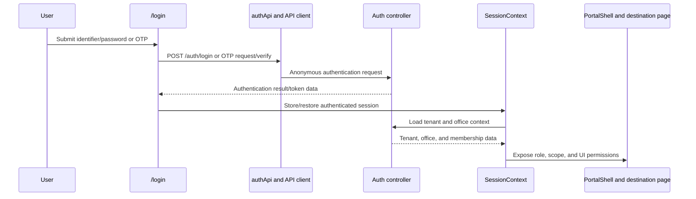
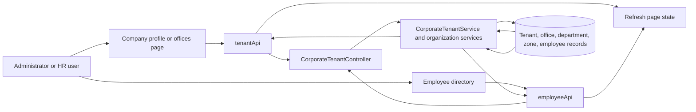
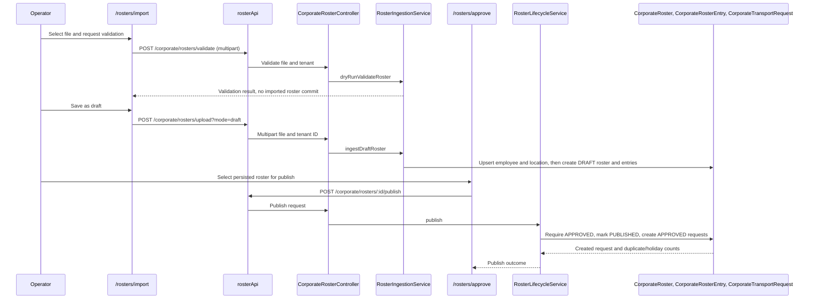
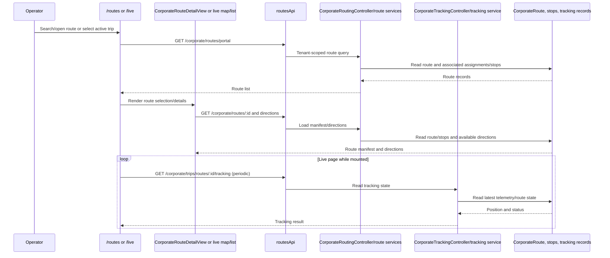

# Corporate end-to-end workflows

This guide follows the Corporate user's work from the page through the API and
backend. It describes only behavior evidenced in the current frontend and
backend. For all 65 routes, see the [route-by-route reference](./detailed-route-reference.md);
for exact HTTP methods and payload shapes, see the [frontend API reference](./api-reference.md).

> **Current reachability:** `/live/**`, `/bookings/**`, `/rosters/**`, and
> `/safety/**` are redirected to `/dashboard` by their parent layouts. The
> corresponding flows below explain the implemented page/API code, but those
> pages are not currently reachable through the Corporate UI. This includes
> pages described as the entry point to a workflow. Fixing those redirects is
> a prerequisite to exercising those flows in the portal.

## 1. Sign in and establish tenant scope

### Functional view

A corporate administrator or operator signs in with a password or requests an
OTP for an existing account. After authentication, the portal restores the
user's Corporate role, tenant, available offices, and selected office scope.
That context decides which navigation and UI actions are available.

### Technical flow



**Implementation:** `apps/corporate/src/app/login/page.tsx`,
`apps/corporate/src/lib/auth/SessionContext.tsx`,
`apps/corporate/src/lib/auth/session.ts`, and
`apps/corporate/src/components/layout/PortalShell.tsx`.

**Rules:** The OTP helper sends `isRegister: false`; this path does not create
accounts. A user must have Corporate eligibility and tenant membership. The
client permission mirror is for navigation and UX; the backend guards are the
authorization boundary. Authenticated API calls use bearer tokens. The shared
client attempts a single silent refresh on eligible 401 responses, then clears
the session and redirects to sign-in if refresh fails.

## 2. Maintain company structure and employee records

### Functional view

Company administrators maintain the tenant profile, offices and organization
metadata. HR or transport staff use the employee directory to find a person,
assign an office/department/cost center, update contact details, and change
active status. Office and employee records then provide the organizational
context used by transport requests, rosters, support, and reporting.

### Technical flow



**Implementation:** `company-profile/page.tsx`, `offices/page.tsx`,
`employees/EmployeeDirectory.tsx`, `lib/api/corporate.ts`, and
`lib/auth/SessionContext.tsx`. The employee directory sends tenant, optional
search/office/active filters, page, and page size. Employee creation includes
employee code, name, email, phone, gender, office and home address; updates
send changed fields; deactivation toggles `isActive`. The API returns whether
delete removed or deactivated a record so the UI can explain retained history.

**Rules and errors:** Client forms require their mandatory fields and office
scope; the backend validates DTOs, tenant ownership and references. A client
role gate (for example `employees:write`) is not sufficient to authorize a
mutation. A successful write is followed by a list reload; failure is shown
without treating the requested change as complete.

## 3. Import a roster, approve it, then publish demand

### Functional view (source behavior; route currently blocked)

An operator downloads the roster template if needed, selects a file, validates
it, and saves it as a draft. The review screen loads saved roster records. The
current screen's action publishes selected records; it does not call the
separate approval helper, even though its labels imply approval.

### Technical flow and data effects



**Important backend lifecycle:** Draft rosters normally follow
`DRAFT -> APPROVED -> PUBLISHED`. `RosterLifecycleService.approve` only
transitions a draft to approved. `publish` requires approved state, is
transactional, skips holiday entries, creates approved transport requests,
and uses an idempotency hash to avoid duplicate demand. The current review
page calls `rosterApi.publish` directly; therefore a draft selected there can
receive a backend conflict unless an approval occurred elsewhere. The UI flow
and lifecycle are not currently aligned. Do not silently document an
approval step that the page does not perform.

**Direct source:** `apps/corporate/src/app/rosters/import/page.tsx`,
`apps/corporate/src/app/rosters/approve/page.tsx`,
`apps/corporate/src/lib/api/corporate.ts`,
`apps/api/src/domains/corporate/rosters/corporate-roster.controller.ts`,
`apps/api/src/domains/corporate/rosters/roster-ingestion.service.ts`, and
`apps/api/src/domains/corporate/rosters/roster-lifecycle.service.ts`.
The [roster controller reference](../api/reference/endpoints/corporate-roster-controller.md)
records route declarations and first-level service evidence.

## 4. Review and act on booking requests

### Functional view (source behavior; route currently blocked)

Operators search transport requests, inspect the employee and schedule
context, and either approve/reject an eligible request or cancel/reschedule an
employee request where the page exposes that action. The dedicated overview
shows aggregate statuses; the cancellations page is a filtered history view.

### Technical flow

1. `/bookings` calls `tripsApi.requests` with tenant and any supported filters.
2. The helper issues `GET /corporate/trips/requests`; the trip-execution
   controller delegates to request handling services and reads
   `CorporateTransportRequest` with related tenant/employee/route context.
3. `/bookings/approvals` submits
   `POST /corporate/trips/requests/:id/review` with
   `{ decision: "APPROVE" | "REJECT", notes? }`.
4. Booking detail cancellation submits
   `POST /corporate/trips/requests/:id/reschedule` with
   `{ employeeId, action: "CANCEL" }`. A reschedule can include the new date
   and shift time if exposed by the caller.
5. On success, the page refreshes its current data; on failure, it displays
   the API error.

**Rules:** The backend owns permitted status transitions, tenant checks, and
the cancellation cutoff. The frontend helper documents a nine-hour cutoff;
the platform-admin override route is not called by the Corporate portal.
Never infer that a request action succeeded from the click itself.

## 5. Inspect a route and follow live tracking

### Functional view (route tracking pages are currently blocked; route directory/detail pages remain available)

Route lists help administrators find route records and assigned vehicles or
drivers. Route details show stop order, passenger/location context, distance
and directions. Live views focus on routes in transit and periodically refresh
the selected route's tracking state.

### Technical flow



**Source:** `apps/corporate/src/app/routes/`,
`apps/corporate/src/app/live/`, `apps/corporate/src/components/routes/CorporateRouteDetailView.tsx`,
`apps/corporate/src/components/maps/GoogleRouteMap.tsx`,
`apps/api/src/domains/corporate/routing/corporate-routing.controller.ts`, and
`apps/api/src/domains/corporate/tracking/corporate-tracking.controller.ts`.

**Boundaries:** `/routes/allocation` summarizes existing assignments; it is
not an assignment editor. Route display and a map do not imply that this
Corporate page dispatches a driver or writes GPS telemetry. Those actions
belong to distinct backend/operations workflows.

## 6. Resolve a safety incident (source behavior; route currently blocked)

1. `/safety` reads alerts and incidents scoped to the current tenant.
2. The user opens the query-ID dossier (`/safety/incidents/details?id=...`).
3. The resolution form loads the selected alert/incident and requires a
   category and non-empty notes.
4. The page calls
   `POST /corporate/safety/alerts/:id/resolve` with
   `{ reason, resolutionNotes, falsePositive }`.
5. The safety service validates the state transition, updates the
   safety record, and returns a result. The page returns to `/safety` only
   after success.

The dynamic safety aliases currently do not forward their `:id` path segment
to the query-driven shared page; use the query-ID URL. See the [route
reference](./detailed-route-reference.md#known-route-and-behavior-discrepancies).

## 7. Create and communicate on a support ticket

The Corporate support page loads authorized tickets and summary, polls its
list every 30 seconds, and applies search/status/priority/category/date
filters in local page state. Creating a ticket requires a subject and
description; non-employee users must select the employee it is for. Optional
uploads are restricted in the UI to up to five JPG/JPEG/PNG/WEBP images, each
no larger than 5 MB. The create helper sends an idempotency key and either
JSON or multipart form data. Ticket replies use the reply endpoint and
optional attachments. The ticket detail implementation can read conversation
messages, send a message, and reopen according to the backend status rules.

```mermaid
flowchart LR
  User[Corporate user] --> Page[/support or /support/tickets]
  Page --> API[GET/POST /corporate/support/tickets]
  API --> Controller[CorporateSupportTicketController]
  Controller --> Service[CorporateSupportTicketService]
  Service --> DB[(Ticket, message, employee, tenant)]
  DB --> Service --> Page
  Page --> Reply[Reply or reopen action]
  Reply --> API2[POST replies/messages/reopen]
  API2 --> Controller --> Service --> DB
```

## 8. Review invoices and raise a dispute

The billing screens read tenant invoice, line-item, and dispute data. A user
with the `billing:write` UI capability can select an invoice, enter a reason
and a positive rupee amount, and submit. The page rounds and converts the
amount to paise, then calls
`POST /corporate/billing/invoices/:id/disputes` with
`{ reason, claimedAmountPaise }`. The billing service checks the invoice and
permission, creates a dispute record, and returns the result. Invoice PDFs
are downloaded through the binary endpoint. The portal displays disputes;
resolution/acceptance is handled by the billing backend or another authorized
workflow, not by the visible dispute form.

## 9. Read notifications and safely navigate from them

The notifications page loads 20 records at a time and supports client-side
search, category, read-state, and date filters. Users can load another page,
mark one/all as read, delete one notification, or clear all after confirmation.
Opening a notification marks it read and navigates only when its destination
is same-origin and on the page's allowlist. On successful mutation the page
updates local counts and emits `adhocx:notifications-updated` so the shell can
refresh its indicator.

