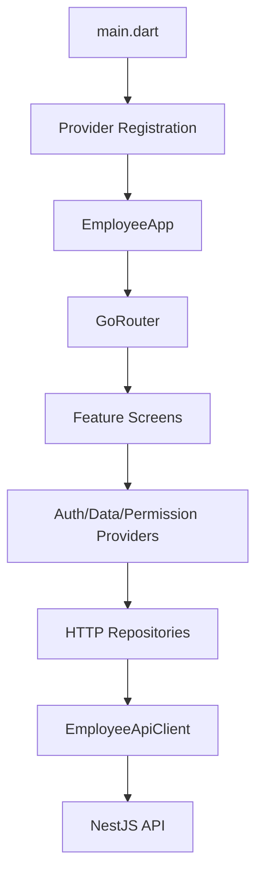

# Employee App Architecture

**Evidence status:** Verified against Flutter manifests, entrypoints, routes,
Provider state, repositories and API client source.

## Application Identity

The Employee App is a Flutter/Dart application for corporate employees using
AdhocX Enterprise Transportation. It uses:

- Flutter Material UI
- `go_router` navigation
- `provider` state management
- `shared_preferences` session storage
- the `http` package
- Sizer responsive layout

The project is configured for Android, iOS and web targets. Location and
notification permission requests are native-only in the audited provider;
web currently reports them granted without invoking browser permission APIs.

## Entry Point

`main.dart` initializes:

- `EmployeeApiClient`
- `HttpEmployeeAuthRepository`
- `HttpEmployeeRiderRepository`
- `EmployeeAuthProvider`
- `EmployeeDataProvider`
- `EmployeePermissionProvider`
- `ThemeProvider`

`app.dart` provides the Material application, theme mode and `GoRouter`
configuration.

## Navigation

GoRouter routes are centralized in
`apps/employee_app/lib/routes/app_routes.dart`. There are 110 literal route
paths and 21 named constant aliases. All 110 paths are registered; two
redirect to mobile-number entry. There is no app-wide auth redirect, so backend
guards are the access-control boundary.

Feature screens are organized under `lib/features` by domain:

- authentication
- boarding
- driver
- home
- profile and settings
- safety and support
- schedule
- tracking
- trips

## API Client

`EmployeeApiClient` resolves the API base URL with this priority:

1. Compile-time `API_BASE_URL` or `API_URL`
2. Web host/AdhocX domain detection
3. Production API URL for release mobile builds
4. Android emulator or localhost development URL

The client stores access tokens, refresh tokens and cached user data in
`shared_preferences`.

It sends JSON requests and adds a bearer token when available. On a 401 with
a token, concurrent requests share a refresh operation; if refresh succeeds,
the original request is replayed once. A rejected/non-success refresh clears
the saved session. Other non-2xx responses become `ApiException`; repositories
unwrap a `data` envelope.

## Technology responsibilities

| Technology/package | Why it is used here | Main source/responsibility |
|---|---|---|
| Flutter / Material | Cross-platform UI toolkit for employee commute pages | `lib/app.dart`, `lib/features/` |
| `go_router` | Central URL/path navigation, screen builders, redirects and route extras | `lib/routes/app_routes.dart`; not an authentication boundary |
| `provider` | Injects API/repository dependencies and exposes observable auth, data, permission and theme state | `lib/main.dart`, `lib/state/` |
| `http` | Sends JSON requests to the shared AdhocX API | `lib/services/employee_api_client.dart` |
| `shared_preferences` | Persists auth tokens, cached user profile and local theme/language choices | API client and local preference services |
| `permission_handler` | Requests native location and notification permissions during onboarding | `lib/state/employee_permission_provider.dart` |
| `sizer` | Makes layout sizing responsive to screen size/orientation | `lib/app.dart` |
| `flutter_svg`, `google_fonts`, `cached_network_image` | Render illustrations/icons, typography and remote image assets | Shared components/theme and feature screens |
| `connectivity_plus`, `url_launcher`, `fluttertoast` | Connectivity/UI utilities and external link/phone actions | Feature and shared UI code where imported |

The complete route-to-screen and reusable component map is in the
[route/screen catalog](./screen-component-catalog.md); request and response
details are in the [service/API matrix](./service-api-matrix.md).

## Integration boundary

The app is an API client; it has no separate Employee backend or local
business database. The API resolves the signed-in user to the corporate
employee and enforces JWT, role, tenant and resource ownership. Route
inventories do not prove that every screen is connected to these APIs. For
example, the current Employee OTP/QR boarding screens do not call the server's
boarding verification endpoints; see the [boarding integration
notes](./boarding-safety-and-api.md).
