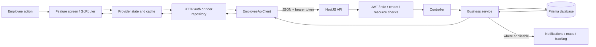

# Employee Commuter Feature Guide

The Employee App is the corporate commuter's view of an employer-arranged
journey. Employees use it to authenticate, check assigned rides and schedules,
see driver and cab information, monitor pickup progress, confirm safe arrival,
report issues, and manage account preferences. It does not create corporate
routes or assign vehicles; those are managed by the corporate operations and
dispatch services.

## Application responsibilities

| Area | Business purpose and user outcome | Main routes | Implementation |
|---|---|---|---|
| Sign-in and eligibility | Link an employee to the correct corporate commute profile; distinguish invalid/expired OTP from an employee without transport eligibility | `/`, `/welcome`, `/mobile-number`, `/otp-verify`, `/employee-verified`, `/error/*` | `EmployeeAuthProvider` → `HttpEmployeeAuthRepository` → `EmployeeApiClient`; auth and `/corporate/me` endpoints |
| Home and schedule | Show the employee's upcoming pickup/drop and their scheduled rides | `/home*`, `/schedule/*` | `EmployeeDataProvider` loads next trip and schedule using `HttpEmployeeRiderRepository` |
| Trip and cab status | Explain the trip's lifecycle and show driver/vehicle assignment or service exceptions | `/trips/*`, `/driver/*` | Screens under `features/trips/` and `features/driver/`; trip summaries and tracking come from rider endpoints where wired |
| Live tracking | Help the employee understand where the assigned cab is, the pickup location, route/stops and degraded GPS/network states | `/tracking/*` | `loadTracking` → `GET /corporate/me/trips/:id/tracking`; map and state presentation in `features/tracking/` |
| Boarding and trip closeout | Present OTP/QR entry, ride completion, safe-reach and feedback steps | `/boarding/*` | Next-trip/tracking data and rider safe-reach/feedback endpoints; boarding verification limitation is explained below |
| Safety and help | Provide an SOS action and ways to raise or follow incidents and support requests | `/safety/*` | SOS uses `POST /corporate/safety/sos`; incident forms create corporate tickets; chat uses support-ticket messages |
| Personal data and preferences | Review profile, contact details, history, notifications, language, privacy, and account actions | `/profile/*`, `/history/*`, `/notifications`, `/settings/*` | Rider repository and auth repository; app stores session/theme preferences locally |

## User workflows and business rules

### 1. Sign in and eligibility

The employee enters a mobile number or email and requests a one-time code.
Phone values have whitespace removed and use `+91`; email is lower-cased.
The API request marks the actor as `EMPLOYEE`, with SMS or email channel.
The user enters the six-digit sign-in OTP; the client rejects an incomplete
code before sending it. Successful server verification returns session
tokens, which the app stores before fetching the employee's corporate
profile. The profile lookup populates the cached employee, organization and
office details.

An invalid/expired code is different from transport ineligibility. A backend
`403` or profile `404` is represented as “transport unavailable” rather than
an OTP error. On app start, the provider restores the saved token and refreshes
the profile. See the [provider catalog](./state-provider-catalog.md) for
exact state transitions and refresh behavior.

The `/company-sso` path redirects to mobile-number entry. The repository's
email “SSO” method actually requests an email OTP; it does not perform an
external identity-provider handshake. A password-login method exists in the
repository/provider, but a route or API helper by itself does not prove a
password login screen is exposed.

### 2. View commute and schedule

Home and schedule screens read the shared `EmployeeDataProvider`. The provider
loads `/corporate/me/trips/next` for the next/active commute and
`/corporate/me/schedule` for shift rides. Responses can provide route and stop
IDs, shift date/time, planned ETA, pickup/drop details, driver/vehicle,
boarding OTP and server-calculated change eligibility. Schedule-date filters
are sent as `startDate`/`endDate`.

The backend owns the authoritative schedule, assignment and cutoff values.
The client uses `canCancel` and `canReschedule` to decide what action to show,
but the API rechecks employee ownership and modification policy when a
request is made. Cached schedule/next-trip data expires after 60 and 30
seconds respectively unless a screen forces refresh.

### 3. Request a commute change or cancellation

For a shift-time change, the change-details screen selects a schedule row
marked `canReschedule` and submits its `requestId`, `action: RESCHEDULE`,
requested time, optional date and reason to the corporate execution
reschedule API. The backend enforces the tenant cutoff policy (default nine
hours) and performs any required route replanning. If there is no modifiable
request, the screen falls back to a support ticket instead of pretending the
trip changed.

Pickup-address changes update the profile's default address using
`PATCH /corporate/me`; the reason may be recorded separately in a support
ticket. Ticket failure does not roll back an already-saved address change.

Cancellation asks the employee to choose a reason, optionally add notes, and
confirm in a second step. It resolves a stop ID from route state, active-trip
data or a cancellable schedule row, then sends
`POST /corporate/me/trips/:stopId/cancel`. If there is no cancellable stop,
the app shows an error. Success navigates to the cancelled-trip state; server
errors are shown to the employee.

### 4. Follow a cab and trip

Trip, driver and tracking screens present the commute lifecycle: planning,
assigned, approaching, arrived, boarded, in progress, completed, cancelled or
unserved. Driver and vehicle profile routes show the assigned service details.
Tracking screens distinguish GPS unavailable, stale location, weak network and
reconnecting states so old data is not necessarily mistaken for a live fix.

The data provider resolves a tracking identifier from a supplied stop, active
stop or route. It sends `GET /corporate/me/trips/:id/tracking`; the backend
checks the authenticated employee's relationship to that trip and reads
current route/stop/driver location. The client caches tracking for ten
seconds. The permission onboarding requests location access, but the
repository does not stream the employee's device location to the backend.

### 5. Board, complete, confirm safe reach and provide feedback

The app offers OTP and QR route screens, then displays verification,
success/wrong-code, trip progress and completion screens. **Current
implementation caveat:** the OTP screen reads the expected OTP from the
next-trip/tracking response and compares it locally; the employee app's
repository has no call to the backend execution `verify-otp` or `verify-qr`
endpoint. It therefore changes UI state but does not itself record the
server-side `BOARDED` transition. The server endpoints are documented for
context; this app's current route should not be described as authoritative
boarding verification.

After completion, safe-reach confirmation posts the stop ID and
`confirmedResidenceEntry: true` to `/corporate/me/trips/:stopId/safe-reach`.
The post-trip feedback form submits a 1–5 rating and optional felt-safe
response, comment and tags to `/corporate/me/trips/:stopId/feedback`. The
backend remains responsible for confirming that the employee may update that
stop and that the transition is valid. **Current safe-reach caveat:** if the
app cannot resolve a provider or stop ID, the confirmation screen skips the
request but still shows a success message and continues to feedback. Only a
successful request with an actual stop ID confirms server persistence.

### 6. Raise an emergency or request help

The SOS screen requires a three-second press-and-hold to reduce accidental
dispatch. It loads the next trip, resolves a route ID, obtains coordinates
from current driver tracking or pickup data, and posts route/location plus a
trigger reason to `/corporate/safety/sos`. If no route is found or the request
fails, it does not show success; it offers emergency number 112 and the
configured safety helpline. The backend validates route and coordinates,
authorizes the actor and dispatches the corporate safety workflow. If neither
driver-location nor pickup coordinates are present, the current client
supplies `0.0, 0.0`; the controller checks that coordinates exist but does not
reject zero values. This is a source-visible location-quality risk, not
evidence that the employee's phone location was captured.

Incident and complaint forms create tickets through
`POST /corporate/me/tickets`. Ticket lists use the commuter ticket endpoint;
details and conversations use the corporate support-ticket endpoint family.
The live chat can create a ticket and then send/read messages. Server-side
ticket category, subject, description, priority, rate limits, tenant scope and
SLA rules are enforced by the support service. The audited Employee create
call is JSON and does not upload attachments.

### 7. History, profile and preferences

Trip history loads using limit/offset pagination. Employee profile reads and
permitted edits use `/corporate/me`; notifications include a corporate
commuter feed and separate user in-app notification read/preference APIs.
Language and theme preferences use local app storage. Sign-out requests
server logout and clears local session state; delete-account clears local
state only after the delete request succeeds. These routes do not by
themselves establish that every page has a remote data source; the
[API matrix](./service-api-matrix.md) lists confirmed repository calls.

## End-to-end architecture

The Employee App is a Flutter client of the shared API, not an independent
data-owning backend. Corporate route planning and dispatch are performed by
the Corporate/Ops workflows; the employee app reads employee-scoped commute
data and submits employee actions. For endpoint-level details and known
client/backend gaps see the [service/API matrix](./service-api-matrix.md).

## Related references

- [Application architecture](./architecture.md)
- [Feature inventory](./feature-inventory.md)
- [Route-family reference](./detailed-route-reference.md)
- [Exact route inventory](./exact-route-inventory.md)
- [Route-to-screen catalog](./screen-component-catalog.md)
- [State and provider catalog](./state-provider-catalog.md)
- [Service/API matrix](./service-api-matrix.md)
- [Boarding, safety and API notes](./boarding-safety-and-api.md)
