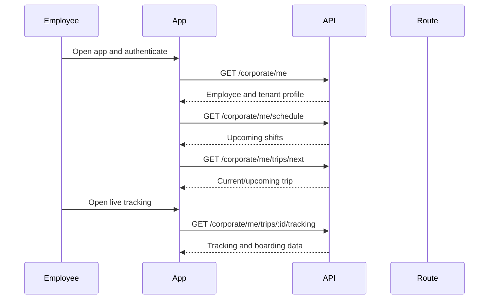

# Employee App Feature Inventory

**Evidence status:** Source-mapped from the route definitions, feature
screens, providers, repositories and backend endpoint source. Screen existence
does not imply every state is backed by an API.

## Feature Groups

| Group | Employee purpose and user capability | Main source areas | API or state integration |
|---|---|---|---|
| Authentication and eligibility | Restore/login to the company commute profile; handle OTP errors and transport ineligibility | `features/auth/`, `state/employee_auth_provider.dart`, `repositories/http_employee_auth_repository.dart` | OTP/login/logout and `/corporate/me`; local token/cache lifecycle |
| Onboarding and permissions | Explain schedule/tracking/safety setup and request location/notification permissions | `features/auth/onboarding/`, `features/auth/permissions/` | `EmployeePermissionProvider` and native `permission_handler`; permission choice is local |
| Home and schedule | Review next pickup/drop, empty schedule, daily/weekly/monthly shifts | `features/home/`, `features/schedule/views/` | Provider loads `/corporate/me/trips/next` and `/corporate/me/schedule` |
| Schedule changes | Request time/location changes or cancel an upcoming trip; view request outcomes | `features/schedule/requests/` | Reschedule or cancellation endpoints when an eligible request/stop is available; fallback support ticket for some changes |
| Trip and driver assignment | Read trip lifecycle, driver/vehicle details, pickup order, reassignment and service alerts | `features/trips/`, `features/driver/` | Next-trip/history/tracking data; some routes are navigation states rather than distinct API mutations |
| Live tracking | View route, pickup and cab progress, plus GPS/network degradation states | `features/tracking/` | `/corporate/me/trips/:id/tracking`; employee device position is not streamed by the audited repository |
| Boarding and completion | Enter OTP/QR, view trip completion, confirm safe reach and submit feedback | `features/boarding/` | Safe-reach and feedback are API-backed; current employee OTP/QR route does not call execution verification endpoints |
| Safety and support | Trigger SOS; report incidents/lost property; list tickets and converse with support | `features/safety_support/` | Corporate SOS, rider ticket endpoints and support-ticket details/messages |
| History and feedback | Browse prior commute summaries, analytics and submit trip feedback | `features/profile_settings/history/` | Trip history and feedback repository operations |
| Notifications | Read notification lists and manage delivery preferences | `features/profile_settings/notifications/` | Separate corporate commuter list and general in-app read/preference APIs |
| Profile and preferences | View/edit details, emergency contacts, language, privacy and theme | `features/profile_settings/profile/`, `settings/`, `theme/` | Profile API for supported employee fields; language/theme stored locally |
| Account lifecycle | Confirm logout and account deletion | `features/profile_settings/account/` | Auth logout/delete; client clears its session after the corresponding operation |

## Authentication States

`EmployeeAuthProvider` maintains a provider state covering:

- unauthenticated/loading
- authenticating
- OTP sent
- authenticated
- invalid/expired OTP
- transport ineligible
- generic error

Repository/provider authentication operations include:

- OTP request and verification
- password login
- company-email OTP flow (the `/company-sso` route redirects; no external SSO
  handshake is implemented)

The repository fetches `/corporate/me` after authentication to build the
employee profile and caches it locally.

## Commute Lifecycle

## Schedule and Change Requests

The rider repository has methods for:

- schedule date ranges
- next-trip lookup
- trip history
- cancellation
- reschedule requests

The route inventory presents corresponding UI states, including rejected,
pending and approved outcomes. These views do not prove every state is
returned by a live API. The exact implemented calls and the OTP/QR verification
gap are in the [service/API matrix](./service-api-matrix.md).

## Code and evidence coverage

The workspace has 197 Dart files in `apps/employee_app/lib/`: 132 feature
files, 30 shared-component files, 15 widgets, 7 theme files, 3 state
providers, 3 repository files, 2 services, 2 models, 1 route file and 2
entry/app files. The [route/screen catalog](./screen-component-catalog.md)
maps 110 canonical routes to registered GoRouter destinations and source
files, and lists 21 named constant aliases.

There are 23 Flutter test files in the workspace. Their existence is not a
claim of full end-to-end coverage; the source-mapped route/API references do
not verify deployed services, external provider delivery, or device-specific
permission behavior.
