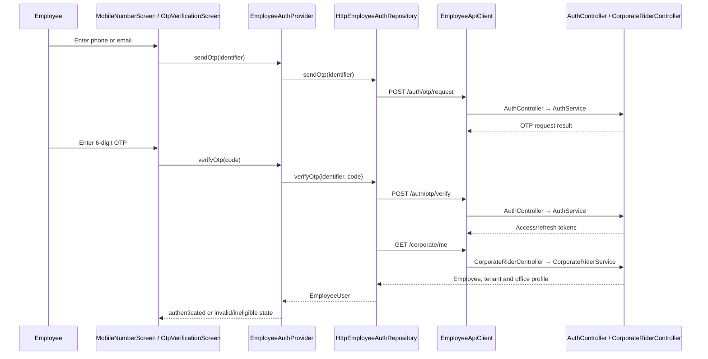
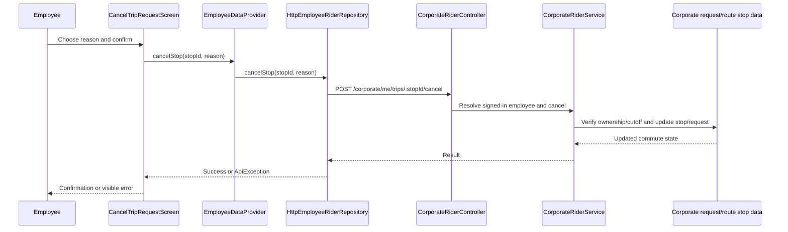

# Employee App Service and API Matrix

The Flutter app has one HTTP client and two HTTP repositories. The auth
repository handles identity/session operations; the rider repository handles
corporate commute data, safety and support. This page documents calls present
in those repositories and screens. A route or UI mock is not evidence that an
API is called.

Base paths below are relative to the resolved API base URL, normally ending in
`/api/v1`. Responses are JSON; repositories generally return `data` when the
server wraps a response in a `data` property, otherwise they return the
response object.

## Authentication and account endpoints

| API endpoint | Method | Purpose and request | Called by | Backend controller/service | Data interaction |
|---|---|---|---|---|---|
| `/auth/otp/request` | POST | Request an employee SMS OTP or email OTP. Body: `phone` or lower-case `email`, `channel`, phone `countryCode: +91`, `role: EMPLOYEE`, `isRegister: false`. | `HttpEmployeeAuthRepository.sendOtp`; mobile-number and OTP screens | `AuthController.requestOtp` → `AuthService.requestOtp` | Resolves the account/OTP and notification delivery. OTP delivery is external to this app. |
| `/auth/otp/verify` | POST | Verify submitted OTP. Body: phone or email, `otp`, optional phone country code, `role: EMPLOYEE`. | `HttpEmployeeAuthRepository.verifyOtp` | `AuthController.verifyOtp` → `AuthService.verifyOtp` | Auth service verifies identity and returns access/refresh tokens and user data. |
| `/auth/login` | POST | Password login. Body: `{identifier, password}`; identifier may be phone or email. | `HttpEmployeeAuthRepository.loginWithPassword`; provider method exists even where login UI is not exposed | `AuthController.login` → `AuthService.login` | Auth user/account records; returns session tokens. |
| `/auth/refresh` | POST | Exchange saved refresh token for a new access token; body `{refreshToken}`. | `EmployeeApiClient` after a 401 on a request with an access token | `AuthController.refresh` → `AuthService.refreshToken` | Rotates/validates session tokens. A failed refresh clears local session. |
| `/auth/logout` | POST | Invalidate the current session; body contains `refreshToken` when present. | `HttpEmployeeAuthRepository.signOut` | `AuthController.logout` → `AuthService.logout` | Session/token state. Local tokens and cached profile are cleared even if this request fails. |
| `/auth/account` | DELETE | Request account deletion. | `HttpEmployeeAuthRepository.deleteAccount` | `AuthController.deleteAccount` → `AuthService.deleteAccount` | Account and related records according to the auth service; local state clears only after a successful response. |
| `/corporate/me` | GET | Fetch the authenticated employee's corporate profile. | Auth profile hydration and rider repository profile loading | `CorporateRiderController.getProfile` → `CorporateRiderService.getRiderProfile` | Resolves the user to a `CorporateEmployee`, tenant, office and pickup details. Used to construct/cache `EmployeeUser`. |
| `/corporate/me` | PATCH | Update supplied `fullName`, `email` and/or `homeAddress`; omitted fields are not sent. | `HttpEmployeeRiderRepository.updateProfile`; profile editor and pickup-address change flow | `CorporateRiderController.updateProfile` → `CorporateRiderService.updateRiderProfile` | Employee profile/default pickup data. Authorization is enforced by JWT, role and corporate access guards. |

The `/company-sso` route is currently a redirect, not an external SSO
integration. The repository method named `authenticateWithSso` validates the
email and requests an email OTP; the user must then verify that OTP. The
password login repository method is implemented, but route registration alone
does not imply a password form is available.

## Commuter, schedule and trip endpoints

| API endpoint | Method | Purpose and request | Called by | Backend controller/service | Data interaction |
|---|---|---|---|---|---|
| `/corporate/me/schedule` | GET | Fetch schedule; optional query parameters `startDate` and `endDate`. | `getSchedule` → `EmployeeDataProvider.loadSchedule`; home/schedule and change screens | `CorporateRiderController.getSchedule` → `CorporateRiderService.getRiderSchedule` | Employee-linked `CorporateTransportRequest`, route/stop state and tenant cutoff policy. Response includes dates, direction, request/stop IDs and `canCancel`/`canReschedule` rules. |
| `/corporate/me/trips/next` | GET | Fetch next/active commute including route/stop identifiers, ETA, driver/vehicle, pickup, and boarding OTP when available. | `getNextTrip` → `loadNextTrip`; home, boarding, SOS and cancel flows | `CorporateRiderController.getNextTrip` → `CorporateRiderService.getRiderNextTrip` | Current employee's scheduled request, `CorporateRoute` and `CorporateRouteStop`. |
| `/corporate/me/trips` | GET | Fetch trip history; query `limit` and `offset` (repository defaults are 20/0). | `getTripsHistory` → `loadTripsHistory` | `CorporateRiderController.getTrips` → `CorporateRiderService.getRiderTrips` | Employee-linked route stops/trips, driver and vehicle summaries, status and feedback state. |
| `/corporate/me/trips/:id/tracking` | GET | Fetch tracking, current location/ETA, stop data and boarding token for the supplied route/stop identifier. | `getTripTracking` → `loadTracking`; tracking/boarding screens | `CorporateRiderController.getTripTracking` → `CorporateRiderService.getRiderTripTracking` | Checks the requested trip/stop against the employee's authorized commute and reads route, stop and latest driver-location data. |
| `/corporate/me/trips/:stopId/cancel` | POST | Cancel/opt out of an upcoming stop. Optional body `{reason}`; blank reason is omitted. | `cancelStop` → `EmployeeDataProvider.cancelStop`; cancellation screen | `CorporateRiderController.cancelTripStop` → `CorporateRiderService.cancelRiderStop` | Updates the employee's route stop/request under a transaction. The backend enforces the schedule's modification cutoff and ownership rather than trusting UI state. |
| `/corporate/trips/requests/:requestId/reschedule` | POST | Request a change with `{action: "RESCHEDULE", newShiftTime, newShiftDate?, reason?}`. The implementation uses the request ID. | `rescheduleRequest` → `EmployeeDataProvider.rescheduleRequest`; change-details screen | `CorporateTripExecutionController.rescheduleOrCancel` → `CorporateTripExecutionService.handleRescheduleOrCancel` and replanning service | Updates the request/route plan. Employee requests are subject to the backend's tenant cutoff policy (default 9 hours); client payload cannot override it. |
| `/corporate/routes/:routeId` | GET | Fetch route details and ordered stops. | `getRouteDetails` → `loadRouteDetails`; route/tracking presentation when invoked | `CorporateRoutingController` → route lookup/directions services | `CorporateRoute` and ordered `CorporateRouteStop` rows, subject to corporate access/tenant checks. |

The Corporate rider controller uses JWT, role and corporate-access guards.
It resolves the authenticated user to the employee on the server; a client
provided route, stop or request identifier is not sufficient authorization.
Schedule responses expose a cutoff timestamp and booleans for convenient UI
display, but the server repeats authorization and cutoff checks when a
mutation is submitted.

## Safety, feedback, support and notifications

| API endpoint | Method | Purpose and request | Called by | Backend controller/service | Data interaction |
|---|---|---|---|---|---|
| `/corporate/me/trips/:stopId/safe-reach` | POST | Confirm residence entry. Body `{confirmedResidenceEntry: boolean, notes?}`. | `submitSafeReach`; safe-reach confirmation screen | `CorporateRiderController.submitSafeReach` → `CorporateRiderService.submitSafeReach` | Associates confirmation with the employee's stop/trip; policy and ownership are evaluated by the backend. |
| `/corporate/me/trips/:stopId/feedback` | POST | Submit `{rating: 1..5, feltSafe?, comment?, tags?}` after a commute. | `submitFeedback`; trip feedback and driver safety rating screens | `CorporateRiderController.submitFeedback` → `CorporateRiderService.submitTripFeedback` | Creates/updates feedback associated with the employee's trip stop and its route/employee relationships. |
| `/corporate/safety/sos` | POST | Dispatch SOS with required `routeId`, `latitude`, `longitude`, optional `triggerReason`. | `triggerSos`; SOS activation screen after a three-second press-and-hold | `CorporateSafetyController.triggerSos` → `CorporateSafetyService.triggerSosAlert` | Creates a corporate SOS alert associated with a route and dispatches notifications to safety/command workflows. Missing route/location or request failure is shown as a failure; the screen does not claim delivery. |
| `/corporate/me/tickets` | POST | Create commuter support ticket with required category, subject, description and optional priority (repository default `MEDIUM`). | `createTicket`; incident form, change fallback and live-support flow | `CorporateRiderController.createTicket` → `CorporateRiderService.createSupportTicket` → shared `CorporateSupportTicketService` | Creates tenant/employee-linked `CorporateSupportTicket`; service validates category/priority/text, limits creation rate, calculates SLA and persists activity. |
| `/corporate/me/tickets` | GET | List the signed-in employee's tickets. | `getTickets` → `loadTickets`; ticket-list screen | `CorporateRiderController.getTickets` → rider service → shared support-ticket service | Employee-scoped `CorporateSupportTicket` records. |
| `/corporate/support/tickets/:ticketId` | GET | Fetch authorized ticket details/timeline. | `getTicketDetails`; request details screen | `CorporateSupportTicketController.getTicket` → `CorporateSupportTicketService.getTicket` | Ticket, public replies, activity and authorized/signed attachment links. |
| `/corporate/support/tickets/:ticketId/messages` | GET | Load conversation messages. | `getTicketMessages`; live support chat | Support-ticket controller `listMessages` → ticket service | Ticket messages, scoped to the authorized actor and ticket. |
| `/corporate/support/tickets/:ticketId/messages` | POST | Send `{message}` in a ticket conversation. | `sendTicketMessage`; live support chat | Support-ticket controller `createMessage` → ticket service | Persists a ticket message; server role, tenant and ticket ownership rules apply. |
| `/corporate/me/notifications` | GET | Fetch corporate commuter notification events. | `getNotifications` → `loadNotifications`; notification center | `CorporateRiderController.getNotifications` → rider service | User/employee notification events. This is distinct from the general in-app notifications feed. |
| `/notifications/in-app/:notificationId/read` | PATCH | Mark one general in-app notification read. | `markNotificationRead`; notification state action | `NotificationsController.markAsRead` → `NotificationsService.markAsRead` | User-owned `Notification` read state. |
| `/notifications/in-app/read-all` | PATCH | Mark all general in-app notifications read. | `markAllNotificationsRead`; notification state action | `NotificationsController.markAllAsRead` → `NotificationsService.markAllAsRead` | Current user's in-app notification read state. |
| `/notifications/preferences` | PATCH | Persist the notification preference map. | `updateNotificationPreferences`; available through rider repository | `NotificationsController.updatePreferences` → `NotificationsService.updatePreferences` | Current user's notification channel and quiet-hour preference record. |

The central support API has additional upload/reply/admin functions, but the
Employee repository's create-ticket method sends JSON to `/corporate/me/tickets`
and does not attach files. Do not assume that employee incident forms upload
images unless that screen and request are separately verified.

## Client/server behavior differences and incomplete wiring

- **Boarding OTP:** the boarding OTP screen obtains the expected OTP from
  already-fetched next-trip/tracking data and compares the entered value
  locally before navigating to success or wrong-OTP UI. There is no
  `verify-otp` or `verify-qr` request in the Employee repository. The backend
  has `/corporate/trips/routes/:id/stops/:stopId/verify-otp` and
  `verify-qr` endpoints for trip execution, but this app's current UI flow
  does not invoke them. Treat successful navigation as a client-side
  comparison, not proof of server-side boarding state.
- **QR path:** a scan route and screen are registered, but there is no
  Employee repository method for server QR verification. Server-side
  one-time/dynamic QR validation is not evidenced in this client's route
  path.
- **Safe reach:** if the safe-reach screen cannot resolve an Employee provider
  or stop ID, its current code skips the API request but still shows a
  success message and navigates to feedback. Only a successful request with a
  valid stop ID confirms server persistence.
- **SOS coordinates:** the client chooses driver location, then pickup
  coordinates, then defaults each missing value to `0.0`. The controller
  requires coordinates to be present but does not reject zero values. The
  screen also does not request the employee device's GPS fix for this payload.
- **Change requests:** time changes call the corporate execution
  reschedule endpoint only when the loaded schedule has a request with
  `canReschedule == true`; otherwise the screen creates a support ticket.
  Pickup-address edits use `PATCH /corporate/me` and may create a separate
  support ticket for the reason. Some secondary support-ticket attempts are
  caught locally; a saved address change is not rolled back if ticket
  creation fails.
- **Notification feed:** the repository has both corporate-specific
  `/corporate/me/notifications` and global `/notifications/in-app` read
  operations. The exact feed/read pairing depends on the screen; the existence
  of repository methods alone does not demonstrate a single synchronized
  feed workflow.
- **Data load failures:** several `EmployeeDataProvider` loaders keep the last
  cached value, set an error field and return cached/null/empty data instead
  of throwing to the screen. Check loading and error properties; an empty
  visual state may otherwise conflate “no records” and “request failed.”
- **Permission scope:** location and notification screens request native
  permissions through `permission_handler`. The audited rider API repository
  does not stream employee-device location; live tracking fetches the
  server's route/driver tracking data.

These are implementation observations, not claims about production
configuration or deployed integrations.

## End-to-end examples

### Employee login

### Trip cancellation

## Persistence and authorization

Employee-facing commute data is associated with `CorporateEmployee`,
`CorporateTransportRequest`, `CorporateRoute` and `CorporateRouteStop`.
Feedback is associated with a stop through `CorporateTripFeedback`.
Support content is stored in `CorporateSupportTicket` with related message,
comment, activity and attachment records. Notification read state is stored
against the authenticated user's notification records and preferences.

The checked-in schema is summarized in the
[API data dictionary](../api/data/data-dictionary.md); these references do
not introspect deployed database contents. Backend authorization is enforced
by the relevant JWT, role, corporate access, tenant-scoped and resource
ownership guards. Employee screens and cached identifiers are not the
security boundary.

## Source references

- `apps/employee_app/lib/repositories/http_employee_auth_repository.dart`
- `apps/employee_app/lib/repositories/http_employee_rider_repository.dart`
- `apps/employee_app/lib/services/employee_api_client.dart`
- `apps/employee_app/lib/state/employee_auth_provider.dart`
- `apps/employee_app/lib/state/employee_data_provider.dart`
- `apps/api/src/modules/auth/auth.controller.ts`
- `apps/api/src/domains/corporate/rider/corporate-rider.controller.ts`
- `apps/api/src/domains/corporate/rider/corporate-rider.service.ts`
- `apps/api/src/domains/corporate/execution/corporate-trip-execution.controller.ts`
- `apps/api/src/domains/corporate/safety/corporate-safety.controller.ts`
- `apps/api/src/domains/corporate/safety/corporate-support-ticket.controller.ts`
- `apps/api/src/domains/corporate/safety/corporate-support-ticket.service.ts`
- `apps/api/src/modules/notifications/notifications.controller.ts`
