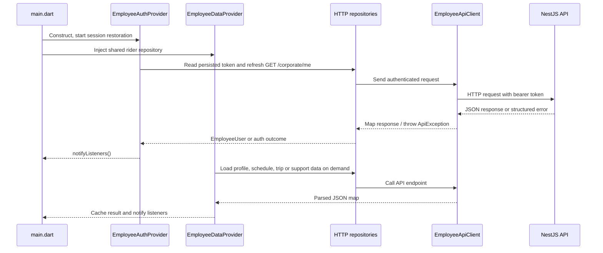

# Employee App State and Provider Catalog

The Employee app uses Flutter `provider`. `main.dart` creates one
`EmployeeApiClient`, injects it into the HTTP repositories, then registers
authentication, commuter data, permission and theme state in a
`MultiProvider`. This keeps widgets focused on display and actions while
providers coordinate asynchronous work and notify dependent screens.

## Provider inventory

| State object | Owner and responsibilities | Important state/actions | Dependencies and source |
|---|---|---|---|
| `EmployeeAuthProvider` | Owns sign-in/session state; restores a current user on construction; coordinates OTP, password login, email verification, sign-out and account deletion | `AuthState`, user, identifier, error, resend countdown; `sendOtp`, `verifyOtp`, `loginWithPassword`, `authenticateWithSso`, `signOut`, `deleteAccount` | `EmployeeAuthRepository` / `HttpEmployeeAuthRepository`; [provider](../../../../employee_app/lib/state/employee_auth_provider.dart), [state model](../../../../employee_app/lib/models/auth_state.dart) |
| `EmployeeDataProvider` | Owns cached employee profile, next trip, tracking, schedules, history, tickets, notifications and route details; performs mutations and notifies screens | Per-resource loading/error state; load/update/cancel/reschedule/notification actions; `clear()` invalidates the signed-in employee's cached data | `HttpEmployeeRiderRepository`; [provider](../../../../employee_app/lib/state/employee_data_provider.dart) |
| `EmployeePermissionProvider` | Requests location and notification permissions during onboarding | Granted/loading booleans; request or skip each permission | `permission_handler`; [provider](../../../../employee_app/lib/state/employee_permission_provider.dart) |
| `ThemeProvider` | Loads and persists light/dark/system selection | `ThemeMode`, `setThemeMode`, `toggleTheme`, effective brightness | `shared_preferences`; [provider](../../../../employee_app/lib/theme/theme_provider.dart) |
| `EmployeeApiClient` | Cross-cutting HTTP/session component rather than a `ChangeNotifier`; chooses base URL, stores tokens, adds bearer headers, refreshes and retries one 401, parses errors | Access/refresh token and cached-user persistence; GET/POST/PATCH/DELETE | `http`, `shared_preferences`; [client](../../../../employee_app/lib/services/employee_api_client.dart) |

`EmployeeUser` is the authenticated employee snapshot. It carries the
employee/user IDs, employee code, name, organization, office, email, phone,
transport eligibility, optional photo and creation time. It is serialized to
local preferences by the auth repository; it is not itself a provider.

## State and request lifecycle

### Authentication state

`AuthState` represents `initial`, `otpSent`, `authenticating`,
`authenticated`, `notEligible`, `invalidOtp` and generic `error`. OTP send
normalizes phone whitespace or lowercases email, and the HTTP repository sends
`role: EMPLOYEE` with `channel: SMS` or `EMAIL`; phone requests include
`countryCode: +91`. OTP verification stores tokens before fetching
`GET /corporate/me`. A `404` profile or `403` authorization response is mapped
to transport ineligibility; expired and invalid OTP errors are separate
outcomes.

The resend timer starts at 24 seconds after a successful send (the value
declared in the default `AuthState` is 30 seconds). `checkExistingSession`
marks the check complete even if restoration fails; it does not expose a
restoration error to the UI. `signOut` clears local tokens in a `finally`
block even if the logout request fails. Account deletion clears local state
after a successful API call.

The `companySso` route is not an implemented external SSO integration:
GoRouter redirects it to `/mobile-number`. The repository method named
`authenticateWithSso` validates an email and dispatches an OTP to that email,
then returns a message directing the caller to enter the code.

### Commuter-data caching and errors

`EmployeeDataProvider` uses in-flight request deduplication to avoid duplicate
simultaneous fetches and freshness windows to avoid unnecessary requests:

| Resource | Freshness window |
|---|---:|
| Profile | 5 minutes |
| Next trip | 30 seconds |
| Tracking | 10 seconds |
| Schedule | 60 seconds |
| Trip history | 2 minutes |
| Tickets and notifications | 30 seconds |
| Route details | 5 minutes; LRU cache capped at 20 route IDs |

It batches notifications during multi-resource refreshes and uses a
generation counter so results from requests started before `clear()` do not
repopulate the signed-out user's state. Most loader failures preserve and
return the last cached value while setting a resource-specific error property;
screens should inspect both the data and its error/loading state. Notification
read actions update local state optimistically and log, rather than surface,
API failures.

### Permissions and theme

On web, the permission provider treats location and notifications as granted
without calling a browser permission API. On native platforms it requests
`locationWhenInUse` and notification permission through `permission_handler`;
the user may skip either request. A skipped permission remains false and
does not itself make an API request.

Theme mode is persisted using the `app_theme_mode` preference. The app starts
with light theme until the saved value is loaded. The current theme provider
shares tokens with the Driver app; theme persistence is local and is not
synced to the backend.

## HTTP behavior and trust boundary

The API client chooses its base URL from `API_BASE_URL`, then `API_URL`, then
web-host detection or platform defaults. Release builds use
`https://api.adhocx.com/api/v1`; local Android uses `10.0.2.2:7001`, and other
local targets use `localhost:7001`. Each normal request uses JSON
`Content-Type`/`Accept`; a stored access token is sent as `Authorization:
Bearer ...`.

On a 401 with an access token, the client exchanges the saved refresh token at
`POST /auth/refresh` and replays the original request once if a new access
token is returned. Concurrent refresh attempts share a `Completer`. A failed
non-2xx refresh clears local session state; a thrown transport/parse error is
logged and returns no replacement token. Non-2xx application responses become
`ApiException(statusCode, message, data)`. The client parses JSON but leaves
`data`-envelope unwrapping to repositories.

The Flutter router has no global authentication/role guard. Cached state and
redirects improve the interface but do not grant access. The API's JWT,
role, corporate-tenant and resource-ownership checks are the authorization
boundary.

## Source references

- `apps/employee_app/lib/main.dart`
- `apps/employee_app/lib/app.dart`
- `apps/employee_app/lib/models/auth_state.dart`
- `apps/employee_app/lib/models/employee_user.dart`
- `apps/employee_app/lib/repositories/employee_auth_repository.dart`
- `apps/employee_app/lib/repositories/http_employee_auth_repository.dart`
- `apps/employee_app/lib/repositories/http_employee_rider_repository.dart`
- `apps/employee_app/lib/services/employee_api_client.dart`
