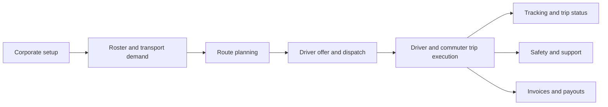

# ETS Current-State Overview

## What ETS is

The Enterprise Transportation System (ETS) is AdhocX's corporate employee
transport business domain. It is not a standalone workspace or separately
deployable application. The source implementation spans the NestJS API and
the Admin, Ops, Corporate, Employee and Mobile applications.

The current implementation uses API modules, Prisma data access and client
applications in the monorepo. The target DDD package topology and other
architecture proposals in the historical specifications are not evidence
that those proposed layers or services exist.

## Evidence and status language

The status labels below refer to repository evidence, not production
availability or business acceptance:

- **Source-present:** a relevant route, module, service, screen or data model
  was found in the repository.
- **Partial:** some behavior is implemented, but source notes, app/API
  mismatches, open acceptance work or incomplete end-to-end coverage remain.
- **Planned:** a proposal or work item; it is not implemented merely because
  a design or plan describes it.
- **Historical:** a dated snapshot or design baseline. Consult current
  source-linked documentation before relying on its details.

See the [implementation status matrix](./implementation-status.md) for
capability-by-capability evidence and the open distinctions.

## Applications and responsibilities

| Application | ETS-facing responsibility | Current source documentation |
|---|---|---|
| API | Corporate tenant, roster, routing, dispatch, execution, rider, tracking, safety, support, analytics and billing endpoints/services. | [API architecture and module/service reference](../api/corporate-module-services.md), [endpoint inventory](../api/reference/exact-controller-endpoints.md) |
| Corporate | Transport-manager configuration, roster/route workflows, support and finance pages. | [Corporate routes](../corporate/detailed-route-reference.md), [workflow reference](../corporate/workflow-reference.md) |
| Employee App | Commuter identity, schedule, trip, tracking, cancellation and support screens. | [Commuter feature guide](../employee-app/commuter-feature-guide.md), [service/API matrix](../employee-app/service-api-matrix.md) |
| Mobile | Driver/vendor app workflows; some Corporate ETS driver screens are present in source but are not registered in the audited app router. | [Driver feature guide](../mobile/driver-feature-guide.md), [service/API matrix](../mobile/service-api-matrix.md) |
| Ops | Dispatch operations, route monitoring, reassignment and safety workflows. | [Ops route reference](../ops/route-by-route-reference.md), [SOS/reassignment guide](../ops/sos-and-reassignment-guide.md) |
| Admin | Platform administration and supporting corporate route-management surfaces. | [Admin route reference](../admin/route-by-route-reference.md) |

These pages document source behavior and known limitations; they do not
certify that all routes are reachable in a deployed environment.

## Current workflow outline

The diagram is a domain map, not a guarantee that every route is automatically
connected or every transition is production-accepted. Known UI/API gaps and
validation limits are listed in the [status matrix](./implementation-status.md)
and application references.

## Shared technical boundaries

- The API is a NestJS modular monolith under `apps/api/src/`; ETS controllers
  are grouped under `apps/api/src/domains/corporate/`.
- Prisma models and migrations are checked-in data-contract evidence. They
  are not live database inspection.
- Client-side visibility or a named route does not replace API-side
  authentication, tenant/resource authorization or business-rule validation.
- Google, Redis, notification, payment and mapping adapters in source do not
  establish that production credentials or services are available.
- The target DDD architecture in archived design documents is not the current
  code structure unless confirmed in the package/module inventory.

## Navigation

- [Implementation status matrix](./implementation-status.md)
- [Current module and API map](./module-and-api-map.md)
- [Operational workflow map](./operational-workflows.md)
- [Historical ETS specifications and audits](./historical-archive.md)
- [Roadmaps and target-state proposals](./roadmap-archive.md)
