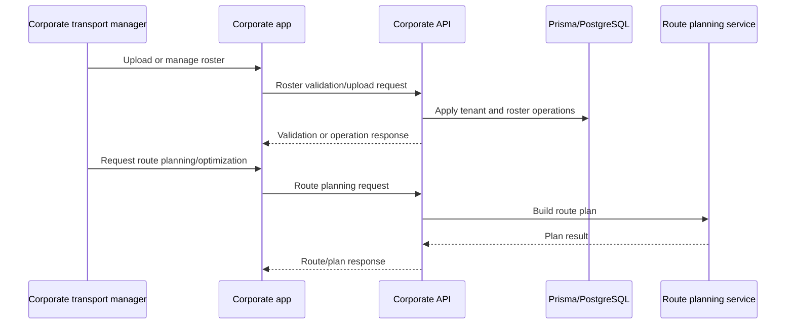
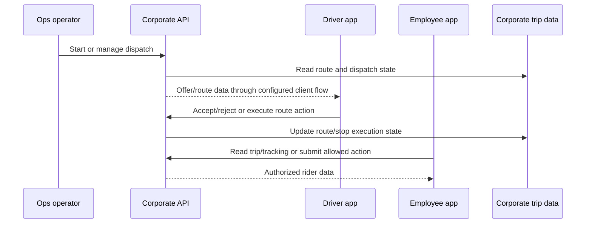
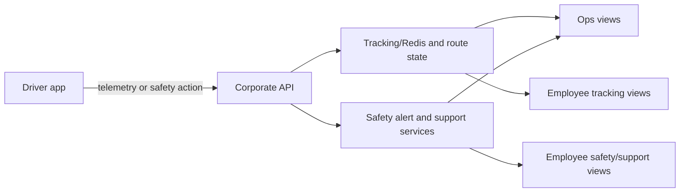

# ETS Current Operational Workflow Map

These diagrams summarize the main source-level path across the applications.
They do not certify every transition, deployment, provider integration or
client/server interaction. For page-specific behavior, follow the linked
application and API references.

## Roster to planned routes

The source contains roster and planning APIs, but this summary intentionally
does not assert a universal automatic publish-to-plan trigger, a particular
approval/version lifecycle, or full production acceptance. Consult the
[Corporate workflow reference](../corporate/workflow-reference.md) and the
[roster/route status rows](./implementation-status.md).

## Dispatch to trip execution

The driver and employee implementations are not interchangeable. The Mobile
app's Corporate ETS driver screens are source-present but unregistered in the
audited router; Employee boarding OTP/QR screens have documented local
verification gaps. See the [Mobile driver guide](../mobile/driver-feature-guide.md)
and [Employee API matrix](../employee-app/service-api-matrix.md).

## Tracking, safety and support

Source contains tracking, safety and support areas. Provider wiring,
monitoring SLAs, device permissions, live alert delivery and production
response must be verified separately; page copy alone is not evidence.

## Finance and reconciliation

Corporate billing, dispute, rate-card, payout and driver earning source areas
exist. Their presence does not mean every legacy dual-ledger rule, payment
provider or settlement state machine is implemented. Use the
[current implementation status](./implementation-status.md), the
[API service/data references](../api/data/index.md) and current billing
controller/service evidence for specific claims.

## Workflow evidence links

- [Corporate route workflows](../corporate/workflow-reference.md)
- [Corporate API reference](../corporate/api-reference.md)
- [Employee commuter guide](../employee-app/commuter-feature-guide.md)
- [Mobile driver guide](../mobile/driver-feature-guide.md)
- [Ops live operations runbook](../ops/live-operations-runbook.md)
- [Exact API endpoint inventory](../api/reference/exact-controller-endpoints.md)
