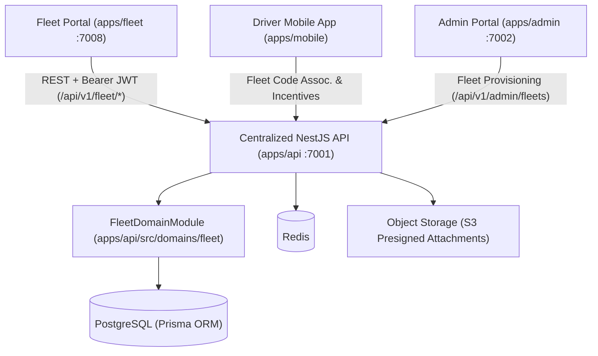

# Fleet architecture

AdhocX Fleet follows the monorepo Domain-Driven Design (DDD) architecture: a dedicated frontend application (`apps/fleet`) communicating over REST with the centralized NestJS backend (`apps/api`) via its **`FleetDomainModule`** bounded context (`apps/api/src/domains/fleet/`).

## 1. Component Topology

| Component | Workspace | Port | Stack & Responsibility |
| :--- | :--- | :--- | :--- |
| **Fleet Portal (Frontend)** | `apps/fleet` | `7008` | Next.js 14 App Router, React 18, TypeScript, `@adhocx/ui` adaptive skeletons, `@adhocx/contracts`, centralized REST client (`/api/v1/fleet/*`). |
| **Fleet Domain Bounded Context** | `apps/api/src/domains/fleet` | `7001` | NestJS `FleetDomainModule` housing domain business logic (`portal/auth`, `portal/code`, `portal/dashboard`, `portal/drivers`, etc.), `FleetAuthGuard`, `FleetRolesGuard`, and REST controllers under `/api/v1/fleet/*`. |
| **Driver & Trip Modules** | `apps/api/src/modules` | `7001` | Driver-side Fleet Code association (`POST /api/v1/drivers/fleet-code/validate`), earnings redaction in `DriversService` & `TripsService`, and incentive progress hooks. |
| **Shared Contracts** | `packages/contracts` | — | Canonical DTOs (`dtos/fleet-portal/*`) and enums shared between `apps/fleet` and `apps/api`. |

## 2. System Diagram

## 3. Architectural Principles

1. **Single Centralized Backend (`apps/api`) with DDD**: All Fleet business logic is encapsulated in `apps/api/src/domains/fleet/` (`FleetDomainModule`), exposing `/api/v1/fleet/*` endpoints alongside `/api/v1/admin/fleets`.
2. **API-Contract-First Synchronization**: All request/response DTOs and enums live in `packages/contracts`, keeping `apps/fleet` and `apps/api` type-synchronized.
3. **Adaptive Skeleton Loading**: Every major route in `apps/fleet` uses dimension-matched skeleton components (`@adhocx/ui` + `Skeletons.tsx`) rather than generic full-page spinners.
4. **Graceful Degradation**: Live Operations remains fully operable as a structured status/ride table even when optional map rendering or live coordinates are unavailable.
5. **Strict Server-Side Isolation**: `FleetAuthGuard` binds `req.fleetContext.fleetId` from the verified JWT and `FleetAdminUser` database record; client requests can never override `fleetId`.
