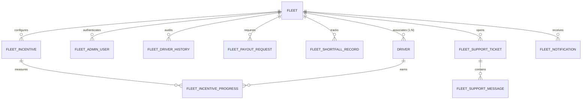

# Database schema and models

AdhocX Fleet builds on the PostgreSQL + Prisma schema defined in `apps/api/prisma/schema.prisma`.

## 1. Existing Models (Implemented in `apps/api/prisma/schema.prisma`)

- **`Fleet`** (`fleets` table): Stores `id` (UUID), `name`, `code` (unique, indexed), `ownerName`, `phone`, `email`, `status` (`FleetStatus`: `ACTIVE | INACTIVE`), `city`, `address`, `gstin`, `notes`, `createdAt`, `updatedAt`.
- **`FleetDriverHistory`** (`fleet_driver_histories` table): Audit trail of driver-fleet mutations (`fleetId`, `driverId`, `action`: `ASSIGNED | TRANSFERRED | REMOVED`, `fromFleetId`, `toFleetId`, `performedByAdminId`, `notes`, `createdAt`).
- **`Driver.fleetId`**: Nullable foreign key referencing `Fleet.id` (`onDelete: SetNull`, indexed), enforcing the **one-fleet rule** at the relational level.

## 2. Fleet Portal Schema Extensions (Implemented via `20261127000000_adhocx_fleet_portal`)

| Model | Purpose | Key Fields & Constraints |
| :--- | :--- | :--- |
| **`FleetAdminUser`** | Fleet Owner and Fleet Manager credentials | `id`, `fleetId` (FK `Fleet`), `fullName`, `email`, `phone`, `passwordHash`, `role` (`FleetAdminRole`), `permissions` (JSONB), `status`, `@@index([fleetId])` |
| **`Fleet`** *(column additions)* | Controlled Fleet Code lifecycle | `codeStatus` (`FleetCodeStatus`: `ACTIVE \| DISABLED`), `codeRotatedAt` |
| **`FleetPayoutRequest`** | Fleet Owner payout requests & settlement tracking | `id`, `fleetId`, `requestedById`, `referenceCode` (unique), `amount`, `currency`, `periodStart`, `periodEnd`, `status` (`FleetPayoutStatus`), `rejectionReason`, `settledAt` |
| **`FleetShortfallRecord`** | Minimum-trip shortfall obligation records | `id`, `fleetId`, `periodStart`, `periodEnd`, `minimumTripsRequired`, `actualTripsOffered`, `shortfallTrips`, `compensationAmount`, `status`, `notes` |
| **`FleetIncentive`** | Target-Based and Time-Based driver incentives | `id`, `fleetId`, `name`, `type` (`TARGET_BASED \| TIME_BASED`), `targetTrips`, `requiredDurationMinutes`, `timeWindowStart`, `timeWindowEnd`, `eligibilityScope` (`ALL \| SELECTED`), `eligibleDriverIds`, `rewardAmount`, `startsAt`, `endsAt`, `status` |
| **`FleetIncentiveProgress`** | Per-driver participation & qualification tracking | `id`, `incentiveId`, `fleetId`, `driverId`, `completedCount`, `activeMinutes`, `qualified`, `qualifiedAt`, `@@unique([incentiveId, driverId])` |
| **`FleetSupportTicket`** & **`FleetSupportMessage`** | Fleet support tickets, replies & S3 attachments | `id`, `ticketNumber` (unique), `fleetId`, `createdById`, `category`, `subject`, `description`, `status`, `attachments` (JSONB) |
| **`FleetNotification`** | Fleet-scoped account, driver, support & incentive alerts | `id`, `fleetId`, `eventType` (`FleetNotificationEventType`), `title`, `message`, `entityType`, `entityId`, `actionUrl`, `isRead`, `readAt` |
| **`FleetShift`** *(feature-flagged)* | Optional driver shift/ride assignment records | `id`, `fleetId`, `driverId`, `title`, `shiftStart`, `shiftEnd`, `status` (`FleetShiftStatus`) |

## 3. Entity Relationship Overview

## 4. Relational Isolation Guarantees

- Every table added for the Fleet Portal carries a non-null `fleetId` foreign key indexed for fast scoped queries.
- All unique business identifiers visible to users (`Fleet.code`, `FleetPayoutRequest.referenceCode`, `FleetSupportTicket.ticketNumber`) are enforced via database-level unique constraints.
- Reassigning a vehicle inside a fleet enforces uniqueness of active `vehiclePlate` across drivers within the fleet so the **1:1 driver-to-vehicle rule** cannot be violated.
