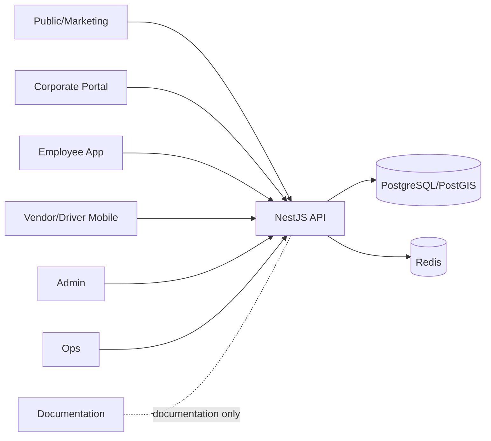

# Application documentation

AdhocX contains eight runnable workspaces. Each application is documented
from both perspectives:

- **Functional:** what the application does, who uses it and why.
- **Technical:** route/source structure, state/API flow, services and database
  interaction.

| Application | Primary users | Functional purpose | Technical implementation |
|---|---|---|---|
| [API](./api/index.md) | Every frontend and integration client | Authentication, marketplace, dispatch, trips, finance, ETS and platform services | NestJS modular monolith, Prisma, PostgreSQL/PostGIS and Redis |
| [Admin](./admin/index.md) | Platform administrators | Govern users, supply, verification, pricing, finance and support | Next.js App Router, React, bearer-token API client |
| [Ops](./ops/index.md) | Operations and safety staff | Monitor live fleet, reassign routes and manage incidents | Next.js App Router, corporate session/API integration |
| [Corporate](./corporate/index.md) | Corporate transport/HR/finance staff | Manage employees, rosters, routes, billing and support | Next.js App Router, tenant/office/session state |
| [Employee App](./employee-app/index.md) | Corporate commuters | Schedule, tracking, boarding, feedback and safety | Flutter, GoRouter, Provider, HTTP repositories |
| [Mobile](./mobile/index.md) | Vendors and drivers | Requirements, offers, trips, KYC, wallet and corporate duties | Flutter, GoRouter, Provider, secure storage and SDK integrations |
| [Marketing](./marketing/index.md) | Prospects and public users | Explain and sell AdhocX, collect enterprise leads | Astro, React islands, static SEO routes |
| [Documentation](./docs/index.md) | Developers and operators | Technical and product knowledge | Docusaurus 3, Markdown and Mermaid |

ETS is not a separate runnable application. It is a business domain shared
by Corporate, Employee, Mobile, Ops and the API.

