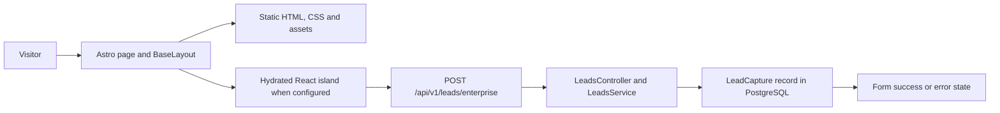
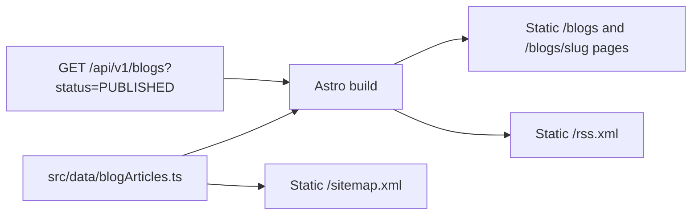

# Marketing Application Reference

## Functional perspective

The Marketing app is the public information and acquisition site for AdhocX.
Corporate transport buyers use it to understand services, operating models,
pricing and safety; drivers and vendors use it to explore partner programs;
employees can read about the commuter app; and other visitors can browse
company, support, blog and legal information. Its main conversion action is a
corporate inquiry, not an authenticated booking or transport workflow.

The site does not implement the driver or employee applications. Download and
product links lead visitors toward those separate apps or to the contact form.
Most page content and the two sizing/vehicle widgets are rendered from local
source; the enterprise form and publication-time blog integration are the
principal first-party API interactions.

## Technical architecture

| Layer | Implementation | Responsibility |
|---|---|---|
| Page framework | Astro 4, file-based routes in `apps/marketing/src/pages/` | Builds the public pages and static XML endpoints. |
| Interactive UI | React 18 through `@astrojs/react` | Hydrates selected components as islands; the remainder is rendered HTML. |
| Shared shell | `src/layouts/BaseLayout.astro`, `Header.astro`, `Footer.astro`, `SeoHead.astro` | Adds navigation, page metadata, JSON-LD, shared styling and links. |
| Styling | `src/styles/global.css` plus scoped Astro styles and component styles | Defines the visual system without a separate CSS runtime. |
| First-party API | NestJS `/api/v1/leads/enterprise` | Intended to validate and persist corporate inquiries. |
| Blog publishing | NestJS `/api/v1/blogs` queried during static generation, plus `src/data/blogArticles.ts` | Adds published blog slugs/content at build time and retains source articles as fallback. |
| Assistant provider | Browser request from `CorporateAiAssistant.tsx` to OpenAI Chat Completions | Generates chat responses; it is not routed through the AdhocX API. |
| Deployment targets | Vercel static adapter, Cloudflare assets configuration and Nginx Docker image | Describe alternative static-output packaging; the repository config does not prove which target is deployed. |

The package uses Astro and React because the site is mostly content pages, with
client JavaScript added only where interaction is needed. Astro's
`client:load`, `client:visible` and `client:idle` directives determine when
those React components hydrate. `astro.config.mjs` sets the canonical site
origin, `output: 'static'`, `trailingSlash: 'never'`, and the React integration.
The Vercel static adapter is included only when the build environment defines
`VERCEL`.

### Shared page rendering

Each `.astro` page supplies page copy and props to `BaseLayout.astro`. The
layout imports global CSS, renders the shared header and footer, provides the
main landmark and skip link, and includes the chat island. `SeoHead.astro`
emits the title, description, canonical URL, robots directive, Open Graph and
Twitter metadata, regional metadata, manifest, RSS link and favicons. The
layout assembles a JSON-LD graph from shared Organization/WebSite nodes and
page-specific schema; it de-duplicates selected node types and omits `HowTo`
nodes.

The header's links are regular route navigations. Its mobile drawer and
application dropdown use browser event handlers, `aria-expanded` attributes,
Escape/outside-click closing, and a scroll shadow. No app-wide auth, user
account state or global client-side router is present.

### End-to-end flows

The diagram shows the intended lead path. There are current client/server
contract mismatches documented in the [lead conversion guide](./lead-conversion-guide.md);
the source does not support treating every displayed success message as a
confirmed database write.

Blog APIs are called while pages are generated, not by the visitor's browser
when opening an article. The build falls back to local blog data if the API
cannot be reached. The actual generated content depends on build-time
environment and API availability.

## Routes, features, and reusable UI

The [complete page reference](./detailed-page-reference.md) explains the
purpose and source behavior of all 21 `.astro`/`.ts` route files. The
[component catalog](./component-feature-catalog.md) describes the shared
shell and each interactive feature. In summary:

- The home, service, industry, pricing, vendor, employee-app and contact pages
  reuse `EnterpriseLeadForm` for enterprise conversion.
- The home page's `CorporateEstimator` calculates a local illustrative
  fleet-size summary; it does not fetch prices or persist assumptions.
- The driver page's `EarningsCalculator` is actually a vehicle-category and
  feature selector; it does not calculate earnings.
- The FAQ page uses native `
` elements and a category-filter script.
  Separate FAQ accordions on driver/vendor pages use `FaqAccordion.astro`.
- The blog listing and article routes use local article data and may
  supplement it with published backend posts at build time.
- `MobileStickyBar.astro` is imported by the layout but is not rendered, and
  its own CSS hides the bar. It is not currently a visible site-wide feature.

## Backend, data, and access

| Use | Endpoint or entity | What the source establishes |
|---|---|---|
| Corporate inquiry | `POST /api/v1/leads/enterprise` | Public `LeadsController` passes a validated DTO to `LeadsService`; the service creates a `LeadCapture` row and attempts a best-effort audit entry. |
| Lead administration | `GET /api/v1/leads` | API-side only; guarded for `ADMIN`, filterable by type/status, and paginated. No Marketing page calls it. |
| Newsletter | `POST /api/v1/leads/newsletter` | Public API exists, but no newsletter form or call was found in the Marketing source. |
| Blog content | `GET /api/v1/blogs?status=PUBLISHED&limit=...` | Used by Astro build-time page generation and RSS generation. |
| Lead data | Prisma `LeadCapture` / `lead_captures` | Stores type, email, optional phone/company/contact/city/requirements/notes, status, and timestamps. |
| Blog data | Prisma `BlogPost` / `blog_posts` | Stores slug, title, excerpt/content, category, tags, cover image, author, publication status/date and SEO fields. |

The form/API request and the distinction between source facts and marketing
claims are covered in the [lead guide](./lead-conversion-guide.md). Schema
models describe the checked-in database contract, not live production data.

## Integrations, publishing, and evidence boundaries

- The lead form chooses `http://localhost:7001/api/v1` on localhost and
  `https://api.adhocx.com/api/v1` otherwise. This origin selection is in the
  React component rather than a runtime configuration service.
- Blog static generation checks `API_URL`, then `PUBLIC_API_URL`, then defaults
  to localhost. Since output is static, changing those values after building
  does not refresh already generated blog pages or feeds.
- The chat widget makes a browser-side request to OpenAI Chat Completions and
  saves its conversation to `sessionStorage`. It sends the current conversation
  to the provider; it does not use a Marketing backend chat endpoint.
- No analytics event wiring, cookie-consent component, or newsletter UI was
  found in the audited `src/` tree. Earlier campaign/specification documents
  describing tracking events or privacy-first analytics are not proof those
  features are implemented.
- `src/pages/sitemap.xml.ts` is the sitemap implementation. Although
  `@astrojs/sitemap` is listed as a package, it is not configured in
  `astro.config.mjs`.
- `scripts/seo-check.mjs` runs after the Astro build. It checks generated
  pages, metadata, canonical URLs, headings, JSON-LD, image alt text, sitemap,
  `robots.txt` and `llms.txt`. Findings are report-only unless
  `SEO_STRICT=1`; passing this script is build-output evidence, not a live
  search-engine or deployment check.
- Deployment configuration exists for Vercel, Cloudflare and Docker/Nginx.
  These are repository deployment options; actual production routing,
  environment values and availability must be verified separately.

See the [SEO and publishing guide](./seo-and-publishing-guide.md) for the
exact build-time behavior and static-file boundaries.

## Source map

- Pages and endpoints: `apps/marketing/src/pages/`
- Shared components: `apps/marketing/src/components/`
- Shared layout: `apps/marketing/src/layouts/BaseLayout.astro`
- Blog seed content: `apps/marketing/src/data/blogArticles.ts`
- Build and integration settings: `apps/marketing/astro.config.mjs`,
  `apps/marketing/package.json`
- Lead backend: `apps/api/src/modules/leads/`
- Blog backend: `apps/api/src/modules/blogs/`
- Database entities: `apps/api/prisma/schema.prisma`

## Related documentation

- [Complete page reference](./detailed-page-reference.md)
- [Exact route inventory](./exact-page-inventory.md)
- [Component and feature catalog](./component-feature-catalog.md)
- [Lead conversion guide](./lead-conversion-guide.md)
- [SEO and publishing guide](./seo-and-publishing-guide.md)
