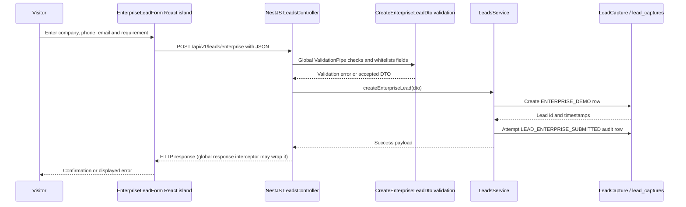

# Marketing Lead Conversion and API Guide

## Business purpose

The enterprise inquiry form gives a prospective corporate customer a way to
request a conversation about fleet needs, service proposals or rate cards.
The current form is shared by seven routes: `/`, `/contact`, `/services`,
`/industries`, `/pricing`, `/vendors` and `/employee-app`. It is not a booking
form and it does not create a corporate tenant, transport request or quote.

## Form fields and browser rules

`apps/marketing/src/components/EnterpriseLeadForm.tsx` stores four displayed
values in component state:

| Visible field | Browser validation | Current request mapping |
|---|---|---|
| Company Name | Required text input | `companyName` |
| Contact (Phone / Mobile) | Required `tel` input | Both `phone` and `contactName` |
| Official Corporate Email | Required email input | `email` |
| Description | Required textarea | Both `fleetRequirements` and `notes` |
| Inquiry purpose | Selected from a default, page prop or allowlisted `purpose` query value | `inquiryPurpose` |

There is no separate contact-person name field, monthly trip estimate or
preferred-vehicle selection in this form. No consent checkbox or consent
property is included in its UI or JSON payload.

The query parameter only recognizes `pricing`, `quotation`, `rfp`, `proposal`
and `pilot`; other values leave the page-provided/default purpose unchanged.
The form chooses `http://localhost:7001/api/v1` on localhost and
`https://api.adhocx.com/api/v1` on other hostnames.

## End-to-end request flow

The flow above describes the intended accepted request. In the checked-in
implementation, the actual request body contains a property that the DTO does
not declare; see the contract findings below before treating a form response
as a reliable database outcome.

## API contract

| Endpoint | Method | Purpose | Called by | Controller/service | Data interaction |
|---|---|---|---|---|---|
| `/api/v1/leads/enterprise` | POST | Capture a corporate inquiry. Public; no login is required by the controller. | `EnterpriseLeadForm.tsx` | `LeadsController.createEnterpriseLead` → `LeadsService.createEnterpriseLead` | Creates `LeadCapture` with type `ENTERPRISE_DEMO`, normalized email, trimmed fields and status `NEW`; then attempts an audit log. |
| `/api/v1/leads` | GET | List leads with type/status filtering and pagination. | No Marketing page found; platform admin use. | `LeadsController.listLeads` → `LeadsService.listLeads` | Reads `LeadCapture`; JWT and `ADMIN` role guards apply. |
| `/api/v1/leads/newsletter` | POST | Subscribe an email to the newsletter. | No newsletter form/call found in Marketing source. | `LeadsController.subscribeNewsletter` → `LeadsService.subscribeNewsletter` | Checks for an existing newsletter row, then creates a `LeadCapture` with type `NEWSLETTER`. |

The API global prefix defaults to `api/v1`. Nest's global `ValidationPipe`
uses `whitelist: true`, `forbidNonWhitelisted: true` and `transform: true`.
The DTO validates required company/contact strings, email format and phone
string; optional city, fleet requirements, trip estimate, preferred vehicles
and notes are optional strings.

## Current contract and behavior findings

1. **`inquiryPurpose` is not accepted by the DTO.** The client always includes
   `inquiryPurpose`, but `CreateEnterpriseLeadDto` has no such property.
   Because unknown fields are forbidden by the global validation pipe, the
   current controller is expected to reject the form request as a validation
   error before `LeadsService` writes the lead. Confirm this against the
   deployed API before concluding that a request is stored.
2. **The contact person's name is populated with their phone number.** The
   visible input is labeled “Contact (Phone / Mobile)” and is assigned to both
   `phone` and `contactName`; the server stores those values separately.
   The form does not ask for a human contact name.
3. **Purpose is not persisted by the current service.** Even if the DTO were
   changed to accept `inquiryPurpose`, `LeadsService.createEnterpriseLead`
   currently does not map it into `LeadCapture`.
4. **City is hard-coded.** The form sends `Telangana (Hyderabad Tech
   Corridors)` regardless of the visitor's location; the service trims and
   persists the supplied city.
5. **The description is duplicated.** The same visitor text is sent as both
   `fleetRequirements` and `notes`.
6. **Network failure can show a false confirmation.** The component treats a
   caught error whose message contains `fetch` as submitted. This changes the
   UI to its success panel even though no successful API response was
   received. This documentation records the behavior; it does not fix it.
7. **No follow-up message is sent by this service.** On successful
   persistence the service returns a message saying the team will respond
   within 30 minutes. The inspected method creates the database row and
   attempts an audit record; it contains no email/SMS dispatch.
8. **Audit is best-effort.** Failure to create the audit log is caught and
   logged as a warning; it does not roll back an already-created lead.

These are source-level findings, not claims about the deployed environment.
The supported field list and response wrapping should be rechecked if the API
contract changes.

## Database record

The Prisma `LeadCapture` model maps to `lead_captures`. Important fields are:

| Field | Role |
|---|---|
| `id` | Primary UUID for the captured lead. |
| `type` | String discriminator used for enterprise demo or newsletter rows. |
| `email`, `phone` | Contact channels; the service lower-cases/trim-normalizes email and trims phone. |
| `companyName`, `contactName`, `city` | Organization and contact context. |
| `fleetRequirements`, `monthlyTripsEstimate`, `preferredVehicles`, `notes` | Optional operational detail. |
| `status` | Defaults to `NEW`; administrative list API supports status filtering. |
| `createdAt`, `updatedAt` | Record timestamps. |

The model has no relation fields in the checked-in Prisma schema. The form
does not directly access Prisma; it calls the NestJS controller/service.

## Consent, privacy, and tracking boundaries

- This form gathers company/contact details and free-text requirements.
- No explicit consent control or consent payload was found in the form source.
- No client-side analytics event call was found around form start, submit or
  success. The separate API audit row is a backend audit record, not an
  analytics event.
- No newsletter form was found, despite a public newsletter API endpoint.
- The public privacy page is `apps/marketing/src/pages/privacy.astro`.
  Read its statements and applicable deployment policy with this guide;
  neither marketing copy nor form success UI proves actual retention or
  contact behavior.

## Source references

- Frontend: `apps/marketing/src/components/EnterpriseLeadForm.tsx`
- Frontend call sites: `apps/marketing/src/pages/`
- Controller and DTO: `apps/api/src/modules/leads/leads.controller.ts`,
  `apps/api/src/modules/leads/dto/create-lead.dto.ts`
- Service and module: `apps/api/src/modules/leads/leads.service.ts`,
  `apps/api/src/modules/leads/leads.module.ts`
- Validation/prefix: `apps/api/src/main.ts`
- Data model: `apps/api/prisma/schema.prisma` (`LeadCapture`)
- [Complete page reference](./detailed-page-reference.md)
