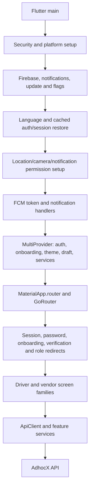

# Mobile Application Reference

**Evidence status:** Source-mapped against the Flutter manifest, bootstrap,
GoRouter configuration, providers, services, main screen families and API
helpers. A source route or helper does not by itself prove deployment,
backend success or user reachability; caveats are called out explicitly.

## Application purpose and users

AdhocX Mobile is the cross-platform Flutter client for two principal user
experiences:

- **Drivers** sign in, submit profile/KYC information, review dispatch offers,
  execute standard trips, and manage earnings, referrals and support.
- **Vendors/bookers** provide trip requirements, track fulfillment and
  assignments, manage vendor trips and (when enabled) payment/wallet details.

These experiences share account/session infrastructure, maps, notifications,
profile and common visual components, but use role-specific routes and API
operations. The application is a client: pricing, verification, eligibility,
trip lifecycle, payment settlement, data access and ownership are enforced by
the AdhocX API.

## Application identity and startup

| Item | Source / behavior |
|---|---|
| Workspace | `apps/mobile` |
| Entrypoint | `apps/mobile/lib/main.dart` |
| Routing | `apps/mobile/lib/routes/app_routes.dart`; `GoRouter` starts at `/` and refreshes when `AuthService` auth state changes. |
| UI/state | Flutter Material, `Provider`/`ChangeNotifier`, `Sizer`, app theme and language provider. |
| Supported Flutter locales | English, Hindi and Telugu are configured in `MaterialApp.router`; `/language` itself redirects to sign-in. |
| API client | `apps/mobile/lib/core/networking/api_client.dart`; shared bearer tokens, refresh, request/response handling and caching. |
| Manifest | `apps/mobile/pubspec.yaml`; Flutter SDK requires Dart `>=3.3.0 <4.0.0`. |

`main()` initializes Flutter bindings, then attempts device-integrity checks,
native Firebase, local notifications and an asynchronous update check. It
configures global error logging and portrait orientation, loads cached and
server-synchronized feature flags, restores language and auth state, initializes
device permissions and FCM, warms map assets, and finally creates the Provider
tree and router application. Several optional startup services log a warning
and allow the UI to continue if initialization fails; this is a resilience
choice, not proof the integration is healthy.

## Functional feature overview

| Feature | Purpose | Primary routes and screens |
|---|---|---|
| Identity and onboarding | Create/restore an account, verify a phone/OTP, collect role-specific information and submit KYC/profile details for review. | `/sign-in`, `/login-otp`, `/sign-up`, `/onboarding-*`, `/kyc-upload-screen`, `/waitlist-gate-screen` |
| Driver dispatch and trips | Show eligible offers and let a driver execute their assigned trips with server-validated lifecycle actions. | `/home-screen`, `/opportunities/details`, `/opportunities/offer`, `/trips-screen`, `/trips/details`, `/trips/chat` |
| Driver earnings and profile | View settlements, request withdrawals, manage vehicle/profile/KYC, score, referrals and help. | `/wallet-screen`, `/earnings/*`, `/profile-screen`, `/profile/*`, `/driver/score` |
| Vendor transport demand | Create a server-priced transport requirement, save drafts, review fulfillment and inspect driver/vehicle assignments. | `/user/home`, `/user/requirements*`, `/user/fulfillment/*` |
| Vendor trips and payments | Review trips and payment history, make an optional wallet top-up and inspect payment status. | `/user/trips/*`, `/user/payments*` |
| Shared support and notifications | Read in-app/push notifications, navigate from notifications, find help and submit support/dispute requests. | `/notifications`, `/profile/support*`, `/user/support/*` |
| Map/location and resilient UI | Choose locations, preview routes and handle offline, permission, loading and session-expired states. | universal location routes, trip maps, `/global-states-gallery` |

The [driver guide](./driver-feature-guide.md) and
[vendor guide](./vendor-feature-guide.md) explain actions, business rules,
request flows and known route limitations. The [exact route inventory](./exact-route-inventory.md)
maps every named route constant to its actual screen or redirect.

## Technology and responsibility

| Technology/package | Why used here | Main responsibility and interaction |
|---|---|---|
| Flutter / Dart | One mobile/web UI codebase with native device integration. | Builds driver/vendor screens and shared widgets; platform-sensitive behavior is guarded or adapted in services. |
| `go_router` | Named navigation, deep links, shell navigation and redirects. | `AppRoutes` registers screen builders, aliases, stateful vendor navigation and authentication/role gates. |
| `provider` | Shared reactive state with minimal app-level wiring. | `ChangeNotifierProvider` exposes auth, onboarding, theme, language, flags and requirement draft state. Many screen filters/forms remain local widget state. |
| `http` | Common JSON and multipart requests. | `ApiClient` handles AdhocX API calls; select integrations (FCM token registration, Google Maps) issue their own HTTP requests. |
| `flutter_secure_storage`, `shared_preferences` | Persist session credentials and small app preferences. | Secure storage is preferred for tokens; SharedPreferences supports local preferences, cached flags and fallback/migration behavior. |
| `firebase_core`, `firebase_messaging`, `flutter_local_notifications` | Push delivery and local alerts. | FCM receives remote notifications; local notifications/sound/vibration and notification route resolution deliver a useful foreground/background experience. Native initialization is skipped on web for Firebase messaging. |
| `google_maps_flutter`, Geolocator and permission APIs | Maps, location, route preview and dispatch/trip coordinates. | Map widgets render location; `LocationService` uses Google Places/Geocoding/Routes and has an OpenStreetMap fallback for reverse geocoding. Server quote/dispatch data remains authoritative. |
| Razorpay Flutter SDK and browser bridge | Collect provider checkout results for vendor top-ups and driver subscriptions. | `RazorpayCheckoutService` returns a normalized success/cancel/failure result; the backend creates orders and verifies signatures. |
| Camera, image/file picker and ML Kit face detection | Capture or select KYC and profile evidence. | UI capture/analysis only; `DriverService` uploads evidence and `DigioService` delegates verification to API/provider integrations. |
| `sizer`, `google_fonts`, Flutter localization | Responsive sizing, typography and translated Material controls. | Presentation layer; they do not enforce business rules or access control. |
| `flutter_overlay_window`, vibration, audio player | Driver assistive offer alerts on supported Android configurations. | Optional overlay/haptics/sounds are integrated with dispatch and payment flows; OS permissions and platform support apply. |

## State and navigation

The primary app-level providers are registered in `main.dart`: `ThemeProvider`,
`LanguageProvider`, `AuthProvider`, `OnboardingProvider`,
`FeatureFlagsService`, `RequirementDraftProvider`, plus `AuthService`,
`DriverService` and `UserService`. `AuthService` persists/restores the current
user and listens for token/session changes; `AuthProvider` mirrors that state.
`OnboardingProvider` carries identity, vehicle and document form data.
`RequirementDraftProvider` holds the multi-step vendor booking draft and
server quote. Feature services own API calls and selected cache invalidation.

`AppRoutes.resolveRedirect` considers session, password setup, onboarding,
verification/review state, role and the vendor-wallet flag. It redirects
unauthenticated users to splash except for public auth routes, blocks drivers
from `/user/*`, and blocks vendors from driver-only routes. Server guards and
ownership checks remain the security boundary. The router includes 107 named
route constants and 119 `GoRoute` entries; some constant paths redirect and
some GoRoute entries exist only as aliases/deep links.

## API, validation and error behavior

Feature screens call `AuthService`, `DriverService`, `UserService`,
`DigioService`, `NotificationService` and other focused services. The
[service/API matrix](./service-api-matrix.md) records methods, endpoint paths,
controllers and data areas.

`ApiClient` selects a configured API base URL, attaches a bearer token, encodes
JSON or multipart requests, refreshes/retries eligible expired sessions,
unwraps the standard success/data envelope, and throws an `ApiException` for
non-success responses. GET caching and write invalidation reduce repeated
requests. Some feature helpers intentionally provide cached/empty fallback
values; refer to the specific guide rather than treating a default as verified
server state.

Input validation exists in forms/providers, but the backend is authoritative
for DTO validation, account and role state, KYC, prices/quotes, trip
transitions, location/geofence checks, ownership, wallet/payment status and
authorization. Client-side device-integrity checks are best-effort: startup
logs a failed check and continues rather than replacing server authorization.

## Platform differences

| Capability | Android | iOS | Web |
|---|---|---|---|
| API base URL | Production base by default; build-time override supported. | Production base by default; build-time override supported. | AdhocX hosted domains use production API; local web defaults to API port 7001; other hosted origins and compile-time overrides are handled in `ApiClient`. |
| Firebase push | Firebase messaging and local notifications are initialized when configured; notification permission required. | Firebase messaging/local notifications are initialized when configured; notification permission required. | Native Firebase messaging initialization is skipped; browser support/fallback behavior differs. |
| Payments | Native Razorpay Flutter checkout. | Native Razorpay Flutter checkout. | Browser `postMessage` bridge to web checkout. |
| Location/maps | Device permission and native location/map integrations. | Device permission and native location/map integrations. | Web geolocation and browser map rendering; native-only operations are guarded or unavailable. |
| Driver alert overlay | Android overlay and vibration path may be available after OS permission. | The Android floating overlay path is not a general iOS feature. | No native floating overlay; web notification/audio behavior is limited by browser permission and lifecycle. |
| App updates | Checks backend metadata and Android Play Core; can open Play Store. | Backend metadata can be checked; Play Store-specific update flow does not apply. | Web app refresh/update behavior differs from installed mobile stores. |
| Device security | Root/emulator-related checks are platform-specific and best-effort. | Jailbreak marker checks are platform-specific and best-effort. | Client integrity check returns a clean result; server authorization still applies. |

## Important implementation status

The Corporate ETS driver module contains a coordinator, active-route screen,
boarding panel, offer/SOS sheets and API adapter. The audited route tree does
not register `CorporateActiveRouteScreen`, and the audited app shell does not
instantiate that screen. Corporate driver duties are therefore source-present
but not confirmed reachable through normal Mobile navigation. The same
distinction applies to registered compatibility routes that redirect rather
than rendering their own page.

## Source and related references

- `apps/mobile/lib/main.dart`
- `apps/mobile/lib/routes/app_routes.dart`
- `apps/mobile/lib/core/networking/api_client.dart`
- `apps/mobile/lib/services/`
- `apps/mobile/lib/presentation/`, `apps/mobile/lib/user/`, `apps/mobile/lib/shared/`
- [Screen/component catalog](./screen-component-catalog.md)
- [Exact route inventory](./exact-route-inventory.md)
- [Driver feature guide](./driver-feature-guide.md)
- [Vendor feature guide](./vendor-feature-guide.md)
- [Service/API matrix](./service-api-matrix.md)
