# Mobile Route and Workflow Reference

**Evidence status:** Source-mapped from `apps/mobile/lib/routes/app_routes.dart`,
screen imports, Provider/services, API helpers and backend controller
references. The named route table and actual GoRouter registration are not
identical: the router also has deep-link aliases, role redirects and
compatibility entries.

## Functional perspective

Mobile gives drivers a place to onboard, receive dispatch offers, execute
trips and manage earnings; vendors/bookers create transport requirements,
track fulfillment and manage vendor trips/payments. Each route is an entry
point into one of those user workflows, but some constants redirect to another
route instead of showing an independent screen.

## Technical perspective

`AppRoutes` defines route constants, the router and navigation helpers.
`appRouter` uses a global `AuthService` refresh listenable and invokes
`AppRoutes.resolveRedirect` for session/role gating. Registered builders pass
GoRouter `state.extra`, path parameters or query parameters to screens. Main
screen components and source paths are in the [screen/component catalog](./screen-component-catalog.md);
all 172 route constant names (107 canonical paths and 65 aliases) are mapped
in the [exact route inventory](./exact-route-inventory.md).

## Route-family reference

| Route family | Page purpose and user actions | Frontend screen/state | API/service and backend path | Important rules/behavior |
|---|---|---|---|---|
| Entry and authentication: `/`, `/splash`, `/sign-in`, `/login-otp`, `/sign-up`, `/set-password`, `/forgot-password*`, `/reset-password`, `/choose-role` | Restore or create a session, verify an OTP, set/recover a password and select a role. | Splash/sign-in/OTP/signup/password/role screens; `AuthProvider` mirrors `AuthService`. | `AuthService` → `/auth/check-phone`, `/auth/otp/*`, `/auth/login`, `/auth/social`, `/auth/password`, `/auth/reset-password`, `/auth/me`; NestJS Auth controller/service. | Public auth paths are allowed without a session. Signed-in users without a password are redirected to `/set-password`. OTP details are passed through `state.extra`. |
| Driver onboarding/review: `/onboarding-*`, `/welcome-success`, `/waitlist-gate-screen`, `/kyc-upload-screen` | Enter profile and vehicle details, upload documents/selfie, review submission and see wait/review state. | `OnboardingProvider`; onboarding pages and KYC widgets; `DriverService` and `DigioService`. | `/drivers/documents/upload`, `/drivers/kyc`, `/kyc/digio/*`; Drivers and DigiO controllers. | Incomplete profiles are routed through onboarding. Unverified accounts are restricted to onboarding/review-safe routes. Backend verification status is authoritative. |
| Driver home and offers: `/home-screen`, `/opportunities-screen`, `/opportunities/details`, `/opportunities/offer` | View the driver home/dispatch surface and review, accept or decline an offer. | Home screen, opportunity details/offer screens and dispatch overlay; `DriverService`. | `/offers`, `/offers/:id`, `/offers/:id/accept`, `/offers/:id/decline`, `/drivers/availability`; Offers and Drivers controllers. | `/opportunities-screen` redirects to `/home-screen`; it is not a separate opportunities list page. Offer status and driver eligibility are server-validated. |
| Driver trips: `/trips-screen`, `/trips/details`, `/trips/chat`, `/trips/:id`, `/trips/:id/chat` | View trip list/details, mark arrival, submit start OTP, send location, complete, chat or invoke safety actions. | Trip pages and OTP/chat widgets; `DriverService`, permission/location services. | `/trips`, `/trips/:id`, trip arrival/start/location/complete/message/SOS endpoints; Trips and related backend services. | Start/completion require a real location fix; trip state transitions and ownership are API-validated. `/trips/:id` adapts its screen by the current role. |
| Driver profile/KYC/support: `/profile-screen`, `/profile/personal-info*`, `/profile/vehicle*`, `/profile/kyc`, `/driver/score`, `/profile/referral`, `/profile/support*`, `/notifications` | Manage driver details and vehicle, inspect KYC, referrals, score, notifications and support. | Driver profile/KYC/support screens; NotificationService and referral helpers. | `/drivers/profile`, `/drivers/trust-score`, `/drivers/referral/*`, `/notifications/in-app*`, `/disputes/support-query*`. | `/profile/documents/details` redirects to KYC verification; `/profile/account-status` redirects to personal information; `/profile/settings` redirects to profile. |
| Driver earnings: `/wallet-screen`, `/earnings/transactions`, `/earnings/withdraw`, `/earnings/withdrawal-details` | Review wallet/settlements, update bank data and request a withdrawal. | Earnings, transactions and withdrawal screens; DriverService. | `/settlements/wallet`, `/settlements*`, `/settlements/withdraw`, `/drivers/bank-details`; Settlements and Drivers controllers. | Backend balances, withdrawal rules and final status are authoritative. Subscription helper calls also exist under `/subscriptions/*`. |
| Vendor navigation/home: `/user/home`, `/user/requirements`, `/user/payments`, `/user/profile` | Navigate between requirement, payment and profile areas. | `UserAppScaffold` uses a GoRouter `StatefulShellRoute.indexedStack` with four branches. | `UserService` calls requirements, payments and vendor profile APIs. | These are vendor-role routes; `resolveRedirect` sends a driver from `/user/*` back to driver home. The payments branch is subject to the wallet feature flag. |
| Vendor requirement creation/management: `/user/requirements/create*`, `/review`, `/posted-confirmation`, `/drafts`, `/edit`, `/details` | Choose vehicle, quantity, route and schedule; review and submit; browse/manage existing requirements. | Requirement forms use `RequirementDraftProvider`; review and detail screens receive current draft/requirement data. | `UserService` → `/vendor/trip-quotes`, `/requirements`, `/requirements/summary`, `/requirements/:id`, cancel/retry paths. | The API quote is the price authority. Vehicle changes invalidate the quote. `/user/requirements/details` builds `UserActiveTripScreen`. Bulk-posting route constants redirect to the requirement list. |
| Vendor fulfillment: `/user/fulfillment/*` | Track searching/fulfilled/failed state, view matched driver/vehicle and inspect assignment/timeline/cancel actions. | Screens under `apps/mobile/lib/user/fulfillment/`; some pages share a status screen. | Source-visible requirements/trip service helpers; backend owns matching and assignment state. See the [API matrix](./service-api-matrix.md) for helpers and gaps. | Page route state may be supplied by `state.extra`; do not assume there is a separate endpoint unless a client helper and controller are present. |
| Vendor trips: `/user/trips/active`, `/user/trips/details-*`, `/user/trips/history`, `/user/trips/timeline-activity`, `/user/trips/historical-details` | View active, historical and status-specific trip screens and trip activity. | Shared `UserTripDetailsScreen` for multiple statuses and dedicated active/history/timeline screens. | `UserService` → `/trips`, `/trips/:id`, messages and cancellation helpers; Trips controller. | `/user/trips` redirects to `/user/requirements`, while specific trip status routes remain registered. |
| Vendor payments: `/user/payments*` | View wallet/payment history and detail/result states; initiate wallet top-up where enabled. | Vendor payment screens, `FeatureFlagsService`, `RazorpayCheckoutService`. | `/payments/wallet*`, `/coupons/*`; Payments and Coupons controllers. | Feature flag controls vendor wallet visibility/routing. A Razorpay callback is not the final payment record; backend order verification is required. |
| Vendor profile/support: `/user/profile*`, `/user/support/*` | Manage organization/contact/profile and notification preferences, read help, raise a query and view ticket state. | Vendor profile/support widgets; company/contact paths share the organization information screen. | `/vendors/profile`, `/notifications/preferences`, `/disputes*`; Vendor, Notifications and Disputes controllers. | `/user/profile/account-status` redirects to `/user/profile`; ticket status paths share one state-driven screen. |
| Shared location and resilience: `/universal-location-picker`, `/universal-location-search`, `/global-states-gallery` | Search/select locations and view/test reusable loading, offline, session and permission states. | Location picker and shared/presentation edge-case widgets. | Google Places/Routes/Geocoding and supported fallback; no AdhocX API call is implied by every shared state widget. | A map preview is not a server quote. Permission-denied UI does not bypass permission checks. |

## Role, session and route guards

`resolveRedirect` uses the current `UserModel` from `AuthService` and checks:

1. **Session:** unauthenticated users may stay on public auth routes; protected
   paths go to `/splash`.
2. **Password:** an authenticated account without a configured password goes
   to `/set-password`.
3. **Onboarding:** incomplete, not-yet-reviewed accounts are directed to the
   appropriate onboarding screen.
4. **Verification:** submitted but unverified users are sent to the waitlist
   gate, with a limited set of profile/support/verification routes allowed.
5. **Role separation:** drivers cannot use `/user/*`; vendors are redirected
   away from driver home, trips, offers and earnings routes.
6. **Vendor wallet feature flag:** vendor payments may redirect to vendor
   home when disabled.

The backend must independently authenticate and authorize each operation.
An accepted GoRouter path is not a data authorization decision.

## Deep-link and notification aliases

| Registered alias | Behavior |
|---|---|
| `/offers/:id`, `/offers` | Build the driver offer screen from a path/query ID or `state.extra`. |
| `/trips/:id` | Choose `TripDetailsScreen` for a driver and `UserActiveTripScreen` for a vendor. |
| `/requirements/:id` | Build the vendor active-trip/requirement detail screen with the route ID. |
| `/trips` | Redirect by role to driver trips or vendor requirements. |
| `/requirements` | Redirect by role to the corresponding requirements/opportunities destination. |
| `/wallet`, `/coupons` | Redirect by role and vendor-wallet feature flag. |
| `/verifications`, `/support` | Redirect to role-specific verification or support. |
| `/trips/:id/chat` | Add the path trip ID to chat route data and build the chat screen. |
| `/profile/notifications`, `/profile/settings` | Compatibility redirects to current profile destinations. |

`FcmService` stores notification data received before the router is ready.
`AppRoutes.handleNotificationNavigation` then routes by notification type and
IDs (for example offer, trip, chat, KYC, support or wallet); unrecognized
events fall back to the notifications feed. External HTTP(S) links open in the
external browser.

## Important route mismatches and implementation status

| Source declaration | Actual behavior | Documentation consequence |
|---|---|---|
| `/language` | Redirects to `/sign-in`. | There is no registered standalone language-selection page; language switching is provided elsewhere in auth UI. |
| `/opportunities-screen` | Redirects to `/home-screen`. | Use the home/dispatch screen for driver opportunity entry. |
| `/profile/documents/details`, `/profile/account-status` | Redirect to KYC verification or personal information. | They are compatibility navigation paths, not separate document/account-status pages. |
| `/user/requirements/bulk-posting`, `/user/requirements/review-bulk` | Redirect to `/user/requirements`. | Bulk-posting screen files/work are not exposed through these registered routes. |
| `/user/requirements/details` | Builds `UserActiveTripScreen`. | The registered component is not a distinct requirement-detail screen. |
| `/user/trips` | Redirects to `/user/requirements`. | The generic route constant does not produce a vendor trip list. Use the specific history/active paths. |
| `/user/profile/company-info`, `/user/profile/contact-info` | Both build `UserOrganizationInformationScreen`. | Distinct paths currently share one screen implementation. |
| Corporate ETS active-route/offer/safety files | `CorporateActiveRouteScreen` is not registered in `appRouter`, and the audited shell does not instantiate it. | Describe this as source-present, not as a verified reachable driver workflow. |

## End-to-end architecture flow

```mermaid
flowchart LR
  User[Driver or vendor] --> Route[GoRouter path/deep link]
  Route --> Guard[AuthService role/session redirect]
  Guard --> Screen[Screen and local form state]
  Screen --> Provider[Provider/ChangeNotifier where shared state is needed]
  Provider --> Feature[AuthService, DriverService, UserService or feature service]
  Feature --> Client[ApiClient: bearer, cache, refresh and errors]
  Client --> Controller[NestJS API controller]
  Controller --> Logic[Service and business validation]
  Logic --> Data[(Prisma-backed data)]
  Data --> Logic --> Client --> Screen
```

The controller/service/data names and relevant endpoint families are listed in
the [service/API matrix](./service-api-matrix.md); API response and database
descriptions link to the shared API reference and data dictionary rather than
assuming every app screen has a one-to-one table.

## Further reading

- [Exact route inventory](./exact-route-inventory.md)
- [Screen and component catalog](./screen-component-catalog.md)
- [Driver feature guide](./driver-feature-guide.md)
- [Vendor feature guide](./vendor-feature-guide.md)
- [Service/API matrix](./service-api-matrix.md)
- [Application architecture and platform differences](./application-reference.md)
