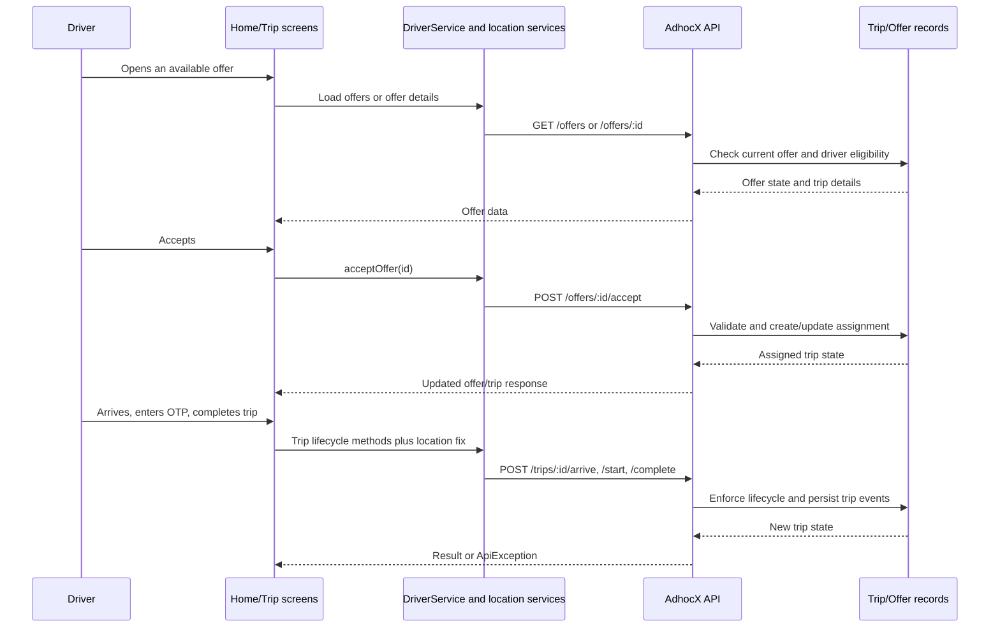

# Mobile Driver Feature Guide

## What the driver experience does

The driver side lets a driver create an account, submit personal and vehicle
details for review, receive eligible trip opportunities, accept work, execute
trips, and review earnings and support information. It is intended for drivers
who provide vehicles and complete trips dispatched through AdhocX. The app
collects identity, contact, vehicle, document and (during dispatch/trips)
location information. The API decides whether the account is verified and
eligible for a particular action.

The driver journey is not one unrestricted sequence. The router may keep an
account at password setup, onboarding, or the waitlist/review screen until the
backend-backed user state allows the next area. Driver screens and buttons are
client UX; server authentication, role checks, KYC rules, trip state and
ownership are authoritative.

## Driver route and feature map

| Feature | Driver routes | User actions | Frontend state and services | API/backend and data |
|---|---|---|---|---|
| Sign-in and account recovery | `/sign-in`, `/login-otp`, `/sign-up`, `/set-password`, `/forgot-password`, `/forgot-password-otp`, `/reset-password`, `/choose-role` | Enter a phone/email, request and verify an OTP, set a password, or choose Driver. | `SignInScreen`, auth screen widgets, `AuthProvider` and `AuthService`; bearer tokens are stored by `ApiClient`. | `/auth/*`; NestJS `AuthController` and `AuthService`; the user/session record is represented by Prisma `User`. |
| Driver onboarding and KYC | `/onboarding-personal`, `/onboarding-vehicle`, `/onboarding-documents`, `/onboarding-face-verification`, `/onboarding-review`, `/kyc-upload-screen`, `/profile/kyc` | Enter personal/emergency and vehicle details, upload documents/selfie, run supported verification checks, and submit for review. | `OnboardingProvider` holds form fields and upload/verification results; screens are under `presentation/1*_onboarding_*`; `DriverService` uploads/submits, `DigioService` handles verification. | `/drivers/documents/upload`, `/drivers/kyc`, `/kyc/digio/*`; `DriversController` and `DigioController`; user, driver/vehicle and verification records (see data dictionary). |
| Account review | `/waitlist-gate-screen`, `/welcome-success`, `/profile/account-status` | See that submission is pending, verified or rejected and continue only when the account state permits. | `AuthService` parses the current user/profile and `AppRoutes.resolveRedirect` selects the permitted screen. `/profile/account-status` redirects to personal information. | Verification decisions are backend-owned; the client does not grant itself verified status. |
| Availability and offers | `/home-screen`, `/opportunities/details`, `/opportunities/offer`; `/opportunities-screen` is a redirect to `/home-screen` | Review dispatch information, open offer details, accept or decline an offer, or change availability from the home screen. | `HomeScreen` polls live profile/wallet/offers/trips every six seconds while active; it also listens for trip events. `DriverService` loads offers and performs accept/decline/availability actions. | `GET /offers`, `GET /offers/:id`, `POST /offers/:id/accept`, `POST /offers/:id/decline`, `PATCH /drivers/availability`; `OffersController` and `DriversController`; Offer, Assignment, Driver and Trip data. |
| Trip execution | `/trips-screen`, `/trips/details`, `/trips/chat`, `/trips/:id`, `/trips/:id/chat` | View trips, mark arrival, enter the trip-start OTP, share trip location, complete a trip, message, review or raise a dispute. | `TripsScreen`, `TripDetailsScreen`, chat and OTP widgets; `DriverService` owns network calls and cache invalidation; `LocationService`/`PermissionService` supply location. | `GET /trips`, `GET /trips/:id`, `POST /trips/:id/arrive`, `POST /trips/:id/start`, `PATCH /trips/:id/location`, `POST /trips/:id/complete`, trip message/review/dispute endpoints; `TripsController`, related trip/review/dispute services; Trip and TripEvent. |
| Safety, support and score | `/driver/score`, `/profile/support`, `/profile/support/faq`, `/profile/support/report-issue` | Review the driver score, find help, submit a support query, or trigger trip SOS from the trip UI. | `DriverScoreScreen`, support screens and trip safety actions; driver `DriverService` owns SOS and support helpers. | `/drivers/trust-score`, `/trips/:id/sos`, `/disputes/support-query*`; Drivers, Trips and Disputes controllers; trust/score, trip-event and support/dispute data. |
| Earnings and withdrawal | `/wallet-screen`, `/earnings/transactions`, `/earnings/withdraw`, `/earnings/withdrawal-details` | Review wallet/settlements, update bank details and request a withdrawal; the wallet also hosts a subscription paywall flow. | Earnings and withdrawal screens plus `subscription_paywall_modal.dart`; `DriverService` provides wallet, settlement, bank, withdrawal and subscription calls. | `GET /settlements/wallet`, `GET /settlements`, `GET /settlements/:id`, `POST /settlements/withdraw`, `PATCH /drivers/bank-details`, `/subscriptions/*`; Settlements, Drivers and Subscriptions controllers; Settlement and related ledger/subscription records. |
| Referral and notifications | `/profile/referral`, `/notifications` | Validate/claim referral rewards, read or delete notifications, and follow a notification to an offer/trip. | `ReferralScreen`, `NotificationsFeedScreen`, `NotificationService`, `FcmService`, local notification service and `AppRoutes.handleNotificationNavigation`. | `/drivers/referral/*`, `/notifications/in-app*`, `/notifications/device-token`; Referrals and Notifications controllers; referral and notification records. |

## End-to-end examples

### Accept and complete a standard trip

The trip-start and completion helpers require a real location fix: they use the
provided coordinates or request a dispatch-quality fix and throw a
`LocationUnavailableException` when none is available. The start body includes
the OTP and current coordinates; completion includes current coordinates and
toll/parking amounts (zero when absent). These are client request details;
the API validates the permitted transition and authoritative trip record.

### Go online and receive work

The driver's home screen shows offline/available/offer/trip states. Going
online first ensures a Driver session, then requests location permission and
checks that device location is enabled. On Android it also requires the
display-over-other-apps permission before enabling the assistive offer bubble.
The app sends `PATCH /drivers/availability` with `AVAILABLE` and includes
coordinates only when a real dispatch-quality fix exists. If no fix is
available it can still set the driver available, but tells the driver they
will not receive dispatch until a heartbeat supplies location. While
available, the home screen polls server data and syncs location; GPS being
turned off causes the monitor to switch the driver offline. These permission
and heartbeat behaviors depend on platform capabilities and OS settings.

### Upload verification documents

1. The driver completes the onboarding fields in `OnboardingProvider`.
2. The screen selects or captures document images; file bytes are sent to
   `DriverService.uploadKycDocument`.
3. `ApiClient.multipartUpload` posts the file and document type to
   `/drivers/documents/upload`; the returned URL is stored in onboarding
   state.
4. The driver can run supported `DigioService` checks. Aadhaar processing is
   gated on server-recorded consent; a decline does not start the protected
   verification request.
5. The onboarding submit action sends the available profile/document
   information to `/drivers/kyc`; the API owns verification status and review.

The app's eight-document completion display is a UI readiness rule, not proof
that the server accepted or verified the submission. DigiO verification
capabilities and outcomes depend on API responses and provider availability.

## Corporate ETS driver functionality: source status

There is a Corporate ETS implementation under
`apps/mobile/lib/presentation/corporate_ets/`: the active-route screen,
coordinator, stop boarding panel, offer/SOS sheets, telemetry scheduler and
`CorporateEtsApi` adapter. It contains helpers for route offers, GPS telemetry,
pickup arrival, boarding OTP, no-show, passenger drop, safe-drop confirmation,
route completion and SOS.

In the audited source, `CorporateActiveRouteScreen` and the Corporate ETS
offer UI are not referenced by `AppRoutes` or by another app-shell screen.
There is no registered named Corporate driver route. Therefore these flows
are **implemented in source but not verified as reachable through normal app
navigation**. Do not treat the Corporate driver specification or these source
files as evidence that the feature is launched in production. Their API
helpers are mapped in the [service/API matrix](./service-api-matrix.md).

## Validation and failure behavior

- Authentication, role, onboarding, verification, trip state and data
  ownership are rechecked by the backend; route guards are not security
  boundaries.
- `ApiClient` adds bearer headers, handles eligible 401 refresh/retry, unwraps
  successful `{success, data}` envelopes and throws `ApiException` for
  unsuccessful HTTP responses.
- Location-dependent actions must report unavailable/denied location rather
  than inventing coordinates. Background/heartbeat behavior also depends on
  OS permissions and device settings.
- Some read helpers intentionally return cached or empty values on errors
  (for example offer/trip lists); inspect the relevant screen and service
  before interpreting an empty list as proof that no server records exist.
- The app checks Android device integrity at startup, but initialization logs
  and continues after a failed check. It is not a backend authorization rule.

## Source references

- `apps/mobile/lib/routes/app_routes.dart`
- `apps/mobile/lib/services/auth_service.dart`, `auth_provider.dart`, `onboarding_provider.dart`
- `apps/mobile/lib/services/driver_service.dart`
- `apps/mobile/lib/services/digio_service.dart`
- `apps/mobile/lib/services/location_service.dart`, `permission_service.dart`, `driver_location_heartbeat_service.dart`
- `apps/mobile/lib/presentation/trips_screen/`, `opportunities_screen/`, `wallet_screen/`, `profile_screen/`
- [Service/API matrix](./service-api-matrix.md), [screen/component catalog](./screen-component-catalog.md), [exact route inventory](./exact-route-inventory.md)
