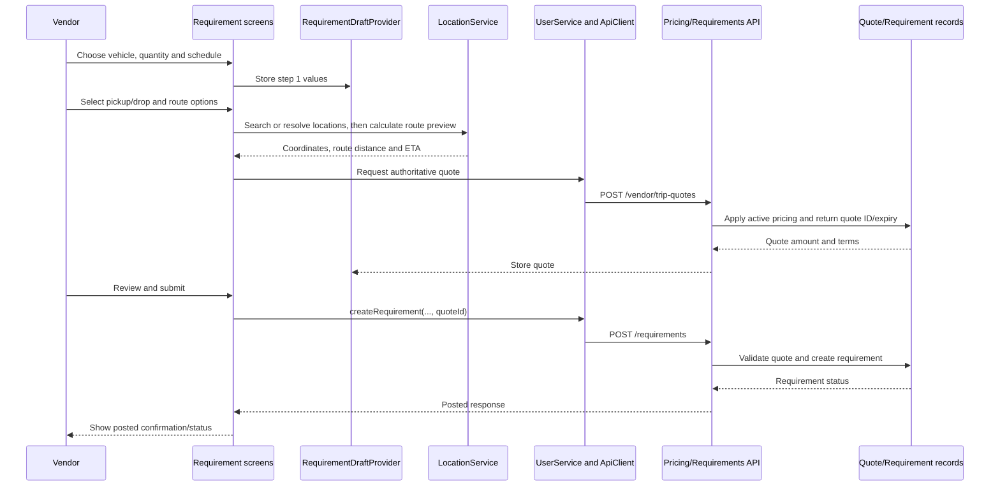

# Mobile Vendor Feature Guide

## What the vendor experience does

The vendor/booker side lets an organization or requester describe a transport
need, obtain a server-priced quote, submit the requirement, follow matching
and assignment progress, review trips and manage vendor payments and support.
The vendor may enter pickup/drop-off locations, vehicle category and
quantity, schedule, passenger/luggage requirements, special instructions,
escort needs and contact/company details.

The source treats vendor identities as `USER`/`VENDOR` in several client
helpers. Route access is selected from the current authenticated user and
vendor-wallet feature flag. The API remains authoritative for role, ownership,
pricing, fulfillment and payment state.

## Vendor route and feature map

| Feature | Vendor routes | Actions and information | Frontend implementation | API/data boundary |
|---|---|---|---|---|
| Vendor home and navigation | `/user/home`, `/user/requirements`, `/user/payments`, `/user/profile` | See summary cards and navigate between requirements, payments and profile. | `UserAppScaffold` with a stateful indexed-stack shell; branch pages live under `apps/mobile/lib/user/`. | `UserService` loads requirements and payment/profile data; backend applies the caller's role and ownership. Payments navigation may be hidden/redirected when the vendor-wallet flag is off. |
| Create a requirement | `/user/requirements/create`, `/create-step2`, `/create-step3`, `/create-step4`, `/review`, `/posted-confirmation` | Choose vehicle and quantity; enter route and schedule; set passenger/stops/notes and options; review and submit. | `RequirementDraftProvider` holds the multi-step draft; screen widgets validate required values and use location/route selection. | `POST /vendor/trip-quotes` obtains the quote; `POST /requirements` submits the booking using the quote ID. Requirements/quote controllers and pricing service own validation and price calculation. |
| Saved requirements | `/user/requirements`, `/drafts`, `/edit`, `/details` | Browse, resume or edit a draft, inspect a requirement, and check its current state. | `UserRequirementsListScreen`, draft/edit/detail pages; `RequirementDraftProvider` for create/edit form state. | `GET /requirements`, `GET /requirements/:id`, requirement summary and retry/cancel helpers; `RequirementsController` and requirement lifecycle data. |
| Fulfillment and assignments | `/user/fulfillment/*` | Follow searching/fulfilled/failed state, inspect matched drivers/vehicles, view assignment details/timeline and use cancellation actions. | Fulfillment pages under `apps/mobile/lib/user/fulfillment/`; selected requirement/trip data is passed through `state.extra` or query parameters. | Source helper calls are summarized in the API matrix. The server owns match/assignment state; don't infer an independent assignment API unless a helper or controller explicitly shows it. |
| Vendor trips | `/user/trips/active`, `/user/trips/details-*`, `/user/trips/history`, `/user/trips/timeline-activity`, `/user/trips/historical-details` | Inspect an active or past trip, its timeline and status, communicate through trip chat, or request cancellation where available. | Screens under `apps/mobile/lib/user/trips/`; some route builders use a shared status-driven `UserTripDetailsScreen`. | `/trips*` and trip message/cancel actions through `UserService`; `TripsController` and Trip/TripEvent data. `/user/trips` itself is a compatibility redirect to `/user/requirements`. |
| Payments and wallet | `/user/payments`, `/user/payments/history`, `/user/payments/details`, `/user/payments/pending`, `/user/payments/processing`, `/user/payments/successful`, `/user/payments/failed` | View wallet/payment information, review transactions, start a top-up and inspect its outcome. | Vendor payment pages under `apps/mobile/lib/user/payments/`; `RazorpayCheckoutService` bridges to the payment provider; `FeatureFlagsService` controls access. | `GET /payments/wallet`, `POST /payments/wallet/top-up/create-order`, `POST /payments/wallet/top-up/verify`, transaction and coupon endpoints; Payments/Coupons controllers and wallet/ledger/payment records. The API verifies provider signatures and final state. |
| Profile and organization | `/user/profile`, `/user/profile/extended`, `/user/profile/organization-info`, `/user/profile/company-info`, `/user/profile/contact-info`, `/user/profile/settings`, `/user/profile/notifications-settings` | Maintain organization, contact and account preferences. | Screens under `apps/mobile/lib/user/profile/`; company/contact route aliases currently build the shared `UserOrganizationInformationScreen`. | `/vendors/profile`, `/notifications/preferences`; Vendor and Notifications controllers; vendor/user profile and preference records. |
| Support and help | `/user/support/center`, `/user/support/faq`, `/user/support/raise-issue`, `/user/support/ticket-*` | Read help, submit a support query or dispute, and inspect ticket details/status. | Screens under `apps/mobile/lib/user/support/`; tickets share a status-driven details widget. | `/disputes/support-query*`, `/disputes*`; Disputes controller/service and support/dispute data. Some list helpers convert failures to empty lists, so an empty result may also represent a request failure. |

## Create and submit a priced requirement

The route sequence captures a request as a draft before sending it to the API.
Changing vehicle type clears the saved quote because the quote is specific to
the route and vehicle category.



### Pricing and request rules visible in source

- The location/routing UI may use Google Places/Routes to assist selection and
  show distance/ETA; it is not the final price authority.
- `UserService.createDistanceTripQuote` posts both `pickup`/`drop` and
  compatibility `pickupLocation`/`dropLocation`, uppercases the vehicle
  category, and includes pickup time or escort only when provided/true.
- The server quote returns `quoteId`, price and expiry information. The draft
  provider considers the quote valid only when it has an ID and is not expired.
- A quote is for one route/vehicle category. Changing vehicle type clears it;
  the screen must request a new quote before booking.
- `UserService.buildCreateRequirementBody` sends the quote ID and omits the
  client amount when a quote is present. The backend-calculated quote is the
  booked price; client-submitted budget fields are not a replacement for it.
- The request includes pickup/drop coordinates and addresses, vehicle type,
  quantity and UTC reporting time. `isScheduled` is derived from the selected
  time; the UI also collects optional instructions, stops and escort selection.
- Multi-cab templates and the four-step draft provider exist in source. The
  `/user/requirements/bulk-posting` and `/review-bulk` GoRoutes currently
  redirect to the requirements list; do not describe them as active bulk
  posting screens.

The request built by `UserService` is structurally similar to:

```json
{
  "vehicleType": "SEDAN",
  "quantity": 1,
  "pickupLocation": {
    "latitude": 17.4435,
    "longitude": 78.3772,
    "address": "Pickup address"
  },
  "dropLocation": {
    "latitude": 17.435,
    "longitude": 78.348,
    "address": "Drop-off address"
  },
  "reportingTime": "2026-11-24T04:30:00.000Z",
  "fulfillmentMode": "DIRECT_DISPATCH",
  "isScheduled": true,
  "quoteId": "server-issued-quote-id"
}
```

Coordinates, IDs and times above are illustrative. With a valid `quoteId`, the
client intentionally does not send its own `ratePerVehicle`; the API resolves
the quote and returns the created requirement record/status used by the
confirmation and follow-up screens.

## Vendor wallet top-up flow

1. If the vendor-wallet flag is enabled, the vendor opens the payments tab and
   requests a server order from `/payments/wallet/top-up/create-order`.
2. `RazorpayCheckoutService` opens checkout with the server-supplied key/order
   configuration. Native Android/iOS uses the Razorpay Flutter SDK; web uses a
   browser message bridge.
3. On success, the app sends order ID, payment ID, signature, amount and
   optional coupon to `/payments/wallet/top-up/verify`.
4. On cancellation/failure, the service sanitizes the gateway message and the
   app can report the outcome to the ledger status endpoint.
5. The payment result screen reflects the server response; a client callback
   alone is not proof of settled funds.

## Vendor route caveats

| Source route | Current GoRouter behavior |
|---|---|
| `/user/trips` | Redirects to `/user/requirements`; it is not a trip list page. |
| `/user/profile/company-info`, `/user/profile/contact-info` | Both render the organization information screen. |
| `/user/profile/account-status` | Redirects to `/user/profile`. |
| `/user/requirements/bulk-posting`, `/user/requirements/review-bulk` | Redirect to `/user/requirements`; no separate bulk-posting screen is wired. |
| `/user/payments*` | Route tree exists, but redirects can send vendors to home when the vendor wallet feature flag is disabled. |

## Error, storage and security behavior

`ApiClient` handles request serialization, bearer headers, token refresh,
response envelopes, short-lived GET caching and `ApiException`. Some
`UserService` methods intentionally convert errors to empty results or local
default summaries; the UI should show loading/error state separately where
provided. Draft state is held in an in-memory Provider and is not documented as
durable across process termination. The backend validates prices, identities,
requirement ownership, cancellation/retry eligibility and payment status.

## Source references

- `apps/mobile/lib/user/requirements/requirement_draft_provider.dart`
- `apps/mobile/lib/user/requirements/` and `apps/mobile/lib/user/fulfillment/`
- `apps/mobile/lib/user/trips/`, `apps/mobile/lib/user/payments/`, `apps/mobile/lib/user/profile/`, `apps/mobile/lib/user/support/`
- `apps/mobile/lib/services/user_service.dart`, `razorpay_checkout_service.dart`, `feature_flags_service.dart`
- [Service/API matrix](./service-api-matrix.md), [screen/component catalog](./screen-component-catalog.md), [exact route inventory](./exact-route-inventory.md)
