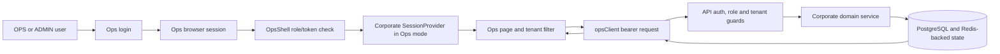
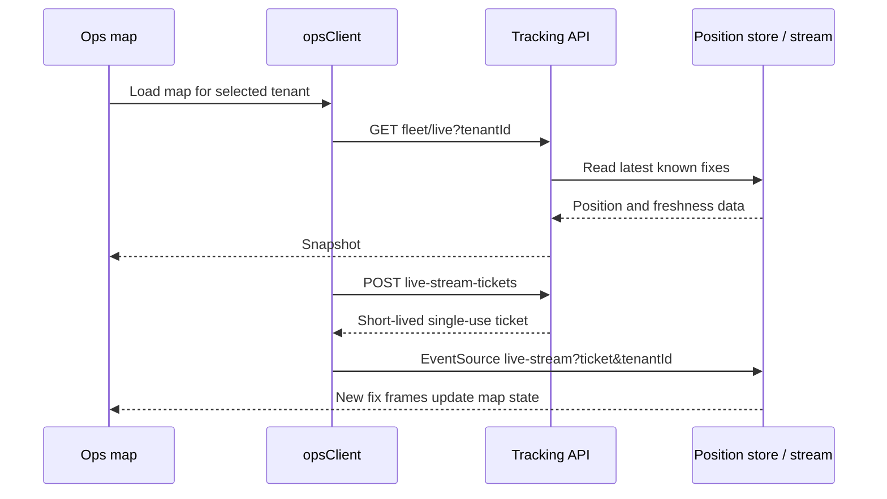

# Ops Route-by-Route Reference

**Evidence status:** The 29 rows below reconcile to the 29 `page.tsx` files
under `apps/ops/src/app/`. Page behavior and API calls are traced to source.
Controller and model links explain the checked-in implementation; they do not
prove which API version is deployed at runtime.

## What Ops does

Ops is the AdhocX operations desk. Operations staff use it to inspect
corporate route demand, drivers, employees and support cases; monitor vehicle
locations; plan or amend routes; and respond to SOS alerts. It is an
operational interface over shared Corporate/ETS services, not a separate
dispatch database or a second implementation of every safety page.

The application runs as a Next.js App Router application. Its route files
mostly render pages, redirects, or re-export a Corporate page. The shared
client in `apps/ops/src/lib/api/opsClient.ts` sends requests to the API, while
React page state and browser storage hold view filters and the selected Ops
tenant.

## Sign-in, authorization and tenant scope

`apps/ops/src/components/layout/OpsShell.tsx` is mounted by
`apps/ops/src/app/layout.tsx`. `/login` is deliberately outside the shell.
For other paths, the shell checks that a stored access token and user exist
and that the stored role is `OPS` or `ADMIN`; it redirects to `/login` if
they do not. This is a client-side entry check, not a server session
verification. The API remains responsible for authorization.

After that check, the shell configures the shared Corporate API session and
wraps pages in Corporate `SessionProvider` in Ops mode. The shared Ops client
uses `/api/v1` on deployed AdhocX hosts and local API port `7001` during
development. It attaches the bearer token, unwraps the standard response
envelope, and retries eligible `401` responses after refreshing the token.
Failed refresh clears the local session and returns the user to login; a
`403` does not itself clear the session.

The shell automatically loads and saves the first tenant when no tenant is
selected for the migrated `/live`, `/routes`, and `/safety` route families.
The home page, dashboards, planner, and employee directory have their own
tenant selection/loading behavior. A selected tenant is a UI scope, not an
authorization grant: corporate API guards and tenant/office checks must
still authorize each request.

## Route catalog

The **Source** column gives the actual route page. API paths are relative to
the configured `/api/v1` base URL. A redirect or re-export row intentionally
describes the actual implementation, rather than implying that the path has
its own feature page.

| Route | Page purpose and user actions | Frontend implementation | API calls | Backend and data |
|---|---|---|---|---|
| `/` | Company hub: load corporate tenants and open tenant-scoped route, live, or analytics work. | `apps/ops/src/app/page.tsx`; Ops shell and tenant navigation. | `GET /corporate/tenants`; links pass tenant IDs into destination pages. | [Tenant controller](../api/reference/endpoints/corporate-tenant-controller.md), `CorporateTenantService`; tenant and office records. |
| `/login` | Authenticate an Ops account and establish its local session; supports a redirect target. | `apps/ops/src/app/login/page.tsx`; standalone login outside `OpsShell`. | `POST /auth/login` with identifier, password and `role: "OPS"`. | Auth controller/service and `User`; role is checked again by protected API endpoints. |
| `/dashboard` | Cross-client daily overview: route status counts, carried passengers, exception count, active SOS count, client summary and links to live dispatch. Refresh is manual. | `apps/ops/src/app/dashboard/page.tsx`; metric cards and tenant links. | `GET /corporate/ops/board?date=...&pageSize=200`; `GET /corporate/tenants`; `GET /corporate/safety/alerts?activeOnly=true`. The SOS request failure is converted to an empty alert list in this page. | [Operations controller](../api/reference/endpoints/corporate-operations-controller.md), `CorporateOperationsService`, tenant and safety services; route, stop, tenant, position and SOS data. |
| `/dashboard/live` | Live-dispatch board for route state, driver/vehicle information and dispatch interventions. | `apps/ops/src/app/dashboard/live/page.tsx`; route cards, detail and action controls. | `GET /corporate/ops/board`; `/corporate/ops/routes/:id/detail`; `POST /corporate/dispatch/routes/:id/start-now` for a dispatch retry. | Operations and [dispatch controllers](../api/reference/endpoints/corporate-dispatch-controller.md); route, stop, driver, vehicle and dispatch-offer state. |
| `/dashboard/analytics` | Filter and review operational trends and aggregates for selected dates/client dimensions. | `apps/ops/src/app/dashboard/analytics/page.tsx`; analytics filters and visual summaries. | `GET /corporate/analytics/dashboard` with date range and optional tenant, office, direction and shift filters. | [Analytics controller](../api/reference/endpoints/corporate-analytics-controller.md), `CorporateAnalyticsService`; tenant-scoped route, request, stop and event data. |
| `/dashboard/exceptions` | Prioritized queue for SOS, unassigned/at-risk routes, delayed routes, stale GPS and selected-tenant unserved-request/stop-delay exceptions. Users can filter by tenant, refresh, claim locally, acknowledge/escalate SOS, retry dispatch and open the relevant route/safety view. | `apps/ops/src/app/dashboard/exceptions/page.tsx`; refreshes every 15 seconds while visible. Claims are saved in this browser's local storage, not shared with other Ops users. | Ops board; active SOS alerts; for a selected tenant, `GET /corporate/analytics/exceptions`; SOS acknowledge/escalate; dispatch start-now. SOS and exception-feed read failures can be converted to empty lists. | Operations, analytics, safety and dispatch services; routes, GPS freshness, exceptions and SOS records. |
| `/live` | Cross-tenant live-operations summary with route status, trend information and paged route data; refreshes every 15 seconds while visible and supports manual refresh and route navigation. | `apps/ops/src/app/live/page.tsx`; page size 25, refresh state and trend chart. | `GET /corporate/ops/live-operations?routePage=...&routePageSize=25`. | Operations controller/service; routes and derived live operations metrics. |
| `/live/trips` | Legacy trip-list URL. It redirects to `/live`; it does not render a separate trip list. | `apps/ops/src/app/live/trips/page.tsx`. | None on the redirect page. | Destination uses the live-operations API. |
| `/live/trips/:id` | Legacy trip-detail URL. It redirects to `/live`; it does not render a separate trip detail. | `apps/ops/src/app/live/trips/[id]/page.tsx`. | None on the redirect page. | Use `/routes/:id` for route-level operations and details. |
| `/live/exceptions` | Legacy exceptions URL. It redirects to `/live`; the implemented exceptions queue is `/dashboard/exceptions`. | `apps/ops/src/app/live/exceptions/page.tsx`. | None on the redirect page. | Destination pages use the operations, analytics and safety APIs listed above. |
| `/live/employees` | Legacy live employee URL. It redirects to `/employees`; there is no separate live employee tracking page here. | `apps/ops/src/app/live/employees/page.tsx`. | None on the redirect page. | Destination uses the tenant employee directory API. |
| `/map` | Live fleet map. It displays the latest known vehicle positions, filters by tenant, overlays routes and updates vehicle locations from a live stream; a position that has not reported is not guessed. | `apps/ops/src/app/map/page.tsx`; React state and `fleet-telemetry.ts` normalize/animate position fixes; Google Maps JavaScript API renders the map. | `GET /corporate/trips/routes/fleet/live[?tenantId=...]` snapshot; `POST /corporate/trips/live-stream-tickets`; `EventSource` to `/corporate/trips/routes/fleet/live-stream?ticket=...&tenantId=...`; `GET /corporate/routes` for route overlays. The short-lived, single-use ticket—not the access token—is placed in the stream URL. | [Tracking controller](../api/reference/endpoints/corporate-tracking-controller.md), `CorporateTrackingService`, stream hub and routing service; latest vehicle-position and route data. |
| `/routes` | Tenant route directory with date, direction, status, dispatch status and text filters. Users inspect routes, retry dispatch, delete eligible unassigned routes, and open detail/actions. | `apps/ops/src/app/routes/page.tsx`; route table, filters and drawers. | `GET /corporate/routes` with filters and `includeStops=true`; route detail; dispatch start-now; `DELETE /corporate/routes/:id`. | [Routing controller](../api/reference/endpoints/corporate-routing-controller.md), operations/dispatch services; `CorporateRoute`, `CorporateRouteStop`, request, driver and vehicle data. |
| `/routes/:id` | Route manifest and operational detail: status, assigned driver/vehicle, stops, passenger information and directions. Depending on route state, permitted actions include edit, cancel, reassign, manage stops, verify boarding OTP or mark a passenger no-show. | `apps/ops/src/app/routes/[id]/page.tsx`, `apps/ops/src/components/routes/OpsRouteDetailView.tsx`, `ReassignDriverModal`, `CancelRouteModal`, `StopItineraryDrawer`. | `GET /corporate/routes/:id`; `GET /corporate/routes/:id/directions`; route/stop `PATCH`, `POST`, `DELETE`; reassignment `POST /corporate/ops/routes/:id/reassign`; cancellation `POST /corporate/trips/routes/:id/cancel`; OTP/no-show `POST /corporate/trips/routes/:id/stops/:stopId/verify-otp|no-show`. Reassignment submits a reason and optional driver ID. | Routing, operations and trip-execution controllers/services; route, stop, transport request, driver, vehicle and trip-event data. Client helper guards allow reassignment only for `ASSIGNED`, and edit/cancel for `PLANNED`, `DISPATCHING` or `ASSIGNED`; the server is authoritative. |
| `/assignments` | Read-only assignment monitor. Users filter by assignment status, search the loaded records by IDs/driver/plate, and inspect a detail drawer; this page does not create or change assignments. | `apps/ops/src/app/assignments/page.tsx`; shared `DataTable`, `FilterBar`, `Drawer`, and `StatusBadge`. Loads up to 100 records; text search is client-side. | `GET /assignments?status=...&limit=100`. | [Assignments controller](../api/reference/endpoints/assignments-controller.md), assignment service; assignment, requirement, driver and vehicle data. |
| `/drivers` | Driver directory with search, verification and availability filters; opens a driver's detail page. | `apps/ops/src/app/drivers/page.tsx`; directory and pagination/filter controls. | `GET /corporate/ops/drivers` with page, search, verification and availability filters. | [Ops drivers controller](../api/reference/endpoints/corporate-ops-drivers-controller.md), driver operations service; driver, user, vehicle and route associations. |
| `/drivers/:id` | Driver profile with suspend/reactivate verification and activate/deactivate account actions. Suspension/deactivation require a reason of at least five characters in the UI; reactivate/activate submit notes. | `apps/ops/src/app/drivers/[id]/page.tsx`; driver detail and action dialogs. | `GET /corporate/ops/drivers/:id`; `POST` to `/suspend`, `/reactivate`, `/deactivate` or `/activate`. | [Ops drivers controller](../api/reference/endpoints/corporate-ops-drivers-controller.md), driver operations service; driver and user records plus route/assignment history. Server validation and authorization determine whether a requested change is allowed. |
| `/employees` | Tenant employee directory. Staff choose a tenant, filter by office/status/search, page through employees, create and edit records, or delete/deactivate them. Create requires an office; a successful create reports that the commuter account was provisioned. | `apps/ops/src/app/employees/page.tsx`; forms, filters and confirmation dialog. Tenant choice is initialized from URL, remembered local storage, or the first tenant. | `GET /corporate/tenants`; `GET /corporate/tenants/:tenantId`; employee `GET`, `POST`, `PATCH`, `DELETE` under `/corporate/tenants/:tenantId/employees`. | [Tenant controller](../api/reference/endpoints/corporate-tenant-controller.md), `CorporateTenantService`; tenant, office, employee and related commuter account/location data. The API may deactivate rather than hard-delete to preserve historical trips. |
| `/planner` | Two route workflows: upload/optimize a roster, review candidate plans and commit them; or create a manual route directly from employee stops. Users select tenant/office, shift and direction and configure vehicle/routing options. | `apps/ops/src/app/planner/page.tsx`; upload/plan forms, progress display, map, result review and manual-route form. Manual stops require name, phone and address; phone validation accepts supported Indian 10-digit formats. | `POST /corporate/routes/plan-stream` (multipart roster and options), `POST /corporate/routes/optimize`, `POST /corporate/routes/commit-plan`, and `POST /corporate/routes` for direct manual-route creation; template and plan export endpoints. The stream waits up to 30 minutes overall, 2 minutes for the initial response and 90 seconds without progress. | [Routing controller](../api/reference/endpoints/corporate-routing-controller.md), `CorporateRoutePlannerService`, `RouteSolverService` and routing adapters; tenant policies, office, employee/request, route and stop records. Roster planning produces a candidate that must be committed; manual creation submits a route directly. |
| `/safety` | Safety landing page. This route re-exports the Corporate `/safety` page rather than implementing a separate Ops page. | `apps/ops/src/app/safety/page.tsx` re-exports `apps/corporate/src/app/safety/page.tsx`. | Same calls as the Corporate page. | Same safety implementation; see [Corporate route reference](../corporate/detailed-route-reference.md) and [safety controller](../api/reference/endpoints/corporate-safety-controller.md). |
| `/safety/:id` | Legacy safety detail alias. Re-exports the Corporate safety detail page. | `apps/ops/src/app/safety/[id]/page.tsx` re-exports `apps/corporate/src/app/safety/[id]/page.tsx`. | Same calls as the Corporate page. | `CorporateSafetyService`; SOS/incident and associated route data. |
| `/safety/:id/resolve` | Legacy safety resolution alias. Re-exports the Corporate resolution page. | `apps/ops/src/app/safety/[id]/resolve/page.tsx` re-exports `apps/corporate/src/app/safety/[id]/resolve/page.tsx`. | Same calls as the Corporate page. | Safety lifecycle and audit records. |
| `/safety/cockpit` | Ops-specific SOS command cockpit. Lists active and terminal alerts, refreshes every six seconds while visible, and provides acknowledge, investigate, resolve and escalate actions. | `apps/ops/src/app/safety/cockpit/page.tsx`; status helpers in `apps/ops/src/lib/opsHelpers.ts`. | `GET /corporate/safety/alerts`; `POST` to alert `/acknowledge`, `/investigate`, `/resolve`, and `/escalate`. Resolve sends notes and `status: "RESOLVED"`. | [Safety controller](../api/reference/endpoints/corporate-safety-controller.md), `CorporateSafetyService`, `CorporateSosEscalationScheduler`; `CorporateSosAlert`, route and location context. |
| `/safety/incidents/:id` | Incident detail path; re-exports the matching Corporate incident page. | `apps/ops/src/app/safety/incidents/[id]/page.tsx` re-exports `apps/corporate/src/app/safety/incidents/[id]/page.tsx`. | Same calls as the Corporate page. | Corporate safety lifecycle and incident data. |
| `/safety/incidents/:id/resolve` | Incident resolution path; re-exports the Corporate incident resolution page. | `apps/ops/src/app/safety/incidents/[id]/resolve/page.tsx` re-exports `apps/corporate/src/app/safety/incidents/[id]/resolve/page.tsx`. | Same calls as the Corporate page. | Corporate safety lifecycle and audit data. |
| `/safety/incidents/details` | Legacy incident-details path; re-exports the Corporate details page. | `apps/ops/src/app/safety/incidents/details/page.tsx` re-exports `apps/corporate/src/app/safety/incidents/details/page.tsx`. | Same calls as the Corporate page. | Corporate safety lifecycle and incident data. |
| `/safety/incidents/resolve` | Legacy incident-resolution path; re-exports the Corporate resolution page. | `apps/ops/src/app/safety/incidents/resolve/page.tsx` re-exports `apps/corporate/src/app/safety/incidents/resolve/page.tsx`. | Same calls as the Corporate page. | Corporate safety lifecycle and audit data. |
| `/safety/reports` | Safety report path; re-exports the Corporate safety reports page. | `apps/ops/src/app/safety/reports/page.tsx` re-exports `apps/corporate/src/app/safety/reports/page.tsx`. | Same calls as the Corporate page. | Corporate safety and analytics data. |
| `/support` | Shared operational ticket queue. Users search/filter assigned tickets, inspect description/attachments/history, send an internal update to Admin, and move ticket status; resolving requires non-empty resolution notes. | `apps/ops/src/app/support/page.tsx`; refreshes the queue every 30 seconds. Update/resolution text is limited to 1,000 characters in the UI. | `GET /ops/support/tickets[/:id]`; `POST /ops/support/tickets/:id/updates`; `PATCH /ops/support/tickets/:id/status` with status and optional notes. | [Ops support controller](../api/reference/endpoints/ops-support-ticket-controller.md), `CorporateSupportTicketService`; ticket, activity, comment and attachment records. |

## Main end-to-end workflows

### Monitor live operations and location freshness

`/live` loads the operational summary and paged routes from one API response.
`/map` has a distinct location workflow: it first loads the last-known
positions, requests a short-lived stream ticket, and opens an `EventSource`.
Incoming fixes update the map's React state; failed stream setup retries with
increasing delay capped at 30 seconds. The snapshot is explicitly a
last-known-position view, not a predicted position. A missing fix or old
timestamp must therefore be interpreted using its freshness fields rather
than as proof that a vehicle is stationary.

The map's snapshot request catches read errors so that stream setup can still
proceed; that catch does not prove a successful snapshot. A stream-ticket
failure instead sets reconnecting state and schedules a retry.

### Plan and commit routes

On `/planner`, tenant and office selection supply the scope. For an uploaded
roster, scheduling/routing options and the file are sent to the streamed
planning endpoint. The response reports progress and returns proposed routes,
summary counts and exclusions; the user reviews the results before using the
separate commit action. Successful optimization alone does not mean those
routes were saved. The page also has a distinct manual-route form: validated
employee stops are sent to `POST /corporate/routes`, which creates the manual
route directly rather than returning a candidate for the roster-plan commit
action. API business rules, tenant policies and planner validation remain
authoritative.

### Dispatch, edit, cancel and reassign

The route list supports a dispatch retry and deletion only where the route is
eligible. Detail actions use status guards from `opsHelpers.ts`; for example,
the client exposes reassignment only for `ASSIGNED` routes. The reassign form
requires a reason and permits an optional target driver; an empty target asks
the backend dispatch flow to find an eligible driver. Cancellation also
requires a reason. The backend may reject stale or illegal transitions, so a
success state is only shown after the API responds successfully.

On the route manifest, stop actions are limited to pending/arrived passenger
stops, not office-hub stops. OTP verification advances boarding through the
trip-execution API. The manual no-show action records a reason and requests
the server-side no-show transition; neither button directly changes a route
record in the browser.

### SOS response

The Ops cockpit periodically reloads alerts and presents active alerts
separately from terminal (`RESOLVED`/`FALSE_ALARM`) alerts. The client
recognizes `NEW`/`ACTIVE` as acknowledgeable, and
`ACKNOWLEDGED`/`INVESTIGATING`/`RESPONDED` as eligible for quick escalation.
The service and scheduler own the actual lifecycle transition. In particular,
the backend scheduler checks eligible unacknowledged SOS alerts every 15
seconds against a 120-second acknowledgement SLA; client polling is not that
SLA mechanism.

## API, service and data map

| Ops capability | HTTP calls used by Ops | Backend responsibility | Important data |
|---|---|---|---|
| Dashboard and live operations | `GET /corporate/ops/board`, `/corporate/ops/live-operations`, `/corporate/ops/routes/:id/detail` | Operations controller/service composes route status, counts, GPS freshness and live summaries. | `CorporateRoute`, `CorporateRouteStop`, requests, drivers, vehicles and positions. |
| Route directory and planning | `GET/POST/PATCH/DELETE /corporate/routes`, `/corporate/routes/optimize`, `/corporate/routes/plan-stream`, `/corporate/routes/commit-plan` | Routing controller delegates planning/route writes to planner and solver services; dispatch operations use the dispatch/operations services. | Tenant, office, employees/requests, `CorporateRoute`, `CorporateRouteStop`. |
| Dispatch and trip actions | `POST /corporate/dispatch/routes/:id/start-now`, `/corporate/ops/routes/:id/reassign`, trip stop OTP/no-show endpoints | Dispatch selects eligible drivers; operations/trip execution validate and record state transitions. | Route assignment/offer state, driver, vehicle, stop and trip-event data; dispatch also uses Redis-backed temporary state. |
| Tracking | `GET /corporate/trips/routes/fleet/live`, `POST /corporate/trips/live-stream-tickets`, live-stream `EventSource` | Tracking reads latest fixes and brokers stream events. | `CorporateVehiclePosition` and live stream state. |
| Safety | `GET/POST /corporate/safety/alerts...` | Safety service validates lifecycle transitions; scheduled escalation is handled server-side. | `CorporateSosAlert`, route and position context. |
| Employee administration | `GET/POST/PATCH/DELETE /corporate/tenants/:id/employees` | Tenant service checks tenant/office scope and provisions or maintains employee records. | Corporate tenant, office, employee/location and commuter-account records. |
| Analytics and exceptions | `GET /corporate/analytics/dashboard`, `/corporate/analytics/exceptions` | Analytics service builds bounded, tenant-scoped aggregates. | Routes, stops, requests, trip events and safety signals. |
| Assignments | `GET /assignments` | Marketplace assignment controller/service returns assignment records; this Ops page is read-only. | `Assignment`, `Requirement`, driver and vehicle data. |
| Support | `GET/POST/PATCH /ops/support/tickets...` | Ops support-ticket controller and support service enforce queue visibility and record status/activity changes. | `CorporateSupportTicket` and associated activity, comments and attachments. |

The linked [Corporate service guide](../api/corporate-module-services.md)
describes the domain service responsibilities and scheduled/realtime
boundaries. The [data dictionary](../api/data/data-dictionary.md) is the
source for schema field definitions and relationships. This route reference
does not infer unverified joins from a page's display fields.

## Technologies and state ownership

| Technology | Why Ops uses it | Where and what it owns | Supporting dependencies |
|---|---|---|---|
| Next.js 14 App Router | Provides the application URL structure, page rendering, layout and redirects. | `apps/ops/src/app/`; `layout.tsx` mounts the shared shell and individual `page.tsx` files implement or delegate each route. | React 18; the app's `next` dependency. |
| React | Renders interactive tables, forms, dashboards, maps and dialogs. | Page/component hooks own transient results, filters, loading/error states, selected records and map connection state. | Shared Ops components and React hooks; this application does not use a Redux store for these flows. |
| Corporate session context | Reuses the Corporate authentication/session adapter for migrated domain modules without duplicating its session integration. | `OpsShell` imports `apps/corporate/src/lib/auth/SessionContext` and `apps/corporate/src/lib/api/client`; Ops token storage and refresh handlers remain in the Ops client. | Corporate `SessionProvider` and API-session configuration. |
| Ops API client and Fetch | Centralizes the `/api/v1` base URL, bearer credentials, refresh handling, response parsing and typed request helpers. | `apps/ops/src/lib/api/opsClient.ts`; page state is updated from request results. | Shared `@adhocx/contracts` telemetry types and Ops API response types. |
| Google Maps JavaScript API | Renders geographic fleet positions and map controls. | Loaded dynamically by `apps/ops/src/app/map/page.tsx`; `NEXT_PUBLIC_GOOGLE_MAPS_KEY` is read by the browser to load Maps JavaScript with geometry/marker libraries. | Google Maps web SDK; `fleet-telemetry.ts` handles incoming fixes and map-side presentation. |
| Browser `EventSource` (SSE) | Receives live position frames without polling the entire fleet endpoint. | `/map` opens the live stream with a short-lived ticket and keeps the connection/reconnect state in React. | API-issued single-use ticket; stream endpoint and shared tracking service. |
| `lucide-react` | Supplies icons in dashboards, filters and actions. | Imported directly by page and component files; it does not own business state or data. | `lucide-react` app dependency. |

## Important implementation and evidence boundaries

- Most Ops pages use local React state and `opsApi`; shared tenant/session
  context comes from Corporate source files imported by `OpsShell`.
- Request methods and paths above are based on `opsClient.ts`. Controller
  links are source references, not runtime URL discovery.
- The client uses short-lived stream tickets for the map. Do not treat the
  EventSource ticket as a reusable login token.
- The Ops route pages for Safety mostly re-export Corporate pages. Fixes to
  those pages may therefore belong to `apps/corporate/src/app/safety/`, not
  to a second Ops implementation.
- UI fallbacks can hide read failures in limited places, notably SOS
  aggregation on `/dashboard` and SOS/analytics exception reads on
  `/dashboard/exceptions`. An empty displayed list in those cases is not
  proof that the underlying system has no alerts.
- The assignment table is a monitor, not a route reassignment screen.
  Reassignment is implemented from route operations.

## Related documentation

- [Ops application overview](./application-reference.md)
- [Exact Ops route inventory](./exact-route-inventory.md)
- [Live operations runbook](./live-operations-runbook.md)
- [SOS and reassignment guide](./sos-and-reassignment-guide.md)
- [Corporate route reference](../corporate/detailed-route-reference.md)
- [Corporate module and service guide](../api/corporate-module-services.md)
