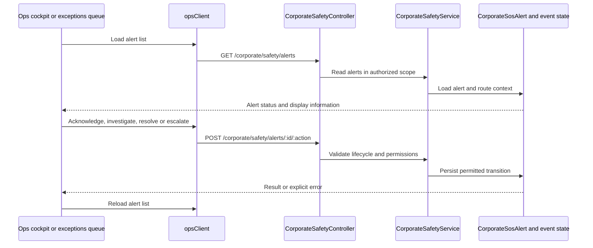
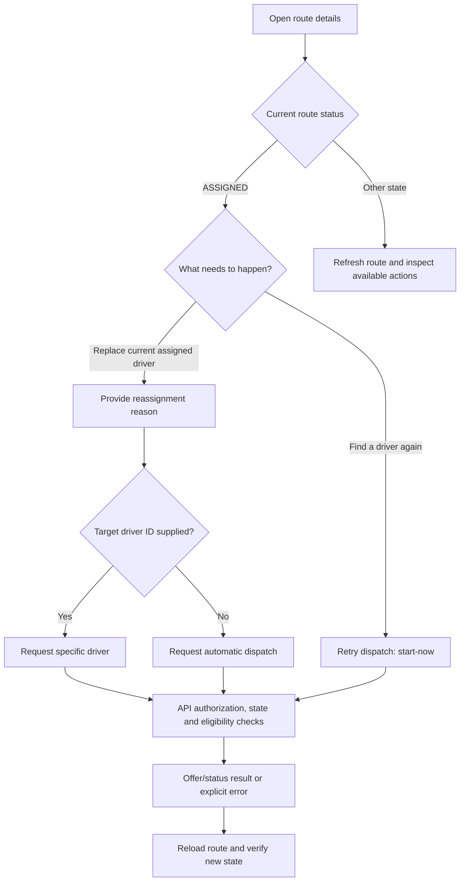

# Ops SOS and Reassignment Guide

This page explains the SOS and driver-reassignment actions implemented by
Ops. It describes the software workflow and its API handoffs; it does not
replace a company emergency-response policy or provide contacts that are not
stored in the application.

## SOS alert workflow

### Where alerts appear

- `/safety/cockpit` is the Ops-specific command cockpit. It loads up to 100
  alerts, refreshes every six seconds while the browser tab is visible, and
  separates statuses recognized by the client as active from terminal
  (`RESOLVED` and `FALSE_ALARM`) records.
- `/dashboard/exceptions` combines active SOS alerts with at-risk or
  unassigned routes and stale-GPS routes. It refreshes its board every 15
  seconds while visible and supports tenant filtering.
- `/dashboard` shows an active SOS count alongside route metrics; its SOS
  request failure is caught as an empty list. Use the cockpit or exception
  page to investigate rather than treating that count as an authoritative
  safety record.
- Most `/safety/*` paths re-export Corporate pages. See the [Ops route
  reference](./route-by-route-reference.md) for the exact shared source paths.

### Statuses and user actions

The Ops helper classifies `NEW`, `ACTIVE`, `ACKNOWLEDGED`, `INVESTIGATING`,
`ESCALATED` and `RESPONDED` as active. It classifies `RESOLVED` and
`FALSE_ALARM` as terminal.

The cockpit exposes four actions:

| Action | User interaction | Request |
|---|---|---|
| Acknowledge | Confirm that Ops has received a new/active alert. | `POST /corporate/safety/alerts/:id/acknowledge` |
| Investigate | Move the alert into investigation from the cockpit. | `POST /corporate/safety/alerts/:id/investigate` |
| Resolve | Submit resolution notes and mark the alert resolved. | `POST /corporate/safety/alerts/:id/resolve` with `resolutionNotes` and `status: "RESOLVED"` |
| Escalate | Escalate the alert from the cockpit. | `POST /corporate/safety/alerts/:id/escalate` with notes. |

On the exceptions page, the quick action is status-dependent: `NEW` or
`ACTIVE` presents acknowledge; `ACKNOWLEDGED`, `INVESTIGATING` or
`RESPONDED` presents escalate. Terminal and already escalated statuses do
not receive that quick action. These UI rules only choose the offered button;
`CorporateSafetyService` and the API validate the actual lifecycle transition.

The cockpit supplies a default resolution note if the operator leaves its
note field empty. If a custom note is entered, that note is sent instead.
Errors from acknowledge, investigate, resolve or escalate are displayed to
the operator; after a successful action, the cockpit reloads the alert list.

### Automated escalation is server-side

`CorporateSosEscalationScheduler` runs independently of the browser. The
backend documentation describes a default 15-second poll interval and a
120-second acknowledgement SLA for eligible unacknowledged SOS alerts. The
scheduler uses a Redis tick lock and conditional per-alert updates to avoid
overlapping workers applying the same escalation. The six-second cockpit
refresh only updates the page; it does not implement or reset that SLA.

The backend lifecycle, controller and scheduler sources are documented in
the [Corporate module/service guide](../api/corporate-module-services.md)
and [safety controller reference](../api/reference/endpoints/corporate-safety-controller.md).
The safety record is `CorporateSosAlert`; location and route context may also
be shown when present. Missing coordinates are presented as unavailable,
not inferred from a route.

## Route reassignment workflow

### Reassignment versus dispatch retry

These are separate actions:

- **Retry dispatch** is available from the route list/operations views and
  sends `POST /corporate/dispatch/routes/:id/start-now` with an empty JSON
  object. The response reports a dispatch scan outcome such as `OFFERED`,
  `NO_DRIVERS_FOUND`, `ALL_DRIVERS_BUSY` or `ALREADY_ASSIGNED`. An `OFFERED`
  response means an offer was sent, not that the driver accepted it.
- **Reassign driver** is a route-detail operation and sends
  `POST /corporate/ops/routes/:id/reassign` with a required `reason` and an
  optional `newDriverId`. The backend returns a status and may identify a
  reassignment record and dispatch mode.

The client helper `canReassignRoute` only enables the action when the route
status is `ASSIGNED`. Route status can change after the page loads, so the
server can still reject the action. The modal displays the current assigned
driver and vehicle before submission.

### Operator inputs and validation

The modal provides common operational reasons and an `Other` option. For
`Other`, it requires non-empty custom text. The target driver ID is optional:

- Enter an ID to request a specific driver assignment.
- Leave it empty to request automatic dispatch. The UI describes this as
  broadcasting to compliant commercial yellow-plate drivers within 10 km.
  That is the interface's explanatory text, not a guarantee that a candidate
  exists or will accept; eligibility and the final dispatch outcome are
  decided by the backend.

After a successful request, the modal closes and its parent reloads the route.
If the API rejects the reason, route state, driver or authorization, the
modal displays the error and does not report success.

### Related route actions are not interchangeable

`canCancelRoute` and `canEditRoute` allow only `PLANNED`, `DISPATCHING` or
`ASSIGNED` client-side. Cancellation requires a reason. `canDeleteRoute`
allows deletion only for a `PLANNED` or `DISPATCHING` route with no driver.
These are user-interface guards aligned to backend rules; backend
authorization and transition checks remain final.

Use the route manifest's OTP/no-show controls only for eligible passenger
stops. Those controls call trip-execution endpoints, not the reassignment
endpoint. OTP verification advances a boarding transition; no-show submits a
reason for the server to record and process.

## API and implementation references

| Concern | Source |
|---|---|
| SOS cockpit, polling and alert actions | `apps/ops/src/app/safety/cockpit/page.tsx` |
| Exceptions queue and quick action selection | `apps/ops/src/app/dashboard/exceptions/page.tsx` |
| SOS status helpers and route-action guards | `apps/ops/src/lib/opsHelpers.ts` |
| Alert and route request methods | `apps/ops/src/lib/api/opsClient.ts` |
| Reassignment form and reason input | `apps/ops/src/components/operations/ReassignDriverModal.tsx` |
| Route detail action wiring | `apps/ops/src/components/routes/OpsRouteDetailView.tsx` and `apps/ops/src/app/routes/[id]/page.tsx` |
| Corporate safety lifecycle and scheduler | `apps/api/src/domains/corporate/safety/` |
| Dispatch and route operations | `apps/api/src/domains/corporate/dispatch/` and `apps/api/src/domains/corporate/operations/` |

See the [live operations runbook](./live-operations-runbook.md) for route
monitoring, tracking freshness and planning; see the [route-by-route
reference](./route-by-route-reference.md) for page-level API and data
mapping.
