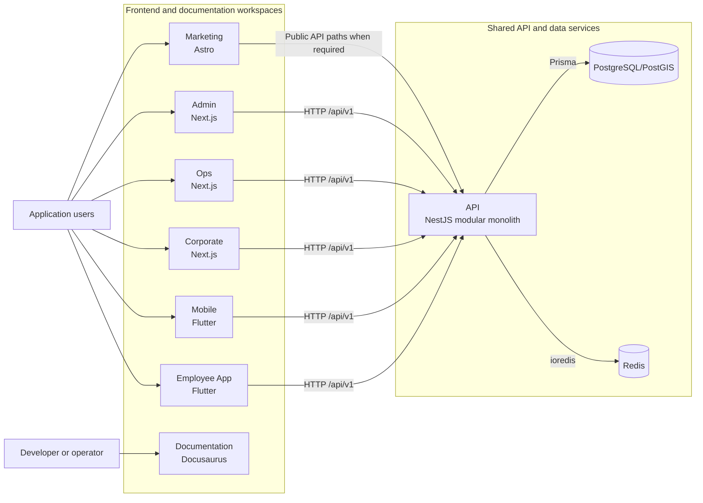

# Container Architecture

**Evidence status:** Workspace containers are source-mapped from package
manifests and entrypoints. A repository workspace is not, by itself, proof of
a production deployment.

## Workspace container view

This is the C4 container-level view expressed as a flowchart because the
native C4 context renderer is failing in the browser runtime. The workspace
and data-service boundaries remain visible; the deployment view is a separate
source, not inferred from this grouping.

The view groups source workspaces by responsibility. Deployment membership is
shown separately in the [deployment view](./deployment-and-components.md).
The API module tree is loaded by the single Nest application in
`apps/api/src/app.module.ts`; it is not evidence of separately deployed
microservices.

## Main runtime responsibilities

- **API:** `apps/api/src/main.ts` creates the Nest application, sets the
  `api/v1` prefix, global DTO validation, exception handling, response
  transformation and tenant-context interception, then listens on its
  configured port. `apps/api/src/app.module.ts` composes domain and shared
  infrastructure modules.
- **PostgreSQL:** Prisma is the API data-access layer. The checked-in schema
  and migration files are under `apps/api/prisma/`. A generated database
  diagram or this page does not certify the live database's applied migrations.
- **Redis:** API modules use Redis for several purposes, including caching,
  revocation state, telemetry streams and live event fan-out. Not every Redis
  feature has the same durability or failure semantics; see
  [data and control flow](./data-and-control-flow.md).
- **Gateway:** `docker-compose.prod.yml` declares Nginx routing for API,
  Admin and Mobile. It does not declare all frontend workspaces.

## Source references

- Workspace manifests: `apps/api/package.json`, `apps/admin/package.json`,
  `apps/ops/package.json`, `apps/corporate/package.json`,
  `apps/mobile/pubspec.yaml`, `apps/employee-app/pubspec.yaml`,
  `apps/marketing/package.json`, `apps/docs/package.json`
- API composition: `apps/api/src/main.ts`,
  `apps/api/src/app.module.ts`
- Declared local and production containers: `docker-compose.yml`,
  `docker-compose.prod.yml`
- Gateway routing: `infrastructure/nginx/production.conf`
