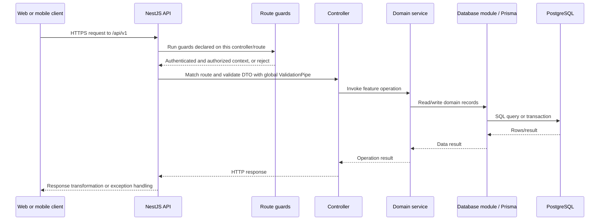
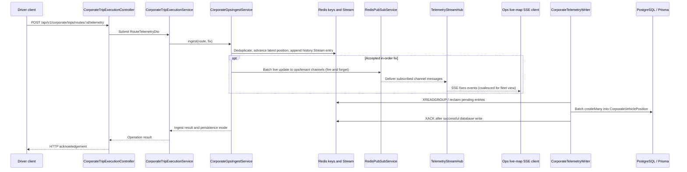
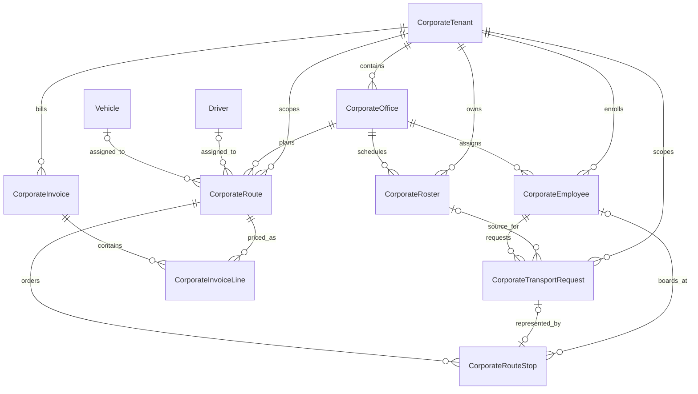

# Data and Control Flow

This page describes representative source paths, not a guarantee that every
route follows an identical lifecycle. Controller decorators, module wiring,
feature-specific services and provider availability determine the exact
behavior.

## Protected HTTP request

The request/response path is configured in `apps/api/src/main.ts`. Authentication,
role, tenant and resource guards are attached selectively; public endpoints do
not all pass through the same authorization checks. The Corporate ETS
controller/service/data relationships are mapped in the
[API endpoint inventory](../../apps/api/reference/exact-controller-endpoints.md),
[service map](../../apps/api/corporate-module-services.md) and
[ETS status matrix](../../apps/ets/implementation-status.md).

## Corporate driver GPS and live-map flow

The high-rate corporate GPS path is not a synchronous “write PostgreSQL, then
publish” operation. The ingest service uses Redis for deduplication/latest
position and a Redis Stream for history; a background writer batches stream
entries into PostgreSQL. Live fan-out is a separate, best-effort Pub/Sub path.

If Redis is unavailable, Pub/Sub falls back to an in-process event bus that
reaches only subscribers on that API instance. GPS history can be buffered
locally and written by the same API instance; that local buffer is bounded and
is not equivalent to a durable cross-instance queue. The ingest response
reports the actual persistence mode. The stream writer acknowledges Redis
entries only after a successful database batch; unacknowledged items can be
reclaimed and deduplicated.

Relevant source: `apps/api/src/domains/corporate/execution/corporate-trip-execution.controller.ts`,
`apps/api/src/domains/corporate/execution/corporate-trip-execution.service.ts`,
`apps/api/src/domains/corporate/tracking/corporate-gps-ingest.service.ts`,
`apps/api/src/domains/corporate/tracking/corporate-telemetry-writer.service.ts`,
`apps/api/src/domains/corporate/tracking/telemetry-stream-hub.ts`,
`apps/api/src/domains/corporate/tracking/corporate-tracking.controller.ts` and
`apps/api/src/redis/redis-pubsub.service.ts`.

## Core ETS relational model

This is a functional ERD of selected Prisma relations, not a complete schema
diagram. Optional relations are marked as such. Fields and mappings are
defined in `apps/api/prisma/schema.prisma`.

The central business chain is tenant and office setup → roster (optional
ingestion source) → transport requests → planned route and ordered stops →
invoice lines grouped into a tenant invoice. A route may be assigned a driver
and vehicle; those links are optional in the schema. `CorporateRouteStop`
references a request through a unique nullable field, so the relationship is
optional and at most one stop per request. This diagram omits many supporting
tables, including roster entries, offers, safety events, trip events,
positions, rate cards, disputes and payouts; consult the
[API data dictionary](../../apps/api/data/data-dictionary.md) for all models.
