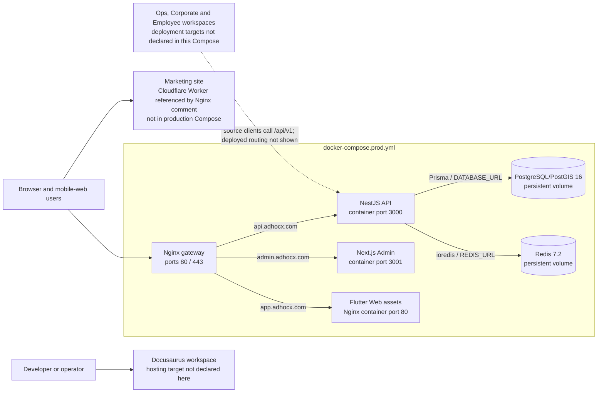
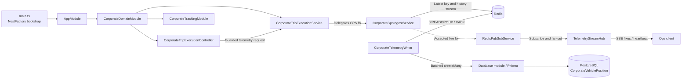

# Deployment and API Components

## Declared production deployment

This diagram summarizes `docker-compose.prod.yml` and
`infrastructure/nginx/production.conf`. It describes checked-in deployment
configuration, not a live cloud inventory.

The production manifest lists PostgreSQL, Redis, API, Admin, Mobile and the
Nginx gateway. Its Nginx configuration routes the declared API, Admin and
Mobile hostnames. A configuration comment says the public Marketing site is
hosted separately on Cloudflare Workers; this repository does not include that
Worker's deployment definition here. Ops, Corporate, Employee App and
documentation are workspace applications, but their deployment targets are
not represented in this Compose topology. Do not infer that they are either
deployed or unavailable based only on this file.

For comparison, `docker-compose.yml` declares local PostgreSQL, Redis, API,
Admin and Marketing services; it is a separate local topology and is not the
production diagram above.

## Corporate API source-level component view

This view traces one supported corporate GPS path through the API. It is
inside one NestJS process; the Nest modules are code boundaries, not separate
network services.

This is the C4 component-level view expressed as a Mermaid flowchart. The
native C4 context renderer raised a browser runtime error in this site, so the
source-level component relationships use the flowchart renderer instead.

The path is implemented across
`apps/api/src/domains/corporate/corporate-domain.module.ts`,
`apps/api/src/domains/corporate/execution/corporate-trip-execution.controller.ts`,
`apps/api/src/domains/corporate/execution/corporate-trip-execution.service.ts`
and `apps/api/src/domains/corporate/tracking/corporate-tracking.module.ts`.
The distinction between live
best-effort Pub/Sub and durable GPS history is detailed in
[data and control flow](./data-and-control-flow.md).
