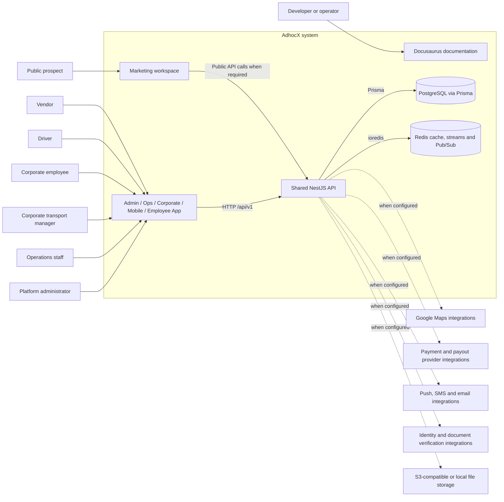

# System Context

**Evidence status:** The workspace and application boundaries below are
verified against manifests and entrypoints. External provider arrows describe
integration code/configuration, not proof of credentials, deployment or live
provider availability.

## What the system does

AdhocX provides a commercial mobility marketplace and a corporate commute
domain. People use separate web/mobile applications for public discovery,
marketplace operations, corporate transport, employee trips, dispatch and
administration. These clients communicate with a shared NestJS API; the API
owns application business logic and data access.

The API is one Nest application composed of modules, not a set of independently
deployed services. Its root composition is
`apps/api/src/app.module.ts`; the HTTP process starts in
`apps/api/src/main.ts`.

This is the C4 context-level view expressed as a Mermaid flowchart. The
Mermaid theme's native C4 context renderer raised a browser runtime error in
this site; the flowchart keeps the same system boundary and relationships
without shipping a blank or failing diagram.

## Application responsibilities

| Workspace | Main users and purpose | Runtime boundary |
|---|---|---|
| API (`apps/api`) | Shared authentication, marketplace, corporate transport and platform business APIs. | NestJS process, normally exposed under `/api/v1`. |
| Marketing (`apps/marketing`) | Public information and enterprise lead capture. | Astro workspace; the production Compose manifest does not deploy it. A comment in `infrastructure/nginx/production.conf` says the public site is served through Cloudflare Workers. |
| Admin (`apps/admin`) | Platform administration. | Next.js workspace; included in the production Compose manifest. |
| Ops (`apps/ops`) | Dispatch, live-operation and safety workflows. | Next.js workspace; no deployment target is declared in `docker-compose.prod.yml`. |
| Corporate (`apps/corporate`) | Tenant transport, employee, roster, route and billing workflows. | Next.js workspace; no deployment target is declared in `docker-compose.prod.yml`. |
| Mobile (`apps/mobile`) | Marketplace vendor and driver experience. | Flutter workspace; a Flutter Web image is declared in production Compose. |
| Employee App (`apps/employee-app`) | Corporate commuter experience. | Flutter workspace; no deployment target is declared in `docker-compose.prod.yml`. |
| Docs (`apps/docs`) | Developer and operator references. | Docusaurus static documentation workspace; hosting is not declared in the production Compose manifest. |

“Not declared in Compose” is not a claim that an application is not deployed
elsewhere. It means this repository's production Compose file does not describe
that deployment target. See the [deployment view](./deployment-and-components.md).

## Integration boundary

The API contains adapters and integration points for mapping, payments,
notifications, KYC/document verification and file storage. The actual provider
and credentials are environment-specific. The
[integration reference](../integrations/external-services.md) and
[provider adapter map](../../apps/api/provider-adapters.md) identify current
source paths and limitations.
