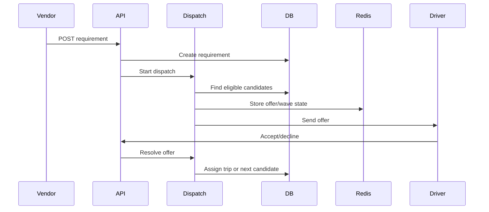

# Backend Business Logic

**Evidence status:** Verified against services, use cases and domain modules.

For the complete list of feature modules and service source paths, see the
[API module and service reference](../../apps/api/module-service-reference.md).
The [Corporate service map](../../apps/api/corporate-module-services.md)
covers the multi-step enterprise commute flow; the
[provider adapter guide](../../apps/api/provider-adapters.md) distinguishes
real provider results from cached or local fallbacks.

## Service Responsibilities

Backend services own business workflows and persistence orchestration.
Controllers should remain thin and delegate to services.

| Service area | Responsibility |
|---|---|
| Auth | OTP/password/social login, token issuance and account lifecycle |
| Drivers/Vehicles/Vendors | Supply profiles, availability and verification |
| Requirements | Demand creation, status and fulfillment |
| Dispatch | Candidate matching, offer waves and retries |
| Trips | Trip state, events, location and completion |
| Payments | Payment records and webhook verification |
| Pricing | Vehicle categories and platform policy |
| Ledger/Settlement | Wallet, earnings and withdrawals |
| Notifications | Push, SMS and in-app delivery |
| Corporate | Tenant, roster, routing, execution, tracking and billing |

## Marketplace Dispatch

The dispatch service is responsible for:

- finding candidates near a requirement
- eligibility and behavioral ranking
- progressive distance radii
- offer creation
- wave expiry and re-dispatch
- scheduled dispatch alerts
- reservation and trip assignment

`DispatchRequirementUseCase` contains a separate domain-core path that
computes 5 km and 10 km H3 rings. Source search found no controller/module
registration that wires this use case into the active API request path.
Additionally, `PrismaDriverRepository.findOnlineDriversInH3Cells` currently
ignores its H3-cell argument and returns up to 100 verified/available
drivers, so that repository path does not perform the spatial filter its
interface suggests. Do not describe this use-case path as a working
proximity search.

The registered `DispatchService` is the runtime dispatch implementation; it
has its own candidate filtering, ranking, offer and scheduler behavior.
Follow the [dispatch service reference](../../apps/api/module-service-reference.md#dispatch-and-offers)
and controller source rather than treating the standalone use case as the
active flow.

## Trip Lifecycle

The trip service verifies ownership and role before exposing trip details.
It coordinates:

- trip queries
- pending review
- arrival
- OTP start
- completion
- cancellation
- no-show
- location updates
- SOS
- trip events and messaging

The state is also constrained by the shared state-machine package. State
changes must remain server-authoritative.

## Pricing and Finance

The pricing service manages:

- active vehicle category catalogue
- platform policy configuration
- subscription/trial policy
- minimum withdrawal amount
- escort fee

Trip prices are distance/pricing-plan driven rather than derived from legacy
vehicle-tier price columns.

The payment service:

- creates payment records
- verifies webhook signatures
- processes wallet top-ups
- prevents direct unauthorized settlement
- emits notifications and audit entries

Money should remain integer/minor-unit or Decimal based on the database
model and provider contract; frontend floating-point calculations are not the
source of truth.

## Corporate ETS

The corporate commute workflow spans several service areas inside one
NestJS domain module:

1. Roster ingestion validates spreadsheet rows before the lifecycle service
   persists a roster version and transport requests.
2. The route planner groups valid demand using tenant policy, vehicle
   capacity and travel-time estimates; the estimate source is retained so a
   heuristic is not described as live traffic.
3. Dispatch rechecks driver eligibility, issues time-limited offers and
   commits assignment only after a valid response and guarded state change.
4. Trip execution verifies route assignment, driver status, seat capacity,
   stop arrival and boarding credentials before changing trip state.
5. GPS/events feed durable tracking history and operational live views;
   notifications are side effects and do not replace the business record.
6. Billing turns eligible completed activity into invoices/earnings. Payout
   submission is not final payment; signed provider confirmation controls the
   final payout transition.

See the
[Corporate module reference](../../apps/api/corporate-module-services.md),
[ETS operations workflow](../../apps/ets/operational-workflows.md) and
controller endpoint references for the source path and API contract.
