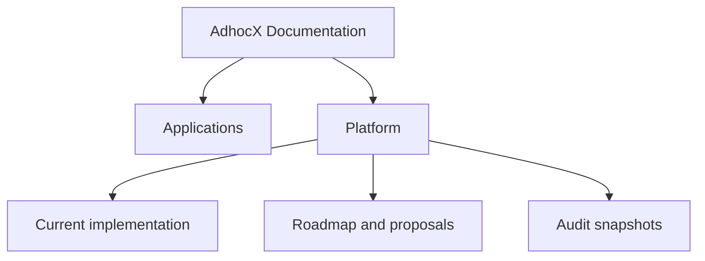

# Documentation Information Architecture

The Docusaurus sidebar is curated in `apps/docs/sidebars.ts`. It groups
content first by application or shared platform responsibility, then by
reference type. Leaf application sections may use an autogenerated list so
new reference pages remain discoverable without changing the top-level
structure.

Each rendered document exposes a GitHub edit link, configured through the
Docusaurus `editUrl`. This link targets the corresponding Markdown source;
it does not indicate that the cited application source code lives in the docs
repository.

## Primary areas

### Applications

Each runnable workspace has its own overview and references: API, Admin,
Ops, Corporate, Employee App, Mobile, Marketing and Documentation. ETS is
presented separately as a shared business domain, not as a ninth application.

### Platform

Shared product, design, architecture, engineering, security, workflows,
integrations, operations and user guides.

### Current implementation, plans and history

The sidebar separates current references from known proposals and the
historical audit snapshot. A plan or specification must not be interpreted
as evidence that its proposed behavior exists. Internal audit, planning and
operations pages remain excluded by `apps/docs/docusaurus.config.ts`.

## Page metadata and status

Use the page template at `apps/docs/templates/documentation-page-template.md`.
New or substantially revised pages should include:

- `title` and `description` for navigation and search.
- `status` using a value from the public
  [documentation status definitions](../documentation-status.md).
- `last_reviewed` as an ISO date.
- A **Sources and verification** section with repository-relative evidence
  paths and a sentence describing what each path verifies.

Do not assign a status to an entire application based on a single page.
Status is scoped to the claim or document. If an implementation cannot be
confirmed, use **Partial** or **Not assessed** instead of implying it is
complete.

## Navigation ownership

| Responsibility | Maintainer |
|---|---|
| Application overview | Application owner; maintains overview and links to technical references |
| API and data reference | API/data owner; maintains route contracts, controller/service behavior and schema evidence |
| Sidebar, dashboard and build | Documentation maintainer; maintains `sidebars.ts`, status/dashboard pages and Docusaurus validation |
| User workflows and terminology | Product/operations owner; confirms user workflows without overriding source evidence |

These are role descriptions, not assigned individuals. Named people or team
aliases must be assigned through the repository's ownership process.

## Navigation rules

- Keep top-level navigation intentional and stable.
- Use one canonical page for each concept and cross-link rather than copying
  the same explanation into multiple pages.
- Keep implementation detail under the owning application or domain.
- Use autogenerated entries only within curated application or topic
  categories, not as the whole site navigation.
- Put proposals under **Roadmap and proposals** and historical audits under
  **Audit snapshots** or the excluded internal area.
- Keep internal content under `internal/`; it is excluded from the generated
  public documentation site.
- Preserve next/previous navigation within coherent documentation sequences.

## Source linking

Use repository-relative paths in prose and source-reference sections, for
example `apps/api/src/app.module.ts`. Identify whether a source file,
configuration, migration or test supports the particular behavior being
described. A path is evidence to inspect, not a guarantee that the behavior
remains unchanged.
The area ownership table in the
[governance guide](../governance.md) assigns responsibility for verifying
that evidence. The rendered page edit link is separate from these
implementation-source references.

## Sources and verification

- `apps/docs/sidebars.ts` — curated sections and page sequence.
- `apps/docs/docusaurus.config.ts` — public/internal boundary.
- `apps/docs/templates/documentation-page-template.md` — page structure and source evidence format.
