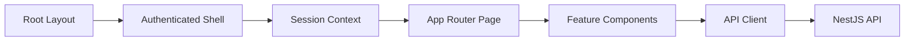

# Frontend Architecture

**Evidence status:** Verified against workspace manifests and application
entrypoints. UI behavior that is not shared by every app is identified
separately.

## Technology Matrix

| Application | Framework | Routing | State |
|---|---|---|---|
| Admin | Next.js 14 App Router | App Router files | React state, API helpers |
| Ops | Next.js 14 App Router | App Router files | React state, session context |
| Corporate | Next.js 14 App Router | App Router files | Session context and API helpers |
| Marketing | Astro 4 | File-based routes | Static output and React islands |
| Mobile | Flutter | GoRouter | Provider, services, secure storage |
| Employee App | Flutter | GoRouter | Provider, repositories |
| Documentation | Docusaurus 3 | Docs plugin | React theme and Markdown |

## Next.js Architecture

The three Next.js applications use the App Router:

- `src/app/layout.tsx` owns root metadata and shell composition.
- `src/app/**/page.tsx` defines route pages.
- Nested layouts provide feature-scoped presentation.
- Root shells enforce authentication and session availability.
- API helpers resolve environment-specific API URLs.
- Shared TypeScript contracts are transpiled into the application build.

## Astro Architecture

The Marketing application uses:

- Astro page routes
- A shared `BaseLayout`
- SEO and JSON-LD components
- Astro and React interactive components
- Static sitemap and RSS routes
- Optional Vercel adapter configuration

Astro is not a replacement API server. Public lead and form operations use
API integrations or existing client-side behavior where implemented.

## Flutter Architecture

The two Flutter applications share common implementation patterns:

- Centralized route constants and GoRouter configuration
- Provider or ChangeNotifier state
- Feature-first screen folders
- API client/service/repository boundaries
- Theme and shared-widget modules
- Platform-specific storage and notification services
- Environment and compile-time API URL resolution

Mobile and Employee apps do not share compiled Dart code in a workspace
package. Shared behavior is maintained by source conventions and API contracts.

## Docusaurus Architecture

The documentation application uses:

- Classic preset
- Generated/autogenerated sidebar
- Internal content exclusion
- Blue Docusaurus theme variables
- Custom cards and responsive landing layout
- Markdown tables and Mermaid diagrams

The existing Docusaurus theme and visual identity are retained.
