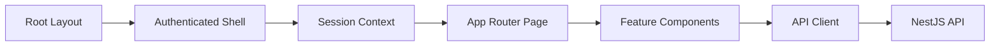

# Frontend Architecture

**Evidence status:** Verified against workspace manifests and application
entrypoints. **`apps/admin` is the canonical reference frontend architecture**
for all AdhocX web dashboards (`apps/admin`, `apps/ops`, `apps/corporate`).
UI behavior that is not shared by every app is identified separately.

> **Design & UX Source of Truth:** All web dashboards must strictly follow
> [`DESIGN.md`](../../../../DESIGN.md), [`UX.md`](../../../../UX.md),
> [`04_DESIGN_SYSTEM.md`](../design/04_DESIGN_SYSTEM.md), and
> [`05_UI_UX_GUIDELINES.md`](../design/05_UI_UX_GUIDELINES.md).

## Technology Matrix

| Application | Framework | Routing | State |
|---|---|---|---|
| Admin | Next.js 14 App Router | App Router files | React state, API helpers |
| Ops | Next.js 14 App Router | App Router files | React state, session context |
| Corporate | Next.js 14 App Router | App Router files | Session context and API helpers |
| Marketing | Astro 4 | File-based routes | Static output and React islands |
| Mobile | Flutter | GoRouter | Provider, services, secure storage |
| Employee App | Flutter | GoRouter | Provider, repositories |
| Documentation | Docusaurus 3 | Docs plugin | React theme and Markdown |

## Next.js Architecture (Canonical `apps/admin` Pattern)

All three Next.js applications (`apps/admin`, `apps/ops`, `apps/corporate`) use
the App Router and should follow the exact structural pattern established in
`apps/admin`:

- `src/styles/style.css` owns centralized CSS design tokens (`:root` light mode,
  `[data-theme="dark"]` dark mode), layout shell classes (`.admin-layout`,
  `.admin-sidebar`, `.admin-main`, `.admin-header`, `.admin-content`,
  `.admin-page`), and component utility classes.
- `src/app/globals.css` imports `../styles/style.css`.
- `src/app/layout.tsx` owns root metadata and shell composition (`AdminShell` /
  portal shell).
- `src/components/AdminShell.tsx` enforces session verification and renders
  `ToastProvider` + `.admin-layout` (`Sidebar` + `.admin-main` containing
  `Header` and full-width `.admin-content` with `max-width: none` and compact
  `1.25rem` horizontal padding).
- `src/components/common/index.ts` exports the canonical UI primitive barrel
  (`PageHeader`, `Card`, `SegmentedTabs`, `KpiStrip`, `MetricCard`, `DataTable`,
  `FilterBar`, `Button`, `StatusBadge`, `Drawer`, `Modal`, `ConfirmDialog`,
  `EmptyState`, `ErrorState`, `LoadingSkeleton`, `ToastProvider`).
- `src/app/**/page.tsx` composes route pages inside `<main className="admin-page">`
  using the 5-band dashboard blueprint defined in `UX.md`.
- `src/lib/api/client.ts` and `src/lib/api/types.ts` resolve environment-specific
  API URLs and consume shared TypeScript contracts from `@adhocx/contracts`.

## Astro Architecture

The Marketing application uses:

- Astro page routes
- A shared `BaseLayout`
- SEO and JSON-LD components
- Astro and React interactive components
- Static sitemap and RSS routes
- Optional Vercel adapter configuration

Astro is not a replacement API server. Public lead and form operations use
API integrations or existing client-side behavior where implemented.

## Flutter Architecture

The two Flutter applications share common implementation patterns:

- Centralized route constants and GoRouter configuration
- Provider or ChangeNotifier state
- Feature-first screen folders
- API client/service/repository boundaries
- Theme and shared-widget modules
- Platform-specific storage and notification services
- Environment and compile-time API URL resolution

Mobile and Employee apps do not share compiled Dart code in a workspace
package. Shared behavior is maintained by source conventions and API contracts.

## Docusaurus Architecture

The documentation application uses:

- Classic preset
- Generated/autogenerated sidebar
- Internal content exclusion
- Blue Docusaurus theme variables
- Custom cards and responsive landing layout
- Markdown tables and Mermaid diagrams

The existing Docusaurus theme and visual identity are retained.
